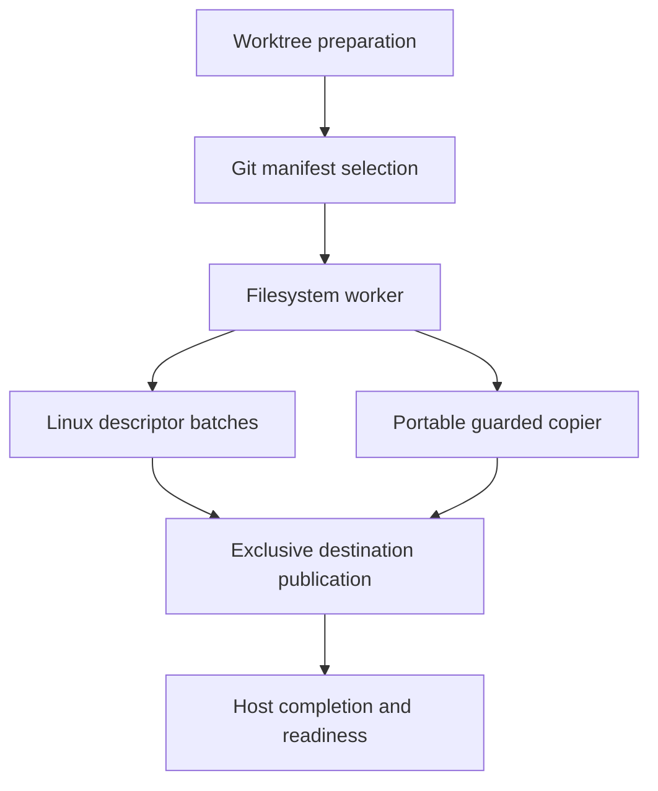

Codex review: needs real behavior proof before merge.

## What this changes

This PR batches selected ignored files through descriptor-pinned GNU cp operations to accelerate Linux managed-worktree provisioning.

**Example:** Copy 50,000 selected ignored files totaling 1 GB on the reported Linux btrfs fixture.
- **Before:** Reported median copy-owner duration: 110.316 seconds.
- **After:** Reported median copy-owner duration: 2.373 seconds; full managed-worktree timing remains pending.

## Review scores

| Measure | Result | What it means |
|---|---|---|
| **Overall readiness** | 🧂 unranked krab **(1/6)** | The performance case is compelling, but a concrete authority regression blocks merge and the required final-effect proof is absent. |
| **Proof confidence** | 🧂 unranked krab **(1/6)** | Real behavior proof is necessary before merge. See [Before merge](#before-merge). |
| **Patch quality** | 🦪 silver shellfish **(2/6)** | Security review found an item that needs attention. |

## Product

**Kind:** Performance · **Worth it:** Yes · **Fix scope:** Complete
**User problem:** Preparing a managed worktree can take minutes when its include manifest selects a large ignored dependency or build tree.
**Reason:** The maintainer-authored direction addresses measured provisioning overhead without new settings or dependencies; the remaining blockers are implementation and authority proof.

## Merge readiness

⛔ **Blocked before merge - 5 items remain**

Keep this PR open: the performance problem remains on main, but the Linux copier introduces two correctness defects that need repair before merge.

**Priority:** P2
**Reviewed head:** `8caa34eabce40380a61ac3a05c6c8d8884222306`

## Before merge

- [ ] **Add real behavior proof** - Authority-chain proof required: the reported btrfs owner benchmark exercises real copying, but its callback only counts assertions; neither it nor the supplied cancellation test proves that live host revocation with an un-aborted signal prevents subsequent cp dispatch and destination publication. Supply allowed and revoked production host-worker final-effect traces with cleanup, redacting credentials and non-public endpoints. After adding proof, update the PR body, then request a new review with `@clawsweeper re-review`. The PR author or someone with repository write access can request it.
- [ ] **\[P1\] Revalidate live host authority before dispatch and publication (P1)** - For a directory containing multiple batches, let the caller's commitGuard become invalid while the first cp child is pending without aborting its signal. assertCurrent ran only at directory entry; after child close, check() consults only AbortSignal, so linkSync publishes that batch and subsequent cp batches start under stale authority. The host rejects the completion receipt only after these effects. Revalidate through the existing host bridge before each native dispatch and after child settlement before publication, and retain the revocation regression rather than allowing later copies.
- [ ] **\[P2\] Skip occupied destinations before opening their sources (P2)** - For a non-root process, an ignored source such as secret.local with mode 0000 now throws EACCES here even when the destination already contains secret.local. This can occur when the selected worktree base tracks a path that the source branch now ignores. The portable copier first observes the existing destination and skips it without opening the source; the Linux path opens before performing that check, turning a previously successful preparation into an error. Move the destination-existence check ahead of source opening while retaining exclusive publication for later collisions.
- [ ] **Resolve security concern: Settlement custody does not authorize further effects** - The affected principal is a caller whose run or source authority has closed while its signal remains live; retaining worker custody and rejecting the final receipt do not authorize additional filesystem effects.
- [ ] **Explain or restore the original intent of Live mutation authority and worker settlement** - 83fb785193030cdd08a2378f106ebd214780ea43: The worker offload preserved live checks before mutations and prevented subsequent copies after caller revocation; batching explains reduced work but does not justify publishing after revocation.

## Findings

- [P1] [P1] Revalidate live host authority before dispatch and publication — `src/agents/worktrees/provisioned-copy-linux.ts:170-175`
- [P2] [P2] Skip occupied destinations before opening their sources — `src/agents/worktrees/provisioned-copy-linux.ts:95-98`
- [medium] Settlement custody does not authorize further effects — `src/agents/worktrees/provisioned-copy-linux.ts:170`

### Provenance

- `Live mutation authority and worker settlement` changes intended behavior without addressing why it exists (83fb785193030cdd08a2378f106ebd214780ea43: The worker offload preserved live checks before mutations and prevented subsequent copies after caller revocation; batching explains reduced work but does not justify publishing after revocation.)

### Tests

- Missing end-to-end proof: Provide a Linux production host-worker trace showing allowed copying, rejection of a revoked caller with an un-aborted signal before further dispatch/publication, and settled cleanup; the full managed-preparation measurement is also still pending.

<strong>Agent review details</strong>

### How this fits together

Managed-worktree preparation selects ignored files through Git, sends them to a filesystem worker, and waits for independently copied files and an authorized completion receipt before readiness.

### Technical review

Best possible solution:

Keep bounded copying within existing worker custody, restore live authority before dispatch and publication, and skip occupied destinations before opening sources.

Do we have a high-confidence way to reproduce the issue?

Current-main source retains repeated per-file admission, and the supplied interleaved benchmark reports the resulting cost; both introduced defects are traceable from source, without executing target code during this read-only review.

Is this the best way to solve the issue?

Batching removes demonstrated waste, and the platform adapter is justified, but directory admission cannot replace live caller authority and occupied destinations must retain their early-skip behavior.

Full review comments:

- [P1] [P1] Revalidate live host authority before dispatch and publication — `src/agents/worktrees/provisioned-copy-linux.ts:170-175`
  For a directory containing multiple batches, let the caller's commitGuard become invalid while the first cp child is pending without aborting its signal. assertCurrent ran only at directory entry; after child close, check() consults only AbortSignal, so linkSync publishes that batch and subsequent cp batches start under stale authority. The host rejects the completion receipt only after these effects. Revalidate through the existing host bridge before each native dispatch and after child settlement before publication, and retain the revocation regression rather than allowing later copies.
  Confidence: 0.99
- [P2] [P2] Skip occupied destinations before opening their sources — `src/agents/worktrees/provisioned-copy-linux.ts:95-98`
  For a non-root process, an ignored source such as secret.local with mode 0000 now throws EACCES here even when the destination already contains secret.local. This can occur when the selected worktree base tracks a path that the source branch now ignores. The portable copier first observes the existing destination and skips it without opening the source; the Linux path opens before performing that check, turning a previously successful preparation into an error. Move the destination-existence check ahead of source opening while retaining exclusive publication for later collisions.
  Confidence: 0.97

Overall correctness: patch is incorrect
Overall confidence: 0.97

AGENTS.md: found and applied where relevant.

Codex review notes: model internal, reasoning medium; reviewed against [93f9678855c9](https://github.com/openclaw/openclaw/commit/93f9678855c9be77bead85c71b4c90e30ed53509).

### Provenance checked

- `Reflinks, metadata, and independent destination bytes` keeps the original intent (718b34950f428f48f597e30f2e0c36b8f2164486: Request opportunistic clones while preserving ordinary-copy fallback, metadata, and independent destinations.)
- `Source pathname replacement` changes intended behavior with a stated reason (83fb785193030cdd08a2378f106ebd214780ea43: The prior guarded copier revalidated source identity; this PR explicitly adopts pinned source descriptors to retain admitted files across pathname swaps without following replacement symlinks.)
- `Provisioning diagnostics` keeps the original intent (63f91c72de59d158133aa3e1744c9dc5fd88bf83: Separate authority, preflight, copy-await, and worker roundtrip measurements without treating inclusive copy waits as native copy time.)

### Testing

Proof path: in-process harness.

### Security

Needs attention: Directory admission currently outlives live caller authority at native dispatch and filesystem publication.

### Evidence

Security concerns:

- [medium] Settlement custody does not authorize further effects — `src/agents/worktrees/provisioned-copy-linux.ts:170`
  The affected principal is a caller whose run or source authority has closed while its signal remains live; retaining worker custody and rejecting the final receipt do not authorize additional filesystem effects.
  Confidence: 0.99

What I checked:

- **Pinned introduced change:** Reviewed the merge-base-to-head diff and affected modules at the original PR head; the checkout remained clean. ([`src/agents/worktrees/provisioned-copy-linux.ts:27`](https://github.com/openclaw/openclaw/blob/8caa34eabce40380a61ac3a05c6c8d8884222306/src/agents/worktrees/provisioned-copy-linux.ts#L27), [8caa34eabce4](https://github.com/openclaw/openclaw/commit/8caa34eabce40380a61ac3a05c6c8d8884222306))
- **Current-main behavior:** Current main still performs guarded Root.copyIn calls separately for selected files; the central throughput change is absent. ([`src/agents/worktrees/provisioned-copy.ts:36`](https://github.com/openclaw/openclaw/blob/93f9678855c9be77bead85c71b4c90e30ed53509/src/agents/worktrees/provisioned-copy.ts#L36), [93f9678855c9](https://github.com/openclaw/openclaw/commit/93f9678855c9be77bead85c71b4c90e30ed53509))
- **Stale authority reaches filesystem effects:** assertCurrent runs once on directory entry, whereas later child dispatches and linkSync publications check only AbortSignal; host authority can expire while that signal remains live. ([`src/agents/worktrees/provisioned-copy-linux.ts:170`](https://github.com/openclaw/openclaw/blob/8caa34eabce40380a61ac3a05c6c8d8884222306/src/agents/worktrees/provisioned-copy-linux.ts#L170), [8caa34eabce4](https://github.com/openclaw/openclaw/commit/8caa34eabce40380a61ac3a05c6c8d8884222306))
- **Existing destination skip regression:** The Linux path opens the source before checking whether the destination already exists; the portable owner checks destination existence before opening the source for copying. ([`src/agents/worktrees/provisioned-copy-linux.ts:95`](https://github.com/openclaw/openclaw/blob/8caa34eabce40380a61ac3a05c6c8d8884222306/src/agents/worktrees/provisioned-copy-linux.ts#L95), [8caa34eabce4](https://github.com/openclaw/openclaw/commit/8caa34eabce40380a61ac3a05c6c8d8884222306))
- **Original live-authority contract:** https://github.com/openclaw/openclaw/pull/191873 explicitly retained per-mutation host authority and verified that revocation after the first publication prevented the second copy; this PR weakens that regression assertion. ([`src/agents/worktrees/provisioned-files.test.ts:62`](https://github.com/openclaw/openclaw/blob/83fb785193030cdd08a2378f106ebd214780ea43/src/agents/worktrees/provisioned-files.test.ts#L62), [83fb78519303](https://github.com/openclaw/openclaw/commit/83fb785193030cdd08a2378f106ebd214780ea43))
- **Performance evidence and draft hold:** The complete live PR body reports interleaved native-owner measurements, real filesystem verification, and cross-filesystem fallback; it explicitly excludes Gateway and worker IPC from timing and retains a draft hold. Discussion contains no additional behavior artifacts or approval. ([`scripts/perf/worktree-provisioning-copy-measure.ts:1`](https://github.com/openclaw/openclaw/blob/8caa34eabce40380a61ac3a05c6c8d8884222306/scripts/perf/worktree-provisioning-copy-measure.ts#L1), [8caa34eabce4](https://github.com/openclaw/openclaw/commit/8caa34eabce40380a61ac3a05c6c8d8884222306))

### PR surface

Source +258, Tests +131, Docs 0, Other +153. Total +542 across 8 files. Added test files: 0.

View PR surface stats

| Area | Files | Added | Removed | Net |
|---|---:|---:|---:|---:|
| Source | 3 | 258 | 0 | +258 |
| Tests | 2 | 146 | 15 | +131 |
| Docs | 1 | 1 | 1 | 0 |
| Config | 0 | 0 | 0 | 0 |
| Generated | 0 | 0 | 0 | 0 |
| Other | 2 | 153 | 0 | +153 |
| **Total** | **8** | **558** | **16** | **+542** |

### Preflight source

Source unknown. Source comparison at the observed PR snapshot only. Completion is self-reported; body, policy, tests, execution, and report bytes are not verified.

### Review metrics

| Metric | Value | Why it matters |
|---|---|---|
| **Production versus regression-test growth** | Production +258 lines; tests +131 lines | The Linux descriptor adapter and retained portable platform support explain the production growth; added tests cover distinct swap, cancellation-settlement, fallback, and work-count boundaries. |

### Labels

Label changes:

- add `P2`: Large ignored trees cause substantial preparation delays on a limited managed-worktree path.
- add `merge-risk: 🚨 compatibility`: Linux preparation can now fail on an unreadable source whose existing destination previously caused a harmless skip.
- add `merge-risk: 🚨 security-boundary`: A revoked caller can still cause subsequent native copies and destination publications while its AbortSignal remains live.
- add `rating: 🧂 unranked krab`: Overall readiness is 🧂 unranked krab; proof is 🧂 unranked krab and patch quality is 🦪 silver shellfish.
- add `status: 📣 needs proof`: The PR needs real behavior proof before ClawSweeper can clear the contributor ask.

Label justifications:

- `P2`: Large ignored trees cause substantial preparation delays on a limited managed-worktree path.
- `merge-risk: 🚨 security-boundary`: A revoked caller can still cause subsequent native copies and destination publications while its AbortSignal remains live.
- `merge-risk: 🚨 compatibility`: Linux preparation can now fail on an unreadable source whose existing destination previously caused a harmless skip.
- `rating: 🧂 unranked krab`: Overall readiness is 🧂 unranked krab; proof is 🧂 unranked krab and patch quality is 🦪 silver shellfish.
- `status: 📣 needs proof`: The PR needs real behavior proof before ClawSweeper can clear the contributor ask.

### Rating scale

6/6 🦀 challenger crab · 5/6 🦞 diamond lobster · 4/6 🐚 platinum hermit · 3/6 🦐 gold shrimp · 2/6 🦪 silver shellfish · 1/6 🧂 unranked krab. Overall follows the weaker of proof and patch quality; ✨ marks media proof (a screenshot, video, or linked artifact) that directly shows the changed behavior.

### Workflow

ClawSweeper edits this one comment on every review. Comment `@clawsweeper re-review` for a fresh review only. Repair and merge execution lanes are retired.

_Reviewed November 9, 2026, 6:25 PM ET / 23:25 UTC._

<!-- clawsweeper-security:security-sensitive item=196298 sha=8caa34eabce40380a61ac3a05c6c8d8884222306 confidence=high updated_at=2026-11-09T23:19:59Z reviewed_at=2026-11-09T23:25:59.247Z lease_owner=github-run-42719402382-1 lease_comment_id=6754118883 source_revision=369fed2ac0245fcaa94a0278f8cfc6c657563a84b0068317d60a3e7fc99db550 -->
<!-- clawsweeper-verdict:needs-human item=196298 sha=8caa34eabce40380a61ac3a05c6c8d8884222306 confidence=high updated_at=2026-11-09T23:19:59Z reviewed_at=2026-11-09T23:25:59.247Z lease_owner=github-run-42719402382-1 lease_comment_id=6754118883 source_revision=369fed2ac0245fcaa94a0278f8cfc6c657563a84b0068317d60a3e7fc99db550 hold=security findings=2 -->
<!-- clawsweeper-review-state:blocked item=196298 sha=8caa34eabce40380a61ac3a05c6c8d8884222306 v=1 -->

<!-- clawsweeper-review-version item=196298 reviewed_at=2026-11-09T23:25:59.247Z sha=8caa34eabce40380a61ac3a05c6c8d8884222306 source_revision=369fed2ac0245fcaa94a0278f8cfc6c657563a84b0068317d60a3e7fc99db550 lease_owner=github-run-42719402382-1 lease_comment_id=6754118883 v=1 -->

<!-- clawsweeper-review item=196298 -->