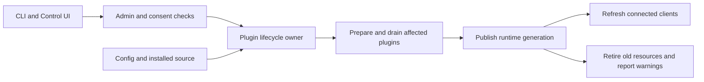

Codex review: blocked before merge. _Reviewed September 12, 2026, 1:53 AM ET / 05:53 UTC (Revision 5)._

# ClawSweeper review

## What this changes

Adds Gateway-owned plugin replacement, CLI and Control UI reload controls, fresh TypeScript loading, and receipts distinguishing saved changes from applied runtime changes.

## Merge readiness

⛔ **Blocked before merge - 2 items remain**

This remains a useful, distinct management slice beyond the merged lifetime foundation. The earlier startup-error blocker is resolved; no new blocking defect was established in the inspected paths.

**Priority:** P2
**Reviewed head:** `562c82c89a91ccde8dcb3c68acc824d468a98632`

## Review scores

| Measure | Result | What it means |
|---|---|---|
| **Overall readiness** | 🐚 platinum hermit **(4/6)** | Useful runtime evidence and coherent lifecycle ownership support a good patch rating, with the third-party cleanup boundary explicitly documented. |
| **Proof confidence** | 🦞 diamond lobster **(5/6)** | Sufficient (live_output): Source-qualified Node and Bun Gateway runs report the changed CLI-handler/RPC path executing edited TypeScript with unchanged PID/config and clean shutdown; historical UI captures supplement those observations. Preserve the recorded candidate identities and upgrade-run qualification rather than treating them as fresh execution of the final head. |
| **Patch quality** | 🐚 platinum hermit **(4/6)** | No actionable review findings were identified. |

## Verification

| Check | Result | Evidence |
|---|---|---|
| **Real behavior** | Verified | Sufficient (live_output): Source-qualified Node and Bun Gateway runs report the changed CLI-handler/RPC path executing edited TypeScript with unchanged PID/config and clean shutdown; historical UI captures supplement those observations. Preserve the recorded candidate identities and upgrade-run qualification rather than treating them as fresh execution of the final head. |
| **Evidence reviewed** | 11 items | Verified introduction and current-main necessity: The local checkout matches the pinned head and the complete local introduction comparison was available. Current-main plugin mutation handlers still return restartRequired: true for install and uninstall; the supplied merged foundation PR explicitly leaves management orchestration to this slice. Previous finding resolved: Replacement rejection excludes retained error records while still rejecting newly evaluated failures. The Gateway regression exercises healthy sibling reload, failed replacement preservation, explicit retry of the broken plugin, and disablement. Re-review continuity: GitHub returned blob f0dca2e31da4fd5355ba86ff1fcf07f960c31281 for loader-shared.ts at the prior reviewed head; the current checkout has the same blob. The previous completed review contains no findings or published rank-up moves. |
| **Findings** | None | None. |
| **Security** | None | None. |

## How this fits together

The Gateway hosts plugin code, registrations, services, and channel connections. Plugin-management requests now pass through a shared replacement lifecycle that publishes updated runtime capabilities to connected clients.

## Before merge

- [ ] **Resolve merge risk (P1)** - Third-party plugins that do not clean up unmanaged resources can retain timers, subscriptions, or native state when replacement replays lifecycle hooks; a Gateway restart may still be necessary.
- [ ] **Review config compatibility** - Confirm compatibility and upgrade impact for the changed config or default surface before merge.

<strong>Agent review details</strong>

### Security

None.

### PR surface

PR surface statistics unavailable: the file list is incomplete.

### Review metrics

| Metric | Value | Why it matters |
|---|---|---|
| **Production versus test growth** | Reported production +3,197; tests/support +15,336 | The PR explains production growth as replacement/config coordination and per-instance loading, with generated protocol output counted separately. |
| **Reload request boundary** | 1 new reload RPC; 1–64 targets per request | The bounded target envelope supports package-coherent replacement while the CLI continues to accept one plugin ID. |

### Stored data model

Persistent data-model change detected: `unknown-data-model-change: packages/gateway-protocol/src/schema/frames.ts`, `unknown-data-model-change: packages/gateway-protocol/src/schema/plugins.ts`, `unknown-data-model-change: ui/src/pages/config/memory-page.ts`, `unknown-truncated-pull-files`, `vector/embedding metadata: ui/src/pages/config/memory-page.ts`. Migration or upgrade compatibility proof is recorded; maintainers should verify it before merge.

### Merge-risk options

**Maintainer options:**
1. **Retain the documented cleanup boundary (recommended)**  
   Accept the explicitly documented best-effort plugin contract with cleanup warnings and Gateway restart recovery for residual third-party behavior.

### Technical review

Best possible solution:

Keep one Gateway-owned replacement lifecycle, preserving the documented upgrade contract, explicit runtime receipts, and restart recovery for unmanaged plugin resources.

Do we have a high-confidence way to reproduce the issue?

Not applicable to the central feature request; current main demonstrably retains restart-based management. This review did not execute the reported Bun regression or Gateway scenarios.

Is this the best way to solve the issue?

Yes: extending the existing Gateway and plugin lifetime owners avoids a competing lifecycle implementation, while preserving unaffected instances and distinguishing persistence from runtime application.

AGENTS.md: found and applied where relevant.

Codex review notes: model internal, reasoning medium; reviewed against [9449a1a780e4](https://github.com/openclaw/openclaw/commit/9449a1a780e410ed8ed485155a7ef18985b0270e).

### Labels

Label justifications:

- `P2`: Restart-free plugin management is a substantial improvement without evidence of an emergency user-facing regression.
- `merge-risk: 🚨 compatibility`: Full replacement replays plugin lifecycle hooks, exposing third-party cleanup assumptions that ordinary CI cannot universally establish.
- `rating: 🐚 platinum hermit`: Overall readiness is 🐚 platinum hermit; proof is 🦞 diamond lobster and patch quality is 🐚 platinum hermit.
- `feature: ✨ showcase`: ClawSweeper spotlight: unusually compelling feature idea for maintainer attention. Applying edited plugin code and management changes without disconnecting clients materially improves both plugin development and everyday administration.
- `status: 👀 ready for maintainer look`: ClawSweeper has no concrete contributor-facing blocker left for this PR. Sufficient (live_output): Source-qualified Node and Bun Gateway runs report the changed CLI-handler/RPC path executing edited TypeScript with unchanged PID/config and clean shutdown; historical UI captures supplement those observations. Preserve the recorded candidate identities and upgrade-run qualification rather than treating them as fresh execution of the final head.
- `proof: sufficient`: Contributor real behavior proof is sufficient. Source-qualified Node and Bun Gateway runs report the changed CLI-handler/RPC path executing edited TypeScript with unchanged PID/config and clean shutdown; historical UI captures supplement those observations. Preserve the recorded candidate identities and upgrade-run qualification rather than treating them as fresh execution of the final head.

### Evidence

What I checked:

- **Verified introduction and current-main necessity:** The local checkout matches the pinned head and the complete local introduction comparison was available. Current-main plugin mutation handlers still return restartRequired: true for install and uninstall; the supplied merged foundation PR explicitly leaves management orchestration to this slice. ([`src/gateway/server-methods/plugins-mutations.ts`](https://github.com/openclaw/openclaw/blob/9449a1a780e410ed8ed485155a7ef18985b0270e/src/gateway/server-methods/plugins-mutations.ts), [9449a1a780e4](https://github.com/openclaw/openclaw/commit/9449a1a780e410ed8ed485155a7ef18985b0270e))
- **Previous finding resolved:** Replacement rejection excludes retained error records while still rejecting newly evaluated failures. The Gateway regression exercises healthy sibling reload, failed replacement preservation, explicit retry of the broken plugin, and disablement. ([`src/plugins/loader-shared.ts:431`](https://github.com/openclaw/openclaw/blob/562c82c89a91ccde8dcb3c68acc824d468a98632/src/plugins/loader-shared.ts#L431), [562c82c89a91](https://github.com/openclaw/openclaw/commit/562c82c89a91ccde8dcb3c68acc824d468a98632))
- **Re-review continuity:** GitHub returned blob f0dca2e31da4fd5355ba86ff1fcf07f960c31281 for loader-shared.ts at the prior reviewed head; the current checkout has the same blob. The previous completed review contains no findings or published rank-up moves. ([`src/plugins/loader-shared.ts:431`](https://github.com/openclaw/openclaw/blob/b53160a3574c6bb1ce5247e71beb169ab814dd4d/src/plugins/loader-shared.ts#L431), [b53160a3574c](https://github.com/openclaw/openclaw/commit/b53160a3574c6bb1ce5247e71beb169ab814dd4d))
- **Publication and authority boundaries:** Lifecycle handlers compose request cancellation, mutation authority, and the management lease guard. Publication rechecks ownership, prepares node credentials within admitted capabilities, and publishes synchronously before notifying clients. ([`src/gateway/server-plugin-reload.ts:445`](https://github.com/openclaw/openclaw/blob/562c82c89a91ccde8dcb3c68acc824d468a98632/src/gateway/server-plugin-reload.ts#L445), [562c82c89a91](https://github.com/openclaw/openclaw/commit/562c82c89a91ccde8dcb3c68acc824d468a98632))
- **Asset-serving final effect:** The inspected asset owner preserves authentication and plugin-specific grants, then resolves the current registry and verifies build authority immediately before sending captured bytes. Retained browser activation receipts remain observations rather than authorization. ([`src/gateway/control-ui-plugin-assets.ts`](https://github.com/openclaw/openclaw/blob/562c82c89a91ccde8dcb3c68acc824d468a98632/src/gateway/control-ui-plugin-assets.ts), [562c82c89a91](https://github.com/openclaw/openclaw/commit/562c82c89a91ccde8dcb3c68acc824d468a98632))
- **Source-bound runtime evidence:** The captured PR body reports real CLI-handler/RPC reloads on Bun 1.4.2 and Node 24.19.0: edited TypeScript executed, PID and config remained unchanged, generation reached 3, and shutdown released the port. Evidence remains attributed to corrective candidate 4d9b6534 and earlier production tree 70398920; the final rebase reports source conformance and 376 overlap checks, not a newly executed full runtime campaign.

Likely related people:

- **steipete:** Suggested for follow-up; no historical authorship or introduction is verified. (role: unverified routing candidate; confidence: low)
- **RomneyDa:** Suggested for follow-up; no historical authorship or introduction is verified. (role: unverified routing candidate; confidence: low)

### Rating scale

| Score | Internal tier | Crab rank | Meaning |
|---:|:---:|---|---|
| **6/6** | S | 🦀 challenger crab | Exceptional readiness |
| **5/6** | A | 🦞 diamond lobster | Very strong readiness |
| **4/6** | B | 🐚 platinum hermit | Good normal PR; ordinary maintainer review |
| **3/6** | C | 🦐 gold shrimp | Useful, but confidence is limited |
| **2/6** | D | 🦪 silver shellfish | Proof or implementation needs work |
| **1/6** | F | 🧂 unranked krab | Not merge-ready |
| N/A | NA | 🌊 off-meta tidepool | Rating does not apply |

Overall follows the weaker of proof and patch quality.
Shiny media proof means a screenshot, video, or linked artifact directly shows the changed behavior. Runtime, network, CSP, and security claims still need visible diagnostics.

### Workflow

- ClawSweeper keeps one durable marker-backed review comment per issue or PR.
- Re-runs edit this comment so the latest verdict, findings, and automation markers stay together instead of adding duplicate bot comments.
- A fresh review can be triggered by eligible `@clawsweeper re-review` comments, exact-item GitHub events, scheduled/background review runs, or manual workflow dispatch.
- PR/issue authors and users with repository write access can comment `@clawsweeper re-review` or `@clawsweeper re-run` on an open PR or issue to request a fresh review only.
- Maintainers can also comment `@clawsweeper review` to request a fresh review only.
- Fresh-review commands do not start repair, autofix, rebase, CI repair, or automerge.
- Maintainer-only repair and merge flows require explicit commands such as `@clawsweeper autofix`, `@clawsweeper automerge`, `@clawsweeper fix ci`, or `@clawsweeper address review`.
- Maintainers can comment `@clawsweeper explain` to ask for more context, or `@clawsweeper stop` to stop active automation.

### History

Review history (4 earlier review cycles)

<!-- clawsweeper-review-history v=1 total=4 -->
- reviewed 2026-09-12T01:25:07.262Z sha 3cf609616b604e0fbe304114f01370c386a24486 :: blocked before merge. :: [P1] [P1] Exclude unchanged failed plugins from replacement rejection
- reviewed 2026-09-12T02:37:01.659Z sha 3cf609616b604e0fbe304114f01370c386a24486 :: blocked before merge. :: [P1] [P1] Exclude unchanged failed plugins from replacement rejection
- reviewed 2026-09-12T03:21:18.258Z sha 8978eb40a5557216810bf618ff13898b8eee73c6 :: blocked before merge. :: none
- reviewed 2026-09-12T05:18:06.773Z sha b53160a3574c6bb1ce5247e71beb169ab814dd4d :: blocked before merge. :: none

<!-- clawsweeper-verdict:needs-human item=145484 sha=562c82c89a91ccde8dcb3c68acc824d468a98632 confidence=high updated_at=2026-09-12T05:49:41Z reviewed_at=2026-09-12T05:53:26.230Z lease_owner=github-run-34676460337-1 lease_comment_id=5643973686 source_revision=ad0b4b67589d2c12bc962f2c00c62341a756448c667cb0171c1ec309ffa23ea3 live_verification=absent -->
<!-- clawsweeper-review-state:blocked item=145484 sha=562c82c89a91ccde8dcb3c68acc824d468a98632 v=1 -->

<!-- clawsweeper-review-version item=145484 reviewed_at=2026-09-12T05:53:26.230Z sha=562c82c89a91ccde8dcb3c68acc824d468a98632 source_revision=ad0b4b67589d2c12bc962f2c00c62341a756448c667cb0171c1ec309ffa23ea3 lease_owner=github-run-34676460337-1 lease_comment_id=5643973686 v=1 -->

<!-- clawsweeper-review item=145484 -->