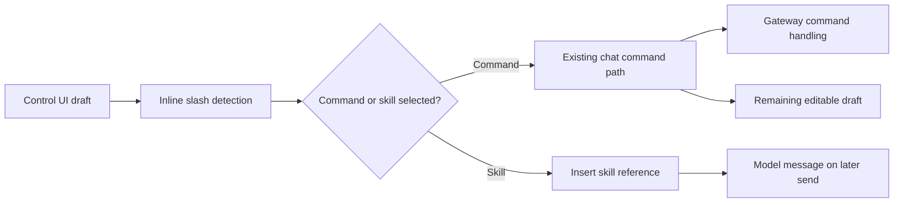

Codex review: needs maintainer review before merge. _Reviewed August 26, 2026, 9:52 AM ET / 13:52 UTC._

# ClawSweeper review

## What this changes

The PR lets the Control UI dispatch a selected slash command from within prose while keeping the remaining draft editable, and converts selected skills to existing `$skill` references.

## Merge readiness

⚠️ **Ready for maintainer review - 3 items remain**

Keep open. The maintainer-authored, automerge-armed PR has no concrete correctness or security finding in the reviewed source; it should proceed only when exact-head required checks complete.

**Priority:** P2
**Reviewed head:** `499956e8e0b91d222e6ceaaf21dedfa3bc15bddf`

## Review scores

| Measure | Result | What it means |
|---|---|---|
| **Overall readiness** | 🐚 platinum hermit **(4/6)** | The PR has strong interaction evidence and broad focused coverage, with exact-head CI still pending. |
| **Proof confidence** | 🦞 diamond lobster **(5/6)** | Not applicable: The ordinary external-contributor proof gate does not apply to this MEMBER PR; its body nevertheless supplies before/after Control UI screenshots and a mock-Gateway trace of the changed interaction. |
| **Patch quality** | 🐚 platinum hermit **(4/6)** | No actionable review findings were identified. |

## Verification

| Check | Result | Evidence |
|---|---|---|
| **Real behavior** | Not applicable | Not applicable: The ordinary external-contributor proof gate does not apply to this MEMBER PR; its body nevertheless supplies before/after Control UI screenshots and a mock-Gateway trace of the changed interaction. |
| **Evidence reviewed** | 6 items | Current-main gap: Current main only opens slash completion for a draft matching a whole-command prefix, so prose before a slash token cannot open the menu; the PR replaces that with caret-aware token detection.<br>Command owner boundary: The PR dispatches the extracted command through the existing page-level send handler while the composer commits only the residual draft; the normal command, permission, confirmation, and recovery path remains the owner.<br>Interaction and sibling coverage: Focused UI tests cover selected commands, typed arguments, aliases, modifier-enter behavior, trailing prose, unavailable command owners, and skill insertion; the browser E2E test verifies the Gateway receives only the command and the composer retains the prose. |
| **Findings** | None | None. |
| **Security** | None | None. |


### Live Verification

**Command:** `pnpm test ui/src/e2e/chat-thinking-arguments.e2e.test.ts`

**Result:** FAIL (failed) — step 1 `run` `pnpm test ui/src/e2e/chat-thinking-arguments.e2e.test.ts`: `previous terminal command was still running after 30 seconds: "pnpm test ui/src/e2e/chat-thinking-arguments.e2e.test.ts"`

```text
$ node --import tsx scripts/test-projects.mts ui/src/e2e/chat-thinking-arguments.e2e.test.ts
[test] starting test/vitest/vitest.ui-e2e.config.ts
[test] preflight test/vitest/vitest.ui-e2e.config.ts
[ui-e2e] Using system Chromium at /usr/bin/chromium-browser.
Downloading FFmpeg (playwright ffmpeg v1011) from https://cdn.playwright.dev/dbazure/download/playwright/builds/ffmpeg/1011/ffmpeg-linux.zip
|                                                                                |   0% of 2.3 MiB
|■■■■■■■■                                                                        |  10% of 2.3 MiB
|■■■■■■■■■■■■■■■■                                                                |  20% of 2.3 MiB
|■■■■■■■■■■■■■■■■■■■■■■■■                                                        |  30% of 2.3 MiB
|■■■■■■■■■■■■■■■■■■■■■■■■■■■■■■■■                                                |  40% of 2.3 MiB
|■■■■■■■■■■■■■■■■■■■■■■■■■■■■■■■■■■■■■■■■                                        |  50% of 2.3 MiB
|■■■■■■■■■■■■■■■■■■■■■■■■■■■■■■■■■■■■■■■■■■■■■■■■                                |  60% of 2.3 MiB
|■■■■■■■■■■■■■■■■■■■■■■■■■■■■■■■■■■■■■■■■■■■■■■■■■■■■■■■■                        |  70% of 2.3 MiB
|■■■■■■■■■■■■■■■■■■■■■■■■■■■■■■■■■■■■■■■■■■■■■■■■■■■■■■■■■■■■■■■■                |  80% of 2.3 MiB
|■■■■■■■■■■■■■■■■■■■■■■■■■■■■■■■■■■■■■■■■■■■■■■■■■■■■■■■■■■■■■■■■■■■■■■■■        |  90% of 2.3 MiB
|■■■■■■■■■■■■■■■■■■■■■■■■■■■■■■■■■■■■■■■■■■■■■■■■■■■■■■■■■■■■■■■■■■■■■■■■■■■■■■■■| 100% of 2.3 MiB
FFmpeg (playwright ffmpeg v1011) downloaded to /tmp/clawsweeper-live-proof-122425-djX1yN/profile/cache/ms-playwright/ffmpeg-1011

 RUN  v4.1.11 /tmp/clawsweeper-live-proof-122425-djX1yN/target
```

**Assertions:**

- FAIL `expect_output`: executes inline /exec gateway separately from the draft

## How this fits together

The Control UI composer detects slash tokens in a draft, then either dispatches a command through the normal Gateway chat-send path or inserts a skill reference for the eventual model turn. The remaining draft stays in the composer instead of being sent as model input.



## Before merge

- [ ] **Resolve merge risk (P1)** - Exact-head checks for 499956e8e0b91d222e6ceaaf21dedfa3bc15bddf are still incomplete; existing automerge must wait for their required green result.
- [ ] **Resolve merge risk (P1)** - The isolated autoreview helper could not inspect the full branch because this shallow checkout lacks a merge base with current main; this does not invalidate the PR’s supplied proof.
- [ ] **Complete next step (P2)** - No discrete repair is identified; wait for the normal exact-head CI gate rather than opening a fix lane.


<details>
<summary><strong>Agent review details</strong></summary>

### Security

None.

### PR surface

Source +531, Tests +850, Docs +3. Total +1384 across 26 files.

<details>
<summary>View PR surface stats</summary>

| Area | Files | Added | Removed | Net |
|---|---:|---:|---:|---:|
| Source | 14 | 651 | 120 | +531 |
| Tests | 11 | 856 | 6 | +850 |
| Docs | 1 | 3 | 0 | +3 |
| Config | 0 | 0 | 0 | 0 |
| Generated | 0 | 0 | 0 | 0 |
| Other | 0 | 0 | 0 | 0 |
| **Total** | **26** | **1510** | **126** | **+1384** |

</details>

### Review metrics

| Metric | Value | Why it matters |
|---|---|---|
| **Production versus test delta** | production +651/-120; tests +856/-6; docs +3/-0 | The production growth implements a new composer interaction and its command/skill routing boundary; the larger test delta covers its UI and reply-path behavior. |

### Stored data model

Persistent data-model change detected: `serialized state: ui/src/e2e/session-suggestions.e2e.test.ts`. Confirm migration or upgrade compatibility proof before merge.

### Merge-risk options

**Maintainer options:**
1. **Decide the mitigation before merge**  
   Land the existing implementation through the armed automerge path after its exact-head checks are green; no replacement design or repair is indicated.
2. **Pause or close**  
   Do not merge this PR until maintainers decide whether the risk is worth taking.

### Technical review

Best possible solution:

Land the existing implementation through the armed automerge path after its exact-head checks are green; no replacement design or repair is indicated.

Do we have a high-confidence way to reproduce the issue?

Yes—current main’s slash-menu matcher only recognizes a command-style draft, while the PR’s targeted browser E2E covers prose plus an inline command and the preserved residual draft.

Is this the best way to solve the issue?

Yes—the UI removes only the selected token and invokes the existing command owner, avoiding a parallel permission or dispatch path; skills remain model references rather than immediate commands.

AGENTS.md: found and applied where relevant.

Codex review notes: model internal, reasoning high; reviewed against [d259f982e4e1](https://github.com/openclaw/openclaw/commit/d259f982e4e16df9fd7ec45159a818c6b1bcdbb1).

### Labels

Label justifications:

- `P2`: This is a bounded Control UI command-composer improvement with no evidence of data loss, security failure, or core availability impact.
- `rating: 🐚 platinum hermit`: Overall readiness is 🐚 platinum hermit; proof is 🦞 diamond lobster and patch quality is 🐚 platinum hermit.
- `status: 🚀 automerge armed`: This PR is in ClawSweeper's automerge lane. Not applicable: The ordinary external-contributor proof gate does not apply to this MEMBER PR; its body nevertheless supplies before/after Control UI screenshots and a mock-Gateway trace of the changed interaction.
- `proof: 📸 screenshot`: Contributor real behavior proof includes screenshot evidence. The ordinary external-contributor proof gate does not apply to this MEMBER PR; its body nevertheless supplies before/after Control UI screenshots and a mock-Gateway trace of the changed interaction.

### Evidence

What I checked:

- **Current-main gap:** Current main only opens slash completion for a draft matching a whole-command prefix, so prose before a slash token cannot open the menu; the PR replaces that with caret-aware token detection. ([`ui/src/pages/chat/components/chat-composer-slash-menu.ts:144`](https://github.com/openclaw/openclaw/blob/d259f982e4e1/ui/src/pages/chat/components/chat-composer-slash-menu.ts#L144), [d259f982e4e1](https://github.com/openclaw/openclaw/commit/d259f982e4e1))
- **Command owner boundary:** The PR dispatches the extracted command through the existing page-level send handler while the composer commits only the residual draft; the normal command, permission, confirmation, and recovery path remains the owner. ([`ui/src/pages/chat/components/chat-composer-slash-menu.ts:251`](https://github.com/openclaw/openclaw/blob/499956e8e0b9/ui/src/pages/chat/components/chat-composer-slash-menu.ts#L251), [499956e8e0b9](https://github.com/openclaw/openclaw/commit/499956e8e0b9))
- **Interaction and sibling coverage:** Focused UI tests cover selected commands, typed arguments, aliases, modifier-enter behavior, trailing prose, unavailable command owners, and skill insertion; the browser E2E test verifies the Gateway receives only the command and the composer retains the prose. ([`ui/src/pages/chat/chat-view.test.ts:3833`](https://github.com/openclaw/openclaw/blob/499956e8e0b9/ui/src/pages/chat/chat-view.test.ts#L3833), [499956e8e0b9](https://github.com/openclaw/openclaw/commit/499956e8e0b9))
- **Skill and directive safety:** Explicit skill references are resolved before directive routing, preventing a referenced-skill payload from applying model directives; tests cover both opaque referenced payloads and invalid-reference rejection before state mutation. ([`src/auto-reply/reply/get-reply-directives.ts:271`](https://github.com/openclaw/openclaw/blob/499956e8e0b9/src/auto-reply/reply/get-reply-directives.ts#L271), [499956e8e0b9](https://github.com/openclaw/openclaw/commit/499956e8e0b9))
- **History and ownership limitation:** Current-main blame reaches a shallow promisor boundary attributed to xingzhou; deeper feature history could not be read because the checkout cannot fetch missing objects, so ownership is low confidence. ([`ui/src/pages/chat/components/chat-composer-slash-menu.ts:144`](https://github.com/openclaw/openclaw/blob/d259f982e4e1/ui/src/pages/chat/components/chat-composer-slash-menu.ts#L144), [d259f982e4e1](https://github.com/openclaw/openclaw/commit/d259f982e4e1))
- **Repository integrity and review-helper limitation:** The diff is whitespace-clean and the checkout remains clean. The requested isolated autoreview helper was attempted but could not construct a three-dot diff because this shallow checkout has no merge base for current main. ([499956e8e0b9](https://github.com/openclaw/openclaw/commit/499956e8e0b9))

Likely related people:

- **xingzhou:** The available current-main blame output attributes the pre-PR composer and command-helper lines to this author, but shallow history prevents a reliable feature-history trace. (role: current-main blame boundary; confidence: low; commits: [ef26489a5969](https://github.com/openclaw/openclaw/commit/ef26489a596965056c744858dccd5ef4d47d59d3); files: `ui/src/pages/chat/components/chat-composer-slash-menu.ts`, `ui/src/lib/chat/commands.ts`)

### Rank-up moves

Optional improvements that raise the rating; they are not merge blockers.

- Allow the required exact-head checks to complete before the armed automerge path lands the PR.

### Rating scale

| Score | Internal tier | Crab rank | Meaning |
|---:|:---:|---|---|
| **6/6** | S | 🦀 challenger crab | Exceptional readiness |
| **5/6** | A | 🦞 diamond lobster | Very strong readiness |
| **4/6** | B | 🐚 platinum hermit | Good normal PR; ordinary maintainer review |
| **3/6** | C | 🦐 gold shrimp | Useful, but confidence is limited |
| **2/6** | D | 🦪 silver shellfish | Proof or implementation needs work |
| **1/6** | F | 🧂 unranked krab | Not merge-ready |
| N/A | NA | 🌊 off-meta tidepool | Rating does not apply |

Overall follows the weaker of proof and patch quality.
Shiny media proof means a screenshot, video, or linked artifact directly shows the changed behavior. Runtime, network, CSP, and security claims still need visible diagnostics.

### Workflow

- ClawSweeper keeps one durable marker-backed review comment per issue or PR.
- Re-runs edit this comment so the latest verdict, findings, and automation markers stay together instead of adding duplicate bot comments.
- A fresh review can be triggered by eligible `@clawsweeper re-review` comments, exact-item GitHub events, scheduled/background review runs, or manual workflow dispatch.
- PR/issue authors and users with repository write access can comment `@clawsweeper re-review` or `@clawsweeper re-run` on an open PR or issue to request a fresh review only.
- Maintainers can also comment `@clawsweeper review` to request a fresh review only.
- Fresh-review commands do not start repair, autofix, rebase, CI repair, or automerge.
- Maintainer-only repair and merge flows require explicit commands such as `@clawsweeper autofix`, `@clawsweeper automerge`, `@clawsweeper fix ci`, or `@clawsweeper address review`.
- Maintainers can comment `@clawsweeper explain` to ask for more context, or `@clawsweeper stop` to stop active automation.

### History

<details>
<summary>Review history (72 earlier review cycles; latest 8 shown)</summary>

<!-- clawsweeper-review-history v=1 total=72 -->
- reviewed 2026-08-26T08:47:27.828Z sha 9745ca6217264074d5bade2778d534d60827a6ba :: needs changes before merge. :: [P2] Synchronize typing presence after inline dispatch
- reviewed 2026-08-26T09:26:50.531Z sha 502c0ac0b45482486697addfe771fe4b6b4ba2f5 :: needs changes before merge. :: [P2] Publish typing after inline dispatch
- reviewed 2026-08-26T09:57:35.342Z sha 502c0ac0b45482486697addfe771fe4b6b4ba2f5 :: needs changes before merge. :: [P2] Publish typing when mutating an inline draft
- reviewed 2026-08-26T10:19:07.284Z sha 30eaa143dfe6c8bcce6f875740cd2b54242eedb5 :: needs maintainer review before merge. :: none
- reviewed 2026-08-26T10:41:12.269Z sha 30eaa143dfe6c8bcce6f875740cd2b54242eedb5 :: needs maintainer review before merge. :: none
- reviewed 2026-08-26T11:06:14.648Z sha 30eaa143dfe6c8bcce6f875740cd2b54242eedb5 :: needs changes before merge. :: [P2] Consume the complete inline argument token
- reviewed 2026-08-26T13:01:18.857Z sha c5b6ab10dd7821f4c4832db3778b96303491f2a6 :: needs maintainer review before merge. :: none
- reviewed 2026-08-26T13:30:07.900Z sha ece5716f91ee4a4e620924dc6dfea4b3bbd5e03d :: needs maintainer review before merge. :: none

</details>

</details>

<!-- clawsweeper-verdict:needs-human item=122425 sha=499956e8e0b91d222e6ceaaf21dedfa3bc15bddf confidence=high updated_at=2026-08-26T13:49:33Z reviewed_at=2026-08-26T13:52:50.943Z lease_owner=github-run-32976380781-1 lease_comment_id=5426294015 source_revision=81c060d795061cfbf1fa73f9dbbda1eb78fdce91efeb002a88babe180133f1a1 -->

<!-- clawsweeper-review-version item=122425 reviewed_at=2026-08-26T13:52:50.943Z sha=499956e8e0b91d222e6ceaaf21dedfa3bc15bddf source_revision=81c060d795061cfbf1fa73f9dbbda1eb78fdce91efeb002a88babe180133f1a1 lease_owner=github-run-32976380781-1 lease_comment_id=5426294015 v=1 -->

<!-- clawsweeper-review item=122425 -->