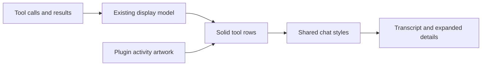

Codex review: needs changes before merge.

## What this changes

This PR standardizes tool-activity typography, spacing, disclosure visibility, and icon sizing.

**Example:** A completed edit to agent.ts shows +1 −1 and expandable diff output.
- **Before:** The row has larger artwork, looser spacing, and a persistent disclosure arrow.
- **After:** The row uses compact typography and calibrated artwork while retaining its file link and expanded diff.

## Review scores

| Measure | Result | What it means |
|---|---|---|
| **Overall readiness** | 🦪 silver shellfish **(2/6)** | Useful visual evidence and the previous repairs improve confidence, but the remaining label-clipping regression blocks a correctness pass. |
| **Proof confidence** | 🦐 gold shrimp **(3/6)** ✨ media proof bonus | Sufficient (screenshot): Inspected before/after screenshots exercise the changed CSS and icon presentation in native Control UI components with synthetic data, showing linked edits, expanded output, tool states, activity masks, and branded images; this establishes the visible component changes rather than full shipped-route execution. |
| **Patch quality** | 🦪 silver shellfish **(2/6)** | 1 actionable review finding remain. |

## Product

**Kind:** Preference · **Worth it:** Yes · **Fix scope:** Complete
**User problem:** Dense tool activity has uneven typography, spacing, and icon emphasis that make transcripts harder to scan.
**Reason:** The maintainer-authored direction is an owner decision, and the inspected screenshots demonstrate a coherent improvement using existing presentation owners.

## Merge readiness

⛔ **Needs changes before merge - 1 item remains**

Keep open: this maintainer-authored visual improvement addresses both prior findings, but one shared-label regression still needs repair.

**Priority:** P3
**Reviewed head:** `d08542d05997ba53f7d1e0b1fdc8fc78805f061c`

## Before merge

- [ ] **Preserve short identity labels beside long summaries (P2)** - In a 220px standalone ToolMessageSummary, a short label such as “Tool output” shares a flex container with a long output preview. Changing the label from flex: none to a shrinkable auto basis with min-width: 0 distributes compression across both elements, clipping the identity label even though the description could yield instead. This restores the failure addressed by https://github.com/openclaw/openclaw/pull/139372. Keep short identity labels non-shrinking and apply long-name truncation without sacrificing them; cover the narrow label-plus-preview case in the existing browser suite. This rule was unchanged in the previously reviewed head, and I missed it in that earlier review.

## Findings

- [P2] Preserve short identity labels beside long summaries — `ui/src/styles/chat/tool-cards.css:302-305`

### Tests

- Missing end-to-end proof: The supplied component previews do not demonstrate short-label preservation beside a long preview in a narrow shipped Chat view.

<strong>Agent review details</strong>

### How this fits together

The Control UI renders tool calls, results, and plugin artwork as transcript rows with expandable details; these changes affect their browser presentation.

### Technical review

Best possible solution:

Keep the presentation changes while preserving short identity labels and truncating adjacent descriptions through the existing shared CSS owner.

Do we have a high-confidence way to reproduce the issue?

Source establishes the remaining clipping path: a narrow standalone summary places its short identity label beside a long description, and both now shrink; no target code was executed.

Is this the best way to solve the issue?

The existing CSS and icon owners are appropriate, and the change needs no additional architecture; the shared label rule should preserve the earlier readability contract.

Full review comments:

- [P2] Preserve short identity labels beside long summaries — `ui/src/styles/chat/tool-cards.css:302-305`
  In a 220px standalone ToolMessageSummary, a short label such as “Tool output” shares a flex container with a long output preview. Changing the label from flex: none to a shrinkable auto basis with min-width: 0 distributes compression across both elements, clipping the identity label even though the description could yield instead. This restores the failure addressed by https://github.com/openclaw/openclaw/pull/139372. Keep short identity labels non-shrinking and apply long-name truncation without sacrificing them; cover the narrow label-plus-preview case in the existing browser suite. This rule was unchanged in the previously reviewed head, and I missed it in that earlier review.
  Confidence: 0.94
  Late finding: first raised on code an earlier review cycle already covered.

Overall correctness: patch is incorrect
Overall confidence: 0.94

AGENTS.md: found and applied where relevant.

Codex review notes: model internal, reasoning medium; reviewed against [7a95ec8a4d64](https://github.com/openclaw/openclaw/commit/7a95ec8a4d64d8f34bc3c025aabb89d95878b1b1).

### Provenance checked

- `Shared typography and label truncation` changes intended behavior with a stated reason (984d417f807736a556aaf2299fcb379d084d5f3e: Keep short tool labels readable while long adjacent summaries and progress receipts truncate.)
- `Compact disclosure and activity presentation` keeps the original intent (540ea124e09acbd477fa65a37785ff71ff1e12c3: Render tool activity as lightweight transcript content while retaining links, expanded output, and nearby disclosure controls.)
- `Shared tool chrome` keeps the original intent (2c5b726de0e978c4c05ec5fc06dcce422f3ef21b: Keep lightweight shared chrome separate from deferred detailed tool rendering.)
- `Plugin activity artwork` keeps the original intent (dab1f08376caee09461ce6c86a2d97a3cf209b80: Plugins own compact monochrome artwork while other surfaces retain their branding.)
- `Bubble activity disclosures` keeps the original intent (670ad6a9b0fcf112ca3c8e285c6454e088721533: Keep commentary and tool progress readable through existing disclosure owners.)

### Testing

Proof path: in-process harness.

### Security

None.

### Evidence

Acceptance criteria:

- node scripts/run-vitest.mjs ui/src/pages/chat/components/chat-tool-cards.browser.test.tsx
- node scripts/run-vitest.mjs ui/src/pages/chat/chat-responsive.browser.test.ts ui/src/pages/chat/components/chat-activity-layout.browser.test.ts
- pnpm lint:ui:styles
- git diff --check

What I checked:

- **Introduced change:** The pinned introduction diff changes presentation assets, shared tool chrome, CSS, and existing layout tests; current main retains the original presentation in these production files. ([`ui/src/styles/chat/tool-cards.css:301`](https://github.com/openclaw/openclaw/blob/d08542d05997ba53f7d1e0b1fdc8fc78805f061c/ui/src/styles/chat/tool-cards.css#L301), [d08542d05997](https://github.com/openclaw/openclaw/commit/d08542d05997ba53f7d1e0b1fdc8fc78805f061c))
- **Prior findings addressed:** The follow-up adds grid-template-columns: minmax(0, 1fr) and removes outdated exact-spacing expectations while retaining overflow and alignment assertions. ([`ui/src/styles/chat/tool-cards.css:77`](https://github.com/openclaw/openclaw/blob/d08542d05997ba53f7d1e0b1fdc8fc78805f061c/ui/src/styles/chat/tool-cards.css#L77), [d08542d05997](https://github.com/openclaw/openclaw/commit/d08542d05997ba53f7d1e0b1fdc8fc78805f061c))
- **Existing label-preservation contract:** https://github.com/openclaw/openclaw/pull/139372 deliberately made identity labels non-shrinking so long adjacent summaries could not clip them; its merged source establishes the reason for flex: none. ([`ui/src/styles/chat/tool-cards.css:292`](https://github.com/openclaw/openclaw/blob/984d417f807736a556aaf2299fcb379d084d5f3e/ui/src/styles/chat/tool-cards.css#L292), [984d417f8077](https://github.com/openclaw/openclaw/commit/984d417f807736a556aaf2299fcb379d084d5f3e))
- **Reachable affected renderer:** ToolMessageSummary renders a fixed identity label beside a separate summary or preview inside the same flex container, so the new shared shrinking rule affects ordinary standalone tool output. ([`ui/src/pages/chat/components/chat-tool-card-row.solid.tsx:389`](https://github.com/openclaw/openclaw/blob/d08542d05997ba53f7d1e0b1fdc8fc78805f061c/ui/src/pages/chat/components/chat-tool-card-row.solid.tsx#L389), [d08542d05997](https://github.com/openclaw/openclaw/commit/d08542d05997ba53f7d1e0b1fdc8fc78805f061c))
- **Visual evidence inspected:** All four prepared screenshots were inspected directly: the light pair shows the linked edit and expanded diff; the dark pair shows tool states, file rows, native icons, activity masks, and branding images in the native-component preview. ([d08542d05997](https://github.com/openclaw/openclaw/commit/d08542d05997ba53f7d1e0b1fdc8fc78805f061c))
- **Current review state:** GitHub reports the reviewed head as mergeable with checks still running and no current failing check reported; the author's discussion requests re-review. ([d08542d05997](https://github.com/openclaw/openclaw/commit/d08542d05997ba53f7d1e0b1fdc8fc78805f061c))

### PR surface

Source +45, Tests -10. Total +35 across 9 files. Added test files: 0.

View PR surface stats

| Area | Files | Added | Removed | Net |
|---|---:|---:|---:|---:|
| Source | 7 | 128 | 83 | +45 |
| Tests | 2 | 10 | 20 | -10 |
| Docs | 0 | 0 | 0 | 0 |
| Config | 0 | 0 | 0 | 0 |
| Generated | 0 | 0 | 0 | 0 |
| Other | 0 | 0 | 0 | 0 |
| **Total** | **9** | **138** | **103** | **+35** |

### Labels

Label changes:

- add `P3`: This is transcript presentation polish with limited impact and no change to tool execution or stored state.
- add `proof: sufficient`: Contributor real behavior proof is sufficient.
- add `proof: 📸 screenshot`: Contributor real behavior proof includes screenshot evidence.
- add `rating: 🦪 silver shellfish`: Overall readiness is 🦪 silver shellfish; proof is 🦐 gold shrimp and patch quality is 🦪 silver shellfish.
- remove `P2`: Current review triage priority is P3, so this older priority label is no longer current.
- remove `rating: 🧂 unranked krab`: Current PR rating is `rating: 🦪 silver shellfish`, so this older rating label is no longer current.

Label justifications:

- `P3`: This is transcript presentation polish with limited impact and no change to tool execution or stored state.
- `rating: 🦪 silver shellfish`: Overall readiness is 🦪 silver shellfish; proof is 🦐 gold shrimp and patch quality is 🦪 silver shellfish.
- `status: ⏳ waiting on author`: ClawSweeper has contributor-facing work open and is waiting for author action.
- `proof: sufficient`: Contributor real behavior proof is sufficient.
- `proof: 📸 screenshot`: Contributor real behavior proof includes screenshot evidence.

### Rating scale

6/6 🦀 challenger crab · 5/6 🦞 diamond lobster · 4/6 🐚 platinum hermit · 3/6 🦐 gold shrimp · 2/6 🦪 silver shellfish · 1/6 🧂 unranked krab. Overall follows the weaker of proof and patch quality; ✨ marks media proof (a screenshot, video, or linked artifact) that directly shows the changed behavior.

### Workflow

ClawSweeper edits this one comment on every review. Comment `@clawsweeper re-review` for a fresh review only. Repair and merge execution lanes are retired.

### History

Review history (1 earlier review cycle)

<!-- clawsweeper-review-history v=1 total=1 -->
- reviewed 2026-10-27T15:11:18.991Z sha 09b31d92eb218dc2224f62cf693bd9bb7660f5fb :: needs changes before merge. :: [P2] Constrain the new grid so long receipts remain inside the transcript | [P2] Update responsive contracts alongside the intended spacing changes

_Reviewed October 27, 2026, 12:15 PM ET / 16:15 UTC (Revision 2)._

<!-- clawsweeper-verdict:needs-changes item=186041 sha=d08542d05997ba53f7d1e0b1fdc8fc78805f061c confidence=high updated_at=2026-10-27T16:10:57Z reviewed_at=2026-10-27T16:15:03.329Z lease_owner=github-run-40538209753-1 lease_comment_id=6447071261 source_revision=49d129d07c7d6e15aeee5d11a5157547110d6a7a4c21fe48d4152f33d30ea3cf -->
<!-- clawsweeper-review-state:needs-changes item=186041 sha=d08542d05997ba53f7d1e0b1fdc8fc78805f061c v=1 -->

<!-- clawsweeper-review-version item=186041 reviewed_at=2026-10-27T16:15:03.329Z sha=d08542d05997ba53f7d1e0b1fdc8fc78805f061c source_revision=49d129d07c7d6e15aeee5d11a5157547110d6a7a4c21fe48d4152f33d30ea3cf lease_owner=github-run-40538209753-1 lease_comment_id=6447071261 v=1 -->

<!-- clawsweeper-review item=186041 -->