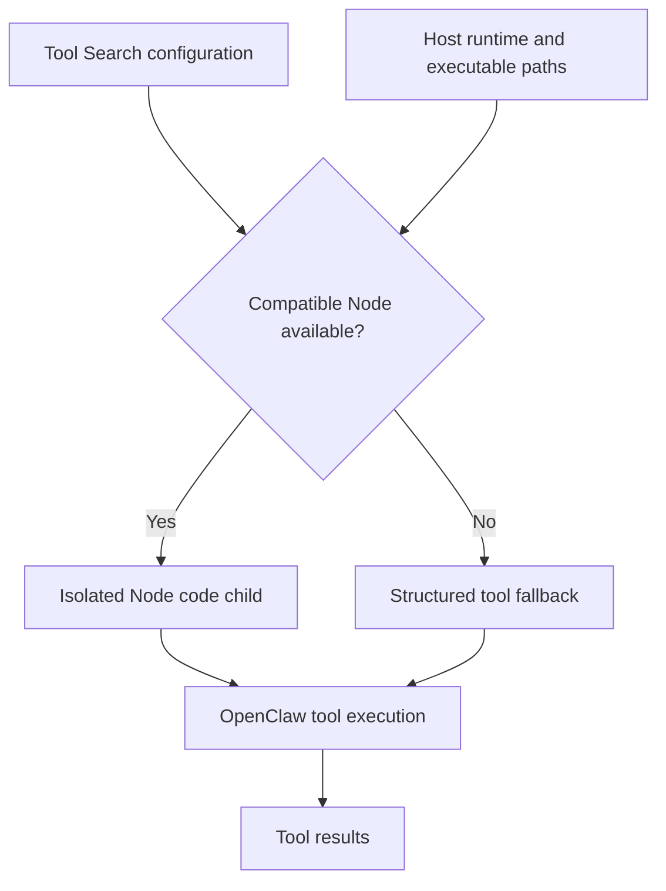

Codex review: needs maintainer review before merge. _Reviewed September 12, 2026, 2:24 AM ET / 06:24 UTC._

# ClawSweeper review

## What this changes

The PR lets Bun-hosted Tool Search run its isolated JavaScript child with an installed compatible Node executable and shares that discovery logic with test helpers.

## Merge readiness

✅ **Ready for maintainer review**

This remains a useful, focused fix: current main still launches the code child through the host runtime. No blocking introduced defect was found, and the maintainer-protected PR should remain open.

**Priority:** P2
**Reviewed head:** `4f6cd753158b0b4ab5446f83d665cb43cdfa2779`

## Review scores

| Measure | Result | What it means |
|---|---|---|
| **Overall readiness** | 🐚 platinum hermit **(4/6)** | A focused repair with shared ownership, relevant reported validation, and no blocking correctness findings. |
| **Proof confidence** | 🌊 off-meta tidepool | Not applicable: The supplied review context identifies maintainer-authored work, so the external-contributor proof gate does not apply. Reported Bun recovery coverage exercises the registered tool and Node child with a mocked MCP backend; no new authority boundary requires additional final-effect proof. |
| **Patch quality** | 🐚 platinum hermit **(4/6)** | No actionable review findings were identified. |

## Verification

| Check | Result | Evidence |
|---|---|---|
| **Real behavior** | Not applicable | Not applicable: The supplied review context identifies maintainer-authored work, so the external-contributor proof gate does not apply. Reported Bun recovery coverage exercises the registered tool and Node child with a mocked MCP backend; no new authority boundary requires additional final-effect proof. |
| **Evidence reviewed** | 7 items | Current main still has the reported runtime coupling: The fetched main revision checks the host process’s permission flag support and spawns process.execPath for the code child; it does not discover an installed Node when hosted by Bun. Latest-release comparison: The supplied latest release, v2026.9.4, also checks the host runtime’s allowedNodeEnvironmentFlags in its code-mode capability gate. Shared executable discovery preserves isolation: The resolver skips Bun identities, requires the requested Node flag, strips inherited preload settings from probes, and caches results. The code child retains --permission, its empty environment, IPC bridge, and existing timeout handling. |
| **Findings** | None | None. |
| **Security** | None | None. |

## How this fits together

Tool Search lets agents discover and call tools through a compact JavaScript bridge. Model code runs in an isolated Node child, while actual tool execution returns to OpenClaw’s existing policy-controlled runtime.

## Before merge

None.

<strong>Agent review details</strong>

### Security

None.

### PR surface

Source +111, Tests -33. Total +78 across 4 files.

View PR surface stats

| Area | Files | Added | Removed | Net |
|---|---:|---:|---:|---:|
| Source | 3 | 117 | 6 | +111 |
| Tests | 1 | 4 | 37 | -33 |
| Docs | 0 | 0 | 0 | 0 |
| Config | 0 | 0 | 0 | 0 |
| Generated | 0 | 0 | 0 | 0 |
| Other | 0 | 0 | 0 | 0 |
| **Total** | **4** | **121** | **43** | **+78** |

### Review metrics

| Metric | Value | Why it matters |
|---|---|---|
| **Runtime ownership consolidation** | Production +111 net lines; tests and test support −33 net lines | Production growth supplies shared capability discovery and caching while removing the separate test-only implementation. |

### Technical review

Best possible solution:

Use one capability-checked Node resolver for the isolated child, retaining structured fallback when unavailable and existing execution safeguards.

Do we have a high-confidence way to reproduce the issue?

Yes, from source: invoking the code tool under Bun reaches a host-runtime permission check and process.execPath launch on current main. The PR reports that failure before the fix; this read-only review did not execute it.

Is this the best way to solve the issue?

Yes. Selecting an installed Node with the required capability fixes the child-runtime mismatch without changing stored settings, installing dependencies, or replacing tool policy enforcement.

AGENTS.md: found and applied where relevant.

Codex review notes: model internal, reasoning medium; reviewed against [ae43ac760877](https://github.com/openclaw/openclaw/commit/ae43ac76087735251fd9cbe3eaab90390b517f13).

### Labels

Label changes:

- add `P2`: This repairs a bounded Tool Search failure under Bun while preserving the existing structured fallback.
- add `rating: 🐚 platinum hermit`: Overall readiness is 🐚 platinum hermit; proof is 🌊 off-meta tidepool and patch quality is 🐚 platinum hermit.
- add `status: 👀 ready for maintainer look`: ClawSweeper has no concrete contributor-facing blocker left for this PR. Not applicable: The supplied review context identifies maintainer-authored work, so the external-contributor proof gate does not apply. Reported Bun recovery coverage exercises the registered tool and Node child with a mocked MCP backend; no new authority boundary requires additional final-effect proof.

Label justifications:

- `P2`: This repairs a bounded Tool Search failure under Bun while preserving the existing structured fallback.
- `rating: 🐚 platinum hermit`: Overall readiness is 🐚 platinum hermit; proof is 🌊 off-meta tidepool and patch quality is 🐚 platinum hermit.
- `status: 👀 ready for maintainer look`: ClawSweeper has no concrete contributor-facing blocker left for this PR. Not applicable: The supplied review context identifies maintainer-authored work, so the external-contributor proof gate does not apply. Reported Bun recovery coverage exercises the registered tool and Node child with a mocked MCP backend; no new authority boundary requires additional final-effect proof.

### Evidence

What I checked:

- **Current main still has the reported runtime coupling:** The fetched main revision checks the host process’s permission flag support and spawns process.execPath for the code child; it does not discover an installed Node when hosted by Bun. ([`src/agents/tool-search-code-mode.ts:50`](https://github.com/openclaw/openclaw/blob/ae43ac76087735251fd9cbe3eaab90390b517f13/src/agents/tool-search-code-mode.ts#L50), [ae43ac760877](https://github.com/openclaw/openclaw/commit/ae43ac76087735251fd9cbe3eaab90390b517f13))
- **Latest-release comparison:** The supplied latest release, v2026.9.4, also checks the host runtime’s allowedNodeEnvironmentFlags in its code-mode capability gate. ([`src/agents/tool-search-config.ts:44`](https://github.com/openclaw/openclaw/blob/3a9d69db306cd7f081e06254cb89c4bcc14a7107/src/agents/tool-search-config.ts#L44), [3a9d69db306c](https://github.com/openclaw/openclaw/commit/3a9d69db306cd7f081e06254cb89c4bcc14a7107))
- **Shared executable discovery preserves isolation:** The resolver skips Bun identities, requires the requested Node flag, strips inherited preload settings from probes, and caches results. The code child retains --permission, its empty environment, IPC bridge, and existing timeout handling. ([`src/infra/node-runtime-executable.ts:47`](https://github.com/openclaw/openclaw/blob/4f6cd753158b0b4ab5446f83d665cb43cdfa2779/src/infra/node-runtime-executable.ts#L47), [4f6cd753158b](https://github.com/openclaw/openclaw/commit/4f6cd753158b0b4ab5446f83d665cb43cdfa2779))
- **OpenClaw implementation boundary:** The Tool Search documentation explicitly distinguishes this implementation from Codex-native tool search. The changed owner launches OpenClaw’s own inline Node child; no Codex dependency contract is implicated. Public docs: [`docs/tools/tool-search.md`](https://docs.openclaw.ai/tools/tool-search). ([`docs/tools/tool-search.md:14`](https://docs.openclaw.ai/tools/tool-search), [4f6cd753158b](https://github.com/openclaw/openclaw/commit/4f6cd753158b0b4ab5446f83d665cb43cdfa2779))
- **Validation claims mapped to the production entry point:** The captured PR body reports Bun MCP recovery 8/8, focused Bun coverage 204/204 plus the resolver regression, and Node coverage 213/213. The inspected recovery test calls the registered code tool and expects recovered:true through the actual child path, while supplying a mocked MCP backend. These are reported focused results, not reviewer-executed tests or live MCP-service proof. ([`src/agents/tool-search.mcp-error.test.ts`](https://github.com/openclaw/openclaw/blob/4f6cd753158b0b4ab5446f83d665cb43cdfa2779/src/agents/tool-search.mcp-error.test.ts), [4f6cd753158b](https://github.com/openclaw/openclaw/commit/4f6cd753158b0b4ab5446f83d665cb43cdfa2779))
- **Prior merged-area contribution:** GitHub commit metadata identifies steipete on the earlier Bun-compatible test resolver change. Current-main history also identifies Alix-007’s Electron fallback work. Some deeper local historical blobs were unavailable, so routing does not assert verified source-line introduction. ([`src/test-utils/node-process.ts`](https://github.com/openclaw/openclaw/blob/2f5822abb67e81ab00e443594ada86779eb78c4b/src/test-utils/node-process.ts), [2f5822abb67e](https://github.com/openclaw/openclaw/commit/2f5822abb67e81ab00e443594ada86779eb78c4b))

Likely related people:

- **steipete:** Suggested for follow-up; no historical authorship or introduction is verified. (role: unverified routing candidate; confidence: low)
- **Alix-007:** Suggested for follow-up; no historical authorship or introduction is verified. (role: unverified routing candidate; confidence: low)

### Rating scale

| Score | Internal tier | Crab rank | Meaning |
|---:|:---:|---|---|
| **6/6** | S | 🦀 challenger crab | Exceptional readiness |
| **5/6** | A | 🦞 diamond lobster | Very strong readiness |
| **4/6** | B | 🐚 platinum hermit | Good normal PR; ordinary maintainer review |
| **3/6** | C | 🦐 gold shrimp | Useful, but confidence is limited |
| **2/6** | D | 🦪 silver shellfish | Proof or implementation needs work |
| **1/6** | F | 🧂 unranked krab | Not merge-ready |
| N/A | NA | 🌊 off-meta tidepool | Rating does not apply |

Overall follows the weaker of proof and patch quality.
Shiny media proof means a screenshot, video, or linked artifact directly shows the changed behavior. Runtime, network, CSP, and security claims still need visible diagnostics.

### Workflow

- ClawSweeper keeps one durable marker-backed review comment per issue or PR.
- Re-runs edit this comment so the latest verdict, findings, and automation markers stay together instead of adding duplicate bot comments.
- A fresh review can be triggered by eligible `@clawsweeper re-review` comments, exact-item GitHub events, scheduled/background review runs, or manual workflow dispatch.
- PR/issue authors and users with repository write access can comment `@clawsweeper re-review` or `@clawsweeper re-run` on an open PR or issue to request a fresh review only.
- Maintainers can also comment `@clawsweeper review` to request a fresh review only.
- Fresh-review commands do not start repair, autofix, rebase, CI repair, or automerge.
- Maintainer-only repair and merge flows require explicit commands such as `@clawsweeper autofix`, `@clawsweeper automerge`, `@clawsweeper fix ci`, or `@clawsweeper address review`.
- Maintainers can comment `@clawsweeper explain` to ask for more context, or `@clawsweeper stop` to stop active automation.

<!-- clawsweeper-verdict:needs-human item=145688 sha=4f6cd753158b0b4ab5446f83d665cb43cdfa2779 confidence=high updated_at=2026-09-12T06:21:53Z reviewed_at=2026-09-12T06:24:07.029Z lease_owner=github-run-34677845860-1 lease_comment_id=5644159575 source_revision=eebb0d24ca6c69746f52da5d0ac34eed45d230a1268af3a66ed716ee7c3a1cfc live_verification=absent -->
<!-- clawsweeper-review-state:ready item=145688 sha=4f6cd753158b0b4ab5446f83d665cb43cdfa2779 v=1 -->

<!-- clawsweeper-review-version item=145688 reviewed_at=2026-09-12T06:24:07.029Z sha=4f6cd753158b0b4ab5446f83d665cb43cdfa2779 source_revision=eebb0d24ca6c69746f52da5d0ac34eed45d230a1268af3a66ed716ee7c3a1cfc lease_owner=github-run-34677845860-1 lease_comment_id=5644159575 v=1 -->

<!-- clawsweeper-review item=145688 -->