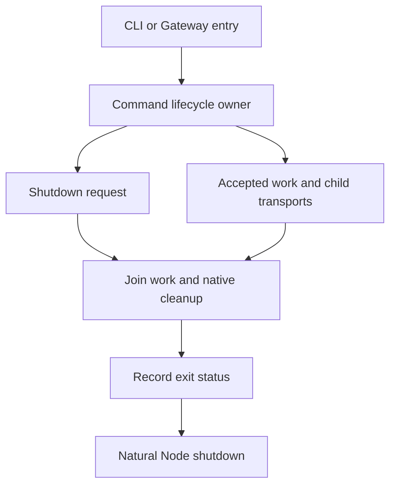

Codex review: needs changes before merge.

## What this changes

This PR restores Node’s default V8 compilers and makes executable lifecycle owners finish cleanup before exiting naturally.

**Example:** A Node 24.19.0 CLI command finishes with status 7 while native cleanup remains pending.
- **Before:** Forced termination can bypass cleanup, with compiler defaults disabled to avoid an exit deadlock.
- **After:** The CLI joins cleanup, retains status 7, and lets Node terminate with its default compiler settings.

## Review scores

| Measure | Result | What it means |
|---|---|---|
| **Overall readiness** | 🐚 platinum hermit **(4/6)** | Useful, owner-directed lifecycle work with reported shipped-entry-point evidence and meaningful process regressions; inspection found no new discrete defect, but CI attribution still blocks landing. |
| **Proof confidence** | 🐚 platinum hermit **(4/6)** | The ordinary contributor-proof gate is exempt for this collaborator-authored PR; its body reports built-CLI model completion, Linux Gateway natural exit, and published-driver update checks, with historical and platform limits stated. |
| **Patch quality** | 🐚 platinum hermit **(4/6)** | No actionable review findings were identified. |

## Product

**Kind:** Bug fix · **Worth it:** Yes · **Fix scope:** Complete
**User problem:** CLI and Gateway termination can stall or abandon cleanup, and the existing mitigation changes Node’s compiler defaults.
**Reason:** The collaborator-authored direction approves replacing the workaround with existing lifecycle owners and explicitly records the remaining native-platform limitations.

## Merge readiness

⛔ **Needs changes before merge - 1 item remains**

Keep open: this maintainer-directed PR replaces main’s compiler workaround with owned natural shutdown; current-head CI remains blocked, and no new actionable defect was established in the inspected paths.

**Priority:** P2
**Reviewed head:** `a39a27b7f99c9d6b4e53dad9e924375bcd0b9387`

## Before merge

- [ ] **Complete next step** - Account for every failed job in CI run 38106144930 with matching baseline evidence, repairing failures caused by this PR and qualifying inherited failures through the documented landing route.

## Findings

None.

### Tests

- Missing end-to-end proof: The supplied shipped-CLI and Linux Gateway observations are historical; native macOS and Windows qualification is expressly unclaimed.

<strong>Agent review details</strong>

### How this fits together

CLI, Gateway, worker, and child-process lifecycle owners receive completion or cancellation requests and release accepted work, native resources, transports, and output before recording terminal outcomes.

### Technical review

Best possible solution:

Land the owned natural-shutdown cutover after current-head CI failures are repaired or qualify through the documented inherited-failure route.

Do we have a high-confidence way to reproduce the issue?

No reproduction was run during this read-only review; the merged predecessor records real Node deadlocks, while current main mitigates them by disabling the affected compilers.

Is this the best way to solve the issue?

Owned cleanup and natural termination address the lifecycle cause while preserving explicit compiler policy, signal outcomes, and system-certificate trust.

AGENTS.md: found and applied where relevant.

Codex review notes: model internal, reasoning medium; reviewed against [ddca97e26ac2](https://github.com/openclaw/openclaw/commit/ddca97e26ac2d734869f4fe74d53fd3c99384152).

### Provenance checked

- `Default V8 compiler suppression` changes intended behavior with a stated reason (1aa0aeb54959b391ca3cb4e283345ee83e2f782b: Observed forced-exit deadlocks required disabling both compiler paths; the predecessor documented measurable cost and natural-exit constraints.)
- `Process-owning skills-watcher detachment` changes intended behavior with a stated reason (8832904b171a34dd5b134f9985208d2ecabea24f: Detachment avoided synchronous macOS FSEvents retirement latency; this PR expressly accepts joining native retirement instead.)
- `Unix respawn signal termination` keeps the original intent (53200287f8ef8977268e16e5c6d103d1e8d082dd: Supervisors distinguish actual signal termination from numeric exits; the current patch preserves that distinction after child and output settlement.)

### Testing

Proof path: shipped entry point.

### Security

None.

### Evidence

What I checked:

- **Current main retains the compiler workaround:** Fetched main still disables Maglev and concurrent Sparkplug; the PR’s central lifecycle replacement is not implemented there. ([`src/bootstrap/node-exit-safe-compilers.ts:26`](https://github.com/openclaw/openclaw/blob/ddca97e26ac2d734869f4fe74d53fd3c99384152/src/bootstrap/node-exit-safe-compilers.ts#L26), [ddca97e26ac2](https://github.com/openclaw/openclaw/commit/ddca97e26ac2d734869f4fe74d53fd3c99384152))
- **Original workaround and rationale:** https://github.com/openclaw/openclaw/pull/163788 documents observed Node exit deadlocks, the compiler mitigation, its performance cost, and the separate macOS natural-exit limitation. ([`src/bootstrap/node-exit-safe-compilers.ts:4`](https://github.com/openclaw/openclaw/blob/1aa0aeb54959b391ca3cb4e283345ee83e2f782b/src/bootstrap/node-exit-safe-compilers.ts#L4), [1aa0aeb54959](https://github.com/openclaw/openclaw/commit/1aa0aeb54959b391ca3cb4e283345ee83e2f782b))
- **Cleanup precedes terminal completion:** The finalizer joins pending disposers, preserves accepted signal or requested exit status, and restores terminal state only for explicit completion paths. ([`src/cli/one-shot-exit.ts:39`](https://github.com/openclaw/openclaw/blob/a39a27b7f99c9d6b4e53dad9e924375bcd0b9387/src/cli/one-shot-exit.ts#L39), [a39a27b7f99c](https://github.com/openclaw/openclaw/commit/a39a27b7f99c9d6b4e53dad9e924375bcd0b9387))
- **Unix signal regression repaired:** Respawn completion waits for child closure and re-emits Unix termination signals; real-process tests distinguish SIGKILL termination from numeric status 143. ([`src/process/respawn-child-runner.ts:130`](https://github.com/openclaw/openclaw/blob/a39a27b7f99c9d6b4e53dad9e924375bcd0b9387/src/process/respawn-child-runner.ts#L130), [a39a27b7f99c](https://github.com/openclaw/openclaw/commit/a39a27b7f99c9d6b4e53dad9e924375bcd0b9387))
- **Accepted shutdown tradeoff:** The collaborator-authored body expressly retains native watcher joins and acknowledges macOS latency and certificate-loader limitations; https://docs.openclaw.ai/cli/update describes reporting deadlines that retain cleanup custody. ([`docs/cli/update.md:159`](https://docs.openclaw.ai/cli/update), [a39a27b7f99c](https://github.com/openclaw/openclaw/commit/a39a27b7f99c9d6b4e53dad9e924375bcd0b9387))
- **Exact-head CI blocks landing:** https://github.com/openclaw/openclaw/actions/runs/38106144930 completed unsuccessfully for the reviewed head, including the enforced openclaw/ci-gate. Inspected failures include channel mocks, database-resource closure, catalog assertions, and UI scenarios; matching baseline evidence has not established attribution for every failed job. ([a39a27b7f99c](https://github.com/openclaw/openclaw/commit/a39a27b7f99c9d6b4e53dad9e924375bcd0b9387))

### PR surface

PR surface statistics unavailable: the file list is incomplete.

### Labels

Label changes:

No label changes.

Label justifications:

- `P2`: This is a maintainer-directed lifecycle improvement to an existing exit-deadlock mitigation, without an established urgent new user regression.
- `merge-risk: 🚨 compatibility`: The patch changes process-exit semantics, restores compiler defaults, and adds opt-in SDK worker retirement; its documented native-shutdown tradeoffs are explicitly accepted in the collaborator-authored direction.
- `rating: 🐚 platinum hermit`: Overall readiness is 🐚 platinum hermit; proof is 🐚 platinum hermit and patch quality is 🐚 platinum hermit.
- `status: ⏳ waiting on author`: ClawSweeper has contributor-facing work open and is waiting for author action.

### Rating scale

6/6 🦀 challenger crab · 5/6 🦞 diamond lobster · 4/6 🐚 platinum hermit · 3/6 🦐 gold shrimp · 2/6 🦪 silver shellfish · 1/6 🧂 unranked krab. Overall follows the weaker of proof and patch quality; ✨ marks media proof (a screenshot, video, or linked artifact) that directly shows the changed behavior.

### Workflow

ClawSweeper edits this one comment on every review. Comment `@clawsweeper re-review` for a fresh review only; repair and merge need explicit maintainer commands such as `@clawsweeper autofix` or `@clawsweeper automerge`.

### History

Review history (7 earlier review cycles)

<!-- clawsweeper-review-history v=1 total=7 -->
- reviewed 2026-10-10T18:12:26.081Z sha a12074716e10153aa254889ea11d57eaece0e138 :: needs changes before merge. :: [P1] [P1] Preserve Unix signal termination through respawn wrappers
- reviewed 2026-10-10T22:39:00.121Z sha c54801d5866c4cfcbe34ca61fe2d2f04efc28885 :: needs changes before merge. :: none
- reviewed 2026-10-10T23:19:21.446Z sha 85115b070e6e8c165461e24e4389e8afe138ef82 :: needs maintainer review before merge. :: none
- reviewed 2026-10-11T00:00:59.897Z sha 62b01792fb9ef312aaf7d95f655618856ba57046 :: needs changes before merge. :: [P2] Align built-CLI terminal assertions with natural completion | [P2] Stop the capture fixture deadline from retaining the child
- reviewed 2026-10-11T00:38:37.566Z sha 3a408fd39563445f26490a221b0dacc6f8b260e6 :: needs changes before merge. :: none
- reviewed 2026-10-11T01:53:39.631Z sha 9b95ad8b7844d038b23eeb9e56b26fe239d4b3fc :: needs changes before merge. :: none
- reviewed 2026-10-11T02:35:48.009Z sha 9b95ad8b7844d038b23eeb9e56b26fe239d4b3fc :: needs changes before merge. :: none

_Reviewed October 10, 2026, 11:06 PM ET / October 11, 2026, 03:06 UTC (Revision 8)._

<!-- clawsweeper-verdict:needs-human item=168587 sha=a39a27b7f99c9d6b4e53dad9e924375bcd0b9387 confidence=high updated_at=2026-10-11T02:58:48Z reviewed_at=2026-10-11T03:06:37.469Z lease_owner=github-run-38106834952-1 lease_comment_id=6104821348 source_revision=481a2ea455a44bf8b0029b93c499c31c5b2a887fa0b9aad3c9b2c9a62cd34ef9 live_verification=absent hold=blocked findings=0 -->
<!-- clawsweeper-review-state:needs-changes item=168587 sha=a39a27b7f99c9d6b4e53dad9e924375bcd0b9387 v=1 -->

<!-- clawsweeper-review-version item=168587 reviewed_at=2026-10-11T03:06:37.469Z sha=a39a27b7f99c9d6b4e53dad9e924375bcd0b9387 source_revision=481a2ea455a44bf8b0029b93c499c31c5b2a887fa0b9aad3c9b2c9a62cd34ef9 lease_owner=github-run-38106834952-1 lease_comment_id=6104821348 v=1 -->

<!-- clawsweeper-review item=168587 -->