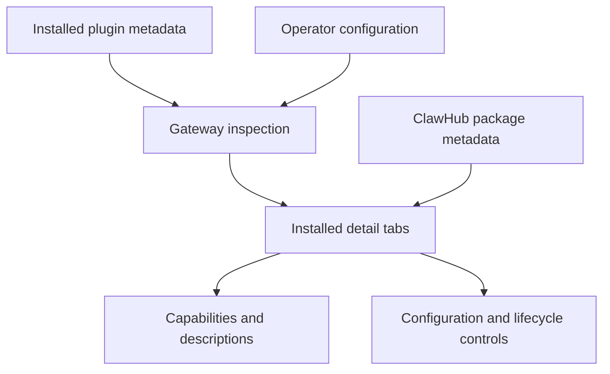

Codex review: blocked before merge. _Reviewed September 9, 2026, 9:57 PM ET / September 10, 2026, 01:57 UTC (Revision 23)._

# ClawSweeper review

## What this changes

Unifies catalog and installed-plugin detail pages into shared tabs, adds installed component inventories, and displays marketplace metadata alongside local administration controls.

## Merge readiness

⛔ **Blocked before merge - 8 items remain**

Keep open: this remains useful, protected stack work that current main does not implement. The three prior findings remain in the pinned head; the documented repairs are verified in the immediate child PR.

**Priority:** P2
**Reviewed head:** `1533eec5984c947255cc30a8c51ded8584429644`

## Review scores

| Measure | Result | What it means |
|---|---|---|
| **Overall readiness** | 🦐 gold shrimp **(3/6)** | Useful shared UI work with three concrete defects in this head and verified repairs in its child. |
| **Proof confidence** | 🌊 off-meta tidepool | Not applicable: The supplied repository state identifies this as maintainer-authored stack work, exempt from the ordinary external-contributor gate. Claimed installed-detail desktop and 744px observations were not independently inspected; prepared images concern child chat cards, and video preparation failed. No authority-changing mutation was introduced by this layer. |
| **Patch quality** | 🦐 gold shrimp **(3/6)** | Security review found an item that needs attention. |

## Verification

| Check | Result | Evidence |
|---|---|---|
| **Real behavior** | Not applicable | Not applicable: The supplied repository state identifies this as maintainer-authored stack work, exempt from the ordinary external-contributor gate. Claimed installed-detail desktop and 744px observations were not independently inspected; prepared images concern child chat cards, and video preparation failed. No authority-changing mutation was introduced by this layer. |
| **Evidence reviewed** | 8 items | Pinned introduction and remaining findings: The verified introduction spans 39f962dbee810e32e2057de85bd9eac2df5578b0 to 1533eec5984c947255cc30a8c51ded8584429644. Inspection now awaits catalog enrichment and selects its identity from source.packageName or inventory packageName. management-service.ts:608 shows that packageName can be an npm package name, without a canonical ClawHub relationship. Remote latency reaches local inspection: The new awaited detail fetch completes before plugins.inspect responds. The ClawHub client uses a 30-second default request timeout, so catching rejection does not preserve immediate local inspection during a slow request. Installed artwork discovery regression: The replacement publisher icon lacks data-plugin-icon-id. plugins-page.ts:225 still gathers that marker, and PluginIconController.sync skips plugins outside the gathered set, preventing artwork loading on direct detail navigation. |
| **Findings** | 3 actionable findings | [P2] [P2] Preserve canonical ClawHub identity in the deployed result [P2] [P2] Keep optional catalog reads off the inspection response [P3] [P3] Preserve the installed icon discovery marker |
| **Security** | Needs attention | Marketplace trust information can describe a different package: An npm/local package name is used as a ClawHub identity without a proven counterpart, and the resulting official badge and security status are shown beside the installed plugin. The child PR's canonical-identity repair addresses this presentation risk. |

## How this fits together

The Control UI reads installed plugin metadata and operator settings from the Gateway. These detail pages combine that local information with optional ClawHub descriptions while retaining existing configuration and lifecycle controls.

## Before merge

- [ ] **\[P2\] Preserve canonical ClawHub identity in the deployed result (P2)** - For npm or local installations, `source.packageName` and inventory `packageName` do not establish a ClawHub counterpart. A namesake at the same version can attach unrelated publisher, official-badge, README, and security information. This prior finding remains in the pinned head; preserve the verified canonical-identity repair in https://github.com/openclaw/openclaw/pull/142782 through the documented combined deployment.
- [ ] **\[P2\] Keep optional catalog reads off the inspection response (P2)** - The handler waits for remote detail requests before returning already available local inspection. Slow ClawHub requests therefore delay capabilities and access information; catching errors only helps after the requests finish. The child PR already separates these reads, so include that repair in the deployable result rather than deploying this intermediate handler.
- [ ] **\[P3\] Preserve the installed icon discovery marker (P3)** - Replacing `renderArtTile` removes `data-plugin-icon-id`, while the page still uses that marker to select installed icons for fetching. Opening an installed detail URL directly consequently leaves the generic box even when artwork exists. The child restores the marker; retain that fix in the combined deployment.
- [ ] **Resolve security concern: Marketplace trust information can describe a different package** - An npm/local package name is used as a ClawHub identity without a proven counterpart, and the resulting official badge and security status are shown beside the installed plugin. The child PR's canonical-identity repair addresses this presentation risk.
- [ ] **Resolve merge risk (P1)** - The combined-deployment commitment is documented, but this review has not validated a final landing artifact containing the child repairs; deploying this intermediate head would retain the reported defects.
- [ ] **Resolve merge risk (P1)** - The claimed desktop and narrow-screen installed-detail captures could not be inspected from the prepared artifacts.
- [ ] **Complete next step (P2)** - Validate the final combined landing with the three verified repairs from https://github.com/openclaw/openclaw/pull/142782 included; do not deploy this intermediate head independently.
- [ ] **Add data-model compatibility proof** - Confirm migration or upgrade compatibility proof before merge.

## Findings

- [P2] [P2] Preserve canonical ClawHub identity in the deployed result — `src/gateway/server-methods/plugins.ts:81-85`
- [P2] [P2] Keep optional catalog reads off the inspection response — `src/gateway/server-methods/plugins.ts:85-95`
- [P3] [P3] Preserve the installed icon discovery marker — `ui/src/pages/plugins/settings-view.ts:655-658`
- [medium] Marketplace trust information can describe a different package — `src/gateway/server-methods/plugins.ts:83`

<strong>Agent review details</strong>

### Security

Needs attention: The pinned enrichment path can misattribute security and publisher information; no authorization bypass or new executable dependency was found.

### PR surface

Source +514, Tests +367, Other +17. Total +898 across 28 files.

View PR surface stats

| Area | Files | Added | Removed | Net |
|---|---:|---:|---:|---:|
| Source | 17 | 975 | 461 | +514 |
| Tests | 9 | 479 | 112 | +367 |
| Docs | 0 | 0 | 0 | 0 |
| Config | 0 | 0 | 0 | 0 |
| Generated | 0 | 0 | 0 | 0 |
| Other | 2 | 18 | 1 | +17 |
| **Total** | **28** | **1472** | **574** | **+898** |

### Review metrics

| Metric | Value | Why it matters |
|---|---|---|
| **Production versus test growth** | Production net +522 lines; tests and test support net +376 lines | Production growth implements shared detail rendering and component projection; the production total includes eight net generated Swift lines. |

### Stored data model

Persistent data-model change detected: `unknown-data-model-change: packages/gateway-protocol/src/schema/plugins.ts`. Confirm migration or upgrade compatibility proof before merge.

### Merge-risk options

**Maintainer options:**
1. **Preserve the child repairs in the combined deployment (recommended)**  
   Validate the final stack with the canonical identity, local-first inspection, and icon repairs from https://github.com/openclaw/openclaw/pull/142782 included.
2. **Make this layer independently deployable**  
   If combined deployment cannot be guaranteed, bring the three existing child repairs into this layer before landing it.

### Technical review

Best possible solution:

Deliver the shared detail interface with canonical marketplace identity, independently loaded enrichment, and restored artwork discovery from the verified child repair.

Do we have a high-confidence way to reproduce the issue?

Yes, the pinned source establishes concrete triggers: an unrelated ClawHub namesake, a delayed catalog request, and direct navigation to an installed plugin with artwork. No runtime reproduction was executed.

Is this the best way to solve the issue?

The shared rendering approach fits the existing configuration and lifecycle owners, but this standalone head is incomplete; the verified child supplies the narrow repairs already accepted in discussion.

Full review comments:

- [P2] [P2] Preserve canonical ClawHub identity in the deployed result — `src/gateway/server-methods/plugins.ts:81-85`
  For npm or local installations, `source.packageName` and inventory `packageName` do not establish a ClawHub counterpart. A namesake at the same version can attach unrelated publisher, official-badge, README, and security information. This prior finding remains in the pinned head; preserve the verified canonical-identity repair in https://github.com/openclaw/openclaw/pull/142782 through the documented combined deployment.
  Confidence: 0.99
- [P2] [P2] Keep optional catalog reads off the inspection response — `src/gateway/server-methods/plugins.ts:85-95`
  The handler waits for remote detail requests before returning already available local inspection. Slow ClawHub requests therefore delay capabilities and access information; catching errors only helps after the requests finish. The child PR already separates these reads, so include that repair in the deployable result rather than deploying this intermediate handler.
  Confidence: 0.99
- [P3] [P3] Preserve the installed icon discovery marker — `ui/src/pages/plugins/settings-view.ts:655-658`
  Replacing `renderArtTile` removes `data-plugin-icon-id`, while the page still uses that marker to select installed icons for fetching. Opening an installed detail URL directly consequently leaves the generic box even when artwork exists. The child restores the marker; retain that fix in the combined deployment.
  Confidence: 0.99

Overall correctness: patch is incorrect
Overall confidence: 0.97

AGENTS.md: found and applied where relevant.

Codex review notes: model internal, reasoning medium; reviewed against [fb9addf62115](https://github.com/openclaw/openclaw/commit/fb9addf62115a74dfa655e3a1da0a332e54d8330).

### Labels

Label justifications:

- `P2`: This is a bounded plugin administration improvement with concrete intermediate-head defects and an existing repair path.
- `merge-risk: 🚨 availability`: The introduced catalog await can delay local plugin inspection during ClawHub latency or outages.
- `merge-risk: 🚨 other`: Name-based enrichment can display another package's publisher, official badge, and security information.
- `rating: 🦐 gold shrimp`: Overall readiness is 🦐 gold shrimp; proof is 🌊 off-meta tidepool and patch quality is 🦐 gold shrimp.
- `status: ⏳ waiting on author`: ClawSweeper has contributor-facing work open and is waiting for author action. Not applicable: The supplied repository state identifies this as maintainer-authored stack work, exempt from the ordinary external-contributor gate. Claimed installed-detail desktop and 744px observations were not independently inspected; prepared images concern child chat cards, and video preparation failed. No authority-changing mutation was introduced by this layer.

### Evidence

Security concerns:

- [medium] Marketplace trust information can describe a different package — `src/gateway/server-methods/plugins.ts:83`
  An npm/local package name is used as a ClawHub identity without a proven counterpart, and the resulting official badge and security status are shown beside the installed plugin. The child PR's canonical-identity repair addresses this presentation risk.
  Confidence: 0.99

What I checked:

- **Pinned introduction and remaining findings:** The verified introduction spans 39f962dbee810e32e2057de85bd9eac2df5578b0 to 1533eec5984c947255cc30a8c51ded8584429644. Inspection now awaits catalog enrichment and selects its identity from source.packageName or inventory packageName. management-service.ts:608 shows that packageName can be an npm package name, without a canonical ClawHub relationship. ([`src/gateway/server-methods/plugins.ts:83`](https://github.com/openclaw/openclaw/blob/1533eec5984c947255cc30a8c51ded8584429644/src/gateway/server-methods/plugins.ts#L83), [1533eec5984c](https://github.com/openclaw/openclaw/commit/1533eec5984c947255cc30a8c51ded8584429644))
- **Remote latency reaches local inspection:** The new awaited detail fetch completes before plugins.inspect responds. The ClawHub client uses a 30-second default request timeout, so catching rejection does not preserve immediate local inspection during a slow request. ([`src/infra/clawhub-client.ts:207`](https://github.com/openclaw/openclaw/blob/1533eec5984c947255cc30a8c51ded8584429644/src/infra/clawhub-client.ts#L207), [1533eec5984c](https://github.com/openclaw/openclaw/commit/1533eec5984c947255cc30a8c51ded8584429644))
- **Installed artwork discovery regression:** The replacement publisher icon lacks data-plugin-icon-id. plugins-page.ts:225 still gathers that marker, and PluginIconController.sync skips plugins outside the gathered set, preventing artwork loading on direct detail navigation. ([`ui/src/pages/plugins/settings-view.ts:656`](https://github.com/openclaw/openclaw/blob/1533eec5984c947255cc30a8c51ded8584429644/ui/src/pages/plugins/settings-view.ts#L656), [1533eec5984c](https://github.com/openclaw/openclaw/commit/1533eec5984c947255cc30a8c51ded8584429644))
- **Child repair verified:** GitHub confirms https://github.com/openclaw/openclaw/pull/142782 is open and mergeable, with this exact head as its base and a58ce1f4aaefc6a84c80aa9fd63fb5154b95bc36 as its head. Its Gateway returns local inspection directly; inventory derives catalogId from canonical clawhubPackage; its UI publishes inspection before awaiting optional catalog metadata; and its installed icon restores the discovery marker. These match the author's documented combined-deployment disposition. ([`src/gateway/server-methods/plugins.ts:90`](https://github.com/openclaw/openclaw/blob/a58ce1f4aaefc6a84c80aa9fd63fb5154b95bc36/src/gateway/server-methods/plugins.ts#L90), [a58ce1f4aaef](https://github.com/openclaw/openclaw/commit/a58ce1f4aaefc6a84c80aa9fd63fb5154b95bc36))
- **Child regression coverage:** The child's routing test holds the catalog response pending, verifies local detail controls render, checks the exact installed-version request, and then resolves enrichment. This is useful supplemental coverage; it was inspected, not executed. ([`ui/src/pages/plugins/plugins-page.routing.test.ts:355`](https://github.com/openclaw/openclaw/blob/a58ce1f4aaefc6a84c80aa9fd63fb5154b95bc36/ui/src/pages/plugins/plugins-page.routing.test.ts#L355), [a58ce1f4aaef](https://github.com/openclaw/openclaw/commit/a58ce1f4aaefc6a84c80aa9fd63fb5154b95bc36))
- **Current-main and release necessity:** Fetched main still renders the existing plugin detail overlay and lacks the new shared installed-detail files. Its inspection schema lacks components and catalog; the v2026.9.3 schema also lacks these additions. No merged replacement was established. ([`ui/src/pages/plugins/view.ts:1166`](https://github.com/openclaw/openclaw/blob/fb9addf62115a74dfa655e3a1da0a332e54d8330/ui/src/pages/plugins/view.ts#L1166), [fb9addf62115](https://github.com/openclaw/openclaw/commit/fb9addf62115a74dfa655e3a1da0a332e54d8330))

Likely related people:

- **Patrick-Erichsen:** Suggested for follow-up; no historical authorship or introduction is verified. (role: unverified routing candidate; confidence: low)
- **steipete:** Suggested for follow-up; no historical authorship or introduction is verified. (role: unverified routing candidate; confidence: low)

### Rank-up moves

Optional improvements that raise the rating; they are not merge blockers.

- Validate the deployable combined stack with all three child repairs preserved.

### Rating scale

| Score | Internal tier | Crab rank | Meaning |
|---:|:---:|---|---|
| **6/6** | S | 🦀 challenger crab | Exceptional readiness |
| **5/6** | A | 🦞 diamond lobster | Very strong readiness |
| **4/6** | B | 🐚 platinum hermit | Good normal PR; ordinary maintainer review |
| **3/6** | C | 🦐 gold shrimp | Useful, but confidence is limited |
| **2/6** | D | 🦪 silver shellfish | Proof or implementation needs work |
| **1/6** | F | 🧂 unranked krab | Not merge-ready |
| N/A | NA | 🌊 off-meta tidepool | Rating does not apply |

Overall follows the weaker of proof and patch quality.
Shiny media proof means a screenshot, video, or linked artifact directly shows the changed behavior. Runtime, network, CSP, and security claims still need visible diagnostics.

### Workflow

- ClawSweeper keeps one durable marker-backed review comment per issue or PR.
- Re-runs edit this comment so the latest verdict, findings, and automation markers stay together instead of adding duplicate bot comments.
- A fresh review can be triggered by eligible `@clawsweeper re-review` comments, exact-item GitHub events, scheduled/background review runs, or manual workflow dispatch.
- PR/issue authors and users with repository write access can comment `@clawsweeper re-review` or `@clawsweeper re-run` on an open PR or issue to request a fresh review only.
- Maintainers can also comment `@clawsweeper review` to request a fresh review only.
- Fresh-review commands do not start repair, autofix, rebase, CI repair, or automerge.
- Maintainer-only repair and merge flows require explicit commands such as `@clawsweeper autofix`, `@clawsweeper automerge`, `@clawsweeper fix ci`, or `@clawsweeper address review`.
- Maintainers can comment `@clawsweeper explain` to ask for more context, or `@clawsweeper stop` to stop active automation.

### History

Review history (22 earlier review cycles; latest 8 shown)

<!-- clawsweeper-review-history v=1 total=22 -->
- reviewed 2026-09-09T20:06:29.144Z sha 2373fe622cea46eeefc3efdc6e6567f3e43b1ee4 :: blocked before merge. :: [P2] Resolve the proven ClawHub counterpart before enrichment | [P2] Keep optional catalog requests off the inspection response | [P3] Preserve the installed icon discovery marker
- reviewed 2026-09-09T20:30:51.217Z sha b55b598844927451581f92b58ccad067c7c74248 :: blocked before merge. :: [P2] Resolve the proven ClawHub counterpart before enrichment | [P2] Keep optional catalog requests off the inspection response | [P3] Preserve the installed icon discovery marker
- reviewed 2026-09-09T20:46:52.945Z sha 18e5ad2f8ae9e06c0cd4a6bd2f8994ac4a7a93a2 :: blocked before merge. :: [P2] Resolve the proven ClawHub counterpart before enrichment | [P2] Keep optional catalog requests off the inspection response | [P3] Preserve the installed icon discovery marker
- reviewed 2026-09-09T21:18:53.820Z sha a571681a246c7c0a72da7328514c9b6c970b460f :: blocked before merge. :: [P2] Resolve the proven ClawHub counterpart before enrichment | [P2] Keep optional catalog requests off the inspection response | [P3] Preserve the installed icon discovery marker
- reviewed 2026-09-09T22:17:37.796Z sha 661a57b8d69683da17b1d9df70b5b360359c094f :: blocked before merge. :: [P2] [P2] Resolve the proven ClawHub counterpart before enrichment | [P2] [P2] Keep optional catalog requests off the inspection response | [P3] [P3] Preserve the installed icon discovery marker
- reviewed 2026-09-09T22:49:39.938Z sha 6bd5a79f63a06352d8bd0faad20f23d84c9c5a2c :: blocked before merge. :: [P2] [P2] Preserve canonical ClawHub identity in the deployed result | [P2] [P2] Keep optional catalog reads off the inspection response | [P3] [P3] Preserve the installed icon discovery marker
- reviewed 2026-09-09T22:57:54.723Z sha 059279dc15b80cdb49fdac766b81b53f57e5ff2a :: blocked before merge. :: [P2] [P2] Preserve canonical ClawHub identity in the deployed result | [P2] [P2] Keep optional catalog reads off the inspection response | [P3] [P3] Preserve the installed icon discovery marker
- reviewed 2026-09-09T23:09:30.881Z sha 1dceb57f4b7d8864a4eea0ad02d332011e5c5cbd :: blocked before merge. :: [P2] [P2] Preserve canonical ClawHub identity in the deployed result | [P2] [P2] Keep optional catalog reads off the inspection response | [P3] [P3] Preserve the installed icon discovery marker

<!-- clawsweeper-security:security-sensitive item=142713 sha=1533eec5984c947255cc30a8c51ded8584429644 confidence=high updated_at=2026-09-10T01:53:05Z reviewed_at=2026-09-10T01:57:09.280Z lease_owner=github-run-34427111217-1 lease_comment_id=5611476218 source_revision=37e98e2ecd82fde5c52578f6498651c8afb55debb2541f26e9bb4f291f88962e live_verification=absent -->
<!-- clawsweeper-verdict:needs-human item=142713 sha=1533eec5984c947255cc30a8c51ded8584429644 confidence=high updated_at=2026-09-10T01:53:05Z reviewed_at=2026-09-10T01:57:09.280Z lease_owner=github-run-34427111217-1 lease_comment_id=5611476218 source_revision=37e98e2ecd82fde5c52578f6498651c8afb55debb2541f26e9bb4f291f88962e live_verification=absent -->
<!-- clawsweeper-review-state:blocked item=142713 sha=1533eec5984c947255cc30a8c51ded8584429644 v=1 -->

<!-- clawsweeper-review-version item=142713 reviewed_at=2026-09-10T01:57:09.280Z sha=1533eec5984c947255cc30a8c51ded8584429644 source_revision=37e98e2ecd82fde5c52578f6498651c8afb55debb2541f26e9bb4f291f88962e lease_owner=github-run-34427111217-1 lease_comment_id=5611476218 v=1 -->

<!-- clawsweeper-review item=142713 -->