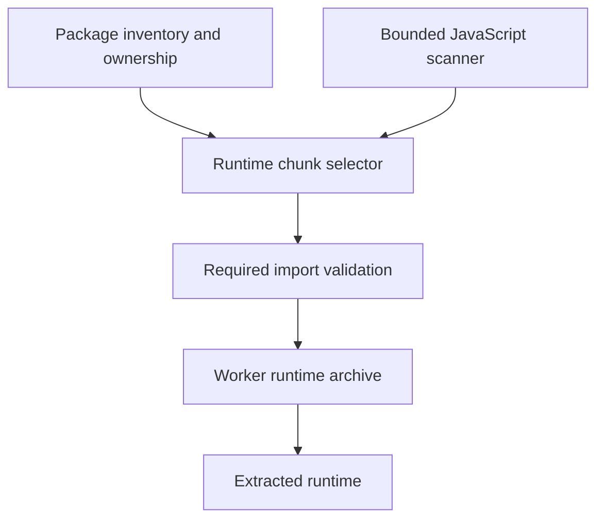

Codex review: needs maintainer review before merge.

## What this changes

This PR retains runtime chunks referenced through optional aliased loaders without treating ordinary path arguments as required imports.

**Example:** A retained entry calls load?.(`./opaque-A1b2C3.mjs`) using an aliased createRequire loader.
- **Before:** Bootstrap can omit the chunk, causing MODULE_NOT_FOUND when the extracted runtime starts.
- **After:** Bootstrap retains the chunk and its transitive dependencies.

## Review scores

| Measure | Result | What it means |
|---|---|---|
| **Overall readiness** | 🦐 gold shrimp **(3/6)** | The focused patch is sound on source review, with useful archive-level regression coverage; supplied behavioral evidence remains harness-based. |
| **Proof confidence** | 🦐 gold shrimp **(3/6)** | The collaborator-authored bot PR is outside the ordinary contributor proof gate; its reported Linux/Node regression exercises the real archive builder and extracted fixture launcher, with full-distribution behavior remaining unproven. |
| **Patch quality** | 🐚 platinum hermit **(4/6)** | No actionable review findings were identified. |

## Product

**Kind:** Bug fix · **Worth it:** Yes · **Fix scope:** Complete
**User problem:** A prepared worker runtime can fail to start because a required loader-referenced chunk was omitted.
**Reason:** The source confirms the missing retention path, and the maintainer-authored direction explicitly accepts conservative extra retention without changing configuration or required-import semantics.

## Merge readiness

✅ **Ready for maintainer review**

Keep this PR open: it fixes a source-confirmed chunk-retention bug still present on main, and the previous body-disclosure finding is resolved; no actionable patch defects remain.

**Priority:** P2
**Reviewed head:** `b0fcfc106f20d6199fe38136e73b01c2fca47bb2`

## Before merge

None.

## Findings

None.

### Tests

- Missing end-to-end proof: The supplied evidence covers a synthetic extracted-runtime regression; it does not demonstrate archive preparation from a full built distribution.

<strong>Agent review details</strong>

### How this fits together

Worker runtime preparation consumes the package inventory and chunk-ownership metadata, selects the required import closure, and emits an archive for worker installation.

### Technical review

Best possible solution:

Use the existing bounded scanner to rescue resolvable literal-call chunks while preserving exact import validation and nested-dependency analysis.

Do we have a high-confidence way to reproduce the issue?

Source inspection confirms the missed template-literal alias path, and the body reports the new archive regression failing on base with MODULE_NOT_FOUND and passing on head; no target code was run during this review.

Is this the best way to solve the issue?

This is a small complete fix using the existing scanner and retention owner: required chunks survive pruning, ordinary missing paths remain nonmandatory, and the superseded callback is removed from all callers.

AGENTS.md: found and applied where relevant.

Codex review notes: model internal, reasoning medium; reviewed against [2f504abebddc](https://github.com/openclaw/openclaw/commit/2f504abebddca671613ede82dee5a704fd4d9478).

### Provenance checked

- `Root-bundle loader analysis and scanner callbacks` changes intended behavior with a stated reason (bfc4c09267ee5909ce050f80eed56c0f704523a3: Reuse bounded scanner facts while retaining full analysis for Node loaders.)
- `Hash-checked private-chunk omission and transitive runtime retention` keeps the original intent (6d9e21892eeabd8902913db4d2a9b0602a51278a: Allow source builds containing private QA tooling to produce complete worker runtimes without transferring excluded tooling.)

### Testing

Proof path: in-process harness.

### Security

None.

### Evidence

What I checked:

- **Pinned introduction:** The introduced diff replaces the loader-reference callback with literal-call collection, removes the root-bundle scope scan, and preserves the nested-dependency fallback. ([`src/gateway/worker-environments/node-bootstrap-runtime-chunks.ts:74`](https://github.com/openclaw/openclaw/blob/b0fcfc106f20d6199fe38136e73b01c2fca47bb2/src/gateway/worker-environments/node-bootstrap-runtime-chunks.ts#L74), [b0fcfc106f20](https://github.com/openclaw/openclaw/commit/b0fcfc106f20d6199fe38136e73b01c2fca47bb2))
- **Current-main behavior:** Fetched main still routes loader-bearing root files through collectPackageRootImports, whose literal import recording accepts string literals but misses the reported template-literal alias call. ([`src/gateway/worker-environments/node-bootstrap-runtime-chunks.ts:91`](https://github.com/openclaw/openclaw/blob/2f504abebddca671613ede82dee5a704fd4d9478/src/gateway/worker-environments/node-bootstrap-runtime-chunks.ts#L91), [2f504abebddc](https://github.com/openclaw/openclaw/commit/2f504abebddca671613ede82dee5a704fd4d9478))
- **Regression boundary:** The added optional-loader case prepares and extracts an archive, executes its fixture launcher, and checks retained transitive chunks; the separate negative case protects ordinary missing path arguments. ([`src/gateway/worker-environments/node-bootstrap-artifact.test.ts:436`](https://github.com/openclaw/openclaw/blob/b0fcfc106f20d6199fe38136e73b01c2fca47bb2/src/gateway/worker-environments/node-bootstrap-artifact.test.ts#L436), [b0fcfc106f20](https://github.com/openclaw/openclaw/commit/b0fcfc106f20d6199fe38136e73b01c2fca47bb2))
- **Original design and accepted tradeoff:** https://github.com/openclaw/openclaw/pull/149926 established hash-checked omission with required-chunk rescue; https://github.com/openclaw/openclaw/pull/184348 reduced duplicate parsing. This maintainer-authored PR explicitly accepts conservative extra retention while preserving strict import validation. ([`src/gateway/worker-environments/node-bootstrap-runtime-chunks.ts:90`](https://github.com/openclaw/openclaw/blob/bfc4c09267ee5909ce050f80eed56c0f704523a3/src/gateway/worker-environments/node-bootstrap-runtime-chunks.ts#L90), [bfc4c09267ee](https://github.com/openclaw/openclaw/commit/bfc4c09267ee5909ce050f80eed56c0f704523a3))
- **Previous finding resolved:** The current body removes the model and hosted-workflow disclosure. Its remaining review tool, scope, coverage, and outcome match the repository's review-evidence instructions; the eligible optional Team provenance link creates no finding. Public docs: [`docs/reference/pull-request-review-flow.md`](https://docs.openclaw.ai/reference/pull-request-review-flow). ([`docs/reference/pull-request-review-flow.md:55`](https://docs.openclaw.ai/reference/pull-request-review-flow), [b0fcfc106f20](https://github.com/openclaw/openclaw/commit/b0fcfc106f20d6199fe38136e73b01c2fca47bb2))
- **Live review state:** GitHub reports the reviewed head as open, non-draft, and mergeable. Paginated check reads found no failed check; dispatch remains queued and CodeQL is neutral. ([b0fcfc106f20](https://github.com/openclaw/openclaw/commit/b0fcfc106f20d6199fe38136e73b01c2fca47bb2))

Likely related people:

- **Peter Steinberger:** Raw commit bfc4c09267ee5909ce050f80eed56c0f704523a3 adds src/gateway/worker-environments/node-bootstrap-runtime-chunks.ts:92 relative to its recorded parents. This identifies author metadata, not feature responsibility or a PR merger. (role: source-line author; confidence: high; commits: [bfc4c09267ee](https://github.com/openclaw/openclaw/commit/bfc4c09267ee5909ce050f80eed56c0f704523a3); files: `src/gateway/worker-environments/node-bootstrap-runtime-chunks.ts`)
- **Patrick Erichsen:** Raw commit 89b85fd7c733469db8cbe589dd61acd07c26a20b adds src/gateway/worker-environments/node-bootstrap-runtime-chunks.ts:56 relative to its recorded parents. This identifies author metadata, not feature responsibility or a PR merger. (role: source-line author; confidence: medium; commits: [89b85fd7c733](https://github.com/openclaw/openclaw/commit/89b85fd7c733469db8cbe589dd61acd07c26a20b); files: `src/gateway/worker-environments/node-bootstrap-runtime-chunks.ts`)
- **Free Wortley:** Raw commit c525b86a79b07070b67feca692bf1a6c49c933a0 adds src/gateway/worker-environments/node-bootstrap-runtime-chunks.ts:35 relative to its recorded parents. This identifies author metadata, not feature responsibility or a PR merger. (role: source-line author; confidence: medium; commits: [c525b86a79b0](https://github.com/openclaw/openclaw/commit/c525b86a79b07070b67feca692bf1a6c49c933a0); files: `src/gateway/worker-environments/node-bootstrap-runtime-chunks.ts`)

### PR surface

Source 0, Tests +17, Other +3. Total +20 across 6 files. Added test files: 0.

View PR surface stats

| Area | Files | Added | Removed | Net |
|---|---:|---:|---:|---:|
| Source | 1 | 7 | 7 | 0 |
| Tests | 2 | 34 | 17 | +17 |
| Docs | 0 | 0 | 0 | 0 |
| Config | 0 | 0 | 0 | 0 |
| Generated | 0 | 0 | 0 | 0 |
| Other | 3 | 13 | 10 | +3 |
| **Total** | **6** | **54** | **34** | **+20** |

### Review metrics

| Metric | Value | Why it matters |
|---|---|---|
| **Production versus test growth** | Production +1 net line; tests +17 net lines | The change replaces existing scanning machinery and adds focused coverage for omitted chunks and false required-import edges. |

### Labels

Label changes:

- add `status: 👀 ready for maintainer look`: ClawSweeper has no concrete contributor-facing blocker left for this PR.
- remove `status: ⏳ waiting on author`: Current PR status label is `status: 👀 ready for maintainer look`.

Label justifications:

- `P2`: The bug affects worker archive preparation for a specific loader and chunk-ownership combination.
- `rating: 🦐 gold shrimp`: Overall readiness is 🦐 gold shrimp; proof is 🦐 gold shrimp and patch quality is 🐚 platinum hermit.
- `status: 👀 ready for maintainer look`: ClawSweeper has no concrete contributor-facing blocker left for this PR.

### Rating scale

6/6 🦀 challenger crab · 5/6 🦞 diamond lobster · 4/6 🐚 platinum hermit · 3/6 🦐 gold shrimp · 2/6 🦪 silver shellfish · 1/6 🧂 unranked krab. Overall follows the weaker of proof and patch quality; ✨ marks media proof (a screenshot, video, or linked artifact) that directly shows the changed behavior.

### Workflow

ClawSweeper edits this one comment on every review. Comment `@clawsweeper re-review` for a fresh review only. Repair and merge execution lanes are retired.

### History

Review history (1 earlier review cycle)

<!-- clawsweeper-review-history v=1 total=1 -->
- reviewed 2026-10-30T19:52:20.064Z sha b0fcfc106f20d6199fe38136e73b01c2fca47bb2 :: needs changes before merge. :: [P3] Remove the model and review-workflow disclosure from the PR body

_Reviewed October 30, 2026, 4:15 PM ET / 20:15 UTC (Revision 2)._

<!-- clawsweeper-verdict:needs-human item=188645 sha=b0fcfc106f20d6199fe38136e73b01c2fca47bb2 confidence=high updated_at=2026-10-30T20:11:36Z reviewed_at=2026-10-30T20:15:46.563Z lease_owner=github-run-41121072520-1 lease_comment_id=6532477448 source_revision=ee5bca2150c50445124630aee25f085a684ffdad08c4126b03ebf91bf31a1276 hold=not_opted_in findings=0 -->
<!-- clawsweeper-review-state:ready item=188645 sha=b0fcfc106f20d6199fe38136e73b01c2fca47bb2 v=1 -->

<!-- clawsweeper-review-version item=188645 reviewed_at=2026-10-30T20:15:46.563Z sha=b0fcfc106f20d6199fe38136e73b01c2fca47bb2 source_revision=ee5bca2150c50445124630aee25f085a684ffdad08c4126b03ebf91bf31a1276 lease_owner=github-run-41121072520-1 lease_comment_id=6532477448 v=1 -->

<!-- clawsweeper-review item=188645 -->