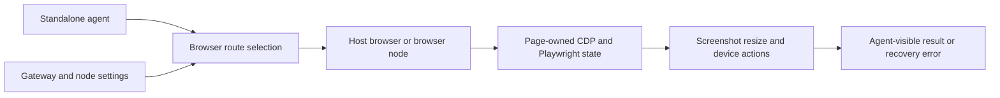

Codex review: found issues before merge. _Reviewed September 1, 2026, 8:47 PM ET / September 2, 2026, 00:47 UTC._

# ClawSweeper review

## What this changes

The PR routes unpinned standalone browser calls to the local host, preserves screenshot geometry through Playwright page ownership, and serializes interrupted screenshot, resize, and device-emulation operations.

## Regression provenance

Possible regression — suspected (reviewed change). No predecessor PR is attributed.

## Merge readiness

⚠️ **Ready for maintainer review - 4 items remain**

Keep open: the prior P1 compatibility finding remains on the exact current head. An existing standalone setup with only a local Gateway port is now forced to the host browser instead of performing its former node discovery, despite the added `mode="auto"` guidance requiring an upgrade-time configuration change.

**Priority:** P1
**Reviewed head:** `2fc9fa3b14d78369ceeeaf719864b93a662f212a`
**Owner decision:** Required. See [Decision needed](#decision-needed).

## Review scores

| Measure | Result | What it means |
|---|---|---|
| **Overall readiness** | 🦐 gold shrimp **(3/6)** | The screenshot and interruption work has substantial test coverage, but the unresolved P1 default-routing regression prevents a merge-ready rating. |
| **Proof confidence** | 🌊 off-meta tidepool | Not applicable: Not applicable under the stated MEMBER authorship; the PR body nevertheless supplies claimed real Chromium geometry and recovery evidence. The remaining blocker is the source-proven routing upgrade regression, not missing contributor proof. |
| **Patch quality** | 🦐 gold shrimp **(3/6)** | 1 actionable review finding remain. |

## Verification

| Check | Result | Evidence |
|---|---|---|
| **Real behavior** | Not applicable | Not applicable: Not applicable under the stated MEMBER authorship; the PR body nevertheless supplies claimed real Chromium geometry and recovery evidence. The remaining blocker is the source-proven routing upgrade regression, not missing contributor proof. |
| **Evidence reviewed** | 6 items | Introduced compatibility change: The introduced condition returns the host route when no explicit node policy exists and the caller is standalone, including a configuration that only supplies a local Gateway port. Current-main baseline: Current main unconditionally called node discovery after the existing manual/off and explicit-target checks; it did not classify a local-port-only standalone configuration as host-only. Regression test encodes the changed behavior: The added standalone-routing table explicitly expects a local-port-only configuration to use the host and not call node discovery, so it does not preserve the former upgrade behavior. |
| **Findings** | 1 actionable finding | [P1] Preserve standalone node routing for local Gateway upgrades |
| **Security** | None | None. |

## How this fits together

The browser plugin selects a host, sandbox, or Gateway/node browser target before issuing page actions. Screenshot, resize, and device changes then share per-page Playwright/CDP state that determines rendered geometry and recovery after interruption.

## Decision needed

| Question | Recommendation |
|---|---|
| Should standalone configurations with only a local Gateway port preserve their existing automatic browser-node discovery, or should host-first routing become an intentional upgrade policy? | **Preserve local Gateway discovery:** Keep node discovery for the existing local-Gateway configuration and use host routing only when no Gateway route is selected. |

Why: The branch changes a default route for existing configurations, and the new opt-in `mode="auto"` instruction does not establish that operators accept the resulting behavior change.

## Before merge

- [ ] **Preserve standalone node routing for local Gateway upgrades (P1)** - A standalone configuration with only `gateway.port` previously reached `listNodes`, but this introduced branch now returns the host route before discovery. Users with a reachable browser node and no usable host browser can fail or control a different browser; the new `mode="auto"` documentation is an upgrade-time configuration change, not compatibility preservation.
- [ ] **Resolve merge risk (P1)** - Merging changes the default for existing standalone configurations that specify only a local Gateway port: a reachable browser node may be bypassed in favor of an unavailable or different host browser.
- [ ] **Resolve merge risk (P1)** - The bug-fix branch has a production net increase of 66 lines; it is partly offset by removing the former viewport-restoration path, but the added public routing fact and queue lifecycle should be accepted only with the routing policy decision.

## Findings

- [P1] Preserve standalone node routing for local Gateway upgrades — `extensions/browser/src/browser-tool.routing.ts:53-58`

<strong>Agent review details</strong>

### Security

None.

### PR surface

Source +66, Tests +307, Docs +22, Other +2. Total +397 across 31 files.

View PR surface stats

| Area | Files | Added | Removed | Net |
|---|---:|---:|---:|---:|
| Source | 15 | 281 | 215 | +66 |
| Tests | 11 | 569 | 262 | +307 |
| Docs | 3 | 22 | 0 | +22 |
| Config | 0 | 0 | 0 | 0 |
| Generated | 0 | 0 | 0 | 0 |
| Other | 2 | 5 | 3 | +2 |
| **Total** | **31** | **877** | **480** | **+397** |

### Review metrics

| Metric | Value | Why it matters |
|---|---|---|
| **Production versus test delta** | production +281/-215 (net +66); tests/support +569/-262 (net +307); docs +22; tooling +2 | The branch removes the old screenshot restoration path but adds routing ownership and page-transition lifecycle code, so its production growth merits the compatibility decision above. |

### Merge-risk options

**Maintainer options:**
1. **Restore compatible standalone discovery (recommended)**  
   Preserve the prior local-Gateway node-discovery path for local-port-only standalone configurations and add an upgrade regression test.
2. **Accept host-first as policy**  
   Document and support the upgrade from implicit local Gateway discovery to explicit automatic routing before merging.

### Technical review

Best possible solution:

Retain existing automatic node discovery for an available local Gateway unless the operator explicitly selects host routing, or make host-first an explicit supported upgrade with a migration and compatibility proof.

Do we have a high-confidence way to reproduce the issue?

Yes, from source: run an unpinned standalone browser action with only a local Gateway port and an available browser node; current main calls node discovery, while this branch returns the host route first. The review worker did not execute it because the read-only environment could not start Corepack.

Is this the best way to solve the issue?

No: the screenshot and interruption repair is coherent, but the routing change is not the best complete fix until it preserves existing local-Gateway discovery or maintainers explicitly approve the upgrade behavior.

Full review comments:

- [P1] Preserve standalone node routing for local Gateway upgrades — `extensions/browser/src/browser-tool.routing.ts:53-58`
  A standalone configuration with only `gateway.port` previously reached `listNodes`, but this introduced branch now returns the host route before discovery. Users with a reachable browser node and no usable host browser can fail or control a different browser; the new `mode="auto"` documentation is an upgrade-time configuration change, not compatibility preservation.
  Confidence: 0.98

Overall correctness: patch is incorrect
Overall confidence: 0.96

AGENTS.md: found and applied where relevant.

Codex review notes: model internal, reasoning high; reviewed against [c7277fb99e69](https://github.com/openclaw/openclaw/commit/c7277fb99e6960ac7e61d8b31eda38fc18d16399).

### Labels

Label justifications:

- `P1`: The changed default can disrupt active standalone browser-agent workflows that previously reached an available browser node.
- `merge-risk: 🚨 compatibility`: A local-port-only Gateway configuration changes from implicit node discovery to host routing without preserving the existing behavior or providing an upgrade migration.
- `rating: 🦐 gold shrimp`: Overall readiness is 🦐 gold shrimp; proof is 🌊 off-meta tidepool and patch quality is 🦐 gold shrimp.
- `status: ⏳ waiting on author`: ClawSweeper has contributor-facing work open and is waiting for author action. Not applicable: Not applicable under the stated MEMBER authorship; the PR body nevertheless supplies claimed real Chromium geometry and recovery evidence. The remaining blocker is the source-proven routing upgrade regression, not missing contributor proof.

### Evidence

What I checked:

- **Introduced compatibility change:** The introduced condition returns the host route when no explicit node policy exists and the caller is standalone, including a configuration that only supplies a local Gateway port. ([`extensions/browser/src/browser-tool.routing.ts:53`](https://github.com/openclaw/openclaw/blob/2fc9fa3b14d78369ceeeaf719864b93a662f212a/extensions/browser/src/browser-tool.routing.ts#L53), [2fc9fa3b14d7](https://github.com/openclaw/openclaw/commit/2fc9fa3b14d78369ceeeaf719864b93a662f212a))
- **Current-main baseline:** Current main unconditionally called node discovery after the existing manual/off and explicit-target checks; it did not classify a local-port-only standalone configuration as host-only. ([`extensions/browser/src/browser-tool.routing.ts:49`](https://github.com/openclaw/openclaw/blob/c7277fb99e6960ac7e61d8b31eda38fc18d16399/extensions/browser/src/browser-tool.routing.ts#L49), [c7277fb99e69](https://github.com/openclaw/openclaw/commit/c7277fb99e6960ac7e61d8b31eda38fc18d16399))
- **Regression test encodes the changed behavior:** The added standalone-routing table explicitly expects a local-port-only configuration to use the host and not call node discovery, so it does not preserve the former upgrade behavior. ([`extensions/browser/src/browser-tool.test.ts:2373`](https://github.com/openclaw/openclaw/blob/2fc9fa3b14d78369ceeeaf719864b93a662f212a/extensions/browser/src/browser-tool.test.ts#L2373), [2fc9fa3b14d7](https://github.com/openclaw/openclaw/commit/2fc9fa3b14d78369ceeeaf719864b93a662f212a))
- **Prior finding remains unfixed:** The routing file has no changes after the earlier reviewed head, so the previously reported standalone node-routing blocker remains applicable. ([`extensions/browser/src/browser-tool.routing.ts:53`](https://github.com/openclaw/openclaw/blob/2fc9fa3b14d78369ceeeaf719864b93a662f212a/extensions/browser/src/browser-tool.routing.ts#L53), [2fc9fa3b14d7](https://github.com/openclaw/openclaw/commit/2fc9fa3b14d78369ceeeaf719864b93a662f212a))
- **Documented upgrade requirement:** The new browser documentation tells standalone users to set `gateway.nodes.browser.mode="auto"` to retain local Gateway node discovery. Public docs: [`docs/tools/browser.md`](https://docs.openclaw.ai/tools/browser). ([`docs/tools/browser.md:500`](https://docs.openclaw.ai/tools/browser), [2fc9fa3b14d7](https://github.com/openclaw/openclaw/commit/2fc9fa3b14d78369ceeeaf719864b93a662f212a))
- **Read-only environment limitation:** `pnpm docs:list` could not start because Corepack attempted to create its cache on the read-only filesystem; no target tests were run by this review worker.

Likely related people:

- **Peter Steinberger:** Raw commit bb51e903325f6c7d0c8609805040df920e0c4908 adds extensions/browser/src/browser-tool.routing.ts:45 relative to its recorded parents. This identifies author metadata, not feature responsibility or a PR merger. (role: source-line author; confidence: high; commits: [bb51e903325f](https://github.com/openclaw/openclaw/commit/bb51e903325f6c7d0c8609805040df920e0c4908); files: `extensions/browser/src/browser-tool.routing.ts`)

### Rank-up moves

Optional improvements that raise the rating; they are not merge blockers.

- Resolve the local-Gateway host-first policy, then update the routing implementation and focused upgrade coverage for the chosen behavior.

### Rating scale

| Score | Internal tier | Crab rank | Meaning |
|---:|:---:|---|---|
| **6/6** | S | 🦀 challenger crab | Exceptional readiness |
| **5/6** | A | 🦞 diamond lobster | Very strong readiness |
| **4/6** | B | 🐚 platinum hermit | Good normal PR; ordinary maintainer review |
| **3/6** | C | 🦐 gold shrimp | Useful, but confidence is limited |
| **2/6** | D | 🦪 silver shellfish | Proof or implementation needs work |
| **1/6** | F | 🧂 unranked krab | Not merge-ready |
| N/A | NA | 🌊 off-meta tidepool | Rating does not apply |

Overall follows the weaker of proof and patch quality.
Shiny media proof means a screenshot, video, or linked artifact directly shows the changed behavior. Runtime, network, CSP, and security claims still need visible diagnostics.

### Workflow

- ClawSweeper keeps one durable marker-backed review comment per issue or PR.
- Re-runs edit this comment so the latest verdict, findings, and automation markers stay together instead of adding duplicate bot comments.
- A fresh review can be triggered by eligible `@clawsweeper re-review` comments, exact-item GitHub events, scheduled/background review runs, or manual workflow dispatch.
- PR/issue authors and users with repository write access can comment `@clawsweeper re-review` or `@clawsweeper re-run` on an open PR or issue to request a fresh review only.
- Maintainers can also comment `@clawsweeper review` to request a fresh review only.
- Fresh-review commands do not start repair, autofix, rebase, CI repair, or automerge.
- Maintainer-only repair and merge flows require explicit commands such as `@clawsweeper autofix`, `@clawsweeper automerge`, `@clawsweeper fix ci`, or `@clawsweeper address review`.
- Maintainers can comment `@clawsweeper explain` to ask for more context, or `@clawsweeper stop` to stop active automation.

### History

Review history (2 earlier review cycles)

<!-- clawsweeper-review-history v=1 total=2 -->
- reviewed 2026-09-01T23:45:18.257Z sha f756c83776a6a7a9b1b1cfd1d30a2a5fd3c0068b :: found issues before merge. :: [P1] Release the page queue after an owner-session screenshot timeout
- reviewed 2026-09-02T00:40:31.498Z sha 2fc9fa3b14d78369ceeeaf719864b93a662f212a :: found issues before merge. :: [P1] Preserve existing standalone node routing on upgrade

<!-- clawsweeper-verdict:needs-human item=135315 sha=2fc9fa3b14d78369ceeeaf719864b93a662f212a confidence=high updated_at=2026-09-02T00:44:33Z reviewed_at=2026-09-02T00:47:41.794Z lease_owner=github-run-33576447297-1 lease_comment_id=5502618662 source_revision=24cf36d8154b02c7fafcf14bcae770713e60ecd6d4876a99867140cb93625b10 live_verification=absent -->

<!-- clawsweeper-review-version item=135315 reviewed_at=2026-09-02T00:47:41.794Z sha=2fc9fa3b14d78369ceeeaf719864b93a662f212a source_revision=24cf36d8154b02c7fafcf14bcae770713e60ecd6d4876a99867140cb93625b10 lease_owner=github-run-33576447297-1 lease_comment_id=5502618662 v=1 -->

<!-- clawsweeper-review item=135315 -->