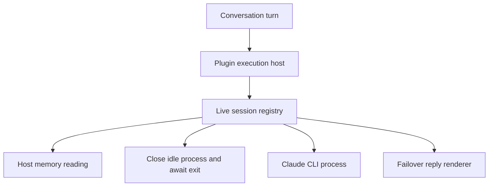

Codex review: needs maintainer review before merge.

## What this changes

This PR closes idle warm CLI sessions under memory pressure and refuses new sessions with an actionable memory-specific message when necessary.

**Example:** A fifth Claude CLI conversation starts with four warm processes and 424 MiB available.
- **Before:** Another process starts despite the host's low memory.
- **After:** An idle process closes, available memory rises to 1124 MiB in the supplied trace, and the new conversation replies.

## Review scores

| Measure | Result | What it means |
|---|---|---|
| **Overall readiness** | 🐚 platinum hermit **(4/6)** | A focused fix with relevant Gateway evidence and distinct regression coverage; the live memory-pressure scenario uses simulated readings rather than actual Linux exhaustion. |
| **Proof confidence** | 🐚 platinum hermit **(4/6)** | Sufficient (logs): Supplied isolated-Gateway traces exercise real Claude processes through openclaw agent under simulated memory readings, covering idle eviction, successful reuse, and all-busy refusal; later production changes preserve the diagnosis through regression-tested reply rendering, and the latest head changes only tests. |
| **Patch quality** | 🦞 diamond lobster **(5/6)** | No actionable review findings were identified. |

## Product

**Kind:** Bug fix · **Worth it:** Yes · **Fix scope:** Complete
**User problem:** Several Claude CLI conversations can exhaust host memory and leave the Gateway unable to make useful progress.
**Reason:** The reported operational failure warrants a bounded admission safeguard, and collaborator authorship establishes direction for the documented resource tradeoff.

## Merge readiness

✅ **Ready for maintainer review**

This PR addresses a concrete host-memory failure that current main still permits; the earlier reply-copy finding is fixed, and no introduced correctness defect was found.

**Priority:** P1
**Reviewed head:** `29d424bdc3bdc497feaa6c0e72b87947d1a8229c`

## Before merge

None.

## Findings

None.

<strong>Agent review details</strong>

### How this fits together

The Gateway's plugin execution host delegates warm-process ownership to the live-session registry, which now checks host memory before admitting another process and sends refusal facts through the shared failover renderer.

### Technical review

Best possible solution:

Land the focused registry-owned admission check and shared failure copy after the existing CI gate passes.

Do we have a high-confidence way to reproduce the issue?

Current main limits warm sessions by count alone, allowing additional processes despite low host memory; the incident report and supplied Gateway trace substantiate that path without a reviewer-run reproduction.

Is this the best way to solve the issue?

The change uses the existing capacity, cleanup, and reply-copy owners, preserves busy sessions and compatible reuse, and adds two regressions for distinct eviction and refusal failures.

AGENTS.md: found and applied where relevant.

Codex review notes: model internal, reasoning medium; reviewed against [ff8fe07318eb](https://github.com/openclaw/openclaw/commit/ff8fe07318eb597ceb8178a81b218c8884695410).

### Provenance checked

- `Warm-session capacity and eviction` changes intended behavior with a stated reason (12d0fd2ef8afa92c5c9480de0f090e34488d565e: Keep compatible CLI processes warm under one host-owned registry with a fixed capacity bound.)
- `Process retirement and cleanup` keeps the original intent (bcef3b3526dd1d015e0b1c1030a1dea12cf1b517: Do not release or replace owned work until its resource cleanup is confirmed.)
- `Canonical failure copy and cooldown privacy` keeps the original intent (c0effea2ca1b42329a2eb8ce7e80553a71af4589: Keep saved-login diagnostics private while preserving useful recovery guidance through the shared renderer.)
- `Structured CLI failure guidance` keeps the original intent (e60fbe9362af72cddeb03db3ace680080754d814: Preserve a specific CLI diagnostic as actionable user-facing copy rather than a generic failure.)

### Testing

Proof path: shipped entry point.

### Security

None.

### Evidence

What I checked:

- **Introduced patch and current main:** The pinned introduction adds memory admission, LRU ordering, and structured failure copy; the affected production files on fetched main retain the merge-base behavior without these changes. ([`src/agents/cli-runner/cli-live-session-registry.ts:196`](https://github.com/openclaw/openclaw/blob/29d424bdc3bdc497feaa6c0e72b87947d1a8229c/src/agents/cli-runner/cli-live-session-registry.ts#L196), [29d424bdc3bd](https://github.com/openclaw/openclaw/commit/29d424bdc3bdc497feaa6c0e72b87947d1a8229c))
- **Production-path proof:** The PR body supplies isolated-Gateway output through openclaw agent with real Claude processes and simulated host-memory readings: idle eviction restores headroom, compatible reuse performs no eviction, and all-busy refusal leaves the running turns able to complete. ([a646b6b806c9](https://github.com/openclaw/openclaw/commit/a646b6b806c92239adda5da0d3566e2bda5bd62a))
- **Prior finding resolved:** The host-memory error code reaches both the shared code renderer and rate-limit reply renderer; the added execution-boundary regression checks the final reply summary. The latest commit changes only test setup and its allocation record. ([`src/agents/failover/user-copy.ts:411`](https://github.com/openclaw/openclaw/blob/29d424bdc3bdc497feaa6c0e72b87947d1a8229c/src/agents/failover/user-copy.ts#L411), [29d424bdc3bd](https://github.com/openclaw/openclaw/commit/29d424bdc3bdc497feaa6c0e72b87947d1a8229c))
- **Accepted availability tradeoff:** The collaborator-authored PR explicitly accepts cold starts after idle eviction and refusal below 1 GiB when no idle process can restore headroom; it also documents concurrent-start and container-memory limitations. ([`src/agents/cli-runner/cli-live-session-registry.ts:19`](https://github.com/openclaw/openclaw/blob/29d424bdc3bdc497feaa6c0e72b87947d1a8229c/src/agents/cli-runner/cli-live-session-registry.ts#L19), [29d424bdc3bd](https://github.com/openclaw/openclaw/commit/29d424bdc3bdc497feaa6c0e72b87947d1a8229c))
- **Existing lifecycle contract:** The registry introduced by https://github.com/openclaw/openclaw/pull/128131 owns warm-process capacity; https://github.com/openclaw/openclaw/pull/139657 requires retained cleanup evidence. Memory eviction reuses closeRecord and waits for that cleanup rather than introducing another process owner. ([`src/agents/cli-runner/cli-live-session-registry.ts:127`](https://github.com/openclaw/openclaw/blob/bcef3b3526dd1d015e0b1c1030a1dea12cf1b517/src/agents/cli-runner/cli-live-session-registry.ts#L127), [bcef3b3526dd](https://github.com/openclaw/openclaw/commit/bcef3b3526dd1d015e0b1c1030a1dea12cf1b517))
- **Related request remains distinct:** https://github.com/openclaw/openclaw/issues/161050 requests broader spawn and cron admission with cgroup pressure, queueing, and configurable policy; this PR narrowly protects warm CLI process admission and does not complete that request.

### PR surface

Source +66, Tests +72, Other +2. Total +140 across 6 files. Added test files: 0.

View PR surface stats

| Area | Files | Added | Removed | Net |
|---|---:|---:|---:|---:|
| Source | 4 | 73 | 7 | +66 |
| Tests | 1 | 75 | 3 | +72 |
| Docs | 0 | 0 | 0 | 0 |
| Config | 0 | 0 | 0 | 0 |
| Generated | 0 | 0 | 0 | 0 |
| Other | 1 | 2 | 0 | +2 |
| **Total** | **6** | **150** | **10** | **+140** |

### Labels

Label changes:

No label changes.

Label justifications:

- `P1`: The reported accumulation of warm Claude processes left a real Gateway host thrashing until reboot.
- `merge-risk: 🚨 availability`: The new 1 GiB admission floor can refuse additional CLI conversations on constrained hosts; the collaborator-authored PR explicitly accepts this behavior to protect host availability.
- `rating: 🐚 platinum hermit`: Overall readiness is 🐚 platinum hermit; proof is 🐚 platinum hermit and patch quality is 🦞 diamond lobster.
- `status: 👀 ready for maintainer look`: ClawSweeper has no concrete contributor-facing blocker left for this PR.
- `proof: sufficient`: Contributor real behavior proof is sufficient.

### Rating scale

6/6 🦀 challenger crab · 5/6 🦞 diamond lobster · 4/6 🐚 platinum hermit · 3/6 🦐 gold shrimp · 2/6 🦪 silver shellfish · 1/6 🧂 unranked krab. Overall follows the weaker of proof and patch quality; ✨ marks media proof (a screenshot, video, or linked artifact) that directly shows the changed behavior.

### Workflow

ClawSweeper edits this one comment on every review. Comment `@clawsweeper re-review` for a fresh review only. Repair and merge execution lanes are retired.

### History

Review history (2 earlier review cycles)

<!-- clawsweeper-review-history v=1 total=2 -->
- reviewed 2026-11-04T04:43:15.064Z sha a646b6b806c92239adda5da0d3566e2bda5bd62a :: needs changes before merge. :: [P2] Preserve the host-memory diagnosis in channel replies
- reviewed 2026-11-04T05:33:16.635Z sha fe0a5140ba62155cdbac198c475b4d3273f28be2 :: needs maintainer review before merge. :: none

_Reviewed November 4, 2026, 12:42 AM ET / 05:42 UTC (Revision 3)._

<!-- clawsweeper-verdict:needs-human item=192534 sha=29d424bdc3bdc497feaa6c0e72b87947d1a8229c confidence=high updated_at=2026-11-04T05:39:07Z reviewed_at=2026-11-04T05:42:56.405Z lease_owner=github-run-41780469391-1 lease_comment_id=6623518681 source_revision=9514c0763dd442743a553d16bac49f094fb3e74db799914d475b70b44439ed38 hold=not_opted_in findings=0 -->
<!-- clawsweeper-review-state:ready item=192534 sha=29d424bdc3bdc497feaa6c0e72b87947d1a8229c v=1 -->

<!-- clawsweeper-review-version item=192534 reviewed_at=2026-11-04T05:42:56.405Z sha=29d424bdc3bdc497feaa6c0e72b87947d1a8229c source_revision=9514c0763dd442743a553d16bac49f094fb3e74db799914d475b70b44439ed38 lease_owner=github-run-41780469391-1 lease_comment_id=6623518681 v=1 -->

<!-- clawsweeper-review item=192534 -->