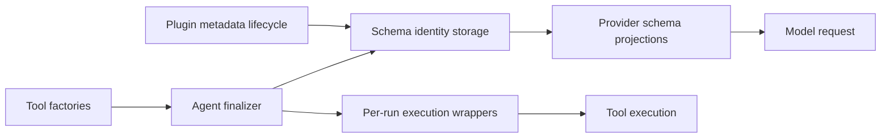

Codex review: needs changes before merge.

## What this changes

Reuses tool-schema projections across catalogs and sessions while preserving separate provider variants and per-run execution bindings.

**Example:** The reported benchmark prepares 72 tools across 24 catalogs and 96 sessions.
- **Before:** Warm runs perform 180 schema projections each.
- **After:** Warm runs perform zero schema projections, with identical serialized provider payloads.

## Review scores

| Measure | Result | What it means |
|---|---|---|
| **Overall readiness** | 🦐 gold shrimp **(3/6)** | The owner-level measurements support the optimization, but exact-head CI exposes an unadapted consumer fixture. |
| **Proof confidence** | 🦐 gold shrimp **(3/6)** | This maintainer-authored PR is outside the ordinary contributor proof gate; its reported measurements cover real factory/finalizer settlement and provider serialization, without claiming Gateway latency. |
| **Patch quality** | 🦐 gold shrimp **(3/6)** | 1 actionable review finding remain. |

## Product

**Kind:** Performance · **Worth it:** Yes · **Fix scope:** Complete
**User problem:** Plugin-heavy agent runs repeat unchanged schema preparation, adding CPU work and transient allocation.
**Reason:** The maintainer-authored direction removes measured repeated work using existing schema owners without adding settings, changing provider payloads, or retaining execution authority.

## Merge readiness

⛔ **Needs changes before merge - 1 item remains**

This PR provides a useful, owner-directed optimization, but its publication lifecycle change breaks two existing digest-cache tests in current-head CI.

**Priority:** P2
**Reviewed head:** `1a160d4fda6260bfb6fc601cde125b7eead12959`

## Before merge

- [ ] **Update digest-cache fixtures for the new publication lifecycle (P2)** - The sessionless helper now triggers immediate publication, but the first returned tool still contains its unpublished schema; the next call substitutes the detached published copy. Consequently, the unchanged warm-identity assertion at line 62 fails, and the oversized-summary test performs an extra schema hash at line 90. Both failures appear in exact-head CI job checks-node-changed-compact-large-9. Update this fixture to warm and settle publication before comparing measured warm runs, retaining the identity and digest-reuse assertions rather than loosening their expectations.

## Findings

- [P2] Update digest-cache fixtures for the new publication lifecycle — `src/agents/system-prompt-report.tool-digest-cache.test.ts:33-35`

### Tests

- Missing end-to-end proof: The supplied performance evidence exercises factory/finalizer settlement rather than a shipped Gateway/model request; the reported Screen E2E covers requester routing.

<strong>Agent review details</strong>

### How this fits together

Tool factories supply schemas and executors to agent finalization, which prepares provider-compatible definitions and binds the current run's hooks, authority, and cancellation.

### Technical review

Best possible solution:

Keep the schema-owner optimization and update the digest-cache fixtures to compare settled warm publications without weakening their reuse assertions.

Do we have a high-confidence way to reproduce the issue?

Current-main source shows catalog-dependent snapshot misses, and exact-head CI independently demonstrates the two digest-cache failures; no target code was executed during this review.

Is this the best way to solve the issue?

Schema identity is the appropriate reuse boundary because normalization inputs remain keyed separately and executable bindings stay per run; the existing digest-cache consumer tests must follow the changed publication lifecycle.

Full review comments:

- [P2] Update digest-cache fixtures for the new publication lifecycle — `src/agents/system-prompt-report.tool-digest-cache.test.ts:33-35`
  The sessionless helper now triggers immediate publication, but the first returned tool still contains its unpublished schema; the next call substitutes the detached published copy. Consequently, the unchanged warm-identity assertion at line 62 fails, and the oversized-summary test performs an extra schema hash at line 90. Both failures appear in exact-head CI job checks-node-changed-compact-large-9. Update this fixture to warm and settle publication before comparing measured warm runs, retaining the identity and digest-reuse assertions rather than loosening their expectations.
  Confidence: 0.99

Overall correctness: patch is incorrect
Overall confidence: 0.95

AGENTS.md: found and applied where relevant.

Codex review notes: model internal, reasoning medium; reviewed against [266002c36f75](https://github.com/openclaw/openclaw/commit/266002c36f7513a9a93f2dc24a2a5797d50207d7).

### Provenance checked

- `Descriptor publication and finalization` changes intended behavior with a stated reason (https://github.com/openclaw/openclaw/pull/170610: Reuse immutable descriptors after settlement while keeping execution, hooks, cancellation, and permission bindings per attempt.)
- `Finalizer ownership` keeps the original intent (797913cf142e0450b4380fb3db8e1c0d050ae6b7: Consolidate private descriptor preparation into its existing finalization owner while preserving lifecycle clearing and detached publications.)
- `Static bundled-tool definitions` keeps the original intent (https://github.com/openclaw/openclaw/pull/186394: Keep unchanged schema definitions at their factories while binding the current store and caller separately.)
- `Browser and Perplexity capability variants` keeps the original intent (https://github.com/openclaw/openclaw/pull/180279: Keep provider preparation with its consumer while preserving public schema shapes and runtime routing; this PR retains ordered Browser capability variants and separate Perplexity transports.)

### Testing

Proof path: in-process harness.

### Security

None.

### Evidence

Acceptance criteria:

- pnpm test src/agents/system-prompt-report.tool-digest-cache.test.ts src/agents/agent-tools.finalize.test.ts src/agents/agent-tools.prefix-stability.test.ts --maxWorkers=1
- pnpm check:changed --base 6842ccd4bddfd821c8479bcb09df4f65154ac12c
- git diff --check

What I checked:

- **Introduced change:** The pinned introduced diff replaces catalog snapshots with schema-identity storage and moves unchanged bundled schemas to their definition owners. ([`src/agents/agent-tools.finalize.ts:128`](https://github.com/openclaw/openclaw/blob/1a160d4fda6260bfb6fc601cde125b7eead12959/src/agents/agent-tools.finalize.ts#L128), [1a160d4fda62](https://github.com/openclaw/openclaw/commit/1a160d4fda6260bfb6fc601cde125b7eead12959))
- **Exact-head CI failure:** The failed job reports schema-identity failure at line 62 and four digest calls instead of three at line 90 in system-prompt-report.tool-digest-cache.test.ts: https://github.com/openclaw/openclaw/actions/runs/41342686935/job/124956280643. ([`src/agents/system-prompt-report.tool-digest-cache.test.ts:62`](https://github.com/openclaw/openclaw/blob/1a160d4fda6260bfb6fc601cde125b7eead12959/src/agents/system-prompt-report.tool-digest-cache.test.ts#L62), [1a160d4fda62](https://github.com/openclaw/openclaw/commit/1a160d4fda6260bfb6fc601cde125b7eead12959))
- **Failure attribution:** The existing fixture supplies neither a session nor cleanup registration; the base skips publication without a session, whereas this PR publishes immediately and substitutes the detached publication on the next call. ([`src/agents/system-prompt-report.tool-digest-cache.test.ts:34`](https://github.com/openclaw/openclaw/blob/6842ccd4bddfd821c8479bcb09df4f65154ac12c/src/agents/system-prompt-report.tool-digest-cache.test.ts#L34), [6842ccd4bddf](https://github.com/openclaw/openclaw/commit/6842ccd4bddfd821c8479bcb09df4f65154ac12c))
- **Current-main behavior:** Fetched main retains the catalog-keyed snapshot implementation and the unchanged digest-cache fixture, so it does not already contain this optimization or its fixture repair. ([`src/agents/agent-tools.finalize.ts:39`](https://github.com/openclaw/openclaw/blob/266002c36f7513a9a93f2dc24a2a5797d50207d7/src/agents/agent-tools.finalize.ts#L39), [266002c36f75](https://github.com/openclaw/openclaw/commit/266002c36f7513a9a93f2dc24a2a5797d50207d7))
- **Provider and authority contracts:** Normalization depends on schema and provider/model compatibility inputs; tool names provide diagnostics. Executable tools, hook context, and abort wrappers remain constructed for each run. ([`packages/ai/src/providers/agent-tools-parameter-schema.ts:267`](https://github.com/openclaw/openclaw/blob/1a160d4fda6260bfb6fc601cde125b7eead12959/packages/ai/src/providers/agent-tools-parameter-schema.ts#L267), [1a160d4fda62](https://github.com/openclaw/openclaw/commit/1a160d4fda6260bfb6fc601cde125b7eead12959))
- **Performance evidence scope:** The body reports counterbalanced owner-level measurements and exact provider-byte comparisons; the committed driver exercises real factories, finalization, and settlement without a Gateway or model request. ([`scripts/perf/finalized-tool-schemas-measure.ts:188`](https://github.com/openclaw/openclaw/blob/1a160d4fda6260bfb6fc601cde125b7eead12959/scripts/perf/finalized-tool-schemas-measure.ts#L188), [1a160d4fda62](https://github.com/openclaw/openclaw/commit/1a160d4fda6260bfb6fc601cde125b7eead12959))

Likely related people:

- **Peter Steinberger:** Raw commit 6edf4a2b7ed03fb2785b55d1c8b2e091a86026c1 adds src/agents/agent-tools.finalize.ts:36 relative to its recorded parents. This identifies author metadata, not feature responsibility or a PR merger. (role: source-line author; confidence: high; commits: [6edf4a2b7ed0](https://github.com/openclaw/openclaw/commit/6edf4a2b7ed03fb2785b55d1c8b2e091a86026c1); files: `src/agents/agent-tools.finalize.ts`)
- **stevenlee-oai:** Raw commit 1bd22b28d632ba4082e923d88a2485be61f8c8af adds src/agents/agent-tools.finalize.ts:179 relative to its recorded parents. This identifies author metadata, not feature responsibility or a PR merger. (role: source-line author; confidence: medium; commits: [1bd22b28d632](https://github.com/openclaw/openclaw/commit/1bd22b28d632ba4082e923d88a2485be61f8c8af); files: `src/agents/agent-tools.finalize.ts`)

### PR surface

Source -9, Tests +68, Other +125. Total +184 across 25 files. Added test files: 0.

View PR surface stats

| Area | Files | Added | Removed | Net |
|---|---:|---:|---:|---:|
| Source | 14 | 411 | 420 | -9 |
| Tests | 9 | 94 | 26 | +68 |
| Docs | 0 | 0 | 0 | 0 |
| Config | 0 | 0 | 0 | 0 |
| Generated | 0 | 0 | 0 | 0 |
| Other | 2 | 155 | 30 | +125 |
| **Total** | **25** | **660** | **476** | **+184** |

### Review metrics

| Metric | Value | Why it matters |
|---|---|---|
| **Production versus regression tests** | Production −9 LOC; tests +68 LOC | The production reduction removes catalog snapshot machinery; test growth covers interleaved reuse, capability ordering, and current-run bindings. |

### Labels

Label changes:

- add `P2`: This is a bounded agent-preparation optimization with a focused, diff-caused test integration repair.
- add `rating: 🦐 gold shrimp`: Overall readiness is 🦐 gold shrimp; proof is 🦐 gold shrimp and patch quality is 🦐 gold shrimp.
- add `status: ⏳ waiting on author`: ClawSweeper has contributor-facing work open and is waiting for author action.

Label justifications:

- `P2`: This is a bounded agent-preparation optimization with a focused, diff-caused test integration repair.
- `rating: 🦐 gold shrimp`: Overall readiness is 🦐 gold shrimp; proof is 🦐 gold shrimp and patch quality is 🦐 gold shrimp.
- `status: ⏳ waiting on author`: ClawSweeper has contributor-facing work open and is waiting for author action.

### Rating scale

6/6 🦀 challenger crab · 5/6 🦞 diamond lobster · 4/6 🐚 platinum hermit · 3/6 🦐 gold shrimp · 2/6 🦪 silver shellfish · 1/6 🧂 unranked krab. Overall follows the weaker of proof and patch quality; ✨ marks media proof (a screenshot, video, or linked artifact) that directly shows the changed behavior.

### Workflow

ClawSweeper edits this one comment on every review. Comment `@clawsweeper re-review` for a fresh review only. Repair and merge execution lanes are retired.

_Reviewed November 1, 2026, 2:55 PM ET / 19:55 UTC._

<!-- clawsweeper-verdict:needs-changes item=190627 sha=1a160d4fda6260bfb6fc601cde125b7eead12959 confidence=high updated_at=2026-11-01T19:50:24Z reviewed_at=2026-11-01T19:55:23.528Z lease_owner=github-run-41343668031-1 lease_comment_id=6563010425 source_revision=e49041a5f346c4cf092ccb69f0ffa12600d4d51b3b9f6cac5c034ee70a63ef00 -->
<!-- clawsweeper-review-state:needs-changes item=190627 sha=1a160d4fda6260bfb6fc601cde125b7eead12959 v=1 -->

<!-- clawsweeper-review-version item=190627 reviewed_at=2026-11-01T19:55:23.528Z sha=1a160d4fda6260bfb6fc601cde125b7eead12959 source_revision=e49041a5f346c4cf092ccb69f0ffa12600d4d51b3b9f6cac5c034ee70a63ef00 lease_owner=github-run-41343668031-1 lease_comment_id=6563010425 v=1 -->

<!-- clawsweeper-review item=190627 -->