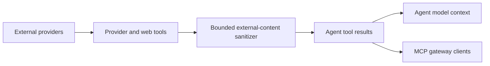

Codex review: found issues before merge. _Reviewed August 3, 2026, 6:03 PM ET / 22:03 UTC._

# ClawSweeper review

## What this changes

This PR adds bounded sanitization and provenance handling for network-derived tool content and errors across core web search, MCP gateway calls, and Firecrawl, Tavily, and xAI plugins.

## Merge readiness

⚠️ **Needs maintainer review before merge - 5 items remain**

Keep this protected security PR open. The shared sanitization direction is coherent and the supplied real-behavior proof is positive, but the patch adds a public callable through a deprecated broad Plugin SDK barrel without visible maintainer confirmation of that API direction; resolve that contract choice before merge.

**Priority:** P1
**Reviewed head:** `45a5dd46f8dd209684c20d30c45962c8f1c66f78`
**Owner decision:** Required. See [Decision needed](#decision-needed).

## Review scores

| Measure | Result | What it means |
|---|---|---|
| **Overall readiness** | 🦐 gold shrimp **(3/6)** | The security implementation and real-behavior proof are substantial, but the introduced public SDK contract has a P1 owner-boundary blocker. |
| **Proof confidence** | 🐚 platinum hermit **(4/6)** ✨ media proof bonus | Sufficient (linked_artifact): The supplied PR body links successful Testbox validation and describes completed real localhost HTTP, SSE, WebSocket, cancellation, hostile-error, and durable-memory exercises; the supplied check context also records a successful real-behavior-proof run. |
| **Patch quality** | 🦐 gold shrimp **(3/6)** | 1 actionable review finding remain. |

## Verification

| Check | Result | Evidence |
|---|---|---|
| **Real behavior** | Verified | Sufficient (linked_artifact): The supplied PR body links successful Testbox validation and describes completed real localhost HTTP, SSE, WebSocket, cancellation, hostile-error, and durable-memory exercises; the supplied check context also records a successful real-behavior-proof run. |
| **Evidence reviewed** | 7 items | Canonical sanitizer implementation: The branch adds a shared helper that sanitizes a retained UTF-16-safe prefix, detects a clipped forged external-content marker, and binary-searches the largest sanitized prefix within the requested limit. Owner-boundary error protection: Network tool failures are wrapped only after trusted preflight errors and caller cancellation are excluded, while timeout identity is preserved for terminal-outcome classification. Model-visible web-search budget: The branch limits result rows to the public maximum, charges URLs and sanitized prose against a shared budget, and carries an explicit truncation fact through the output contract. |
| **Findings** | 1 actionable finding | [P1] Move the sanitizer off the deprecated broad SDK barrel |
| **Security** | None | None. |

## How this fits together

Network-facing providers and tools turn external HTTP responses into agent-visible tool results. This change sits at their owner boundaries, sanitizing and bounding untrusted text before it reaches the agent loop, Tool Search, or MCP gateway clients.

## Decision needed

| Question | Recommendation |
|---|---|
| Should the bounded external-content sanitizer become a supported public API through the deprecated `security-runtime` barrel, or should this PR introduce a focused documented SDK runtime subpath instead? | **Use a focused SDK subpath:** Export the generic sanitizer through a narrow documented runtime entrypoint and migrate bundled callers, keeping the deprecated broad barrel from gaining another permanent contract. |

Why: This is a third-party plugin compatibility and security-boundary decision, not a mechanical implementation choice: the current module explicitly discourages new broad-barrel imports.

## Before merge

- [ ] **Move the sanitizer off the deprecated broad SDK barrel (P1)** - `security-runtime` explicitly says it is a deprecated broad public SDK barrel and that new imports should not be added there, yet this exports a new third-party callable. Put the generic helper on a focused documented runtime entrypoint (or obtain explicit maintainer approval for this permanent compatibility contract) before merging.
- [ ] **Resolve merge risk (P1)** - Merging adds a third-party Plugin SDK callable through a deprecated broad barrel, creating a long-lived compatibility commitment without a visible maintainer decision on the intended public entrypoint.
- [ ] **Resolve merge risk (P1)** - The review checkout cannot construct the entire branch-wide three-way diff because one required promisor object cannot be fetched; refresh the exact merge result before landing.
- [ ] **Complete next step (P2)** - The remaining blocker is a maintainer-owned Plugin SDK and security-boundary contract choice, not a safe automated repair.

## Findings

- [P1] Move the sanitizer off the deprecated broad SDK barrel — `src/plugin-sdk/security-runtime.ts:28-32`

<strong>Agent review details</strong>

### Security

None.

### PR surface

Source +583, Tests +2303, Generated 0, Other +2. Total +2888 across 50 files.

View PR surface stats

| Area | Files | Added | Removed | Net |
|---|---:|---:|---:|---:|
| Source | 29 | 783 | 200 | +583 |
| Tests | 19 | 2318 | 15 | +2303 |
| Docs | 0 | 0 | 0 | 0 |
| Config | 0 | 0 | 0 | 0 |
| Generated | 1 | 1 | 1 | 0 |
| Other | 1 | 4 | 2 | +2 |
| **Total** | **50** | **3106** | **218** | **+2888** |

### Review metrics

| Metric | Value | Why it matters |
|---|---|---|
| **Public SDK callable surface** | 1 added callable/export (4829→4830 exports; 2906→2907 callable exports) | The new sanitizer becomes available to bundled and third-party plugins, so the entrypoint choice is an upgrade-sensitive compatibility decision. |

### Stored data model

Persistent data-model change detected: `serialized state: extensions/firecrawl/src/firecrawl-tools.test.ts`, `serialized state: extensions/xai/x-search.test.ts`, `serialized state: src/agents/tools/web-search.ts`, `vector/embedding metadata: extensions/xai/x-search.test.ts`, `vector/embedding metadata: src/agents/tools/web-search-output.security.test.ts`. Confirm migration or upgrade compatibility proof before merge.

### Merge-risk options

**Maintainer options:**
1. **Move the public helper to a focused SDK path (recommended)**  
   Create or reuse a narrow documented runtime entrypoint for the sanitizer, migrate bundled provider callers, and retain the export baseline checks before merge.
2. **Explicitly accept the broad SDK contract**  
   A maintainer may intentionally keep the new broad-barrel export, but should record why this permanent third-party compatibility surface is necessary.
3. **Pause the SDK portion**  
   Hold the PR if maintainers do not want to commit to either public API shape while keeping the security work available for a narrower follow-up.

### Technical review

Best possible solution:

Keep the canonical security helper, but expose it through an intentional narrow, documented Plugin SDK runtime subpath—or retain the existing broad export only after an explicit maintainer decision records that compatibility contract—then verify the exact merge result against current main.

Do we have a high-confidence way to reproduce the issue?

Yes for the review finding: the exact branch source shows the new callable is exported from the deprecated broad `security-runtime` barrel at `src/plugin-sdk/security-runtime.ts:28`, while that module’s header prohibits new broad-barrel imports. The broader hostile-content behavior was not re-executed locally in this read-only review.

Is this the best way to solve the issue?

No: centralizing the security invariant is the right repair direction, but adding it through the deprecated broad public barrel is not the best durable Plugin SDK contract without explicit maintainer approval or a focused runtime subpath.

Full review comments:

- [P1] Move the sanitizer off the deprecated broad SDK barrel — `src/plugin-sdk/security-runtime.ts:28-32`
  `security-runtime` explicitly says it is a deprecated broad public SDK barrel and that new imports should not be added there, yet this exports a new third-party callable. Put the generic helper on a focused documented runtime entrypoint (or obtain explicit maintainer approval for this permanent compatibility contract) before merging.
  Confidence: 0.94

Overall correctness: patch is incorrect
Overall confidence: 0.82

AGENTS.md: found and applied where relevant.

Codex review notes: model internal, reasoning high; reviewed against [65fa1f9a7bd1](https://github.com/openclaw/openclaw/commit/65fa1f9a7bd19bdd625dabd434e0edc3920166ac).

### Labels

Label changes:

- add `P1`: The PR hardens active agent and gateway paths that project hostile network content into real user workflows.
- add `merge-risk: 🚨 compatibility`: The patch adds a callable public Plugin SDK export that third-party plugins may adopt permanently.
- add `merge-risk: 🚨 security-boundary`: The patch changes the canonical boundary that distinguishes untrusted network output from trusted tool preflight failures and caller cancellation.
- add `proof: sufficient`: Contributor real behavior proof is sufficient. The supplied PR body links successful Testbox validation and describes completed real localhost HTTP, SSE, WebSocket, cancellation, hostile-error, and durable-memory exercises; the supplied check context also records a successful real-behavior-proof run.
- add `rating: 🦐 gold shrimp`: Overall readiness is 🦐 gold shrimp; proof is 🐚 platinum hermit and patch quality is 🦐 gold shrimp.
- add `status: ⏳ waiting on author`: ClawSweeper has contributor-facing work open and is waiting for author action. Sufficient (linked_artifact): The supplied PR body links successful Testbox validation and describes completed real localhost HTTP, SSE, WebSocket, cancellation, hostile-error, and durable-memory exercises; the supplied check context also records a successful real-behavior-proof run.

Label justifications:

- `P1`: The PR hardens active agent and gateway paths that project hostile network content into real user workflows.
- `merge-risk: 🚨 compatibility`: The patch adds a callable public Plugin SDK export that third-party plugins may adopt permanently.
- `merge-risk: 🚨 security-boundary`: The patch changes the canonical boundary that distinguishes untrusted network output from trusted tool preflight failures and caller cancellation.
- `rating: 🦐 gold shrimp`: Overall readiness is 🦐 gold shrimp; proof is 🐚 platinum hermit and patch quality is 🦐 gold shrimp.
- `status: ⏳ waiting on author`: ClawSweeper has contributor-facing work open and is waiting for author action. Sufficient (linked_artifact): The supplied PR body links successful Testbox validation and describes completed real localhost HTTP, SSE, WebSocket, cancellation, hostile-error, and durable-memory exercises; the supplied check context also records a successful real-behavior-proof run.
- `proof: sufficient`: Contributor real behavior proof is sufficient. The supplied PR body links successful Testbox validation and describes completed real localhost HTTP, SSE, WebSocket, cancellation, hostile-error, and durable-memory exercises; the supplied check context also records a successful real-behavior-proof run.

### Evidence

What I checked:

- **Canonical sanitizer implementation:** The branch adds a shared helper that sanitizes a retained UTF-16-safe prefix, detects a clipped forged external-content marker, and binary-searches the largest sanitized prefix within the requested limit. ([`src/security/external-content.ts:307`](https://github.com/openclaw/openclaw/blob/45a5dd46f8dd/src/security/external-content.ts#L307), [45a5dd46f8dd](https://github.com/openclaw/openclaw/commit/45a5dd46f8dd))
- **Owner-boundary error protection:** Network tool failures are wrapped only after trusted preflight errors and caller cancellation are excluded, while timeout identity is preserved for terminal-outcome classification. ([`src/agents/tool-result-error.ts:165`](https://github.com/openclaw/openclaw/blob/45a5dd46f8dd/src/agents/tool-result-error.ts#L165), [45a5dd46f8dd](https://github.com/openclaw/openclaw/commit/45a5dd46f8dd))
- **Model-visible web-search budget:** The branch limits result rows to the public maximum, charges URLs and sanitized prose against a shared budget, and carries an explicit truncation fact through the output contract. ([`src/agents/tools/web-search-output.ts:294`](https://github.com/openclaw/openclaw/blob/45a5dd46f8dd/src/agents/tools/web-search-output.ts#L294), [45a5dd46f8dd](https://github.com/openclaw/openclaw/commit/45a5dd46f8dd))
- **Public SDK expansion:** The branch exports the new sanitizer from `security-runtime`, whose module header says it is a deprecated broad public SDK barrel and advises against new imports there. ([`src/plugin-sdk/security-runtime.ts:1`](https://github.com/openclaw/openclaw/blob/45a5dd46f8dd/src/plugin-sdk/security-runtime.ts#L1), [45a5dd46f8dd](https://github.com/openclaw/openclaw/commit/45a5dd46f8dd))
- **PR provenance:** The behavior appears to date to the security hardening commit authored by Peter Steinberger; the second branch commit merges upstream main and resolves the SDK budget conflict. ([`src/security/external-content.ts:307`](https://github.com/openclaw/openclaw/blob/b26a2c78837e/src/security/external-content.ts#L307), [b26a2c78837e](https://github.com/openclaw/openclaw/commit/b26a2c78837e))
- **Supplied real-behavior proof:** The supplied PR body links a successful Blacksmith Testbox run and reports real localhost HTTP, SSE, WebSocket, streamed-marker, cancellation, hostile-error, and durable-memory exercises; the supplied check context also records a successful `Real behavior proof` check. ([45a5dd46f8dd](https://github.com/openclaw/openclaw/commit/45a5dd46f8dd))

Likely related people:

- **steipete:** The supplied PR history attributes the canonical security hardening commit and its upstream-main merge to Peter Steinberger; the available history trail is otherwise incomplete because the checkout is missing promisor objects. (role: proposed security implementation contributor; confidence: medium; commits: [b26a2c78837e](https://github.com/openclaw/openclaw/commit/b26a2c78837eed49c2adce07a73ad0d52cc42671), [45a5dd46f8dd](https://github.com/openclaw/openclaw/commit/45a5dd46f8dd209684c20d30c45962c8f1c66f78); files: `src/security/external-content.ts`, `src/agents/tool-result-error.ts`, `src/agents/tools/web-search-output.ts`)

### Rank-up moves

Optional improvements that raise the rating; they are not merge blockers.

- Choose and implement the intended focused Plugin SDK entrypoint, or obtain explicit approval for the broad-barrel contract.
- Refresh the final exact-head three-way merge view in a complete checkout before landing.

### Rating scale

| Score | Internal tier | Crab rank | Meaning |
|---:|:---:|---|---|
| **6/6** | S | 🦀 challenger crab | Exceptional readiness |
| **5/6** | A | 🦞 diamond lobster | Very strong readiness |
| **4/6** | B | 🐚 platinum hermit | Good normal PR; ordinary maintainer review |
| **3/6** | C | 🦐 gold shrimp | Useful, but confidence is limited |
| **2/6** | D | 🦪 silver shellfish | Proof or implementation needs work |
| **1/6** | F | 🧂 unranked krab | Not merge-ready |
| N/A | NA | 🌊 off-meta tidepool | Rating does not apply |

Overall follows the weaker of proof and patch quality.
Shiny media proof means a screenshot, video, or linked artifact directly shows the changed behavior. Runtime, network, CSP, and security claims still need visible diagnostics.

### Workflow

- ClawSweeper keeps one durable marker-backed review comment per issue or PR.
- Re-runs edit this comment so the latest verdict, findings, and automation markers stay together instead of adding duplicate bot comments.
- A fresh review can be triggered by eligible `@clawsweeper re-review` comments, exact-item GitHub events, scheduled/background review runs, or manual workflow dispatch.
- PR/issue authors and users with repository write access can comment `@clawsweeper re-review` or `@clawsweeper re-run` on an open PR or issue to request a fresh review only.
- Maintainers can also comment `@clawsweeper review` to request a fresh review only.
- Fresh-review commands do not start repair, autofix, rebase, CI repair, or automerge.
- Maintainer-only repair and merge flows require explicit commands such as `@clawsweeper autofix`, `@clawsweeper automerge`, `@clawsweeper fix ci`, or `@clawsweeper address review`.
- Maintainers can comment `@clawsweeper explain` to ask for more context, or `@clawsweeper stop` to stop active automation.

<!-- clawsweeper-verdict:needs-human item=118984 sha=45a5dd46f8dd209684c20d30c45962c8f1c66f78 confidence=medium updated_at=2026-08-03T21:59:12Z reviewed_at=2026-08-03T22:03:19.938Z lease_owner=github-run-30856238243-1 lease_comment_id=5172200559 source_revision=d756b15e6a39996eff2be0427b9578846e0a3d2ea95c0e9db71f962eb6494019 -->

<!-- clawsweeper-review-version item=118984 reviewed_at=2026-08-03T22:03:19.938Z sha=45a5dd46f8dd209684c20d30c45962c8f1c66f78 source_revision=d756b15e6a39996eff2be0427b9578846e0a3d2ea95c0e9db71f962eb6494019 lease_owner=github-run-30856238243-1 lease_comment_id=5172200559 v=1 -->

<!-- clawsweeper-review item=118984 -->