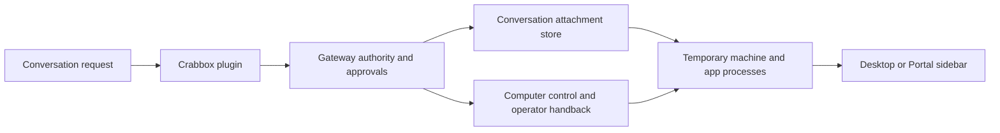

Codex review: blocked before merge. _Reviewed September 18, 2026, 7:46 PM ET / 23:46 UTC (Revision 10)._

# ClawSweeper review

## What this changes

Adds temporary Crabbox machines that run applications beside the requesting conversation, with persistent background processes, Desktop or Portal previews, and shared computer control.

## Merge readiness

⛔ **Blocked before merge - 2 items remain**

The prior blockers are resolved, and this review found no new actionable defect. The PR remains useful; its documented compatibility choices should not become a repeated request for approval.

**Priority:** P2
**Reviewed head:** `d89a709785564a9aadfc257240b6e701584056e1`

## Review scores

| Measure | Result | What it means |
|---|---|---|
| **Overall readiness** | 🐚 platinum hermit **(4/6)** | A useful, well-supported feature with prior blockers resolved and explicit compatibility limits. |
| **Proof confidence** | 🦞 diamond lobster **(5/6)** ✨ media proof bonus | Sufficient (linked_artifact): Inspected AWS/Linux UI evidence and recorded restart, handback, HTTP readback, and cleanup results cover the attachment-to-app workflow; the registered-plugin boundary harness additionally records allowed allocation and zero allocation after non-aborting revocation. Screenshots alone were not used to establish authorization or network correctness. |
| **Patch quality** | 🐚 platinum hermit **(4/6)** | No actionable review findings were identified. |

## Verification

| Check | Result | Evidence |
|---|---|---|
| **Real behavior** | Verified | Sufficient (linked_artifact): Inspected AWS/Linux UI evidence and recorded restart, handback, HTTP readback, and cleanup results cover the attachment-to-app workflow; the registered-plugin boundary harness additionally records allowed allocation and zero allocation after non-aborting revocation. Screenshots alone were not used to establish authorization or network correctness. |
| **Evidence reviewed** | 10 items | Pinned introduction and clean checkout: Inspected the complete introduced file inventory and targeted source diffs from the pinned merge base to the actual head. git diff --check passed, and git status -sb remained clean. Still distinct from current main: The fetched main tree lacks the conversation attachment service and Crabbox conversation tool. Existing cloud-session placement moves execution remotely; the proposed attachment preserves primary placement. The same new paths are absent from the supplied latest-release tree. Re-review continuity: GitHub blob identities at the previous reviewed revision match HEAD for the attachment service, Crabbox provider, attached-command approval owner, and Desktop panel. The attachment-service blob is 2b34b4c3e876a7ba599a7dbbc85c68e574aeb06c. Local comparison against the earlier commit was unavailable, so these specific identities were checked through read-only GitHub contents reads. |
| **Findings** | None | None. |
| **Security** | None | None. |

## How this fits together

The Crabbox plugin turns conversation requests into temporary machine operations managed by the Gateway. Existing desktop, computer-control, and portal transports expose those applications in the requesting browser while preserving the conversation’s primary workspace.

## Before merge

- [ ] **Resolve merge risk (P1)** - Updated bundled providers cannot provision on older hosts without allocation authority, and downgrading with active attachments loses conversation-aware lifecycle management; coordinated upgrades and stop-before-downgrade are the explicitly documented compatibility boundary.
- [ ] **Review config compatibility** - Confirm compatibility and upgrade impact for the changed config or default surface before merge.

<strong>Agent review details</strong>

### Security

None.

### PR surface

PR surface statistics unavailable: the file list is incomplete.

### Review metrics

| Metric | Value | Why it matters |
|---|---|---|
| **Public runtime contract** | 4 conversation RPCs; 1 runtime-required provider assertion | The provider assertion creates the coordinated host/provider upgrade boundary. |
| **Persistent attachment ownership** | 1 additive companion table; numeric schema version unchanged | Older readers can reopen storage but cannot maintain the new conversation attachment lifecycle. |
| **Growth justification** | Production/tooling net +3,504; tests/support net +2,728; generated native protocol net +550 | The stated production growth supplies durable attachment ownership, managed processes, authority checks, and existing-view integration. |

### Stored data model

Persistent data-model change detected: `unknown-truncated-pull-files`. Migration or upgrade compatibility proof is recorded; maintainers should verify it before merge.

### Merge-risk options

**Maintainer options:**
1. **Honor the recorded compatibility boundary (recommended)**  
   Ship matching host and bundled providers, and retain the documented requirement to stop attachments before downgrading.

### Technical review

Best possible solution:

Keep the shared lifecycle and transport owners, shipping host and providers together with the documented stop-before-downgrade contract backed by published-reader compatibility proof.

Do we have a high-confidence way to reproduce the issue?

Not applicable to the feature request; the supplied live demonstration and source-bound authority scenarios exercise the proposed behavior, and no new defect was established.

Is this the best way to solve the issue?

Yes. The implementation extends existing environment, approval, computer, and presentation owners while keeping Crabbox-specific workflow in its plugin.

AGENTS.md: found and applied where relevant.

Codex review notes: model internal, reasoning medium; reviewed against [a06bd2c520a1](https://github.com/openclaw/openclaw/commit/a06bd2c520a126ee32dad07bcfeac98851444956).

### Labels

Label justifications:

- `P2`: This is a bounded improvement to optional cloud application workflows, without evidence of an urgent existing-user outage.
- `merge-risk: 🚨 compatibility`: Provider runtime requirements and attachment downgrade semantics require the documented coordinated upgrade contract.
- `rating: 🐚 platinum hermit`: Overall readiness is 🐚 platinum hermit; proof is 🦞 diamond lobster and patch quality is 🐚 platinum hermit.
- `status: 👀 ready for maintainer look`: ClawSweeper has no concrete contributor-facing blocker left for this PR. Sufficient (linked_artifact): Inspected AWS/Linux UI evidence and recorded restart, handback, HTTP readback, and cleanup results cover the attachment-to-app workflow; the registered-plugin boundary harness additionally records allowed allocation and zero allocation after non-aborting revocation. Screenshots alone were not used to establish authorization or network correctness.
- `proof: sufficient`: Contributor real behavior proof is sufficient. Inspected AWS/Linux UI evidence and recorded restart, handback, HTTP readback, and cleanup results cover the attachment-to-app workflow; the registered-plugin boundary harness additionally records allowed allocation and zero allocation after non-aborting revocation. Screenshots alone were not used to establish authorization or network correctness.

### Evidence

What I checked:

- **Pinned introduction and clean checkout:** Inspected the complete introduced file inventory and targeted source diffs from the pinned merge base to the actual head. git diff --check passed, and git status -sb remained clean. ([d89a70978556](https://github.com/openclaw/openclaw/commit/d89a709785564a9aadfc257240b6e701584056e1))
- **Still distinct from current main:** The fetched main tree lacks the conversation attachment service and Crabbox conversation tool. Existing cloud-session placement moves execution remotely; the proposed attachment preserves primary placement. The same new paths are absent from the supplied latest-release tree. ([`src/gateway/worker-environments/provider-lifecycle.ts`](https://github.com/openclaw/openclaw/blob/a06bd2c520a126ee32dad07bcfeac98851444956/src/gateway/worker-environments/provider-lifecycle.ts), [a06bd2c520a1](https://github.com/openclaw/openclaw/commit/a06bd2c520a126ee32dad07bcfeac98851444956))
- **Re-review continuity:** GitHub blob identities at the previous reviewed revision match HEAD for the attachment service, Crabbox provider, attached-command approval owner, and Desktop panel. The attachment-service blob is 2b34b4c3e876a7ba599a7dbbc85c68e574aeb06c. Local comparison against the earlier commit was unavailable, so these specific identities were checked through read-only GitHub contents reads. ([`src/gateway/worker-environments/session-attachment-service.ts`](https://github.com/openclaw/openclaw/blob/96a5dd5fe7c39d429b2b981a269a5b2eef228c00/src/gateway/worker-environments/session-attachment-service.ts), [96a5dd5fe7c3](https://github.com/openclaw/openclaw/commit/96a5dd5fe7c39d429b2b981a269a5b2eef228c00))
- **Live authority reaches allocation:** Reservation retains the environment lock through provisioning and passes its live assertion into reconciliation. The Crabbox adapter composes host and project authority and carries it into warm-image allocation; existing warmup and checkpoint command owners recheck immediately before command dispatch. ([`src/gateway/worker-environments/session-attachment-service.ts:300`](https://github.com/openclaw/openclaw/blob/d89a709785564a9aadfc257240b6e701584056e1/src/gateway/worker-environments/session-attachment-service.ts#L300), [d89a70978556](https://github.com/openclaw/openclaw/commit/d89a709785564a9aadfc257240b6e701584056e1))
- **Forbidden and revoked allocation coverage:** Read the registered-plugin harness covering allowed and revoked warmup/checkpoint-fork operations through asynchronous SQLite lookup to the command boundary. It asserts one versus zero allocation calls and checks later reconciliation. The captured PR body reports these cases passing and separately records foreign-conversation rejection before reservation; these tests were not rerun during this read-only review. ([`test/plugins/crabbox-allocation-authority.gateway.test.ts:44`](https://github.com/openclaw/openclaw/blob/d89a709785564a9aadfc257240b6e701584056e1/test/plugins/crabbox-allocation-authority.gateway.test.ts#L44), [d89a70978556](https://github.com/openclaw/openclaw/commit/d89a709785564a9aadfc257240b6e701584056e1))
- **Previous approval and native-generation findings resolved:** Attached commands now use the shared execution-approval delivery owner, retaining forwarding, push delivery, expiry, and one-shot consumption. Generated Swift contains UiCommand and its nested panel union; the added round-trip cases cover valid targets and reject mixed targets. ([`src/gateway/server-methods/environments.session-exec-approval.ts:73`](https://github.com/openclaw/openclaw/blob/d89a709785564a9aadfc257240b6e701584056e1/src/gateway/server-methods/environments.session-exec-approval.ts#L73), [d89a70978556](https://github.com/openclaw/openclaw/commit/d89a709785564a9aadfc257240b6e701584056e1))

Likely related people:

- **unknown:** The claimed source-line change could not be verified from bounded local history. (role: source history unknown; confidence: low)

### Rating scale

| Score | Internal tier | Crab rank | Meaning |
|---:|:---:|---|---|
| **6/6** | S | 🦀 challenger crab | Exceptional readiness |
| **5/6** | A | 🦞 diamond lobster | Very strong readiness |
| **4/6** | B | 🐚 platinum hermit | Good normal PR; ordinary maintainer review |
| **3/6** | C | 🦐 gold shrimp | Useful, but confidence is limited |
| **2/6** | D | 🦪 silver shellfish | Proof or implementation needs work |
| **1/6** | F | 🧂 unranked krab | Not merge-ready |
| N/A | NA | 🌊 off-meta tidepool | Rating does not apply |

Overall follows the weaker of proof and patch quality.
Shiny media proof means a screenshot, video, or linked artifact directly shows the changed behavior. Runtime, network, CSP, and security claims still need visible diagnostics.

### Workflow

- ClawSweeper keeps one durable marker-backed review comment per issue or PR.
- Re-runs edit this comment so the latest verdict, findings, and automation markers stay together instead of adding duplicate bot comments.
- A fresh review can be triggered by eligible `@clawsweeper re-review` comments, exact-item GitHub events, scheduled/background review runs, or manual workflow dispatch.
- PR/issue authors and users with repository write access can comment `@clawsweeper re-review` or `@clawsweeper re-run` on an open PR or issue to request a fresh review only.
- Maintainers can also comment `@clawsweeper review` to request a fresh review only.
- Fresh-review commands do not start repair, autofix, rebase, CI repair, or automerge.
- Maintainer-only repair and merge flows require explicit commands such as `@clawsweeper autofix`, `@clawsweeper automerge`, `@clawsweeper fix ci`, or `@clawsweeper address review`.
- Maintainers can comment `@clawsweeper explain` to ask for more context, or `@clawsweeper stop` to stop active automation.

### History

Review history (9 earlier review cycles; latest 8 shown)

<!-- clawsweeper-review-history v=1 total=9 -->
- reviewed 2026-09-18T19:58:28.846Z sha 019fd437e99175f71d7b7d9379081a24dc3261b6 :: needs real behavior proof before merge. :: [P1] Preserve a generated Swift declaration for UiCommand | [P1] Carry live caller authority through fresh provisioning | [P2] Preserve the existing execution-approval delivery routes
- reviewed 2026-09-18T20:26:59.026Z sha 35e521cb4f432317aa3ed41b29ffa5fc1ef37dbf :: needs real behavior proof before merge. :: [P1] Preserve a generated Swift declaration for UiCommand | [P1] Carry live caller authority through fresh provisioning | [P2] Preserve the existing execution-approval delivery routes
- reviewed 2026-09-18T20:51:11.630Z sha 3ca5cc952d444fa95b35ab89cc624a2b3760f0bb :: needs real behavior proof before merge. :: [P1] Preserve a generated Swift declaration for UiCommand | [P1] Carry live caller authority through fresh provisioning | [P2] Preserve the existing execution-approval delivery routes
- reviewed 2026-09-18T21:02:38.409Z sha 15880b9a7726f70163fa650fe139e212823ddb9b :: needs real behavior proof before merge. :: [P1] Preserve a generated Swift declaration for UiCommand | [P1] Carry live caller authority through fresh provisioning | [P2] Preserve the existing execution-approval delivery routes
- reviewed 2026-09-18T21:59:31.412Z sha 17fd72b88150323c58ffe559a7fd774cfd6c9015 :: needs real behavior proof before merge. :: [P1] Carry caller authority to the Crabbox allocation command
- reviewed 2026-09-18T22:08:59.047Z sha b3d543bb9f7586aca8883bc79046a68026514410 :: needs real behavior proof before merge. :: [P1] Carry caller authority to the Crabbox allocation command
- reviewed 2026-09-18T23:11:50.428Z sha e6012db86a23a1f62d10a72f1141b037a458d22a :: blocked before merge. :: none
- reviewed 2026-09-18T23:26:10.933Z sha 96a5dd5fe7c39d429b2b981a269a5b2eef228c00 :: blocked before merge. :: none

<!-- clawsweeper-verdict:needs-human item=152094 sha=d89a709785564a9aadfc257240b6e701584056e1 confidence=high updated_at=2026-09-18T23:41:57Z reviewed_at=2026-09-18T23:46:25.069Z lease_owner=github-run-35406601369-1 lease_comment_id=5737503772 source_revision=86b1d15674e75f9a01af1bd70ce785b9c275faa64337803be7d09e649e106fe0 live_verification=absent -->
<!-- clawsweeper-review-state:blocked item=152094 sha=d89a709785564a9aadfc257240b6e701584056e1 v=1 -->

<!-- clawsweeper-review-version item=152094 reviewed_at=2026-09-18T23:46:25.069Z sha=d89a709785564a9aadfc257240b6e701584056e1 source_revision=86b1d15674e75f9a01af1bd70ce785b9c275faa64337803be7d09e649e106fe0 lease_owner=github-run-35406601369-1 lease_comment_id=5737503772 v=1 -->

<!-- clawsweeper-review item=152094 -->