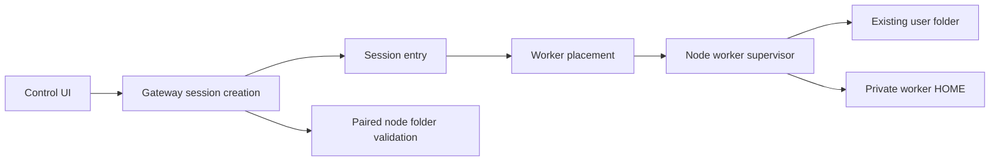

Codex review: needs maintainer review before merge.

## What this changes

This PR lets sessions run directly in existing folders on explicitly selected paired devices.

**Example:** Start a session on paired-runner in the existing non-Git folder /srv/existing project.
- **Before:** Device-hosted sessions use an OpenClaw-managed workspace rather than that existing device folder.
- **After:** The worker runs in /srv/existing project, stays bound to paired-runner, and leaves the folder intact when the session is deleted.

## Review scores

| Measure | Result | What it means |
|---|---|---|
| **Overall readiness** | 🦞 diamond lobster **(5/6)** | Useful, coherent feature work with shipped-path behavior, authority, and upgrade evidence and no identified actionable defect; pending CI remains a landing gate. |
| **Proof confidence** | 🦞 diamond lobster **(5/6)** | Sufficient (live_output): Supplied real Gateway and paired-node evidence exercises creation, explicit dispatch, hosted execution, restart recovery, attachment refusal, folder preservation, scope denial, and caller/device revocation before worker execution; inspected screenshots cover desktop and mobile presentation. |
| **Patch quality** | 🦞 diamond lobster **(5/6)** | No actionable review findings were identified. |

## Product

**Kind:** Feature · **Worth it:** Yes · **Fix scope:** Complete
**User problem:** Users cannot run a complete hosted session directly in an existing non-Git folder on their paired device.
**Reason:** The maintainer-authored direction supplies a concrete device workflow, reuses existing execution owners, and explicitly documents its consent and lifecycle tradeoffs.

## Merge readiness

✅ **Ready for maintainer review**

Keep open: this maintainer-authored PR adds a useful capability absent from current main, and no definite introduced defect was found; current-head CI remains pending.

**Priority:** P2
**Reviewed head:** `364a0000a69b09b9a51defa90e69cababc077829`

## Before merge

None.

## Findings

None.

<strong>Agent review details</strong>

### How this fits together

The Control UI submits a device and folder to Gateway session creation; the paired node validates its local folder policy, and existing placement and worker lifecycle owners execute turns without transferring the folder.

### Technical review

Best possible solution:

Land the device-bound workspace mode through the existing worker owners while preserving node-local consent and user-folder lifecycle guarantees.

Do we have a high-confidence way to reproduce the issue?

This is a feature addition: current-main source lacks the new creation parameter, and supplied live evidence exercises the proposed device-folder flow.

Is this the best way to solve the issue?

The implementation fits the existing placement and worker lifecycle owners and keeps user-owned folders outside Gateway transfer and reconciliation.

AGENTS.md: found and applied where relevant.

Codex review notes: model internal, reasoning medium; reviewed against [f4f0255bc773](https://github.com/openclaw/openclaw/commit/f4f0255bc773d767c5ddc43a15e20202c8e33065).

### Provenance checked

- `Paired-worker workspace transport` keeps the original intent (438d0358857ba4ab15a23a890862cffc4cdbb7e1: The original paired-worker launch implementation deliberately used node-owned workspaces; subsequent transfer work supported Gateway-owned inputs and reconciliation.)
- `Worker lifetime and teardown` keeps the original intent (e4d602c6f374fd2e325016e6758aee3bc3d5eec0: Existing lifecycle owners preserve background processes and retain exact environment cleanup responsibility; this PR adds folder-specific cleanup without replacing those owners.)
- `New Session picker and retry state` keeps the original intent (bcafd72f610e6ceb3e97edac7a183abd9808ac41: Picker changes preserve submitted selections, accepted-session ownership, and concurrent preferences; device-folder recovery likewise retains its frozen request.)

### Testing

Proof path: shipped entry point.

### Security

None.

### Evidence

What I checked:

- **Pinned introduction and current-main boundary:** The pinned base-to-head diff adds deviceFolder to sessions.create; the fetched main schema still has no such field. GitHub confirms the reviewed head is open, non-draft, and mergeable. ([`packages/gateway-protocol/src/schema/sessions-create.ts:104`](https://github.com/openclaw/openclaw/blob/364a0000a69b09b9a51defa90e69cababc077829/packages/gateway-protocol/src/schema/sessions-create.ts#L104), [364a0000a69b](https://github.com/openclaw/openclaw/commit/364a0000a69b09b9a51defa90e69cababc077829))
- **Caller and device authority:** Creation composes current requester authority with the validated device connection before commit; private node dispatch rechecks authorization and pairing immediately before sending the command. ([`src/gateway/server-methods/sessions-create.ts:186`](https://github.com/openclaw/openclaw/blob/364a0000a69b09b9a51defa90e69cababc077829/src/gateway/server-methods/sessions-create.ts#L186), [364a0000a69b](https://github.com/openclaw/openclaw/commit/364a0000a69b09b9a51defa90e69cababc077829))
- **Node-owned folder policy:** The node resolves existing directories, rejects filesystem roots and private-storage overlap, applies configured roots, and checks directory identity again before execution. ([`src/node-host/node-worker-device-folder.ts:87`](https://github.com/openclaw/openclaw/blob/364a0000a69b09b9a51defa90e69cababc077829/src/node-host/node-worker-device-folder.ts#L87), [364a0000a69b](https://github.com/openclaw/openclaw/commit/364a0000a69b09b9a51defa90e69cababc077829))
- **Lifecycle preserves user files:** Device-folder completion and reclaim bypass workspace reconciliation; node retention collects namespaced private HOME rather than the existing user folder. ([`src/gateway/worker-environments/placement-reclaim.ts:127`](https://github.com/openclaw/openclaw/blob/364a0000a69b09b9a51defa90e69cababc077829/src/gateway/worker-environments/placement-reclaim.ts#L127), [364a0000a69b](https://github.com/openclaw/openclaw/commit/364a0000a69b09b9a51defa90e69cababc077829))
- **Supplied behavior and authority proof:** The body and obviyus's discussion record real Gateway/node execution across two Macs, restart recovery, independent file readback, attachment refusal, scope denial, and requester/device revocation with no worker execution or persisted session after rejection. ([364a0000a69b](https://github.com/openclaw/openclaw/commit/364a0000a69b09b9a51defa90e69cababc077829))
- **Visual proof inspected:** Prepared screenshots visibly show the previous workspace choice and the new desktop/mobile device-folder input, including /srv/existing project; these are explicitly mocked-Gateway UI captures. ([`ui/src/pages/new-session/target-controls-view.tsx:327`](https://github.com/openclaw/openclaw/blob/364a0000a69b09b9a51defa90e69cababc077829/ui/src/pages/new-session/target-controls-view.tsx#L327), [364a0000a69b](https://github.com/openclaw/openclaw/commit/364a0000a69b09b9a51defa90e69cababc077829))

Likely related people:

- **Peter Steinberger:** Raw commit 438d0358857ba4ab15a23a890862cffc4cdbb7e1 adds src/gateway/worker-environments/node-worker-tunnel.ts:70 relative to its recorded parents. This identifies author metadata, not feature responsibility or a PR merger. (role: source-line author; confidence: high; commits: [438d0358857b](https://github.com/openclaw/openclaw/commit/438d0358857ba4ab15a23a890862cffc4cdbb7e1); files: `src/gateway/worker-environments/node-worker-tunnel.ts`)

### PR surface

PR surface statistics unavailable: the file list is incomplete.

### Review metrics

| Metric | Value | Why it matters |
|---|---|---|
| **New configuration option** | 1: nodeHost.workerRuns.folders | Unset permits existing directories, a non-empty list restricts roots, and an empty list disables the capability. |
| **Persisted workspace binding** | 1 optional session-entry field; no SQL schema change | deviceFolder retains the canonical device/path binding through reset, recovery, and row publication. |

### Labels

Label changes:

No label changes.

Label justifications:

- `P2`: A useful optional device-session capability with a limited, explicitly selected execution surface.
- `rating: 🦞 diamond lobster`: Overall readiness is 🦞 diamond lobster; proof is 🦞 diamond lobster and patch quality is 🦞 diamond lobster.
- `status: 👀 ready for maintainer look`: ClawSweeper has no concrete contributor-facing blocker left for this PR.
- `proof: sufficient`: Contributor real behavior proof is sufficient.

### Rating scale

6/6 🦀 challenger crab · 5/6 🦞 diamond lobster · 4/6 🐚 platinum hermit · 3/6 🦐 gold shrimp · 2/6 🦪 silver shellfish · 1/6 🧂 unranked krab. Overall follows the weaker of proof and patch quality; ✨ marks media proof (a screenshot, video, or linked artifact) that directly shows the changed behavior.

### Workflow

ClawSweeper edits this one comment on every review. Comment `@clawsweeper re-review` for a fresh review only. Repair and merge execution lanes are retired.

### History

Review history (20 earlier review cycles; latest 8 shown)

<!-- clawsweeper-review-history v=1 total=20 -->
- reviewed 2026-10-13T18:18:44.160Z sha 49a83f285a92cdbb47edf3eaf58a4fdc51d69455 :: needs real behavior proof before merge. :: none
- reviewed 2026-10-13T19:45:59.343Z sha 49a83f285a92cdbb47edf3eaf58a4fdc51d69455 :: needs changes before merge. :: none
- reviewed 2026-10-13T20:45:42.502Z sha f354d35e4aaf29445e3a4355d0faacac43521ebc :: needs maintainer review before merge. :: none
- reviewed 2026-10-13T22:44:40.607Z sha 73b0fc131ca2598b9491197d2697cb8af89551b7 :: needs changes before merge. :: none
- reviewed 2026-10-14T00:38:13.510Z sha e7db547529c5740e6ce1bb693344b98f47355fd4 :: needs changes before merge. :: none
- reviewed 2026-10-14T00:48:30.838Z sha e7db547529c5740e6ce1bb693344b98f47355fd4 :: needs maintainer review before merge. :: none
- reviewed 2026-10-14T01:27:17.253Z sha 12a2d823b06a229facfe2d04e1f23b5f1b6f59b2 :: needs maintainer review before merge. :: none
- reviewed 2026-10-14T01:37:41.454Z sha bea786ce92558055494151cbf3979f60a7180805 :: needs maintainer review before merge. :: none

_Reviewed October 13, 2026, 11:08 PM ET / October 14, 2026, 03:08 UTC (Revision 21)._

<!-- clawsweeper-verdict:needs-human item=169722 sha=364a0000a69b09b9a51defa90e69cababc077829 confidence=high updated_at=2026-10-14T03:02:26Z reviewed_at=2026-10-14T03:08:16.270Z lease_owner=github-run-38504057039-1 lease_comment_id=6159905367 source_revision=ca7a177e2eafd5d1fcc509b47692c85336f3141c1852acf46ca1519e0db98bd7 hold=not_opted_in findings=0 -->
<!-- clawsweeper-review-state:ready item=169722 sha=364a0000a69b09b9a51defa90e69cababc077829 v=1 -->

<!-- clawsweeper-review-version item=169722 reviewed_at=2026-10-14T03:08:16.270Z sha=364a0000a69b09b9a51defa90e69cababc077829 source_revision=ca7a177e2eafd5d1fcc509b47692c85336f3141c1852acf46ca1519e0db98bd7 lease_owner=github-run-38504057039-1 lease_comment_id=6159905367 v=1 -->

<!-- clawsweeper-review item=169722 -->