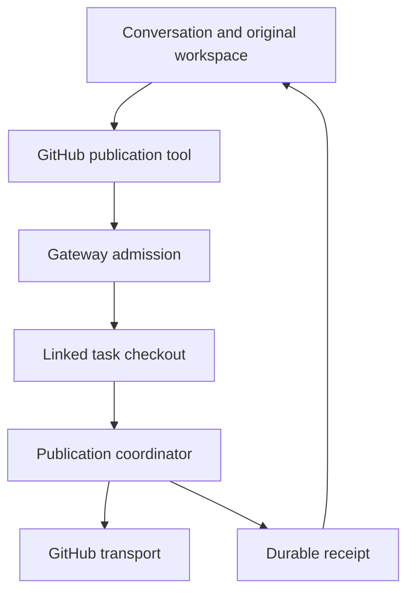

Codex review: needs maintainer review before merge.

## What this changes

This PR publishes local checkouts through linked task conversations while preserving the initiating conversation’s workspace.

**Example:** A conversation working in /work publishes committed changes from /work/repository-a, then edits /work/repository-b.
- **Before:** Publication binds the conversation to repository-a’s managed checkout, restricting subsequent file access.
- **After:** A linked task owns the publication checkout, and the conversation continues working from /work.

## Review scores

| Measure | Result | What it means |
|---|---|---|
| **Overall readiness** | 🐚 platinum hermit **(4/6)** | A coherent workspace fix with sufficient production-entry-point and upgrade evidence, no actionable findings, and explicit limits on external transport and native-shell coverage. |
| **Proof confidence** | 🐚 platinum hermit **(4/6)** | Sufficient (live_output): Recorded public-Gateway execution exercises the actual tool, handoff, custody and durable receipt owners, including omitted-path recovery, unchanged parent workspace, successful publication, correlated delivery, restart recovery, read-only rejection, and accepted-task revocation before writes; external model and GitHub effects were isolated, and native-shell selection remains explicitly unverified. |
| **Patch quality** | 🦞 diamond lobster **(5/6)** | No actionable review findings were identified. |

## Product

**Kind:** Bug fix · **Worth it:** Yes · **Fix scope:** Complete
**User problem:** Publishing one repository changes where the conversation executes and prevents later work in another repository.
**Reason:** Preserving conversation workspace continuity has clear user value, and the collaborator-authored PR supplies the direction decision while retaining intentional PR preparation and historical file associations.

## Merge readiness

✅ **Ready for maintainer review**

Keep this PR open: it fixes workspace changes still present on main, and no actionable correctness or security defect was found.

**Priority:** P2
**Reviewed head:** `d74bf34d2f9773f72135ee21809a56be38d44119`

## Before merge

None.

## Findings

None.

<strong>Agent review details</strong>

### How this fits together

The GitHub publication tool hands a selected checkout and requester authority to Gateway session and publication owners, which retain custody, execute publication, and deliver receipts to the initiating transcript.

### Technical review

Best possible solution:

Keep publication custody in a linked task while preserving the initiating workspace, original requester authority, and durable completion delivery.

Do we have a high-confidence way to reproduce the issue?

Fetched main still commits local publication custody onto the initiating session; the PR records a failing base regression and successful public-Gateway replay, while this read-only review ran no target code.

Is this the best way to solve the issue?

The linked task is a coherent fix using existing session, worktree, authority, receipt, and delivery owners, and removes the local adoption branch without changing deliberate sandbox PR selection.

AGENTS.md: found and applied where relevant.

Codex review notes: model internal, reasoning medium; reviewed against [5aa6d59ccaf1](https://github.com/openclaw/openclaw/commit/5aa6d59ccaf1afa4cfadcc2284838cd4728f60c8).

### Provenance checked

- `Local checkout adoption` changes intended behavior with a stated reason (01689fdd902f3a93275d428f45e728f0a8bd70b7: https://github.com/openclaw/openclaw/pull/184531 enabled local chats to publish authorized task checkouts by binding the conversation; this PR explains why publication custody must instead be separate.)
- `Project repository admission` keeps the original intent (f4976c968539eda937ce3ffdaaa5146c55bcb1bd: https://github.com/openclaw/openclaw/pull/195039 admitted project checkouts only from the project's repository; the linked-task path retains repository identity and adds current requester project visibility checks.)
- `Durable requester authority` keeps the original intent (65e49fa2008c2d77147f4604b6dd21333fee00bd: https://github.com/openclaw/openclaw/pull/154477 retained the original requester and permission ceiling across restart and checked current authority before new GitHub actions; task restoration preserves that contract.)
- `Publication transcript run association` keeps the original intent (86e6040b33970a6fcb5f174757637eff23933bf9: https://github.com/openclaw/openclaw/pull/172662 kept publication notices within the requesting turn; durable origin metadata preserves that attribution when source custody moves to a task.)
- `Shared receipt observation` keeps the original intent (4cf3df6352cea03d80bf0ff35758503089ba30db: https://github.com/openclaw/openclaw/pull/173589 shared pending reads while retaining caller authority and invalidation; task discovery continues through the existing worker reader and adds session-change invalidation.)

### Testing

Proof path: shipped entry point.

### Security

None.

### Evidence

What I checked:

- **Current main still adopts the initiating conversation:** The workspacePath branch on fetched main calls adoptUnboundPullRequestWorkspace, whose local-source path commits the managed workspace onto the original session. ([`src/gateway/server-methods/sessions-github.ts:379`](https://github.com/openclaw/openclaw/blob/5aa6d59ccaf1afa4cfadcc2284838cd4728f60c8/src/gateway/server-methods/sessions-github.ts#L379), [5aa6d59ccaf1](https://github.com/openclaw/openclaw/commit/5aa6d59ccaf1afa4cfadcc2284838cd4728f60c8))
- **Introduced change replaces local adoption:** The pinned introduced diff replaces local adoption with existing session creation and worktree preparation, while retaining deliberate sandbox PR adoption. ([`src/gateway/github-publication-task-workspace.ts:140`](https://github.com/openclaw/openclaw/blob/d74bf34d2f9773f72135ee21809a56be38d44119/src/gateway/github-publication-task-workspace.ts#L140), [d74bf34d2f97](https://github.com/openclaw/openclaw/commit/d74bf34d2f9773f72135ee21809a56be38d44119))
- **Requester authority remains live:** Restored task authority checks the original scope ceiling, current identity and session access, and exact initiating session incarnation; the executor retains final push and PR authority checks. ([`src/gateway/github-publication-requester.ts:203`](https://github.com/openclaw/openclaw/blob/d74bf34d2f9773f72135ee21809a56be38d44119/src/gateway/github-publication-requester.ts#L203), [d74bf34d2f97](https://github.com/openclaw/openclaw/commit/d74bf34d2f9773f72135ee21809a56be38d44119))
- **Current-head public runtime and revocation evidence:** The complete PR body and author’s runtime account describe public WebSocket sessions.create/chat.send, actual tool handoff, successful non-admin publication, same-turn omitted-path recovery, unchanged parent workspace, correlated reports, restart recovery, and an accepted revoked task settling identity_changed without push or PR POST: https://github.com/openclaw/openclaw/pull/196168#issuecomment-6755906429. ([d74bf34d2f97](https://github.com/openclaw/openclaw/commit/d74bf34d2f9773f72135ee21809a56be38d44119))
- **Stable-created persisted-state compatibility:** Recorded 2026.11.2-to-e6d50eed upgrade exercised candidate Doctor and real Gateway startup with stable-created pending and terminal receipts, preserved settings and transcripts, exactly-once recovery delivery, and unrelated-session isolation; the final follow-up changes only missing-workspace error classification. ([`src/state/github-publication-requester.ts:19`](https://github.com/openclaw/openclaw/blob/e6d50eed45c4293c63256d3656f56c2076a18236/src/state/github-publication-requester.ts#L19), [e6d50eed45c4](https://github.com/openclaw/openclaw/commit/e6d50eed45c4293c63256d3656f56c2076a18236))
- **Additive SDK compatibility is explicitly preserved:** The maintainer-authored change documents optional requester-origin metadata and retains bidirectional compatibility assertions against released requester types, rather than requiring new caller inputs. ([`test/type-contracts/gateway-placement-compat.ts:155`](https://github.com/openclaw/openclaw/blob/d74bf34d2f9773f72135ee21809a56be38d44119/test/type-contracts/gateway-placement-compat.ts#L155), [d74bf34d2f97](https://github.com/openclaw/openclaw/commit/d74bf34d2f9773f72135ee21809a56be38d44119))

Likely related people:

- **Shakker:** Raw commit 65e49fa2008c2d77147f4604b6dd21333fee00bd adds src/gateway/github-publication-requester.ts:89 relative to its recorded parents. This identifies author metadata, not feature responsibility or a PR merger. (role: source-line author; confidence: high; commits: [65e49fa2008c](https://github.com/openclaw/openclaw/commit/65e49fa2008c2d77147f4604b6dd21333fee00bd); files: `src/gateway/github-publication-requester.ts`)

### PR surface

Source +588, Tests +720, Docs +13, Other +3. Total +1324 across 31 files. Added test files: 0.

View PR surface stats

| Area | Files | Added | Removed | Net |
|---|---:|---:|---:|---:|
| Source | 16 | 725 | 137 | +588 |
| Tests | 12 | 803 | 83 | +720 |
| Docs | 2 | 14 | 1 | +13 |
| Config | 0 | 0 | 0 | 0 |
| Generated | 0 | 0 | 0 | 0 |
| Other | 1 | 3 | 0 | +3 |
| **Total** | **31** | **1545** | **221** | **+1324** |

### Preflight source

Source unknown. Source comparison at the observed PR snapshot only. Completion is self-reported; body, policy, tests, execution, and report bytes are not verified.

### Review metrics

| Metric | Value | Why it matters |
|---|---|---|
| **Production versus regression growth** | Production +725/-137, net +588; tests/support +803/-83, net +720 | Growth connects existing session creation, requester restoration, receipt observation, and transcript delivery; regression coverage protects distinct custody, revocation, retry, and recovery boundaries. |

### Labels

Label changes:

- add `merge-risk: 🚨 compatibility`: Optional origin metadata reaches SDK-visible requester types and persisted receipts; the maintainer-authored direction, released-type compatibility checks, and stable-created receipt upgrade evidence cover the change without an unresolved compatibility action.

Label justifications:

- `P2`: Local publication can persistently redirect subsequent conversation work, with a demonstrated but limited workflow scope.
- `merge-risk: 🚨 compatibility`: Optional origin metadata reaches SDK-visible requester types and persisted receipts; the maintainer-authored direction, released-type compatibility checks, and stable-created receipt upgrade evidence cover the change without an unresolved compatibility action.
- `rating: 🐚 platinum hermit`: Overall readiness is 🐚 platinum hermit; proof is 🐚 platinum hermit and patch quality is 🦞 diamond lobster.
- `status: 👀 ready for maintainer look`: ClawSweeper has no concrete contributor-facing blocker left for this PR.
- `proof: sufficient`: Contributor real behavior proof is sufficient.

### Rating scale

6/6 🦀 challenger crab · 5/6 🦞 diamond lobster · 4/6 🐚 platinum hermit · 3/6 🦐 gold shrimp · 2/6 🦪 silver shellfish · 1/6 🧂 unranked krab. Overall follows the weaker of proof and patch quality; ✨ marks media proof (a screenshot, video, or linked artifact) that directly shows the changed behavior.

### Workflow

ClawSweeper edits this one comment on every review. Comment `@clawsweeper re-review` for a fresh review only. Repair and merge execution lanes are retired.

### History

Review history (2 earlier review cycles)

<!-- clawsweeper-review-history v=1 total=2 -->
- reviewed 2026-11-09T18:07:55.275Z sha c5765bc4b14555c43018498599363a3652b88bea :: blocked before merge. :: none
- reviewed 2026-11-09T22:06:06.548Z sha e6d50eed45c4293c63256d3656f56c2076a18236 :: needs maintainer review before merge. :: none

_Reviewed November 9, 2026, 8:12 PM ET / November 10, 2026, 01:12 UTC (Revision 3)._

<!-- clawsweeper-verdict:needs-human item=196168 sha=d74bf34d2f9773f72135ee21809a56be38d44119 confidence=high updated_at=2026-11-10T01:06:46Z reviewed_at=2026-11-10T01:12:54.145Z lease_owner=github-run-42733292029-1 lease_comment_id=6755908262 source_revision=5bb305869de04fa192b8a9f9be41ccba20f8e6b18af53f25ba3f0112bb9b1c40 hold=not_opted_in findings=0 -->
<!-- clawsweeper-review-state:ready item=196168 sha=d74bf34d2f9773f72135ee21809a56be38d44119 v=1 -->

<!-- clawsweeper-review-version item=196168 reviewed_at=2026-11-10T01:12:54.145Z sha=d74bf34d2f9773f72135ee21809a56be38d44119 source_revision=5bb305869de04fa192b8a9f9be41ccba20f8e6b18af53f25ba3f0112bb9b1c40 lease_owner=github-run-42733292029-1 lease_comment_id=6755908262 v=1 -->

<!-- clawsweeper-review item=196168 -->