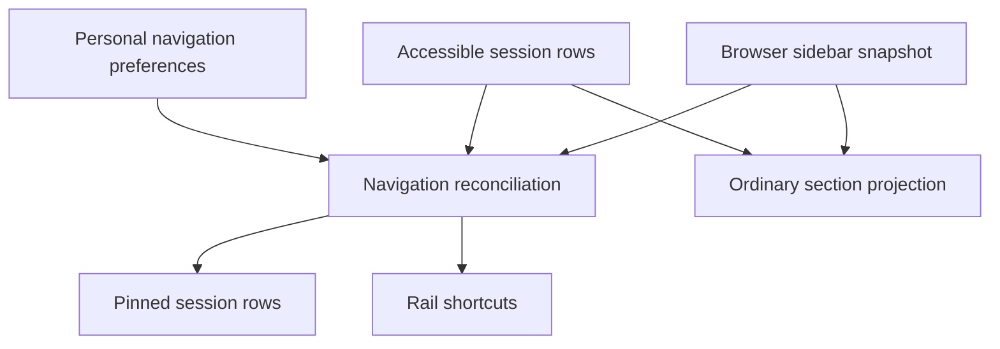

Codex review: blocked before merge.

## What this changes

This PR places personal session pins in a full-row Pinned section while retaining independently removable rail shortcuts.

**Example:** Pin Reliability Tracker in Sessions.
- **Before:** A rail icon appears while the conversation remains in the ordinary list.
- **After:** The conversation moves into Pinned; dragging it onto the rail adds a separate shortcut.

## Review scores

| Measure | Result | What it means |
|---|---|---|
| **Overall readiness** | 🦪 silver shellfish **(2/6)** | The visual change is demonstrated, but three confirmed regressions remain and existing-state compatibility is not established. |
| **Proof confidence** | 🦐 gold shrimp **(3/6)** | Real behavior proof is not required for maintainer- or bot-authored pull requests. |
| **Patch quality** | 🦪 silver shellfish **(2/6)** | 3 actionable review findings remain. |

## Product

**Kind:** Preference · **Worth it:** Yes · **Fix scope:** Complete
**User problem:** Pinned conversations appear as compact rail icons rather than readable rows together above the Sessions list.
**Reason:** The maintainer-authored direction is approved, and the full-row placement improves discoverability without adding a setting.

## Merge readiness

⛔ **Blocked before merge - 6 items remain**

Keep this maintainer-authored PR open: the placement change has clear value, but all three previous correctness findings remain after the dependency-cycle repair.

**Priority:** P2
**Reviewed head:** `fa95a42f978bb3c5c32aa7fb96c31c7bb150ccee`

## Before merge

- [ ] **Preserve headerless ordinary rows in None mode (P2)** - With Group by set to None and any saved session pin, this OR branch forces an Other header before checking the grouping mode. A saved ungrouped collapse then hides ordinary sessions where that preference was previously inert. Archived or unresolved pins produce the same result even when Pinned is absent. Keep the None exclusion outside the pin condition and use displayed pin presence when deciding whether a peer header exists.
- [ ] **Retain reorder controls for sidebar session pins (P2)** - Filtering session pins out of the rail removes their existing drag insertion and Move up/down controls. For two saved sidebar pins, dragging the second above the first reaches sectionDrop, which only calls setPersonalSessionPin(true); an already-pinned entry is unchanged. The ordinary session menu supplies no replacement ordering action. Expose pin ordering through the existing writeSidebarEntryAt owner, including a keyboard and mobile action.
- [ ] **Reconcile older cached sections before rendering Pinned (P2)** - A sidebar snapshot saved before this change can contain a personal pin both in pinnedSessions and in an ordinary cached section, because rail pins previously retained their ordinary rows. This renderer now creates a Pinned row from that snapshot, while zonedVisibleSections calls restoreSnapshotSections without filtering the older section. Reloading therefore displays the conversation twice until live handoff, and collapsing Pinned leaves its ordinary copy visible. Reconcile cached section membership and counts through the snapshot owner before rendering.
- [ ] **Add data-model compatibility proof** - The review found that existing stored data may not work after upgrade. Show that existing data still loads and works with this change.
- [ ] **Explain or restore the original intent of Headerless None grouping** - 87122facbd81b015209daaf24d7e8857f77f378b: https://github.com/openclaw/openclaw/pull/131543 deliberately made None flat and made stored ungrouped collapse inert.
- [ ] **Explain or restore the original intent of Session pin reordering** - 1fed8f304f087bb35059e4cf86b727d4ff3bc730: https://github.com/openclaw/openclaw/pull/168997 provided drag ordering and keyboard-accessible Move up/down controls for saved shortcuts.

## Findings

- [P2] Preserve headerless ordinary rows in None mode — `ui/src/components/app-sidebar-session-projection.ts:601-604`
- [P2] Retain reorder controls for sidebar session pins — `ui/src/components/app-sidebar-rail.tsx:58-61`
- [P2] Reconcile older cached sections before rendering Pinned — `ui/src/components/app-sidebar-session-list-render.tsx:198-200`

### Provenance

- `Headerless None grouping` changes intended behavior without addressing why it exists (87122facbd81b015209daaf24d7e8857f77f378b: https://github.com/openclaw/openclaw/pull/131543 deliberately made None flat and made stored ungrouped collapse inert.)
- `Session pin reordering` changes intended behavior without addressing why it exists (1fed8f304f087bb35059e4cf86b727d4ff3bc730: https://github.com/openclaw/openclaw/pull/168997 provided drag ordering and keyboard-accessible Move up/down controls for saved shortcuts.)

### Tests

- Missing end-to-end proof: Provide a redacted latest-stable upgrade capture preserving saved preferences and cached sections, and show the repaired regressions failing on the base.

<strong>Agent review details</strong>

### How this fits together

The Control UI projects saved personal navigation preferences and accessible session rows into the rail, session sections, selection order, and browser reload snapshots.

### Technical review

Best possible solution:

Use the existing personal preference and ordering owner to render each pin once, preserve headerless None grouping, and retain accessible reorder controls.

Do we have a high-confidence way to reproduce the issue?

Current-main rendering and the inspected before screenshot establish rail placement; the remaining regressions follow directly from the projection, drag, and snapshot paths.

Is this the best way to solve the issue?

Separating placements within the existing preference owner fits the approved direction, but the cutover must include ordering controls and previously saved projections.

Full review comments:

- [P2] Preserve headerless ordinary rows in None mode — `ui/src/components/app-sidebar-session-projection.ts:601-604`
  With Group by set to None and any saved session pin, this OR branch forces an Other header before checking the grouping mode. A saved ungrouped collapse then hides ordinary sessions where that preference was previously inert. Archived or unresolved pins produce the same result even when Pinned is absent. Keep the None exclusion outside the pin condition and use displayed pin presence when deciding whether a peer header exists.
  Confidence: 0.99
- [P2] Retain reorder controls for sidebar session pins — `ui/src/components/app-sidebar-rail.tsx:58-61`
  Filtering session pins out of the rail removes their existing drag insertion and Move up/down controls. For two saved sidebar pins, dragging the second above the first reaches sectionDrop, which only calls setPersonalSessionPin(true); an already-pinned entry is unchanged. The ordinary session menu supplies no replacement ordering action. Expose pin ordering through the existing writeSidebarEntryAt owner, including a keyboard and mobile action.
  Confidence: 0.99
- [P2] Reconcile older cached sections before rendering Pinned — `ui/src/components/app-sidebar-session-list-render.tsx:198-200`
  A sidebar snapshot saved before this change can contain a personal pin both in pinnedSessions and in an ordinary cached section, because rail pins previously retained their ordinary rows. This renderer now creates a Pinned row from that snapshot, while zonedVisibleSections calls restoreSnapshotSections without filtering the older section. Reloading therefore displays the conversation twice until live handoff, and collapsing Pinned leaves its ordinary copy visible. Reconcile cached section membership and counts through the snapshot owner before rendering.
  Confidence: 0.99

Overall correctness: patch is incorrect
Overall confidence: 0.98

AGENTS.md: found and applied where relevant.

Codex review notes: model internal, reasoning medium; reviewed against [42c0d5a8f9d0](https://github.com/openclaw/openclaw/commit/42c0d5a8f9d00e113c48090c3d259977e67b5b5a).

### Provenance checked

- `Personal session placement and independent rail shortcuts` changes intended behavior with a stated reason (fd018170c94387e843076b259ee54d8998ba935f: https://github.com/openclaw/openclaw/pull/168325 established personal navigation references separate from shared session metadata.)
- `Retained cached sidebar projections` keeps the original intent (5b1b96b953e5d42480a982c4f5c4c6acbb9ce177: https://github.com/openclaw/openclaw/pull/179254 preserves admitted cached rows, sections, and expansion until the live roster can replace them.)

### Testing

Proof path: shipped entry point.

### Security

None.

### Evidence

Acceptance criteria:

- node scripts/run-vitest.mjs run --config test/vitest/vitest.ui.config.ts ui/src/components/app-sidebar-session-projection.test.ts ui/src/components/sidebar-snapshot-model.test.ts ui/src/components/app-sidebar-rail.test.ts
- pnpm test:ui:e2e ui/src/e2e/sidebar-pin-placement.e2e.test.ts ui/src/e2e/sidebar-cold-load.e2e.test.ts
- Verify None grouping with saved ungrouped collapse and active, archived, and unresolved pins.
- Verify drag and keyboard/mobile pin reordering survives reload without changing independent rail shortcuts.
- Upgrade from v2026.10.6 with existing personal navigation and cached sidebar state; confirm preserved settings and one visible row per pin.

What I checked:

- **Exact-head re-review:** The delta from the previously reviewed fd40d391c8b1c98602292fd3afdb591a846e09c0 moves pin contracts into the existing leaf types module; it does not repair the three reported behaviors. ([`ui/src/components/app-sidebar-session-types.ts:567`](https://github.com/openclaw/openclaw/blob/fa95a42f978bb3c5c32aa7fb96c31c7bb150ccee/ui/src/components/app-sidebar-session-types.ts#L567), [fa95a42f978b](https://github.com/openclaw/openclaw/commit/fa95a42f978bb3c5c32aa7fb96c31c7bb150ccee))
- **Flat grouping regression:** Saved pin membership bypasses the None grouping exclusion, enabling an Other header and applying a previously inert ungrouped collapse; https://github.com/openclaw/openclaw/pull/131543 explicitly established headerless None behavior. ([`ui/src/components/app-sidebar-session-projection.ts:602`](https://github.com/openclaw/openclaw/blob/fa95a42f978bb3c5c32aa7fb96c31c7bb150ccee/ui/src/components/app-sidebar-session-projection.ts#L602), [fa95a42f978b](https://github.com/openclaw/openclaw/commit/fa95a42f978bb3c5c32aa7fb96c31c7bb150ccee))
- **Pin ordering loses its controls:** Sidebar session entries are filtered out of the rail, where drag insertion and Move up/down controls live; their replacement rows expose ordinary session actions, and dropping an existing pin on Pinned does not change its saved position. ([`ui/src/components/app-sidebar-rail.tsx:61`](https://github.com/openclaw/openclaw/blob/fa95a42f978bb3c5c32aa7fb96c31c7bb150ccee/ui/src/components/app-sidebar-rail.tsx#L61), [fa95a42f978b](https://github.com/openclaw/openclaw/commit/fa95a42f978bb3c5c32aa7fb96c31c7bb150ccee))
- **Older snapshot duplication:** The new Pinned renderer reads cached pin entries, while restoreSnapshotSections restores older ordinary sections without removing those same rows. ([`ui/src/components/app-sidebar-session-list-render.tsx:198`](https://github.com/openclaw/openclaw/blob/fa95a42f978bb3c5c32aa7fb96c31c7bb150ccee/ui/src/components/app-sidebar-session-list-render.tsx#L198), [fa95a42f978b](https://github.com/openclaw/openclaw/commit/fa95a42f978bb3c5c32aa7fb96c31c7bb150ccee))
- **Current main still uses rail pins:** Fetched main renders personal session entries directly in the rail and has no session-rail discriminator, so this PR's central change is not implemented there. ([`ui/src/components/app-sidebar-rail.tsx:58`](https://github.com/openclaw/openclaw/blob/42c0d5a8f9d00e113c48090c3d259977e67b5b5a/ui/src/components/app-sidebar-rail.tsx#L58), [42c0d5a8f9d0](https://github.com/openclaw/openclaw/commit/42c0d5a8f9d00e113c48090c3d259977e67b5b5a))
- **Inspected visual evidence:** The downloaded before/after screenshots show Reliability Tracker moving into Pinned with its full title and icon; the other downloaded pair illustrates historical None-grouping behavior from https://github.com/openclaw/openclaw/pull/131543. ([fa95a42f978b](https://github.com/openclaw/openclaw/commit/fa95a42f978bb3c5c32aa7fb96c31c7bb150ccee))

Likely related people:

- **RoboClaw:** Raw commit fd018170c94387e843076b259ee54d8998ba935f adds ui/src/components/session-organizer-controller.ts:173 relative to its recorded parents. This identifies author metadata, not feature responsibility or a PR merger. (role: source-line author; confidence: high; commits: [fd018170c943](https://github.com/openclaw/openclaw/commit/fd018170c94387e843076b259ee54d8998ba935f); files: `ui/src/components/session-organizer-controller.ts`)

### PR surface

Source +142, Tests +283, Docs +6. Total +431 across 37 files. Added test files: 1.

View PR surface stats

| Area | Files | Added | Removed | Net |
|---|---:|---:|---:|---:|
| Source | 14 | 220 | 78 | +142 |
| Tests | 22 | 422 | 139 | +283 |
| Docs | 1 | 11 | 5 | +6 |
| Config | 0 | 0 | 0 | 0 |
| Generated | 0 | 0 | 0 | 0 |
| Other | 0 | 0 | 0 | 0 |
| **Total** | **37** | **653** | **222** | **+431** |

### Review metrics

| Metric | Value | Why it matters |
|---|---|---|
| **Persisted navigation format** | 1 new entry prefix: session-rail: | The existing preference now stores two independent placements for one session, making existing-state compatibility relevant. |

### Root-cause cluster

Relationship: `fixed_by_candidate`
Canonical: https://github.com/openclaw/openclaw/issues/179018
Summary: Both proposals address full-row sidebar pins, but they retain different session rail capabilities.

Members:
- `canonical`: https://github.com/openclaw/openclaw/issues/179018 - It states the sidebar placement, ordering, persistence, and mobile requirements.
- `partial_overlap`: https://github.com/openclaw/openclaw/pull/179023 - It implements the same sidebar placement while removing session rail shortcuts.

Proposal only: this assessment does not dispatch repair, suppress jobs, mutate sibling items, close, or merge anything.

### Labels

Label changes:

- add `merge-risk: 🚨 compatibility`: Existing personal pins lose reorder controls, and previously saved sidebar sections can render duplicate pinned rows.

Label justifications:

- `P2`: The change improves sidebar organization, while the remaining regressions affect grouping, ordering, and reload presentation.
- `merge-risk: 🚨 compatibility`: Existing personal pins lose reorder controls, and previously saved sidebar sections can render duplicate pinned rows.
- `rating: 🦪 silver shellfish`: Overall readiness is 🦪 silver shellfish; proof is 🦐 gold shrimp and patch quality is 🦪 silver shellfish.
- `status: ⏳ waiting on author`: ClawSweeper has contributor-facing work open and is waiting for author action.

### Rating scale

6/6 🦀 challenger crab · 5/6 🦞 diamond lobster · 4/6 🐚 platinum hermit · 3/6 🦐 gold shrimp · 2/6 🦪 silver shellfish · 1/6 🧂 unranked krab. Overall follows the weaker of proof and patch quality; ✨ marks media proof (a screenshot, video, or linked artifact) that directly shows the changed behavior.

### Workflow

ClawSweeper edits this one comment on every review. Comment `@clawsweeper re-review` for a fresh review only. Repair and merge execution lanes are retired.

### History

Review history (2 earlier review cycles)

<!-- clawsweeper-review-history v=1 total=2 -->
- reviewed 2026-10-20T05:14:20.800Z sha 9fd0d459ee2b124504d03aa9b2175e1210d0a54d :: blocked before merge. :: [P2] Preserve the Pinned collapse state in sidebar snapshots
- reviewed 2026-10-22T18:34:38.107Z sha fd40d391c8b1c98602292fd3afdb591a846e09c0 :: blocked before merge. :: [P2] Preserve headerless ordinary rows in None mode | [P2] Retain reorder controls for sidebar session pins | [P2] Reconcile older cached sections before rendering Pinned

_Reviewed October 22, 2026, 2:45 PM ET / 18:45 UTC (Revision 3)._

<!-- clawsweeper-verdict:needs-human item=178066 sha=fa95a42f978bb3c5c32aa7fb96c31c7bb150ccee confidence=high updated_at=2026-10-22T18:39:10Z reviewed_at=2026-10-22T18:45:01.390Z lease_owner=github-run-39833161223-1 lease_comment_id=6348414440 source_revision=a374c86010adc3ab249f579e4ca152e061735e0518516a32c0227191b6dc0c3d hold=blocked findings=3 -->
<!-- clawsweeper-review-state:blocked item=178066 sha=fa95a42f978bb3c5c32aa7fb96c31c7bb150ccee v=1 -->

<!-- clawsweeper-review-version item=178066 reviewed_at=2026-10-22T18:45:01.390Z sha=fa95a42f978bb3c5c32aa7fb96c31c7bb150ccee source_revision=a374c86010adc3ab249f579e4ca152e061735e0518516a32c0227191b6dc0c3d lease_owner=github-run-39833161223-1 lease_comment_id=6348414440 v=1 -->

<!-- clawsweeper-review item=178066 -->