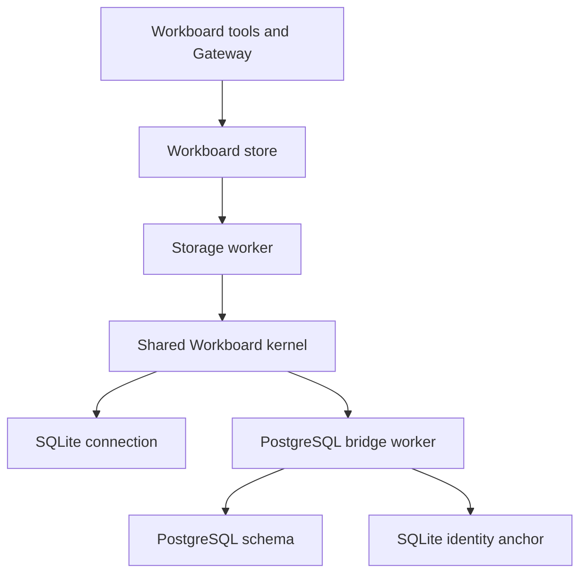

Codex review: needs real behavior proof before merge.

## What this changes

This PR adds an optional experimental PostgreSQL backend for Workboard while retaining SQLite as the default.

**Example:** A new Workboard installation selects database.engine="postgres" and schemaPrefix="team".
- **Before:** Workboard stores boards, cards, and attachments in SQLite.
- **After:** Workboard stores them in a PostgreSQL schema named team_workboard_&lt;store-id-prefix>, with a local SQLite identity anchor.

## Review scores

| Measure | Result | What it means |
|---|---|---|
| **Overall readiness** | 🧂 unranked krab **(1/6)** | The approved architecture has substantial reported conformance coverage, but a reply-boundary defect and mandatory authority and upgrade verification prevent readiness. |
| **Proof confidence** | 🧂 unranked krab **(1/6)** | Real behavior proof is necessary before merge. See [Before merge](#before-merge). |
| **Patch quality** | 🦐 gold shrimp **(3/6)** | Security review found an item that needs attention. |

## Product

**Kind:** Feature · **Worth it:** Yes · **Fix scope:** Complete
**User problem:** Operators cannot use PostgreSQL for Workboard persistence.
**Reason:** The maintainer explicitly owns the experimental direction and its limits; the implementation retains one Workboard kernel and preserves SQLite as the default.

## Merge readiness

⛔ **Blocked before merge - 5 items remain**

Keep this PR open: it delivers a maintainer-approved PostgreSQL pilot, but uncertain-write classification still breaks across Workboard replies.

**Priority:** P2
**Reviewed head:** `741fd94fb226118eb51013f90a76d0064711cbd0`

## Before merge

- [ ] **Add real behavior proof** - Authority-chain proof required: provide redacted terminal output or logs through a Workboard tool or Gateway method, storage worker, and real PostgreSQL client showing an allowed upload persists and an upload revoked during queueing or advisory-lock waiting is rejected before COMMIT; query physical blob and metadata rows to confirm the forbidden upload is absent. The reported conformance and connection-termination suites do not exercise this scenario. Also show a v2026.10.2 upgrade retaining populated SQLite Workboard data and settings. Redact credentials, IPs, phone numbers, and non-public endpoints. After adding proof, update the PR body; ClawSweeper should re-review automatically. If it does not, the PR author or someone with repository write access can comment `@clawsweeper re-review`.
- [ ] **Preserve uncertain-outcome classification through Workboard replies (P2)** - When PostgreSQL loses its connection during COMMIT, the new write path throws a canonical SqliteWorkerError and this backend catches it into encodeWorkboardSqliteFailure. The outer worker then V8-serializes the envelope. The codec restores name and code but omits the private retainedWorkerErrorCode marker, so hasSqliteWorkerOutcomeUnknown on the host returns false even though the write may have committed. Preserve canonical classification explicitly across this envelope and cover a failure returned through createWorkboardSqliteStores, rather than only a direct PostgresSyncConnection call. This previously reported finding remains unresolved.
- [ ] **Resolve security concern: Verify revoked upload authority before PostgreSQL publication** - The new backend admits writes before advisory-lock waiting and requests host authority again before COMMIT. Existing upload tests skip PostgreSQL, so they do not establish rejection of a disabled upload at this final effect boundary or confirm physical blob and metadata cleanup.
- [ ] **Resolve merge risk** - Establish that upload authority revoked during Workboard queueing or PostgreSQL advisory-lock waiting prevents durable blob and metadata publication.
- [ ] **Add data-model compatibility proof** - The review found that existing stored data may not work after upgrade. Show that existing data still loads and works with this change.

## Findings

- [P2] Preserve uncertain-outcome classification through Workboard replies — `extensions/workboard/src/sqlite-store.worker.ts:158-159`
- [medium] Verify revoked upload authority before PostgreSQL publication — `src/infra/postgres-sync/transaction.ts:59`

### Tests

- Missing end-to-end proof: Supply a Workboard upload trace proving allowed persistence and rejection after revocation during queueing or PostgreSQL lock waiting, plus a v2026.10.2 upgrade preserving populated SQLite data and settings.

<strong>Agent review details</strong>

### How this fits together

Workboard tools and Gateway methods submit storage operations to a worker; the selected SQL connection persists boards, cards, attachments, and session placements and publishes cache-invalidating receipts.

### Technical review

Best possible solution:

Preserve canonical uncertain-write errors through Workboard replies and verify the approved backend through upload-authority and stable-release upgrade scenarios.

Do we have a high-confidence way to reproduce the issue?

Source establishes the lost-marker path through Workboard's serialized error envelope; no runtime reproduction or target-code execution was performed.

Is this the best way to solve the issue?

The shared Workboard kernel and worker-owned PostgreSQL client fit the approved pilot, but connection-level tests do not validate error classification across the Workboard reply boundary.

Full review comments:

- [P2] Preserve uncertain-outcome classification through Workboard replies — `extensions/workboard/src/sqlite-store.worker.ts:158-159`
  When PostgreSQL loses its connection during COMMIT, the new write path throws a canonical SqliteWorkerError and this backend catches it into encodeWorkboardSqliteFailure. The outer worker then V8-serializes the envelope. The codec restores name and code but omits the private retainedWorkerErrorCode marker, so hasSqliteWorkerOutcomeUnknown on the host returns false even though the write may have committed. Preserve canonical classification explicitly across this envelope and cover a failure returned through createWorkboardSqliteStores, rather than only a direct PostgresSyncConnection call. This previously reported finding remains unresolved.
  Confidence: 0.99

Overall correctness: patch is incorrect
Overall confidence: 0.96

AGENTS.md: found and applied where relevant.

Codex review notes: model internal, reasoning medium; reviewed against [438e06c68838](https://github.com/openclaw/openclaw/commit/438e06c68838bbc304c5552ba1e371b243677a7c).

### Merge-risk options

**Maintainer options:**
1. **Hold for final-effect authority verification (recommended)**  
   Keep this PR open until allowed uploads and uploads revoked during queueing or lock waiting are exercised through Workboard and the real PostgreSQL client, with physical persistence observations.

### Provenance checked

- `Workboard storage and worker lifecycle` keeps the original intent (38fb08d04bd410122b4adcc5c1e43c54ed25b0b4: Move database work off the Gateway event loop while retaining data format, logical leases, draining, and retryable cleanup.)
- `Transaction recovery` keeps the original intent (3d0254af02bacf51da80322a3b9e79fd8c4052c0: Retain terminal failures and refuse continuation after failed rollback; the new backend retires failed connections through its own connection owner.)
- `PostgreSQL schema generation` changes intended behavior with a stated reason (457515502e84954c8061f9b151d63d92770d2a29: Generate a deterministic PostgreSQL projection from canonical SQLite schemas before runtime conformance; this maintainer-authored PR deliberately advances to a Workboard-only runtime pilot.)
- `SQLite dialect ratchet` keeps the original intent (a1c1610b1907a3750f623297af19dedd425f7399: Prevent SQLite-specific SQL debt growth; the patch distinguishes portable savepoints and table column lists from engine-specific constructs.)

### Testing

Proof path: in-process harness.

### Security

Needs attention: Upload revocation across the new PostgreSQL persistence boundary remains unverified; no concrete authorization bypass was established.

### Evidence

Security concerns:

- [medium] Verify revoked upload authority before PostgreSQL publication — `src/infra/postgres-sync/transaction.ts:59`
  The new backend admits writes before advisory-lock waiting and requests host authority again before COMMIT. Existing upload tests skip PostgreSQL, so they do not establish rejection of a disabled upload at this final effect boundary or confirm physical blob and metadata cleanup.
  Confidence: 0.92

What I checked:

- **Approved direction and accepted pilot limits:** The maintainer-authored body explicitly selects an experimental Workboard-only backend, keeps SQLite as default, refuses engine switching for existing SQLite stores, requires paired backups, and accepts synchronous_commit=off. These choices do not require another product approval. ([741fd94fb226](https://github.com/openclaw/openclaw/commit/741fd94fb226118eb51013f90a76d0064711cbd0))
- **Current main remains SQLite-only:** Fetched main opens the native SQLite database and installs the Workboard SQLite schema without PostgreSQL selection. ([`extensions/workboard/src/sqlite-store-schema.ts:335`](https://github.com/openclaw/openclaw/blob/438e06c68838bbc304c5552ba1e371b243677a7c/extensions/workboard/src/sqlite-store-schema.ts#L335), [438e06c68838](https://github.com/openclaw/openclaw/commit/438e06c68838bbc304c5552ba1e371b243677a7c))
- **Uncertain errors lose canonical classification:** PostgreSQL connection loss creates a branded SqliteWorkerError. Workboard catches it inside its result envelope, serializes that envelope through V8, and restores ordinary error fields without restoring the private classification marker. ([`extensions/workboard/src/sqlite-store-errors.ts:25`](https://github.com/openclaw/openclaw/blob/741fd94fb226118eb51013f90a76d0064711cbd0/extensions/workboard/src/sqlite-store-errors.ts#L25), [741fd94fb226](https://github.com/openclaw/openclaw/commit/741fd94fb226118eb51013f90a76d0064711cbd0))
- **Canonical checker requires the private marker:** hasSqliteWorkerOutcomeUnknown checks the retained symbol, including through causes and aggregates; an error's name and public code are insufficient. ([`src/infra/sqlite-worker-contract.ts:217`](https://github.com/openclaw/openclaw/blob/741fd94fb226118eb51013f90a76d0064711cbd0/src/infra/sqlite-worker-contract.ts#L217), [741fd94fb226](https://github.com/openclaw/openclaw/commit/741fd94fb226118eb51013f90a76d0064711cbd0))
- **Prior findings reassessed:** The new head adds the previously missing wrapper inventory entries. Transaction dispatch now uses a lightweight branded interface and delegates to the PostgreSQL transaction owner; the remaining duplicate validator has no established failing behavior and is not re-raised as a correctness defect. The Workboard uncertain-error codec is unchanged. ([`scripts/pr-lib/wrapper-components.txt:348`](https://github.com/openclaw/openclaw/blob/741fd94fb226118eb51013f90a76d0064711cbd0/scripts/pr-lib/wrapper-components.txt#L348), [741fd94fb226](https://github.com/openclaw/openclaw/commit/741fd94fb226118eb51013f90a76d0064711cbd0))
- **Authority coverage does not reach PostgreSQL upload persistence:** Existing upload-policy cases inspect physical SQLite rows and are skipped for PostgreSQL. The added PostgreSQL termination tests operate directly on the connection rather than through Workboard uploads and their host authority. ([`extensions/workboard/src/tools.upload-policy.test.ts:44`](https://github.com/openclaw/openclaw/blob/741fd94fb226118eb51013f90a76d0064711cbd0/extensions/workboard/src/tools.upload-policy.test.ts#L44), [741fd94fb226](https://github.com/openclaw/openclaw/commit/741fd94fb226118eb51013f90a76d0064711cbd0))

Likely related people:

- **Peter Steinberger:** Raw commit 457515502e84954c8061f9b151d63d92770d2a29 adds scripts/generate-postgres-schema.mts:14 relative to its recorded parents. This identifies author metadata, not feature responsibility or a PR merger. (role: source-line author; confidence: high; commits: [457515502e84](https://github.com/openclaw/openclaw/commit/457515502e84954c8061f9b151d63d92770d2a29); files: `scripts/generate-postgres-schema.mts`)

### PR surface

Source +1412, Tests +1522, Docs +33, Config +3, Generated 0, Other +192. Total +3162 across 76 files. Added test files: 14.

View PR surface stats

| Area | Files | Added | Removed | Net |
|---|---:|---:|---:|---:|
| Source | 31 | 1724 | 312 | +1412 |
| Tests | 32 | 1630 | 108 | +1522 |
| Docs | 1 | 33 | 0 | +33 |
| Config | 1 | 4 | 1 | +3 |
| Generated | 2 | 3 | 3 | 0 |
| Other | 9 | 212 | 20 | +192 |
| **Total** | **76** | **3606** | **444** | **+3162** |

### Review metrics

| Metric | Value | Why it matters |
|---|---|---|
| **New configuration fields** | 3 | Adds database.engine, database.postgres.connection, and database.postgres.schemaPrefix; engine selection is optional and SQLite remains the default. |

### Labels

Label changes:

- remove `merge-risk: 🚨 automation`: Current PR review merge-risk labels are `merge-risk: 🚨 compatibility`, `merge-risk: 🚨 security-boundary`.

Label justifications:

- `P2`: This is an optional experimental backend with a limited Workboard blast radius and a source-established error-classification defect.
- `merge-risk: 🚨 compatibility`: Adds configuration and SDK connection capabilities plus a persistent anchor/schema contract; stable-release upgrade preservation remains unproved.
- `merge-risk: 🚨 security-boundary`: Upload publication crosses PostgreSQL transport and lock waiting, requiring verification that revoked authority cannot reach durable persistence.
- `rating: 🧂 unranked krab`: Overall readiness is 🧂 unranked krab; proof is 🧂 unranked krab and patch quality is 🦐 gold shrimp.
- `status: 📣 needs proof`: The PR needs real behavior proof before ClawSweeper can clear the contributor ask.

### Rank-up moves

Optional improvements that raise the rating; they are not merge blockers.

- Prove allowed and revoked uploads through the final PostgreSQL persistence boundary.
- Demonstrate a stable-release upgrade with existing SQLite Workboard data and settings intact.

### Rating scale

6/6 🦀 challenger crab · 5/6 🦞 diamond lobster · 4/6 🐚 platinum hermit · 3/6 🦐 gold shrimp · 2/6 🦪 silver shellfish · 1/6 🧂 unranked krab. Overall follows the weaker of proof and patch quality; ✨ marks media proof (a screenshot, video, or linked artifact) that directly shows the changed behavior.

### Workflow

ClawSweeper edits this one comment on every review. Comment `@clawsweeper re-review` for a fresh review only. Repair and merge execution lanes are retired.

### History

Review history (8 earlier review cycles)

<!-- clawsweeper-review-history v=1 total=8 -->
- reviewed 2026-10-11T16:38:42.007Z sha d04728300d9398c9574fd17602ec575090e28810 :: needs real behavior proof before merge. :: [P2] Preserve unknown-outcome classification across Workboard worker replies
- reviewed 2026-10-11T18:38:54.812Z sha 46a406a9d916652543eac38d39039f9188a85ca0 :: needs real behavior proof before merge. :: [P2] Preserve unknown-outcome classification across Workboard replies
- reviewed 2026-10-11T19:01:09.208Z sha 251d732325841497bea3170758abb0b4f8b2375c :: needs real behavior proof before merge. :: [P2] Preserve unknown-outcome classification across Workboard replies
- reviewed 2026-10-11T23:29:55.621Z sha 9a8c7dac78527ae9bef9fc5a657bb9a250fdef7d :: needs real behavior proof before merge. :: [P2] Preserve unknown-outcome classification across Workboard replies
- reviewed 2026-10-12T04:34:58.173Z sha e2d365922fa3cec4e7b97efb3fd42f66d399323f :: needs real behavior proof before merge. :: [P2] Preserve unknown-outcome classification across Workboard replies
- reviewed 2026-10-12T04:54:09.567Z sha e2d365922fa3cec4e7b97efb3fd42f66d399323f :: needs real behavior proof before merge. :: [P2] Preserve unknown-outcome classification across Workboard replies
- reviewed 2026-10-12T05:11:41.490Z sha e2d365922fa3cec4e7b97efb3fd42f66d399323f :: needs real behavior proof before merge. :: [P2] Preserve unknown-outcome classification across Workboard replies
- reviewed 2026-10-12T07:04:09.433Z sha 02be1c2efe01d1b986a06666c846c0556114d723 :: needs real behavior proof before merge. :: [P2] Preserve uncertain-outcome classification through Workboard replies | [P1] Include the new imports in the trusted wrapper source inventory | [P2] Use one owner for transaction-usability validation

_Reviewed October 12, 2026, 4:50 AM ET / 08:50 UTC (Revision 9)._

<!-- clawsweeper-security:security-sensitive item=169214 sha=741fd94fb226118eb51013f90a76d0064711cbd0 confidence=high updated_at=2026-10-12T08:43:11Z reviewed_at=2026-10-12T08:50:21.356Z lease_owner=github-run-38225171734-1 lease_comment_id=6120796453 source_revision=733bee14ea2c63acc7202130d69ea70771ff79bae7fb710346c9578811d73636 -->
<!-- clawsweeper-verdict:needs-human item=169214 sha=741fd94fb226118eb51013f90a76d0064711cbd0 confidence=high updated_at=2026-10-12T08:43:11Z reviewed_at=2026-10-12T08:50:21.356Z lease_owner=github-run-38225171734-1 lease_comment_id=6120796453 source_revision=733bee14ea2c63acc7202130d69ea70771ff79bae7fb710346c9578811d73636 hold=security findings=1 -->
<!-- clawsweeper-review-state:blocked item=169214 sha=741fd94fb226118eb51013f90a76d0064711cbd0 v=1 -->

<!-- clawsweeper-review-version item=169214 reviewed_at=2026-10-12T08:50:21.356Z sha=741fd94fb226118eb51013f90a76d0064711cbd0 source_revision=733bee14ea2c63acc7202130d69ea70771ff79bae7fb710346c9578811d73636 lease_owner=github-run-38225171734-1 lease_comment_id=6120796453 v=1 -->

<!-- clawsweeper-review item=169214 -->