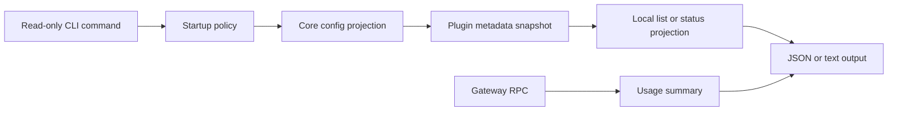

Codex review: needs maintainer review before merge. _Reviewed August 2, 2026, 5:37 AM ET / 09:37 UTC._

# ClawSweeper review

## What this changes

The branch keeps nine read-only CLI commands cold by skipping unnecessary plugin validation and loading, reusing a single plugin metadata snapshot for channel listings, and returning the first `usage.cost` Gateway response instead of polling for cache freshness.

## Merge readiness

⚠️ **Ready for maintainer review - 5 items remain**

This PR remains necessary: it extends the recently merged CLI cold-path work to additional read-only commands and removes command-local metadata rediscovery. The manifest-first snapshot design matches the repository’s hot-path guidance, and no concrete patch defect was established, but the `maintainer` label requires human handling and the local sibling Codex source required to independently verify the `models status` Codex-runtime contract is unavailable.

**Priority:** P2
**Reviewed head:** `5b701d953dd8861ea75740f869e8364285e1a7ee`
**Owner decision:** Required. See [Decision needed](#decision-needed).

## Review scores

| Measure | Result | What it means |
|---|---|---|
| **Overall readiness** | 🐚 platinum hermit **(4/6)** | The branch has strong focused behavior evidence and coherent manifest-first ownership, with a remaining compatibility decision and unavailable local Codex-contract check. |
| **Proof confidence** | 🐚 platinum hermit **(4/6)** | Sufficient (live_output): The PR body supplies after-fix production and local command timings plus route-level cold-import and one-RPC assertions; a maintainer still needs to confirm the supported all-agent timeout envelope before merge. |
| **Patch quality** | 🐚 platinum hermit **(4/6)** | No actionable review findings were identified. |

## Verification

| Check | Result | Evidence |
|---|---|---|
| **Real behavior** | Verified | Sufficient (live_output): The PR body supplies after-fix production and local command timings plus route-level cold-import and one-RPC assertions; a maintainer still needs to confirm the supported all-agent timeout envelope before merge. |
| **Evidence reviewed** | 6 items | Manifest-first channel-list path: The branch reads valid core configuration while skipping plugin-schema validation, resolves one process-stable metadata snapshot, and passes its discovery/index facts to the channel readers instead of rediscovering plugins per catalog row. Gateway owns cached usage summaries: The Gateway has a dedicated `usage.cost` handler and cache-loading path, supporting the branch’s removal of CLI-side freshness polling while preserving the returned cache-status information. Usage-cost command contract changed deliberately: Current main gives `gateway usage-cost` a five-minute command default and polls for a fresh cache; the branch instead sends one RPC through the ordinary transport options, retaining explicit `--timeout` handling but changing the default wait behavior to the standard RPC timeout. |
| **Findings** | None | None. |
| **Security** | None | None. |

## How this fits together

The CLI’s startup policy decides whether a command performs local config and plugin work before dispatching to a local projection or the running Gateway. This PR keeps read-only commands on manifest-backed control-plane data and lets the Gateway own cached usage-summary refreshes.

## Decision needed

| Question | Recommendation |
|---|---|
| Should `gateway usage-cost` adopt the standard 10-second default RPC timeout now that it returns cached or in-flight summaries immediately, rather than preserve its former five-minute freshness-wait budget? | **Accept immediate cached summaries:** Keep the one-RPC implementation and standard timeout, with the Gateway continuing background refresh ownership. |

Why: This is an operator-visible compatibility choice: the branch intentionally changes latency and freshness semantics, and supported high-volume all-agent deployments determine whether the shorter default is safe.

## Before merge

- [ ] **Resolve merge risk (P2)** - `gateway usage-cost` changes its default transport timeout from five minutes to the standard 10-second RPC timeout while intentionally stopping cache-freshness polling; confirm that cached all-agent summaries remain safely responsive under supported production load.
- [ ] **Resolve merge risk (P1)** - The `models status` change touches Codex runtime availability, but this review could not inspect the required sibling Codex source because `../codex` is absent.
- [ ] **Resolve merge risk (P1)** - The protected `maintainer` label requires explicit human handling before merge.
- [ ] **Complete next step (P2)** - No mechanical repair is identified; human confirmation is needed for the usage-cost timeout compatibility choice and the required Codex dependency-contract check.

<strong>Agent review details</strong>

### Security

None.

### PR surface

Source +26, Tests +282. Total +308 across 30 files.

View PR surface stats

| Area | Files | Added | Removed | Net |
|---|---:|---:|---:|---:|
| Source | 17 | 175 | 149 | +26 |
| Tests | 13 | 375 | 93 | +282 |
| Docs | 0 | 0 | 0 | 0 |
| Config | 0 | 0 | 0 | 0 |
| Generated | 0 | 0 | 0 | 0 |
| Other | 0 | 0 | 0 | 0 |
| **Total** | **30** | **550** | **242** | **+308** |

### Review metrics

| Metric | Value | Why it matters |
|---|---|---|
| **Startup-policy changes** | 9 read-only command paths | The branch broadens cold-path startup behavior across several operator commands, making preserved validation and timeout contracts material before merge. |

### Stored data model

Persistent data-model change detected: `persistent cache schema: src/cli/gateway-cli.coverage.test.ts`, `serialized state: src/cli/models-status-route-cold-imports.test.ts`, `vector/embedding metadata: src/channels/plugins/read-only.ts`, `vector/embedding metadata: src/cli/channels-list-route-cold-imports.test.ts`, `vector/embedding metadata: src/commands/channels.list.test.ts`, `vector/embedding metadata: src/commands/channels/list.ts`. Confirm migration or upgrade compatibility proof before merge.

### Merge-risk options

**Maintainer options:**
1. **Confirm one-RPC timeout behavior (recommended)**  
   Verify a representative all-agent cached and refreshing usage summary under the intended production topology before accepting the shorter default timeout.
2. **Keep the prior timeout default**  
   Preserve the five-minute command default while removing only the freshness polling if operators need more than the standard RPC window.
3. **Defer the semantic change**  
   Pause or split the usage-cost portion if the supported latency envelope cannot be demonstrated before merge.

### Technical review

Best possible solution:

Merge only after a maintainer confirms the one-RPC usage-cost timeout behavior is acceptable for supported all-agent deployments and a reviewer with the sibling Codex checkout verifies the lazy runtime-availability contract; otherwise retain the manifest-first cold-path changes and narrow only the affected command behavior.

Do we have a high-confidence way to reproduce the issue?

Yes for the code-path change: current main polls `usage.cost` until freshness with a five-minute default, while the branch performs one RPC; the reported large-plugin timing topology was not independently available in this read-only checkout.

Is this the best way to solve the issue?

Mostly yes: the prepared metadata snapshot follows the repository’s manifest-first, process-stable metadata model, but the shorter usage-cost default timeout and Codex runtime contract need explicit confirmation before this is the best complete solution.

AGENTS.md: found and applied where relevant.

Codex review notes: model internal, reasoning high; reviewed against [c4810336d575](https://github.com/openclaw/openclaw/commit/c4810336d5756e2effc206956464f3c11cb61207).

### Labels

Label changes:

- add `P2`: This is a bounded performance improvement across common CLI read paths, without evidence of an urgent current user outage.
- add `merge-risk: 🚨 compatibility`: The branch changes plugin-validation startup behavior and changes the default timeout/freshness behavior of an existing CLI command.
- add `proof: sufficient`: Contributor real behavior proof is sufficient. The PR body supplies after-fix production and local command timings plus route-level cold-import and one-RPC assertions; a maintainer still needs to confirm the supported all-agent timeout envelope before merge.
- add `rating: 🐚 platinum hermit`: Overall readiness is 🐚 platinum hermit; proof is 🐚 platinum hermit and patch quality is 🐚 platinum hermit.
- add `status: 👀 ready for maintainer look`: ClawSweeper has no concrete contributor-facing blocker left for this PR. Sufficient (live_output): The PR body supplies after-fix production and local command timings plus route-level cold-import and one-RPC assertions; a maintainer still needs to confirm the supported all-agent timeout envelope before merge.

Label justifications:

- `P2`: This is a bounded performance improvement across common CLI read paths, without evidence of an urgent current user outage.
- `merge-risk: 🚨 compatibility`: The branch changes plugin-validation startup behavior and changes the default timeout/freshness behavior of an existing CLI command.
- `rating: 🐚 platinum hermit`: Overall readiness is 🐚 platinum hermit; proof is 🐚 platinum hermit and patch quality is 🐚 platinum hermit.
- `status: 👀 ready for maintainer look`: ClawSweeper has no concrete contributor-facing blocker left for this PR. Sufficient (live_output): The PR body supplies after-fix production and local command timings plus route-level cold-import and one-RPC assertions; a maintainer still needs to confirm the supported all-agent timeout envelope before merge.
- `proof: sufficient`: Contributor real behavior proof is sufficient. The PR body supplies after-fix production and local command timings plus route-level cold-import and one-RPC assertions; a maintainer still needs to confirm the supported all-agent timeout envelope before merge.

### Evidence

What I checked:

- **Manifest-first channel-list path:** The branch reads valid core configuration while skipping plugin-schema validation, resolves one process-stable metadata snapshot, and passes its discovery/index facts to the channel readers instead of rediscovering plugins per catalog row. ([`src/commands/channels/list.ts:150`](https://github.com/openclaw/openclaw/blob/5b701d953dd8/src/commands/channels/list.ts#L150), [5b701d953dd8](https://github.com/openclaw/openclaw/commit/5b701d953dd8))
- **Gateway owns cached usage summaries:** The Gateway has a dedicated `usage.cost` handler and cache-loading path, supporting the branch’s removal of CLI-side freshness polling while preserving the returned cache-status information. ([`src/gateway/server-methods/usage.ts:1037`](https://github.com/openclaw/openclaw/blob/c4810336d575/src/gateway/server-methods/usage.ts#L1037), [c4810336d575](https://github.com/openclaw/openclaw/commit/c4810336d575))
- **Usage-cost command contract changed deliberately:** Current main gives `gateway usage-cost` a five-minute command default and polls for a fresh cache; the branch instead sends one RPC through the ordinary transport options, retaining explicit `--timeout` handling but changing the default wait behavior to the standard RPC timeout. ([`src/cli/gateway-cli/register.ts:580`](https://github.com/openclaw/openclaw/blob/5b701d953dd8/src/cli/gateway-cli/register.ts#L580), [5b701d953dd8](https://github.com/openclaw/openclaw/commit/5b701d953dd8))
- **Existing public command documentation:** The documented `gateway usage-cost` interface covers day, agent, and all-agent scopes; it does not promise cache freshness before returning. Public docs: [`docs/cli/gateway.md`](https://docs.openclaw.ai/cli/gateway). ([`docs/cli/gateway.md:211`](https://docs.openclaw.ai/cli/gateway), [c4810336d575](https://github.com/openclaw/openclaw/commit/c4810336d575))
- **Related feature history:** The supplied merged PRs show the same contributor recently landed the startup-policy unification and adjacent cold-path fixes; local log/blame identifies the current Gateway CLI file as introduced in the available shallow history by Vincent Koc. ([`src/cli/gateway-cli/register.ts:641`](https://github.com/openclaw/openclaw/blob/134dcac3c032/src/cli/gateway-cli/register.ts#L641), [134dcac3c032](https://github.com/openclaw/openclaw/commit/134dcac3c032))
- **Codex dependency gate unavailable locally:** The branch changes lazy Codex runtime availability evaluation, but the required sibling `../codex` checkout is absent, so this review cannot independently validate the referenced Codex account protocol and runtime ownership contract. ([`src/commands/models/list.status-command.ts:417`](https://github.com/openclaw/openclaw/blob/5b701d953dd8/src/commands/models/list.status-command.ts#L417), [5b701d953dd8](https://github.com/openclaw/openclaw/commit/5b701d953dd8))

Likely related people:

- **steipete:** The provided related merged PRs show repeated ownership of the CLI cold-path, routing-policy, and metadata-only listing work that this branch extends. (role: recent area contributor; confidence: high; commits: [681e8c5ab193](https://github.com/openclaw/openclaw/commit/681e8c5ab1931c5561c42b4d823af2550d9e0d5c), [a9bbf45d4bb8](https://github.com/openclaw/openclaw/commit/a9bbf45d4bb8dab5488b68016ad6c17372df83e7), [76ec39556ebd](https://github.com/openclaw/openclaw/commit/76ec39556ebde3d4c9ccfedeb87dac758775ba56); files: `src/cli/command-catalog.ts`, `src/commands/channels/list.ts`, `src/commands/models/list.status-command.ts`)
- **Vincent Koc:** Available local blame and shallow history connect this contributor to the current Gateway CLI command-registration surface that the branch modifies. (role: recent area contributor; confidence: medium; commits: [134dcac3c032](https://github.com/openclaw/openclaw/commit/134dcac3c032d32bdf0f6e6a8fe25f4448b929e9), [7cc2e6d83003](https://github.com/openclaw/openclaw/commit/7cc2e6d83003eae16b07ef9a922192e765fa4000); files: `src/cli/gateway-cli/register.ts`)

### Rank-up moves

Optional improvements that raise the rating; they are not merge blockers.

- Confirm the all-agent `gateway usage-cost` timeout envelope on a representative production-sized Gateway.
- Recheck the `models status` Codex runtime contract from the required sibling Codex source before merge.

### Rating scale

| Score | Internal tier | Crab rank | Meaning |
|---:|:---:|---|---|
| **6/6** | S | 🦀 challenger crab | Exceptional readiness |
| **5/6** | A | 🦞 diamond lobster | Very strong readiness |
| **4/6** | B | 🐚 platinum hermit | Good normal PR; ordinary maintainer review |
| **3/6** | C | 🦐 gold shrimp | Useful, but confidence is limited |
| **2/6** | D | 🦪 silver shellfish | Proof or implementation needs work |
| **1/6** | F | 🧂 unranked krab | Not merge-ready |
| N/A | NA | 🌊 off-meta tidepool | Rating does not apply |

Overall follows the weaker of proof and patch quality.
Shiny media proof means a screenshot, video, or linked artifact directly shows the changed behavior. Runtime, network, CSP, and security claims still need visible diagnostics.

### Workflow

- ClawSweeper keeps one durable marker-backed review comment per issue or PR.
- Re-runs edit this comment so the latest verdict, findings, and automation markers stay together instead of adding duplicate bot comments.
- A fresh review can be triggered by eligible `@clawsweeper re-review` comments, exact-item GitHub events, scheduled/background review runs, or manual workflow dispatch.
- PR/issue authors and users with repository write access can comment `@clawsweeper re-review` or `@clawsweeper re-run` on an open PR or issue to request a fresh review only.
- Maintainers can also comment `@clawsweeper review` to request a fresh review only.
- Fresh-review commands do not start repair, autofix, rebase, CI repair, or automerge.
- Maintainer-only repair and merge flows require explicit commands such as `@clawsweeper autofix`, `@clawsweeper automerge`, `@clawsweeper fix ci`, or `@clawsweeper address review`.
- Maintainers can comment `@clawsweeper explain` to ask for more context, or `@clawsweeper stop` to stop active automation.

<!-- clawsweeper-verdict:needs-human item=117932 sha=5b701d953dd8861ea75740f869e8364285e1a7ee confidence=medium updated_at=2026-08-02T09:35:04Z reviewed_at=2026-08-02T09:37:59.035Z lease_owner=github-run-30742025983-1 lease_comment_id=5156890195 source_revision=355ff3ebadf9f2f74d559ec580dac09d1592c14def7269f1063c5c87e76194bb -->

<!-- clawsweeper-review-version item=117932 reviewed_at=2026-08-02T09:37:59.035Z sha=5b701d953dd8861ea75740f869e8364285e1a7ee source_revision=355ff3ebadf9f2f74d559ec580dac09d1592c14def7269f1063c5c87e76194bb lease_owner=github-run-30742025983-1 lease_comment_id=5156890195 v=1 -->

<!-- clawsweeper-review item=117932 -->