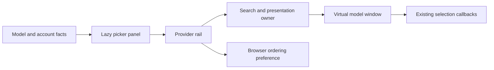

Codex review: needs changes before merge.

## What this changes

This PR replaces provider disclosures with a reorderable provider rail and restyles model details.

**Example:** Browse OpenAI, Anthropic, and Google models.
- **Before:** Providers appear as disclosure headings within the scrolling model list.
- **After:** Provider icons remain in a separate rail beside the selected provider’s models.

## Review scores

| Measure | Result | What it means |
|---|---|---|
| **Overall readiness** | 🦪 silver shellfish **(2/6)** | Useful visual evidence supports the feature, but confirmed navigation, diagnostic, ownership, consumer-cutover, and CSS-budget defects prevent approval. |
| **Proof confidence** | 🐚 platinum hermit **(4/6)** | This maintainer-authored PR is outside the ordinary contributor proof gate; inspected application screenshots support the multi-provider and single-provider layout changes but do not establish keyboard overflow or reorder persistence. |
| **Patch quality** | 🦪 silver shellfish **(2/6)** | 5 actionable review findings remain. |

## Product

**Kind:** Feature · **Worth it:** Yes · **Fix scope:** Complete
**User problem:** Browsing multiple providers requires navigating headings and model rows in the same scrolling list.
**Reason:** Maintainer authorship settles this stage’s direction, and the screenshots demonstrate a useful separation of provider navigation from model browsing.

## Merge readiness

⛔ **Needs changes before merge - 6 items remain**

Keep this maintainer-authored PR open: the provider rail has clear browsing value, but the cutover introduces navigation and diagnostic regressions and leaves attributable CI failures.

**Priority:** P2
**Reviewed head:** `e192b290c307c95a53004f0edb6c6c2a475b55c9`

## Before merge

- [ ] **Reveal rail tabs reached by vertical keyboard navigation (P2)** - When providers exceed the visible rail height, ArrowDown or ArrowUp can select and focus a tab outside the scroll viewport. This branch prevents default scrolling and calls focus with preventScroll, without the reveal step used by createTabList. Reveal the destination through the shared tab owner so keyboard focus remains visible.
- [ ] **Keep the rail renderer within shared tab ownership (P2)** - The new hand-rendered tablist and tabs fail the existing shared-control ownership test, which permits these roles only in shared control renderers. Tabs already owns this markup, while createTabList owns navigation. Add the required vertical presentation support at that existing boundary and consume it here rather than introducing another tab renderer or widening the guard.
- [ ] **Preserve a visible explanation for unavailable runtime choices (P2)** - For an additional Codex runtime row with unavailableReason=unsupported-runtime, removing title leaves the explanation only in aria-label. formatModelRuntimeLabel supplies no detail for that route, so the existing tooltip wrapper does not render and a sighted user sees a disabled choice without its reason. Preserve the explanation with visible text or the existing tooltip mechanism; CI confirms the removed explanation in chat-model-runtime.test.ts.
- [ ] **Migrate disclosure-dependent picker consumers in this cutover (P2)** - Moving toggles outside provider groups and replacing aria-expanded with exclusive aria-selected leaves affected test consumers on the removed contract. chat-model-picker-composition.e2e.test.ts waits for a nested toggle that no longer exists; expandModelProviders and New Session test support still expect simultaneous disclosure expansion, and chat-view expectations retain the old auth label. Update those helpers and journeys to select rail tabs or search while preserving their selection, metadata, composition, and account assertions.
- [ ] **Bring the rail styles within the existing CSS budget (P2)** - The added styles cause the required performance check to reject total CSS raw size and gzip growth beyond the base allowance. The replaced provider-toggle rules also remain in this stylesheet although production markup no longer uses that class. Remove superseded styles and reduce the added CSS until the existing gate passes, retaining the intended rail appearance.
- [ ] **Explain or restore the original intent of Unavailable-runtime explanation** - 07384e07238086c922ef3ed87b41f66b7b3c7f6d: The Solid port retained existing model-control contracts, including the unavailable-runtime title; this PR removes its visible explanation without a replacement.

## Findings

- [P2] Reveal rail tabs reached by vertical keyboard navigation — `ui/src/pages/chat/components/chat-model-provider-rail.tsx:138-140`
- [P2] Keep the rail renderer within shared tab ownership — `ui/src/pages/chat/components/chat-model-provider-rail.tsx:69-74`
- [P2] Preserve a visible explanation for unavailable runtime choices — `ui/src/pages/chat/components/chat-model-picker-options.tsx:164-165`

### Provenance

- `Unavailable-runtime explanation` changes intended behavior without addressing why it exists (07384e07238086c922ef3ed87b41f66b7b3c7f6d: The Solid port retained existing model-control contracts, including the unavailable-runtime title; this PR removes its visible explanation without a replacement.)

<strong>Agent review details</strong>

### How this fits together

The shared Chat and New Session picker receives model, runtime, target, and account facts and presents searchable choices through existing selection callbacks.

### Technical review

Best possible solution:

Complete the rail cutover through the existing tab, search, virtualization, and selection owners while preserving visible diagnostics and updating affected consumers.

Do we have a high-confidence way to reproduce the issue?

Source establishes the offscreen-focus and missing-diagnostic paths, and CI annotations independently confirm consumer and ownership failures; no target code was executed.

Is this the best way to solve the issue?

The two-column structure addresses browsing friction, but its smallest complete implementation must reuse shared tab policy and migrate disclosure-dependent consumers.

Full review comments:

- [P2] Reveal rail tabs reached by vertical keyboard navigation — `ui/src/pages/chat/components/chat-model-provider-rail.tsx:138-140`
  When providers exceed the visible rail height, ArrowDown or ArrowUp can select and focus a tab outside the scroll viewport. This branch prevents default scrolling and calls focus with preventScroll, without the reveal step used by createTabList. Reveal the destination through the shared tab owner so keyboard focus remains visible.
  Confidence: 0.98
- [P2] Keep the rail renderer within shared tab ownership — `ui/src/pages/chat/components/chat-model-provider-rail.tsx:69-74`
  The new hand-rendered tablist and tabs fail the existing shared-control ownership test, which permits these roles only in shared control renderers. Tabs already owns this markup, while createTabList owns navigation. Add the required vertical presentation support at that existing boundary and consume it here rather than introducing another tab renderer or widening the guard.
  Confidence: 0.99
- [P2] Preserve a visible explanation for unavailable runtime choices — `ui/src/pages/chat/components/chat-model-picker-options.tsx:164-165`
  For an additional Codex runtime row with unavailableReason=unsupported-runtime, removing title leaves the explanation only in aria-label. formatModelRuntimeLabel supplies no detail for that route, so the existing tooltip wrapper does not render and a sighted user sees a disabled choice without its reason. Preserve the explanation with visible text or the existing tooltip mechanism; CI confirms the removed explanation in chat-model-runtime.test.ts.
  Confidence: 0.99
- [P2] Migrate disclosure-dependent picker consumers in this cutover — `ui/src/pages/chat/components/chat-model-picker-panel.tsx:590-597`
  Moving toggles outside provider groups and replacing aria-expanded with exclusive aria-selected leaves affected test consumers on the removed contract. chat-model-picker-composition.e2e.test.ts waits for a nested toggle that no longer exists; expandModelProviders and New Session test support still expect simultaneous disclosure expansion, and chat-view expectations retain the old auth label. Update those helpers and journeys to select rail tabs or search while preserving their selection, metadata, composition, and account assertions.
  Confidence: 1
- [P2] Bring the rail styles within the existing CSS budget — `ui/src/styles/chat/composer.css:4048-4054`
  The added styles cause the required performance check to reject total CSS raw size and gzip growth beyond the base allowance. The replaced provider-toggle rules also remain in this stylesheet although production markup no longer uses that class. Remove superseded styles and reduce the added CSS until the existing gate passes, retaining the intended rail appearance.
  Confidence: 0.97

Overall correctness: patch is incorrect
Overall confidence: 0.97

AGENTS.md: found and applied where relevant.

Codex review notes: model internal, reasoning medium; reviewed against [7d828beea88c](https://github.com/openclaw/openclaw/commit/7d828beea88ced818f27272c97ff5f37960608c6).

### Provenance checked

- `Provider disclosure, grouping, and search` changes intended behavior with a stated reason (https://github.com/openclaw/openclaw/pull/178613: Keep presentation in the existing search owner while retaining filtering, keyboard navigation, refresh behavior, and provider/account ownership.)
- `Virtualized catalog rendering` keeps the original intent (b9689588648536c51480404580835776a2112485: Bound mounted rows for large catalogs while preserving search, accounts, targets, and keyboard selection.)
- `Claude CLI grouping` keeps the original intent (7b17e7b7bf81e0aa72542e1211d34974f3609676: Avoid presenting CLI-only Anthropic choices as a separate API provider and retain expanded All models choices.)
- `Picker and row styling` changes intended behavior with a stated reason (feff169c052cbb1ae330c5f35a788108a13fbfa6: The stylesheet was split to share composer presentation without loading Chat-only workbench styles; this PR deliberately changes picker presentation within that owner.)

### Testing

Proof path: shipped entry point.

### Security

None.

### Evidence

Acceptance criteria:

- pnpm --dir ui test src/pages/chat/components/chat-model-picker.test.tsx src/pages/chat/components/chat-model-picker.browser.test.tsx src/components/web-awesome-migration.node.test.ts
- pnpm --dir ui test src/pages/chat/chat-view.test.ts src/pages/chat/chat-model-runtime.test.ts src/pages/new-session/model-control.metadata-lifecycle.test.ts
- pnpm test:ui:e2e ui/src/e2e/chat-model-picker-composition.e2e.test.ts ui/src/e2e/chat-model-picker-touch.e2e.test.ts
- pnpm tsgo:ui
- pnpm lint:ui:styles

What I checked:

- **Introduced change and current-main behavior:** The pinned introduced diff replaces provider disclosures; fetched main still uses disclosures and moves the leading provider first. ([`ui/src/pages/chat/components/chat-model-picker-panel.tsx:590`](https://github.com/openclaw/openclaw/blob/e192b290c307c95a53004f0edb6c6c2a475b55c9/ui/src/pages/chat/components/chat-model-picker-panel.tsx#L590), [e192b290c307](https://github.com/openclaw/openclaw/commit/e192b290c307c95a53004f0edb6c6c2a475b55c9))
- **Navigation bypasses shared scrolling:** The vertical-arrow branch focuses with preventScroll and never reveals the destination; the existing tab owner explicitly reveals keyboard destinations. ([`ui/src/pages/chat/components/chat-model-provider-rail.tsx:140`](https://github.com/openclaw/openclaw/blob/e192b290c307c95a53004f0edb6c6c2a475b55c9/ui/src/pages/chat/components/chat-model-provider-rail.tsx#L140), [e192b290c307](https://github.com/openclaw/openclaw/commit/e192b290c307c95a53004f0edb6c6c2a475b55c9))
- **Attributed consumer and ownership failures:** CI annotations identify the new rail in the shared-control ownership failure, API versus API key expectations, disclosure-dependent model tests, and composition E2E waiting for the removed nested provider toggle. ([`ui/src/components/web-awesome-migration.node.test.ts:37`](https://github.com/openclaw/openclaw/blob/e192b290c307c95a53004f0edb6c6c2a475b55c9/ui/src/components/web-awesome-migration.node.test.ts#L37), [e192b290c307](https://github.com/openclaw/openclaw/commit/e192b290c307c95a53004f0edb6c6c2a475b55c9))
- **CSS budget failure:** The performance check reports total CSS raw above its ceiling and total CSS gzip growth beyond the already-over-budget base allowance; the patch adds rail styles while retaining obsolete provider-toggle selectors. ([`ui/src/styles/chat/composer.css:4048`](https://github.com/openclaw/openclaw/blob/e192b290c307c95a53004f0edb6c6c2a475b55c9/ui/src/styles/chat/composer.css#L4048), [e192b290c307](https://github.com/openclaw/openclaw/commit/e192b290c307c95a53004f0edb6c6c2a475b55c9))
- **Inspected visual evidence:** Four prepared screenshots show before/after application layouts for multiple providers and one provider using mocked Gateway data; the rail and visible context metadata are present. ([e192b290c307](https://github.com/openclaw/openclaw/commit/e192b290c307c95a53004f0edb6c6c2a475b55c9))
- **Related request and implementation stack:** https://github.com/openclaw/openclaw/issues/142966 previously requested independent provider/model columns and credited Pondsi’s ModelSelectorOpenClaw workaround; https://github.com/openclaw/openclaw/pull/192137, https://github.com/openclaw/openclaw/pull/192142, and https://github.com/openclaw/openclaw/pull/192145 explicitly build on this first stage.

Likely related people:

- **Peter Steinberger:** Raw commit ab97597b3390921d53ac29acfa1cec18a2ae11d2 adds ui/src/pages/chat/components/chat-model-picker-panel.tsx:33 relative to its recorded parents. This identifies author metadata, not feature responsibility or a PR merger. (role: source-line author; confidence: high; commits: [ab97597b3390](https://github.com/openclaw/openclaw/commit/ab97597b3390921d53ac29acfa1cec18a2ae11d2); files: `ui/src/pages/chat/components/chat-model-picker-panel.tsx`)

### PR surface

Source +259, Tests +34. Total +293 across 11 files. Added test files: 0.

View PR surface stats

| Area | Files | Added | Removed | Net |
|---|---:|---:|---:|---:|
| Source | 9 | 403 | 144 | +259 |
| Tests | 2 | 55 | 21 | +34 |
| Docs | 0 | 0 | 0 | 0 |
| Config | 0 | 0 | 0 | 0 |
| Generated | 0 | 0 | 0 | 0 |
| Other | 0 | 0 | 0 | 0 |
| **Total** | **11** | **458** | **165** | **+293** |

### Review metrics

| Metric | Value | Why it matters |
|---|---|---|
| **Persisted UI preference** | 1 new browser-local provider-order preference | The isolated modelProviderOrder.v1 key stores ordering without rewriting existing model or account preferences. |

### Labels

Label changes:

- add `P2`: This is a useful picker improvement with bounded navigation, diagnostic, and validation repairs.
- add `proof: 📸 screenshot`: Contributor real behavior proof includes screenshot evidence.
- add `rating: 🦪 silver shellfish`: Overall readiness is 🦪 silver shellfish; proof is 🐚 platinum hermit and patch quality is 🦪 silver shellfish.
- add `status: ⏳ waiting on author`: ClawSweeper has contributor-facing work open and is waiting for author action.

Label justifications:

- `P2`: This is a useful picker improvement with bounded navigation, diagnostic, and validation repairs.
- `rating: 🦪 silver shellfish`: Overall readiness is 🦪 silver shellfish; proof is 🐚 platinum hermit and patch quality is 🦪 silver shellfish.
- `status: ⏳ waiting on author`: ClawSweeper has contributor-facing work open and is waiting for author action.
- `proof: 📸 screenshot`: Contributor real behavior proof includes screenshot evidence.

### Rating scale

6/6 🦀 challenger crab · 5/6 🦞 diamond lobster · 4/6 🐚 platinum hermit · 3/6 🦐 gold shrimp · 2/6 🦪 silver shellfish · 1/6 🧂 unranked krab. Overall follows the weaker of proof and patch quality; ✨ marks media proof (a screenshot, video, or linked artifact) that directly shows the changed behavior.

### Workflow

ClawSweeper edits this one comment on every review. Comment `@clawsweeper re-review` for a fresh review only. Repair and merge execution lanes are retired.

_Reviewed November 3, 2026, 1:05 PM ET / 18:05 UTC._

<!-- clawsweeper-verdict:needs-changes item=192135 sha=e192b290c307c95a53004f0edb6c6c2a475b55c9 confidence=high updated_at=2026-11-03T17:58:16Z reviewed_at=2026-11-03T18:05:54.146Z lease_owner=github-run-41689024910-1 lease_comment_id=6611521789 source_revision=7df7bd98d7798734e726585e3c31c141c60dda4c0f6ed0194501329be2c8505c -->
<!-- clawsweeper-review-state:needs-changes item=192135 sha=e192b290c307c95a53004f0edb6c6c2a475b55c9 v=1 -->

<!-- clawsweeper-review-version item=192135 reviewed_at=2026-11-03T18:05:54.146Z sha=e192b290c307c95a53004f0edb6c6c2a475b55c9 source_revision=7df7bd98d7798734e726585e3c31c141c60dda4c0f6ed0194501329be2c8505c lease_owner=github-run-41689024910-1 lease_comment_id=6611521789 v=1 -->

<!-- clawsweeper-review item=192135 -->