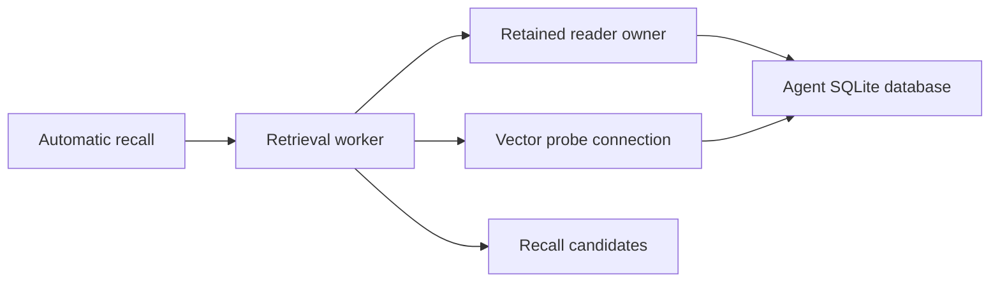

Codex review: needs maintainer review before merge.

## What this changes

This PR reuses the existing read-only database owner between memory searches while keeping vector-extension probes separate.

**Example:** Search MEMORY.md for violetcompass, then request curated memory candidates.
- **Before:** Each ordinary worker request opens and closes a database connection.
- **After:** Requests borrow the retained reader and return the same memory content.

## Review scores

| Measure | Result | What it means |
|---|---|---|
| **Overall readiness** | 🐚 platinum hermit **(4/6)** | Useful, focused optimization with detailed live measurements, meaningful lifecycle coverage and no actionable finding. |
| **Proof confidence** | 🐚 platinum hermit **(4/6)** | Maintainer-authored PR outside the ordinary contributor proof gate; supplied Linux Gateway measurements exercise populated automatic recall on the pinned base and candidate, while linked raw logs were inaccessible through the review proxy. |
| **Patch quality** | 🦞 diamond lobster **(5/6)** | No actionable review findings were identified. |

## Product

**Kind:** Performance · **Worth it:** Yes · **Fix scope:** Complete
**User problem:** Automatic recall pays repeated connection-admission and preparation overhead before prompt construction.
**Reason:** A small change removes measured redundant work through an established owner, with maintainer direction and unchanged retrieval semantics.

## Merge readiness

✅ **Ready for maintainer review**

Keep open: this focused, maintainer-directed optimization remains absent from main, and source review found no introduced correctness defect.

**Priority:** P2
**Reviewed head:** `92339c2f83da92720611aaada93dabe8fe9295d3`

## Before merge

None.

## Findings

None.

### Tests

- Missing end-to-end proof: The added replacement test proves preserved freshness; a failing-base result for that test is not shown.

<strong>Agent review details</strong>

### How this fits together

Automatic recall submits keyword, curated and vector retrieval requests to a worker, which reads the agent database and returns candidates for prompt preparation.

### Technical review

Best possible solution:

Retain this reuse of the established reader lifecycle and land through the repository’s inherited-CI exception when its requirements are satisfied.

Do we have a high-confidence way to reproduce the issue?

Current main visibly opens and closes ordinary search-worker connections per request; the supplied populated-recall measurements quantify that overhead.

Is this the best way to solve the issue?

Reusing the existing owner is a focused solution that preserves query logic, generation custody and separate extension-capable connections.

AGENTS.md: found and applied where relevant.

Codex review notes: model internal, reasoning medium; reviewed against [10bdf2c2ab1f](https://github.com/openclaw/openclaw/commit/10bdf2c2ab1f65133461b2c3b487f5172934aa86).

### Provenance checked

- `Search-worker connection lifetime` changes intended behavior with a stated reason (e14b3ddac2e5ea9dbb450057b7436c22a012a89b: Move expensive retrieval off the Gateway thread while preserving publication leases, cancellation and forget filtering.)
- `Vector-extension connection isolation` keeps the original intent (4c884c148d031f46a90146dc978a1b9b423f5c91: Keep vector preparation with its publication owner and read-only capability probing with retrieval.)

### Testing

Proof path: shipped entry point.

### Security

None.

### Evidence

What I checked:

- **Introduced change and current main:** The pinned introduced diff replaces ordinary fresh opens with retained borrows and releases each borrow in finally; fetched main still uses the fresh-open path. ([`extensions/memory-core/src/memory/manager-search.worker.ts:133`](https://github.com/openclaw/openclaw/blob/92339c2f83da92720611aaada93dabe8fe9295d3/extensions/memory-core/src/memory/manager-search.worker.ts#L133), [92339c2f83da](https://github.com/openclaw/openclaw/commit/92339c2f83da92720611aaada93dabe8fe9295d3))
- **Existing lifecycle owner:** The reused owner checks agent identity and physical-path currency, registers lifecycle cleanup, pins active borrowers and expires idle connections. ([`src/state/openclaw-agent-db-readonly-scope.ts:157`](https://github.com/openclaw/openclaw/blob/92339c2f83da92720611aaada93dabe8fe9295d3/src/state/openclaw-agent-db-readonly-scope.ts#L157), [92339c2f83da](https://github.com/openclaw/openclaw/commit/92339c2f83da92720611aaada93dabe8fe9295d3))
- **Behavior coverage:** The added test publishes violetcompass, reads search and curated results, publishes ambercompass, then verifies new content and removal of the old match; existing tests cover cancellation, forget filtering and writer-lock preservation. ([`extensions/memory-core/src/memory/manager-search-worker.test.ts:19`](https://github.com/openclaw/openclaw/blob/92339c2f83da92720611aaada93dabe8fe9295d3/extensions/memory-core/src/memory/manager-search-worker.test.ts#L19), [92339c2f83da](https://github.com/openclaw/openclaw/commit/92339c2f83da92720611aaada93dabe8fe9295d3))
- **Supplied live measurements:** The body records three alternating base/candidate pairs with populated automatic recall and successful memory injection, reporting 64.6% less memory-worker service without claiming whole-turn latency improvement. The linked supplemental run was still running, and its log redirect was blocked by the review proxy; raw traces were not independently inspected. ([92339c2f83da](https://github.com/openclaw/openclaw/commit/92339c2f83da92720611aaada93dabe8fe9295d3))
- **CI failure attribution:** Failed extension-check annotations show runtime-config preparation errors in untouched forget and filesystem-watcher paths. The body records identical failures on the exact base; these are not evidence of a reader-reuse defect. CI remains red. ([`src/config/runtime-snapshot.ts:391`](https://github.com/openclaw/openclaw/blob/92339c2f83da92720611aaada93dabe8fe9295d3/src/config/runtime-snapshot.ts#L391), [92339c2f83da](https://github.com/openclaw/openclaw/commit/92339c2f83da92720611aaada93dabe8fe9295d3))
- **Original design:** https://github.com/openclaw/openclaw/pull/146168 established worker retrieval and generation custody; https://github.com/openclaw/openclaw/pull/169164 separated vector preparation. This patch preserves those responsibilities. ([`extensions/memory-core/src/memory/manager-search.worker.ts:132`](https://github.com/openclaw/openclaw/blob/10bdf2c2ab1f65133461b2c3b487f5172934aa86/extensions/memory-core/src/memory/manager-search.worker.ts#L132), [10bdf2c2ab1f](https://github.com/openclaw/openclaw/commit/10bdf2c2ab1f65133461b2c3b487f5172934aa86))

### PR surface

Source +4, Tests +22, Docs +7. Total +33 across 4 files. Added test files: 0.

View PR surface stats

| Area | Files | Added | Removed | Net |
|---|---:|---:|---:|---:|
| Source | 2 | 14 | 10 | +4 |
| Tests | 1 | 22 | 0 | +22 |
| Docs | 1 | 7 | 0 | +7 |
| Config | 0 | 0 | 0 | 0 |
| Generated | 0 | 0 | 0 | 0 |
| Other | 0 | 0 | 0 | 0 |
| **Total** | **4** | **43** | **10** | **+33** |

### Review metrics

| Metric | Value | Why it matters |
|---|---|---|
| **SDK surface** | 1 additive export; 0 removed exports | Exposes the existing retained-reader operation through an existing SDK subpath. |

### Labels

Label changes:

- add `rating: 🐚 platinum hermit`: Overall readiness is 🐚 platinum hermit; proof is 🐚 platinum hermit and patch quality is 🦞 diamond lobster.
- remove `rating: 🦐 gold shrimp`: Current PR rating is `rating: 🐚 platinum hermit`, so this older rating label is no longer current.

Label justifications:

- `P2`: Reduces measured memory-retrieval worker overhead without changing search results or addressing an urgent outage.
- `merge-risk: 🚨 compatibility`: The additive Plugin SDK export requires compatibility visibility; maintainer direction is established and no breaking contract change was found.
- `rating: 🐚 platinum hermit`: Overall readiness is 🐚 platinum hermit; proof is 🐚 platinum hermit and patch quality is 🦞 diamond lobster.
- `status: 👀 ready for maintainer look`: ClawSweeper has no concrete contributor-facing blocker left for this PR.

### Rating scale

6/6 🦀 challenger crab · 5/6 🦞 diamond lobster · 4/6 🐚 platinum hermit · 3/6 🦐 gold shrimp · 2/6 🦪 silver shellfish · 1/6 🧂 unranked krab. Overall follows the weaker of proof and patch quality; ✨ marks media proof (a screenshot, video, or linked artifact) that directly shows the changed behavior.

### Workflow

ClawSweeper edits this one comment on every review. Comment `@clawsweeper re-review` for a fresh review only. Repair and merge execution lanes are retired.

### History

Review history (1 earlier review cycle)

<!-- clawsweeper-review-history v=1 total=1 -->
- reviewed 2026-10-12T19:55:38.405Z sha 92339c2f83da92720611aaada93dabe8fe9295d3 :: needs maintainer review before merge. :: none

_Reviewed October 12, 2026, 5:56 PM ET / 21:56 UTC (Revision 2)._

<!-- clawsweeper-verdict:needs-human item=170183 sha=92339c2f83da92720611aaada93dabe8fe9295d3 confidence=high updated_at=2026-10-12T21:52:24Z reviewed_at=2026-10-12T21:56:47.809Z lease_owner=github-run-38313112955-1 lease_comment_id=6133283631 source_revision=26d81ea633bfb9180629403f0217745a7378bed7148d36a924376c98d4ad66b7 hold=not_opted_in findings=0 -->
<!-- clawsweeper-review-state:ready item=170183 sha=92339c2f83da92720611aaada93dabe8fe9295d3 v=1 -->

<!-- clawsweeper-review-version item=170183 reviewed_at=2026-10-12T21:56:47.809Z sha=92339c2f83da92720611aaada93dabe8fe9295d3 source_revision=26d81ea633bfb9180629403f0217745a7378bed7148d36a924376c98d4ad66b7 lease_owner=github-run-38313112955-1 lease_comment_id=6133283631 v=1 -->

<!-- clawsweeper-review item=170183 -->