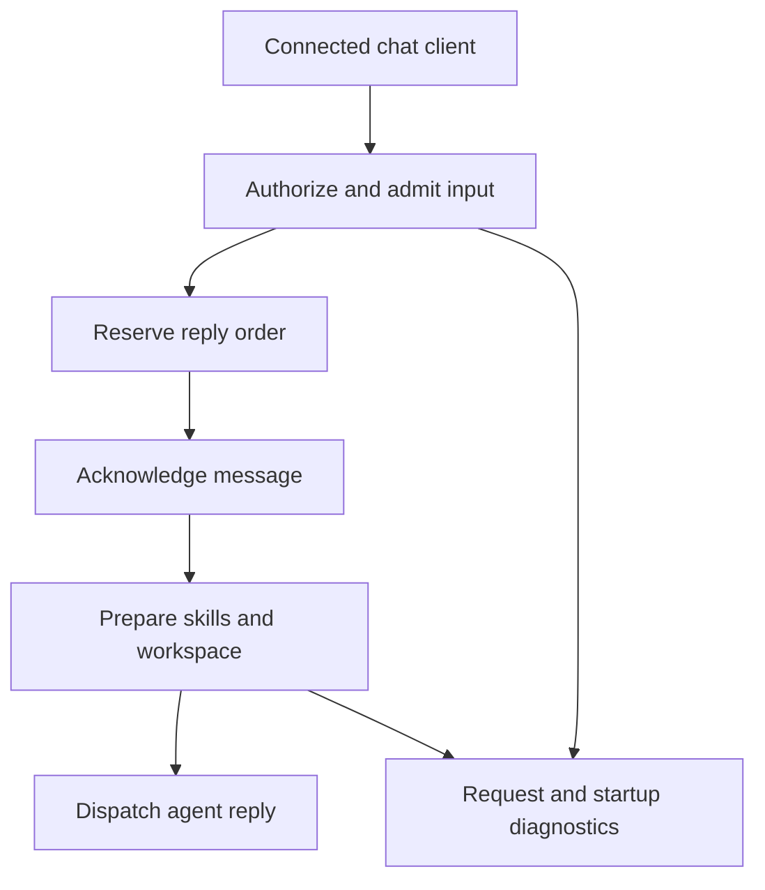

Codex review: blocked before merge. _Reviewed October 5, 2026, 9:53 PM ET / October 6, 2026, 01:53 UTC (Revision 10)._

# ClawSweeper review

## What this changes

The PR moves skill selection and authoring after chat acknowledgement, preserves send ordering through retries, and adds startup timing logs and metrics.

## Merge readiness

⛔ **Blocked before merge - 3 items remain**

Keep open: current main still performs skill preparation before ACK, and this maintainer-authored PR remains useful. No actionable patch defect was found; the previously identified latency tradeoff still needs explicit acceptance.

**Priority:** P2
**Reviewed head:** `fcc8409858e1b755b19ddb35508513f91f1172d3`
**Owner decision:** Required. See [Decision needed](#decision-needed).

## Review scores

| Measure | Result | What it means |
|---|---|---|
| **Overall readiness** | 🐚 platinum hermit **(4/6)** | Useful, well-supported implementation with no concrete correctness finding; performance acceptance remains a separate landing decision. |
| **Proof confidence** | 🦞 diamond lobster **(5/6)** | Sufficient (live_output): The recorded source-bound WebSocket rig exercises Gateway admission and detached dispatch with real workspace, sandbox, and transport boundaries, showing post-ACK preparation and preserved transcript/order results. Latest-tree integration checks supplement that proof; historical latency results do not prove current-head target attainment. No stored-data contract changes require migration. |
| **Patch quality** | 🐚 platinum hermit **(4/6)** | No actionable review findings were identified. |

## Verification

| Check | Result | Evidence |
|---|---|---|
| **Real behavior** | Verified | Sufficient (live_output): The recorded source-bound WebSocket rig exercises Gateway admission and detached dispatch with real workspace, sandbox, and transport boundaries, showing post-ACK preparation and preserved transcript/order results. Latest-tree integration checks supplement that proof; historical latency results do not prove current-head target attainment. No stored-data contract changes require migration. |
| **Evidence reviewed** | 8 items | Pinned introduction: Reviewed the merge-base-to-head introduced patch, rather than endpoint drift. The introduced changes retain existing persistence and authorization machinery and add no dependency, configuration, protocol-field, or schema changes. ACK and FIFO ownership: The handler revalidates input authority, reserves the existing reply-admission ticket, sends the ACK, and hands the ticket to detached dispatch. Dispatch retains it across retries and releases it at terminal settlement; the existing agent runner also releases it at queue handoff. Deferred preparation and authority: Skill preparation now runs inside admitted dispatch. Existing authoring capabilities continue to check caller, delegated-run, revocation, and receipt authority at use; the prepared-session callback retains main's reply-dispatch handoff. No concrete introduced authority bypass was established. |
| **Findings** | None | None. |
| **Security** | None | None. |

## How this fits together

The Gateway receives chat messages from connected clients, admits their input, and starts agent replies. This change separates acknowledgement from skill preparation while retaining the existing cancellation, persistence, and reply-ordering owners.

## Decision needed

| Question | Recommendation |
|---|---|
| May this PR land for deferred preparation and diagnostics despite the historical median ACK regression and unmet 50/200 ms targets? | **Accept the scoped improvement:** Explicitly accept the published latency tradeoff and land this as deferred preparation and diagnostics without claiming the original targets are met. |

Why: The implementation and behavior proof support its scoped benefits, but only the requirement owner can relax the requested latency limits.

## Before merge

- [ ] **Resolve merge risk (P1)** - The historical comparison worsened median ACK latency by 13.52 ms and missed both requested limits; no current-head measurement or explicit maintainer acceptance resolves that performance tradeoff.
- [ ] **Complete next step (P2)** - Explicitly accept the published latency tradeoff or retain the original targets as a before-merge requirement.
- [ ] **Resolve maintainer decision** - Resolve the maintainer decision shown above before merge.

<strong>Agent review details</strong>

### Security

None.

### PR surface

Source +250, Tests +478, Docs +24. Total +752 across 26 files.

View PR surface stats

| Area | Files | Added | Removed | Net |
|---|---:|---:|---:|---:|
| Source | 13 | 422 | 172 | +250 |
| Tests | 10 | 502 | 24 | +478 |
| Docs | 3 | 24 | 0 | +24 |
| Config | 0 | 0 | 0 | 0 |
| Generated | 0 | 0 | 0 | 0 |
| Other | 0 | 0 | 0 | 0 |
| **Total** | **26** | **948** | **196** | **+752** |

### Review metrics

| Metric | Value | Why it matters |
|---|---|---|
| **Production and test growth** | production +422/−172, net +250; tests +502/−24, net +478 | The body justifies production growth with diagnostic lifecycle and FIFO ownership across deferred preparation and retries. |
| **Historical ACK comparison** | p50 +13.52 ms; p99 −132.49 ms | The measured median and tail move in opposite directions, requiring explicit performance acceptance. |

### Merge-risk options

**Maintainer options:**
1. **Accept the measured tradeoff (recommended)**  
   Record explicit acceptance of the historical median regression and unmet targets for this scoped delivery.
2. **Keep the original targets**  
   Pause landing until a current-head comparison meets the retained latency requirement.

### Technical review

Best possible solution:

Retain the single admitted-dispatch owner and bounded diagnostics, with an explicitly agreed performance acceptance criterion.

Do we have a high-confidence way to reproduce the issue?

Not applicable as a functional bug report: source and recorded rig results establish deferred preparation, but the rebased head has no new latency measurement.

Is this the best way to solve the issue?

Yes for moving preparation into the existing admitted owner and preserving FIFO order; it does not yet establish the requested ACK performance improvement.

AGENTS.md: found and applied where relevant.

Codex review notes: model internal, reasoning medium; reviewed against [50f38c6ceb80](https://github.com/openclaw/openclaw/commit/50f38c6ceb801f2b61e2ddb85e18f9ba2f83dbbf).

### Labels

Label changes:

No label changes.

Label justifications:

- `P2`: This is a bounded chat acknowledgement and diagnostics improvement without an established urgent production regression.
- `merge-risk: 🚨 other`: Green correctness checks do not resolve the measured median latency regression or acceptance of unmet performance targets.
- `rating: 🐚 platinum hermit`: Overall readiness is 🐚 platinum hermit; proof is 🦞 diamond lobster and patch quality is 🐚 platinum hermit.
- `status: 👀 ready for maintainer look`: ClawSweeper has no concrete contributor-facing blocker left for this PR. Sufficient (live_output): The recorded source-bound WebSocket rig exercises Gateway admission and detached dispatch with real workspace, sandbox, and transport boundaries, showing post-ACK preparation and preserved transcript/order results. Latest-tree integration checks supplement that proof; historical latency results do not prove current-head target attainment. No stored-data contract changes require migration.
- `proof: sufficient`: Contributor real behavior proof is sufficient. The recorded source-bound WebSocket rig exercises Gateway admission and detached dispatch with real workspace, sandbox, and transport boundaries, showing post-ACK preparation and preserved transcript/order results. Latest-tree integration checks supplement that proof; historical latency results do not prove current-head target attainment. No stored-data contract changes require migration.

### Evidence

What I checked:

- **Pinned introduction:** Reviewed the merge-base-to-head introduced patch, rather than endpoint drift. The introduced changes retain existing persistence and authorization machinery and add no dependency, configuration, protocol-field, or schema changes. ([fcc8409858e1](https://github.com/openclaw/openclaw/commit/fcc8409858e1b755b19ddb35508513f91f1172d3))
- **ACK and FIFO ownership:** The handler revalidates input authority, reserves the existing reply-admission ticket, sends the ACK, and hands the ticket to detached dispatch. Dispatch retains it across retries and releases it at terminal settlement; the existing agent runner also releases it at queue handoff. ([`src/gateway/server-methods/chat-send-handler.ts:579`](https://github.com/openclaw/openclaw/blob/fcc8409858e1b755b19ddb35508513f91f1172d3/src/gateway/server-methods/chat-send-handler.ts#L579), [fcc8409858e1](https://github.com/openclaw/openclaw/commit/fcc8409858e1b755b19ddb35508513f91f1172d3))
- **Deferred preparation and authority:** Skill preparation now runs inside admitted dispatch. Existing authoring capabilities continue to check caller, delegated-run, revocation, and receipt authority at use; the prepared-session callback retains main's reply-dispatch handoff. No concrete introduced authority bypass was established. ([`src/gateway/server-methods/chat-send-agent-dispatch.ts:302`](https://github.com/openclaw/openclaw/blob/fcc8409858e1b755b19ddb35508513f91f1172d3/src/gateway/server-methods/chat-send-agent-dispatch.ts#L302), [fcc8409858e1](https://github.com/openclaw/openclaw/commit/fcc8409858e1b755b19ddb35508513f91f1172d3))
- **Still necessary on current main:** Fetched main still awaits user-turn skill selection and authoring before responding. The merged related PR https://github.com/openclaw/openclaw/pull/165788 repairs a separate follow-up drain barrier and does not implement this ACK change. ([`src/gateway/server-methods/chat-send-handler.ts`](https://github.com/openclaw/openclaw/blob/50f38c6ceb801f2b61e2ddb85e18f9ba2f83dbbf/src/gateway/server-methods/chat-send-handler.ts), [50f38c6ceb80](https://github.com/openclaw/openclaw/commit/50f38c6ceb801f2b61e2ddb85e18f9ba2f83dbbf))
- **Complete captured body inspected:** GitHub's full body matched captured SHA-256 b58e10b52ccaaf4c71c4780e72e164477d302f67064fb80c32a4f4e5a824e7f4. The omitted range records an inherited dependency-audit failure and pending CI, not additional latency acceptance. Live non-ClawSweeper discussion contains only the informational security guard; there are no submitted reviews. ([fcc8409858e1](https://github.com/openclaw/openclaw/commit/fcc8409858e1b755b19ddb35508513f91f1172d3))
- **Positive behavior proof with bounded claims:** The captured body reports a source-bound Testbox WebSocket rig with 25 authenticated clients, a real worktree and Docker sandbox, historical messages, private skills, and a loopback streaming provider. It observed preparation after ACK, preserved transcript bytes and input order, and included stalled-preparation and retry-order negative controls. Latest-tree remote integration checks supplement this historical feature proof; they are not current-head latency measurements. ([6af0005d88a6](https://github.com/openclaw/openclaw/commit/6af0005d88a6f37383f1d82d52433ef78685f563))

Likely related people:

- **steipete:** Suggested for follow-up; no historical authorship or introduction is verified. (role: unverified routing candidate; confidence: low)
- **vincentkoc:** Suggested for follow-up; no historical authorship or introduction is verified. (role: unverified routing candidate; confidence: low)

### Rank-up moves

Optional improvements that raise the rating; they are not merge blockers.

- Record explicit acceptance or retention of the original ACK latency requirement using the published historical comparison.

### Rating scale

| Score | Internal tier | Crab rank | Meaning |
|---:|:---:|---|---|
| **6/6** | S | 🦀 challenger crab | Exceptional readiness |
| **5/6** | A | 🦞 diamond lobster | Very strong readiness |
| **4/6** | B | 🐚 platinum hermit | Good normal PR; ordinary maintainer review |
| **3/6** | C | 🦐 gold shrimp | Useful, but confidence is limited |
| **2/6** | D | 🦪 silver shellfish | Proof or implementation needs work |
| **1/6** | F | 🧂 unranked krab | Not merge-ready |
| N/A | NA | 🌊 off-meta tidepool | Rating does not apply |

Overall follows the weaker of proof and patch quality.
Shiny media proof means a screenshot, video, or linked artifact directly shows the changed behavior. Runtime, network, CSP, and security claims still need visible diagnostics.

### Workflow

- ClawSweeper keeps one durable marker-backed review comment per issue or PR.
- Re-runs edit this comment so the latest verdict, findings, and automation markers stay together instead of adding duplicate bot comments.
- A fresh review can be triggered by eligible `@clawsweeper re-review` comments, exact-item GitHub events, scheduled/background review runs, or manual workflow dispatch.
- PR/issue authors and users with repository write access can comment `@clawsweeper re-review` or `@clawsweeper re-run` on an open PR or issue to request a fresh review only.
- Maintainers can also comment `@clawsweeper review` to request a fresh review only.
- Fresh-review commands do not start repair, autofix, rebase, CI repair, or automerge.
- Maintainer-only repair and merge flows require explicit commands such as `@clawsweeper autofix`, `@clawsweeper automerge`, `@clawsweeper fix ci`, or `@clawsweeper address review`.
- Maintainers can comment `@clawsweeper explain` to ask for more context, or `@clawsweeper stop` to stop active automation.

### History

Review history (9 earlier review cycles; latest 8 shown)

<!-- clawsweeper-review-history v=1 total=9 -->
- reviewed 2026-10-05T14:56:46.765Z sha 484989c0c95752eeba94bd8b502dd9c4f9e7c6a0 :: blocked before merge. :: none
- reviewed 2026-10-05T15:16:00.721Z sha 88a6c726ab839562300cce19325133f49c3d46a1 :: blocked before merge. :: none
- reviewed 2026-10-05T15:51:47.942Z sha 5eb2265de3d3e65bfe0482171d841e9eb599aa08 :: blocked before merge. :: none
- reviewed 2026-10-05T16:21:03.278Z sha bec13ef6cc12cb00ec02a64d2941baf1d382a4d5 :: blocked before merge. :: none
- reviewed 2026-10-05T17:03:07.550Z sha bec13ef6cc12cb00ec02a64d2941baf1d382a4d5 :: blocked before merge. :: none
- reviewed 2026-10-05T17:59:01.414Z sha 6af0005d88a6f37383f1d82d52433ef78685f563 :: blocked before merge. :: none
- reviewed 2026-10-06T00:07:25.061Z sha 621c5694625a07f7c7b32e51b9adbbbb78690f1f :: blocked before merge. :: none
- reviewed 2026-10-06T01:28:04.571Z sha 35ffbaccc98fc97be1484756d26603f80d51324c :: blocked before merge. :: none

<!-- clawsweeper-verdict:needs-human item=165608 sha=fcc8409858e1b755b19ddb35508513f91f1172d3 confidence=high updated_at=2026-10-06T01:49:57Z reviewed_at=2026-10-06T01:53:40.136Z lease_owner=github-run-37401075695-1 lease_comment_id=6007672135 source_revision=9cb2bb352a4ff20c0fb41822a4e312fd71ff43c14544e7a73473351d429b064c live_verification=absent -->
<!-- clawsweeper-review-state:blocked item=165608 sha=fcc8409858e1b755b19ddb35508513f91f1172d3 v=1 -->

<!-- clawsweeper-review-version item=165608 reviewed_at=2026-10-06T01:53:40.136Z sha=fcc8409858e1b755b19ddb35508513f91f1172d3 source_revision=9cb2bb352a4ff20c0fb41822a4e312fd71ff43c14544e7a73473351d429b064c lease_owner=github-run-37401075695-1 lease_comment_id=6007672135 v=1 -->

<!-- clawsweeper-review item=165608 -->