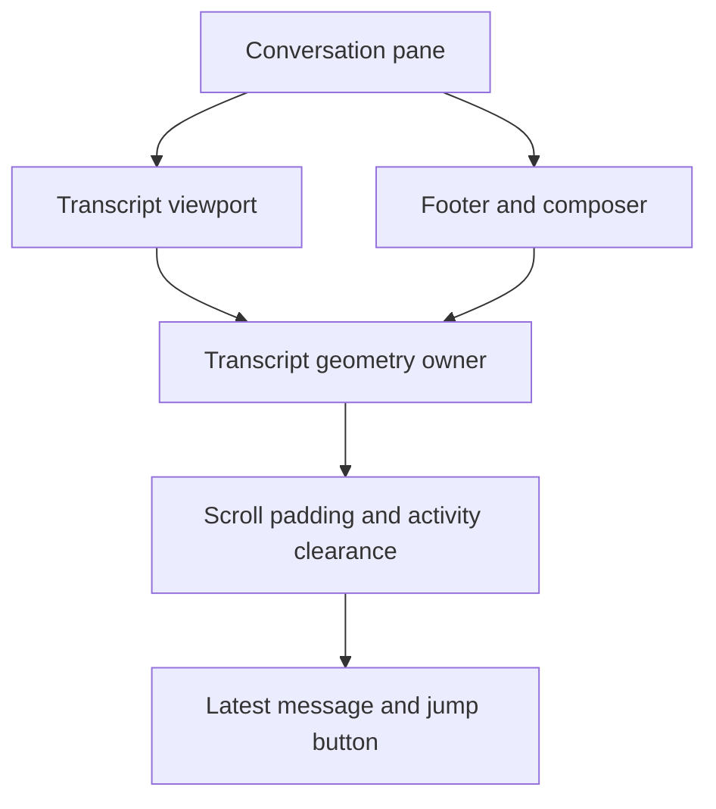

Codex review: needs changes before merge.

## What this changes

Extends the chat transcript behind the composer’s rounded corners while preserving final-message and jump-button clearance.

**Example:** Scroll an existing chat at 1280×800 in dark mode until a message crosses the composer’s top-left corner.
- **Before:** The message and avatar stop along a flat horizontal edge above the rounded corner.
- **After:** The transcript remains visible beside the rounded corner and continues behind the composer.

## Review scores

| Measure | Result | What it means |
|---|---|---|
| **Overall readiness** | 🦐 gold shrimp **(3/6)** | The visual behavior is demonstrated and the production change is focused, but affected browser tests require repair before merge. |
| **Proof confidence** | 🦞 diamond lobster **(5/6)** ✨ media proof bonus | Sufficient (screenshot): Inspected before/after screenshots exercise the visible transcript/composer boundary in the Control UI browser at 1280×800 with synthetic Gateway data and show the clipping corrected; the body also reports desktop/phone regressions failing before the CSS change and passing afterward. |
| **Patch quality** | 🦐 gold shrimp **(3/6)** | 1 actionable review finding remain. |

## Product

**Kind:** Bug fix · **Worth it:** Yes · **Fix scope:** Complete
**User problem:** Messages are visibly cut off along a flat edge beside the composer’s rounded top corners.
**Reason:** The maintainer-authored direction addresses a demonstrated visual defect with a bounded change; the body explicitly accepts the narrow notice-pill overlap tradeoff.

## Merge readiness

⛔ **Needs changes before merge - 1 item remains**

Keep this PR open: the visual fix is supported by screenshots, but unchanged footer tests still enforce the replaced layout and fail CI.

**Priority:** P2
**Reviewed head:** `a05f6a7213f668745ea87d13eae22121b5ff411d`

## Before merge

- [ ] **Update the existing footer tests for the intentional overlap (P2)** - The negative footer margin makes the transcript extend past the footer top, but chat-footer-layout.browser.test.ts still requires thread.bottom &lt;= footer.top at lines 204, 495, and 517, and its PR-card assertion at line 531 also assumes separation. The current UI check already fails seven cases with a consistent 35px overlap. Update these assertions to the new overlap contract while preserving last-content clearance, notice ordering, and actionable controls; updating only chat-footer.e2e.test.ts leaves the affected consumer suite broken.

## Findings

- [P2] Update the existing footer tests for the intentional overlap — `ui/src/styles/chat/startup-layout.css:182`

<strong>Agent review details</strong>

### How this fits together

The Control UI lays out transcript rows, footer notices, and the composer inside one conversation pane; CSS and the existing transcript geometry owner determine scroll padding and floating-button clearance.

### Technical review

Best possible solution:

Keep the coordinated CSS fix and update the existing footer browser assertions to permit intentional overlap while retaining message-clearance and control-reachability checks.

Do we have a high-confidence way to reproduce the issue?

Current-main CSS retains the separated transcript/footer boundary, and the supplied before image shows the resulting flat clipping; no target code was executed during this read-only review.

Is this the best way to solve the issue?

The fix uses the existing conversation CSS and geometry owner, applies matching overlap and bottom padding, and extends an existing regression without adding another layout mechanism.

Full review comments:

- [P2] Update the existing footer tests for the intentional overlap — `ui/src/styles/chat/startup-layout.css:182`
  The negative footer margin makes the transcript extend past the footer top, but chat-footer-layout.browser.test.ts still requires thread.bottom &lt;= footer.top at lines 204, 495, and 517, and its PR-card assertion at line 531 also assumes separation. The current UI check already fails seven cases with a consistent 35px overlap. Update these assertions to the new overlap contract while preserving last-content clearance, notice ordering, and actionable controls; updating only chat-footer.e2e.test.ts leaves the affected consumer suite broken.
  Confidence: 1

Overall correctness: patch is incorrect
Overall confidence: 0.97

AGENTS.md: found and applied where relevant.

Codex review notes: model internal, reasoning medium; reviewed against [9fb87cfca57a](https://github.com/openclaw/openclaw/commit/9fb87cfca57acdb63b3ed3476c8653400d3b6955).

### Provenance checked

- `Transcript/footer separation and composer top spacing` changes intended behavior with a stated reason (https://github.com/openclaw/openclaw/pull/152608: Separate footer context from the transcript to prevent notices from covering PR controls and the last reply; the earlier origin of the carried 8px spacing could not be recovered because old blobs were unavailable.)
- `Short-pane transcript padding` keeps the original intent (a1ec6f7f4e1de7f2f27b52055096020f541b194f: Keep short-pane overrides with their defaults so lazy stylesheet order cannot restore unwanted padding.)
- `Jump-to-latest activity clearance` keeps the original intent (d3883d8c818c2a4fecdfaa013518d0c4d06df17e: Keep the centered latest button clear of intersecting mobile activity pills.)

### Testing

Proof path: shipped entry point.

### Security

None.

### Evidence

Acceptance criteria:

- pnpm --dir ui exec vitest run --config vitest.node.config.ts src/pages/chat/chat-footer-layout.browser.test.ts
- pnpm test:ui:e2e ui/src/e2e/chat-footer.e2e.test.ts
- pnpm exec oxfmt --check ui/src/pages/chat/chat-footer-layout.browser.test.ts
- git diff --check

What I checked:

- **Verified introduced patch:** The pinned introduction changes only footer geometry, jump-button placement, and the existing desktop/phone footer regression; current main retains the original behavior in these files. ([`ui/src/styles/chat/startup-layout.css:182`](https://github.com/openclaw/openclaw/blob/a05f6a7213f668745ea87d13eae22121b5ff411d/ui/src/styles/chat/startup-layout.css#L182), [a05f6a7213f6](https://github.com/openclaw/openclaw/commit/a05f6a7213f668745ea87d13eae22121b5ff411d))
- **Inspected visual proof:** Both downloaded before/after images were inspected directly: the original clips the avatar above the composer, and the repaired image exposes it beside the rounded corner. The body identifies a mocked Control UI browser scene and credits @vyctorbrzezowski. ([a05f6a7213f6](https://github.com/openclaw/openclaw/commit/a05f6a7213f668745ea87d13eae22121b5ff411d))
- **Diff-caused UI check failures:** The failed checks-ui job reports six failures at chat-footer-layout.browser.test.ts:495 and one at :204. Each measures the transcript extending 35px past the footer top, directly matching the introduced negative footer margin. Job: https://github.com/openclaw/openclaw/actions/runs/42547955377/job/128937431942. ([`ui/src/pages/chat/chat-footer-layout.browser.test.ts:495`](https://github.com/openclaw/openclaw/blob/a05f6a7213f668745ea87d13eae22121b5ff411d/ui/src/pages/chat/chat-footer-layout.browser.test.ts#L495), [a05f6a7213f6](https://github.com/openclaw/openclaw/commit/a05f6a7213f668745ea87d13eae22121b5ff411d))
- **Original footer separation contract:** https://github.com/openclaw/openclaw/pull/152608 removed transcript underlap to keep notices, PR controls, and the last reply reachable. This PR explains its deliberate visual change and compensates with padding while retaining the bounded footer context owner. ([`ui/src/styles/chat/startup-layout.css`](https://github.com/openclaw/openclaw/blob/2cc8b43efa8a35046e927385b30ac66eec8834f5/ui/src/styles/chat/startup-layout.css), [2cc8b43efa8a](https://github.com/openclaw/openclaw/commit/2cc8b43efa8a35046e927385b30ac66eec8834f5))
- **Related layout safeguards:** https://github.com/openclaw/openclaw/pull/161134 explains short-pane padding ownership; https://github.com/openclaw/openclaw/pull/179021 explains measured activity-pill clearance; https://github.com/openclaw/openclaw/pull/181017 removed the footer shadow. The patch preserves these owners rather than restoring the removed fade. ([`ui/src/styles/chat/layout.css:807`](https://github.com/openclaw/openclaw/blob/9fb87cfca57acdb63b3ed3476c8653400d3b6955/ui/src/styles/chat/layout.css#L807), [9fb87cfca57a](https://github.com/openclaw/openclaw/commit/9fb87cfca57acdb63b3ed3476c8653400d3b6955))
- **Policy and inspection limits:** Root and UI AGENTS.md were read; no deeper ancestor instructions or maintainer-notes directory were present. Older content searches encountered unavailable promisor blobs, so the original introduction of the 8px margin remains unknown. Full Actions logs redirected to a blocked Azure host; GitHub check annotations supplied the concrete failures. The checkout remains clean. ([`ui/AGENTS.md`](https://github.com/openclaw/openclaw/blob/a05f6a7213f668745ea87d13eae22121b5ff411d/ui/AGENTS.md), [a05f6a7213f6](https://github.com/openclaw/openclaw/commit/a05f6a7213f668745ea87d13eae22121b5ff411d))

### PR surface

Source +8, Tests +11. Total +19 across 3 files. Added test files: 0.

View PR surface stats

| Area | Files | Added | Removed | Net |
|---|---:|---:|---:|---:|
| Source | 2 | 15 | 7 | +8 |
| Tests | 1 | 16 | 5 | +11 |
| Docs | 0 | 0 | 0 | 0 |
| Config | 0 | 0 | 0 | 0 |
| Generated | 0 | 0 | 0 | 0 |
| Other | 0 | 0 | 0 | 0 |
| **Total** | **3** | **31** | **12** | **+19** |

### Preflight source

Source unknown. Source comparison at the observed PR snapshot only. Completion is self-reported; body, policy, tests, execution, and report bytes are not verified.

### Labels

Label changes:

- add `P2`: The PR repairs visible transcript clipping with limited impact; the remaining repair is a focused update to affected browser tests.
- add `proof: sufficient`: Contributor real behavior proof is sufficient.
- add `proof: 📸 screenshot`: Contributor real behavior proof includes screenshot evidence.
- add `rating: 🦐 gold shrimp`: Overall readiness is 🦐 gold shrimp; proof is 🦞 diamond lobster and patch quality is 🦐 gold shrimp.
- add `status: ⏳ waiting on author`: ClawSweeper has contributor-facing work open and is waiting for author action.

Label justifications:

- `P2`: The PR repairs visible transcript clipping with limited impact; the remaining repair is a focused update to affected browser tests.
- `rating: 🦐 gold shrimp`: Overall readiness is 🦐 gold shrimp; proof is 🦞 diamond lobster and patch quality is 🦐 gold shrimp.
- `status: ⏳ waiting on author`: ClawSweeper has contributor-facing work open and is waiting for author action.
- `proof: sufficient`: Contributor real behavior proof is sufficient.
- `proof: 📸 screenshot`: Contributor real behavior proof includes screenshot evidence.

### Rating scale

6/6 🦀 challenger crab · 5/6 🦞 diamond lobster · 4/6 🐚 platinum hermit · 3/6 🦐 gold shrimp · 2/6 🦪 silver shellfish · 1/6 🧂 unranked krab. Overall follows the weaker of proof and patch quality; ✨ marks media proof (a screenshot, video, or linked artifact) that directly shows the changed behavior.

### Workflow

ClawSweeper edits this one comment on every review. Comment `@clawsweeper re-review` for a fresh review only. Repair and merge execution lanes are retired.

_Reviewed November 8, 2026, 9:11 PM ET / November 9, 2026, 02:11 UTC._

<!-- clawsweeper-verdict:needs-changes item=195508 sha=a05f6a7213f668745ea87d13eae22121b5ff411d confidence=high updated_at=2026-11-09T02:08:01Z reviewed_at=2026-11-09T02:11:05.827Z lease_owner=github-run-42549084837-1 lease_comment_id=6730526906 source_revision=8cdbc433e719dc8b929277002fcda34b5c352ce3143a8ebfef7e86654804e795 -->
<!-- clawsweeper-review-state:needs-changes item=195508 sha=a05f6a7213f668745ea87d13eae22121b5ff411d v=1 -->

<!-- clawsweeper-review-version item=195508 reviewed_at=2026-11-09T02:11:05.827Z sha=a05f6a7213f668745ea87d13eae22121b5ff411d source_revision=8cdbc433e719dc8b929277002fcda34b5c352ce3143a8ebfef7e86654804e795 lease_owner=github-run-42549084837-1 lease_comment_id=6730526906 v=1 -->

<!-- clawsweeper-review item=195508 -->