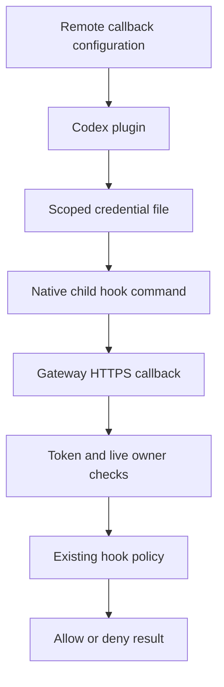

Codex review: blocked before merge. _Reviewed October 7, 2026, 5:49 PM ET / 21:49 UTC._

# ClawSweeper review

## What this changes

The PR lets native Codex child processes call Gateway hooks across hosts using an explicitly configured HTTPS callback and a scoped credential file.

## Merge readiness

⛔ **Blocked before merge - 1 item remains**

This PR remains useful: current main lacks the remote callback transport, and no blocking introduced defect was found. The verified maintain-access author also makes this ineligible for automatic closure.

**Priority:** P2
**Reviewed head:** `d5d928aadf5e386e0a8ae1dab9cff0c7b9797052`

## Review scores

| Measure | Result | What it means |
|---|---|---|
| **Overall readiness** | 🐚 platinum hermit **(4/6)** | A coherent repair with focused lifecycle and authorization coverage, useful deployment observations, and no blocking introduced finding. |
| **Proof confidence** | 🌊 off-meta tidepool | Not applicable: The verified maintain-access author is exempt from ordinary contributor proof. The captured body nevertheless reports deployed native spawn/wait/result success and wrong-target, invalid-token, stale-generation, and retired-capability rejection through the HTTPS route; source preserves final live-authority checks. No unresolved authority-chain proof gap or authoritative stored-data migration was identified. |
| **Patch quality** | 🐚 platinum hermit **(4/6)** | No actionable review findings were identified. |

## Verification

| Check | Result | Evidence |
|---|---|---|
| **Real behavior** | Not applicable | Not applicable: The verified maintain-access author is exempt from ordinary contributor proof. The captured body nevertheless reports deployed native spawn/wait/result success and wrong-target, invalid-token, stale-generation, and retired-capability rejection through the HTTPS route; source preserves final live-authority checks. No unresolved authority-chain proof gap or authoritative stored-data migration was identified. |
| **Evidence reviewed** | 10 items | Pinned introduced change: Reviewed the merge-base-to-head production changes, tests, configuration, documentation, and Gateway routing. The stale test merge was not used to infer removal of current-main behavior. Still necessary on main: Current main's command builder emits the Gateway-local state database path and has no remote-credential argument. A broader current-main search found no remote credential path, remote callback enablement, or native-hook HTTP endpoint; the new client and endpoint files are also absent from the latest release tree. Release boundary check: Neither newly introduced remote transport file appears in the v2026.9.8 tree. This establishes file-level release absence, not a claim that every remote deployment scenario was tested. |
| **Findings** | None | None. |
| **Security** | None | None. |

## How this fits together

The Codex plugin installs hook commands that native parent and child processes use to request OpenClaw policy evaluation. The new transport carries those requests from a remote Codex host to the existing Gateway relay owner.

## Before merge

- [ ] **Add data-model compatibility proof** - Confirm migration or upgrade compatibility proof before merge.

<strong>Agent review details</strong>

### Security

None.

### PR surface

Source +475, Tests +694, Docs +27, Generated 0. Total +1196 across 35 files.

View PR surface stats

| Area | Files | Added | Removed | Net |
|---|---:|---:|---:|---:|
| Source | 23 | 501 | 26 | +475 |
| Tests | 9 | 697 | 3 | +694 |
| Docs | 1 | 28 | 1 | +27 |
| Config | 0 | 0 | 0 | 0 |
| Generated | 2 | 3 | 3 | 0 |
| Other | 0 | 0 | 0 | 0 |
| **Total** | **35** | **1229** | **33** | **+1196** |

### Review metrics

| Metric | Value | Why it matters |
|---|---|---|
| **Opt-in configuration** | 1 configuration object with 2 required fields; 1 CLI flag | The callback requires explicit URL and credential-directory configuration while existing local deployments retain their transport. |
| **Production versus tests** | production net +475 lines; tests and test support net +694 lines | Production growth is justified by remote credential projection, HTTPS transport, authorization, and lifecycle integration. |

### Stored data model

Persistent data-model change detected: `serialized state: extensions/codex/src/app-server/protocol.ts`. Confirm migration or upgrade compatibility proof before merge.

### Technical review

Best possible solution:

Keep remote transport opt-in, with the existing relay owner enforcing policy and lifetime and the deployment supplying a private credential directory and HTTPS routing.

Do we have a high-confidence way to reproduce the issue?

Yes, source establishes the failure mechanism: remote hook commands reference the Gateway-local database and loopback relay. No current-main runtime reproduction was executed during this read-only review.

Is this the best way to solve the issue?

Yes, the opt-in transport reuses the existing policy and lifetime owners instead of introducing a second authorization path, and preserves the default local behavior.

AGENTS.md: found and applied where relevant.

Codex review notes: model internal, reasoning medium; reviewed against [d4a2e61910a4](https://github.com/openclaw/openclaw/commit/d4a2e61910a4ac332b9c69cbc262b41900b1b2fa).

### Labels

Label changes:

- add `P2`: This repairs native-child hook execution in dedicated remote Codex deployments with a bounded, opt-in change.
- add `merge-risk: 🚨 security-boundary`: The callback exposes restricted hook authority across hosts; the maintain-access author's accepted Harness-user trust scope remains bounded by token, generation, target, and live-owner checks.
- add `rating: 🐚 platinum hermit`: Overall readiness is 🐚 platinum hermit; proof is 🌊 off-meta tidepool and patch quality is 🐚 platinum hermit.
- add `status: 👀 ready for maintainer look`: ClawSweeper has no concrete contributor-facing blocker left for this PR. Not applicable: The verified maintain-access author is exempt from ordinary contributor proof. The captured body nevertheless reports deployed native spawn/wait/result success and wrong-target, invalid-token, stale-generation, and retired-capability rejection through the HTTPS route; source preserves final live-authority checks. No unresolved authority-chain proof gap or authoritative stored-data migration was identified.

Label justifications:

- `P2`: This repairs native-child hook execution in dedicated remote Codex deployments with a bounded, opt-in change.
- `merge-risk: 🚨 security-boundary`: The callback exposes restricted hook authority across hosts; the maintain-access author's accepted Harness-user trust scope remains bounded by token, generation, target, and live-owner checks.
- `rating: 🐚 platinum hermit`: Overall readiness is 🐚 platinum hermit; proof is 🌊 off-meta tidepool and patch quality is 🐚 platinum hermit.
- `status: 👀 ready for maintainer look`: ClawSweeper has no concrete contributor-facing blocker left for this PR. Not applicable: The verified maintain-access author is exempt from ordinary contributor proof. The captured body nevertheless reports deployed native spawn/wait/result success and wrong-target, invalid-token, stale-generation, and retired-capability rejection through the HTTPS route; source preserves final live-authority checks. No unresolved authority-chain proof gap or authoritative stored-data migration was identified.

### Evidence

What I checked:

- **Pinned introduced change:** Reviewed the merge-base-to-head production changes, tests, configuration, documentation, and Gateway routing. The stale test merge was not used to infer removal of current-main behavior. ([d5d928aadf5e](https://github.com/openclaw/openclaw/commit/d5d928aadf5e386e0a8ae1dab9cff0c7b9797052))
- **Still necessary on main:** Current main's command builder emits the Gateway-local state database path and has no remote-credential argument. A broader current-main search found no remote credential path, remote callback enablement, or native-hook HTTP endpoint; the new client and endpoint files are also absent from the latest release tree. ([`src/agents/harness/native-hook-relay-command.ts:72`](https://github.com/openclaw/openclaw/blob/d4a2e61910a4ac332b9c69cbc262b41900b1b2fa/src/agents/harness/native-hook-relay-command.ts#L72), [d4a2e61910a4](https://github.com/openclaw/openclaw/commit/d4a2e61910a4ac332b9c69cbc262b41900b1b2fa))
- **Release boundary check:** Neither newly introduced remote transport file appears in the v2026.9.8 tree. This establishes file-level release absence, not a claim that every remote deployment scenario was tested. ([fc23bc864e45](https://github.com/openclaw/openclaw/commit/fc23bc864e4553c2d215e479eeec47b67a0bf943))
- **Callback authority chain:** The callback checks the relay token, provider and target, registration identity before and after awaiting the body, and exact remote generation. Invocation then uses the existing foreground or retained-child authority checks, including revalidation after asynchronous policy work before returning an allow result. ([`src/agents/harness/native-hook-relay-bridge.ts:293`](https://github.com/openclaw/openclaw/blob/d5d928aadf5e386e0a8ae1dab9cff0c7b9797052/src/agents/harness/native-hook-relay-bridge.ts#L293), [d5d928aadf5e](https://github.com/openclaw/openclaw/commit/d5d928aadf5e386e0a8ae1dab9cff0c7b9797052))
- **Credential lifecycle and compatibility:** Credential projection serializes writes and removals, captures the app-server client, checks current authority before delivery, and prevents an old projection from deleting its successor. The remote option is additive; absent configuration retains the local transport. No existing authoritative stored-data schema or format is rewritten. ([`extensions/codex/src/app-server/native-hook-relay-remote.ts:50`](https://github.com/openclaw/openclaw/blob/d5d928aadf5e386e0a8ae1dab9cff0c7b9797052/extensions/codex/src/app-server/native-hook-relay-remote.ts#L50), [d5d928aadf5e](https://github.com/openclaw/openclaw/commit/d5d928aadf5e386e0a8ae1dab9cff0c7b9797052))
- **Recorded deployment evidence and accepted trust scope:** The captured PR body reports a deployed run at 43a7333aa04c30c232877956bbdcd330d85c771c with stock Codex 0.160.0: native spawn/wait/result, a successful child command, inherited developer instructions, and a subsequent parent turn. It also reports deployed HTTPS rejection of invalid tokens, target mismatches, stale generations, and retired capabilities with 403/410 outcomes. The maintain-access author's stated design explicitly accepts that the Harness OS user can read its own restricted hook credential; it grants no operator RPC authority. Kubernetes and AWS rollout coverage is expressly unclaimed. ([43a7333aa04c](https://github.com/openclaw/openclaw/commit/43a7333aa04c30c232877956bbdcd330d85c771c))

Likely related people:

- **Peter Steinberger:** Suggested for follow-up; no historical authorship or introduction is verified. (role: unverified routing candidate; confidence: low)
- **Vincent Koc:** Suggested for follow-up; no historical authorship or introduction is verified. (role: unverified routing candidate; confidence: low)
- **Bek:** Suggested for follow-up; no historical authorship or introduction is verified. (role: unverified routing candidate; confidence: low)

### Rating scale

| Score | Internal tier | Crab rank | Meaning |
|---:|:---:|---|---|
| **6/6** | S | 🦀 challenger crab | Exceptional readiness |
| **5/6** | A | 🦞 diamond lobster | Very strong readiness |
| **4/6** | B | 🐚 platinum hermit | Good normal PR; ordinary maintainer review |
| **3/6** | C | 🦐 gold shrimp | Useful, but confidence is limited |
| **2/6** | D | 🦪 silver shellfish | Proof or implementation needs work |
| **1/6** | F | 🧂 unranked krab | Not merge-ready |
| N/A | NA | 🌊 off-meta tidepool | Rating does not apply |

Overall follows the weaker of proof and patch quality.
Shiny media proof means a screenshot, video, or linked artifact directly shows the changed behavior. Runtime, network, CSP, and security claims still need visible diagnostics.

### Workflow

- ClawSweeper keeps one durable marker-backed review comment per issue or PR.
- Re-runs edit this comment so the latest verdict, findings, and automation markers stay together instead of adding duplicate bot comments.
- A fresh review can be triggered by eligible `@clawsweeper re-review` comments, exact-item GitHub events, scheduled/background review runs, or manual workflow dispatch.
- PR/issue authors and users with repository write access can comment `@clawsweeper re-review` or `@clawsweeper re-run` on an open PR or issue to request a fresh review only.
- Maintainers can also comment `@clawsweeper review` to request a fresh review only.
- Fresh-review commands do not start repair, autofix, rebase, CI repair, or automerge.
- Maintainer-only repair and merge flows require explicit commands such as `@clawsweeper autofix`, `@clawsweeper automerge`, `@clawsweeper fix ci`, or `@clawsweeper address review`.
- Maintainers can comment `@clawsweeper explain` to ask for more context, or `@clawsweeper stop` to stop active automation.

<!-- clawsweeper-verdict:needs-human item=166400 sha=d5d928aadf5e386e0a8ae1dab9cff0c7b9797052 confidence=high updated_at=2026-10-07T21:45:46Z reviewed_at=2026-10-07T21:49:29.350Z lease_owner=github-run-37691462733-1 lease_comment_id=6047453434 source_revision=c6cf27013295d805354477baf951567c523904adbb185ec3922a5d5b27668a58 live_verification=absent -->
<!-- clawsweeper-review-state:blocked item=166400 sha=d5d928aadf5e386e0a8ae1dab9cff0c7b9797052 v=1 -->

<!-- clawsweeper-review-version item=166400 reviewed_at=2026-10-07T21:49:29.350Z sha=d5d928aadf5e386e0a8ae1dab9cff0c7b9797052 source_revision=c6cf27013295d805354477baf951567c523904adbb185ec3922a5d5b27668a58 lease_owner=github-run-37691462733-1 lease_comment_id=6047453434 v=1 -->

<!-- clawsweeper-review item=166400 -->