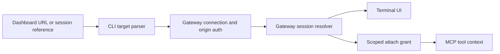

Codex review: needs maintainer review before merge. _Reviewed August 9, 2026, 4:46 PM ET / 20:46 UTC._

# ClawSweeper review

## What this changes

Adds dashboard URL, host/reference, and bare-reference targets to TUI, attach, and bare-root CLI flows, resolving them through the selected Gateway.

## Merge readiness

⚠️ **Ready for maintainer review - 2 items remain**

Keep open: current main still accepts only existing TUI and attach session inputs, while this PR adds the missing dashboard-to-CLI continuation flow. The patch has no supported correctness finding, but GitHub reports a dirty merge state and this maintainer-authored, protected PR needs exact-head reconciliation before landing.

**Priority:** P2
**Reviewed head:** `1310db9cfecf4c205e0dc48ba397402a8f3cb529`

## Review scores

| Measure | Result | What it means |
|---|---|---|
| **Overall readiness** | 🐚 platinum hermit **(4/6)** | The implementation and focused coverage are strong, but the current dirty merge state requires exact-head validation before merge. |
| **Proof confidence** | 🌊 off-meta tidepool | Not applicable: This is maintainer-authored work; the PR body supplies extensive focused and exact-head CI validation, while final proof must be refreshed after conflict resolution. |
| **Patch quality** | 🐚 platinum hermit **(4/6)** | No actionable review findings were identified. |

## Verification

| Check | Result | Evidence |
|---|---|---|
| **Real behavior** | Not applicable | Not applicable: This is maintainer-authored work; the PR body supplies extensive focused and exact-head CI validation, while final proof must be refreshed after conflict resolution. |
| **Evidence reviewed** | 6 items | Current main lacks the requested CLI target surface: Current main registers TUI without a positional target and forwards only existing options such as --session; the requested URL/ref ingestion is not already implemented. Canonical target parsing and resolution: The branch reuses the session-URL contract, rejects credential-bearing URLs, and resolves short or literal references through the Gateway rather than duplicating Control UI lookup behavior. Global-session owner is carried at the grant boundary: The branch records an explicit agent only for the canonical global session and passes it into the bound MCP request context, preserving the existing no-spoofed-header boundary. |
| **Findings** | None | None. |
| **Security** | None | None. |

## How this fits together

CLI session targets are parsed into a Gateway origin, agent, and session reference, then resolved by the Gateway before TUI or a scoped attach grant uses the resulting canonical session. The selected session and agent owner feed terminal behavior and MCP tool scope.

## Before merge

- [ ] **Resolve merge risk (P1)** - GitHub reports a dirty merge; reconciliation must preserve current-main behavior and rerun exact-head validation for URL-selected session and global-agent ownership.
- [ ] **Complete next step (P2)** - The protected maintainer-authored PR has a dirty merge state and needs maintainer-led reconciliation, not an automated repair job.

<strong>Agent review details</strong>

### Security

None.

### PR surface

Source +673, Tests +1046, Docs +76, Config +1, Generated 0, Other +168. Total +1964 across 40 files.

View PR surface stats

| Area | Files | Added | Removed | Net |
|---|---:|---:|---:|---:|
| Source | 17 | 863 | 190 | +673 |
| Tests | 11 | 1057 | 11 | +1046 |
| Docs | 2 | 79 | 3 | +76 |
| Config | 2 | 2 | 1 | +1 |
| Generated | 1 | 10 | 10 | 0 |
| Other | 7 | 180 | 12 | +168 |
| **Total** | **40** | **2191** | **227** | **+1964** |

### Review metrics

| Metric | Value | Why it matters |
|---|---|---|
| **Production versus test delta** | production/config +794/-157; tests +788/-1; docs +79/-3 | The production growth implements three CLI continuation entry paths plus canonical global-session ownership, with substantial focused coverage. |
| **Continuation entry paths** | 3 added: bare-root URL, tui target, attach target | All three paths must preserve the same Gateway-origin, session-resolution, and agent-owner invariant. |

### Stored data model

Persistent data-model change detected: `persistent cache schema: src/cli/attach-cli.ts`, `serialized state: scripts/package-manifest.mjs`, `serialized state: src/cli/session-ref.test.ts`, `serialized state: src/cli/session-ref.ts`, `serialized state: src/cli/session-target.ts`, `serialized state: src/config/sessions/main-session-key.ts`, and 6 more. Confirm migration or upgrade compatibility proof before merge.

### Root-cause cluster

Relationship: `fixed_by_candidate`
Canonical: https://github.com/openclaw/openclaw/issues/120492
Summary: This PR is the implementation candidate for the canonical dashboard-session-to-CLI continuation feature.

Members:
- `canonical`: https://github.com/openclaw/openclaw/issues/120492 - The PR body and linked context identify that issue as the approved feature request this branch implements.

Proposal only: this assessment does not dispatch repair, suppress jobs, mutate sibling items, close, or merge anything.

### Merge-risk options

**Maintainer options:**
1. **Reconcile session-continuation behavior before merge (recommended)**  
   Resolve the dirty merge and rerun exact-head continuation and attach-grant checks so the selected Gateway session and global-session agent remain correctly associated.

### Technical review

Best possible solution:

Rebase and resolve the branch against current main while retaining the canonical parser → Gateway resolver → session/agent-owner flow, then validate the resolved head.

Do we have a high-confidence way to reproduce the issue?

Not applicable: this PR adds a new continuation capability rather than repairing a reported existing-behavior bug; current-main source confirms the target grammar is absent.

Is this the best way to solve the issue?

Yes, subject to merge reconciliation: the branch reuses the canonical session URL parser and Gateway-owned resolver rather than adding client-side session-list inference.

AGENTS.md: found and applied where relevant.

Codex review notes: model internal, reasoning high; reviewed against [bff0494f33b2](https://github.com/openclaw/openclaw/commit/bff0494f33b24aef664990dafda0d38750d798bc).

### Labels

Label justifications:

- `P2`: This is a bounded operator workflow addition whose current merge conflict blocks normal landing but does not establish an urgent regression.
- `merge-risk: 🚨 session-state`: The patch converts a URL-selected agent and reference into TUI state and an attach-grant context, so incorrect conflict resolution could associate work with the wrong session or agent.
- `rating: 🐚 platinum hermit`: Overall readiness is 🐚 platinum hermit; proof is 🌊 off-meta tidepool and patch quality is 🐚 platinum hermit.
- `status: 👀 ready for maintainer look`: ClawSweeper has no concrete contributor-facing blocker left for this PR. Not applicable: This is maintainer-authored work; the PR body supplies extensive focused and exact-head CI validation, while final proof must be refreshed after conflict resolution.

### Evidence

What I checked:

- **Current main lacks the requested CLI target surface:** Current main registers TUI without a positional target and forwards only existing options such as --session; the requested URL/ref ingestion is not already implemented. ([`src/cli/tui-cli.ts:12`](https://github.com/openclaw/openclaw/blob/bff0494f33b2/src/cli/tui-cli.ts#L12), [bff0494f33b2](https://github.com/openclaw/openclaw/commit/bff0494f33b2))
- **Canonical target parsing and resolution:** The branch reuses the session-URL contract, rejects credential-bearing URLs, and resolves short or literal references through the Gateway rather than duplicating Control UI lookup behavior. ([`src/cli/session-target.ts:179`](https://github.com/openclaw/openclaw/blob/1310db9cfecf/src/cli/session-target.ts#L179), [1310db9cfecf](https://github.com/openclaw/openclaw/commit/1310db9cfecf))
- **Global-session owner is carried at the grant boundary:** The branch records an explicit agent only for the canonical global session and passes it into the bound MCP request context, preserving the existing no-spoofed-header boundary. ([`src/gateway/mcp-grant-store.ts:122`](https://github.com/openclaw/openclaw/blob/1310db9cfecf/src/gateway/mcp-grant-store.ts#L122), [1310db9cfecf](https://github.com/openclaw/openclaw/commit/1310db9cfecf))
- **Dependency and packaging review:** The new private session-URL contract is a workspace development dependency; the packaging helper removes workspace dev dependencies only in the temporary published manifest and restores the original bytes. ([`scripts/package-manifest.mjs:19`](https://github.com/openclaw/openclaw/blob/1310db9cfecf/scripts/package-manifest.mjs#L19), [1310db9cfecf](https://github.com/openclaw/openclaw/commit/1310db9cfecf))
- **Feature provenance:** The merged Gateway short-reference resolver dates to the related feature commit, and blame shows the current attach and TUI session-owner paths were recently maintained by the same contributor. ([`src/gateway/server-methods/attach.ts:31`](https://github.com/openclaw/openclaw/blob/0b85f9c174c9/src/gateway/server-methods/attach.ts#L31), [0b85f9c174c9](https://github.com/openclaw/openclaw/commit/0b85f9c174c9))
- **Merge gate:** The supplied GitHub state reports this exact PR head as dirty/merge-conflicted, so clean CI on the branch is not proof for the final merge result. ([1310db9cfecf](https://github.com/openclaw/openclaw/commit/1310db9cfecf))

Likely related people:

- **steipete:** Merged Gateway short-reference work and current-main blame for the attach and TUI session-owner paths identify this contributor as the central history owner. (role: feature owner and recent area contributor; confidence: high; commits: [0b85f9c174c9](https://github.com/openclaw/openclaw/commit/0b85f9c174c964570922e5e77d84243b548442ff), [5ec12b1330ae](https://github.com/openclaw/openclaw/commit/5ec12b1330aee5822e03757f797f91781fdfbd95); files: `src/gateway/sessions-resolve.ts`, `src/gateway/server-methods/attach.ts`, `src/tui/tui.ts`)

### Rank-up moves

Optional improvements that raise the rating; they are not merge blockers.

- Resolve the GitHub merge conflicts and rerun the continuation and attach-grant checks on the resulting head.

### Rating scale

| Score | Internal tier | Crab rank | Meaning |
|---:|:---:|---|---|
| **6/6** | S | 🦀 challenger crab | Exceptional readiness |
| **5/6** | A | 🦞 diamond lobster | Very strong readiness |
| **4/6** | B | 🐚 platinum hermit | Good normal PR; ordinary maintainer review |
| **3/6** | C | 🦐 gold shrimp | Useful, but confidence is limited |
| **2/6** | D | 🦪 silver shellfish | Proof or implementation needs work |
| **1/6** | F | 🧂 unranked krab | Not merge-ready |
| N/A | NA | 🌊 off-meta tidepool | Rating does not apply |

Overall follows the weaker of proof and patch quality.
Shiny media proof means a screenshot, video, or linked artifact directly shows the changed behavior. Runtime, network, CSP, and security claims still need visible diagnostics.

### Workflow

- ClawSweeper keeps one durable marker-backed review comment per issue or PR.
- Re-runs edit this comment so the latest verdict, findings, and automation markers stay together instead of adding duplicate bot comments.
- A fresh review can be triggered by eligible `@clawsweeper re-review` comments, exact-item GitHub events, scheduled/background review runs, or manual workflow dispatch.
- PR/issue authors and users with repository write access can comment `@clawsweeper re-review` or `@clawsweeper re-run` on an open PR or issue to request a fresh review only.
- Maintainers can also comment `@clawsweeper review` to request a fresh review only.
- Fresh-review commands do not start repair, autofix, rebase, CI repair, or automerge.
- Maintainer-only repair and merge flows require explicit commands such as `@clawsweeper autofix`, `@clawsweeper automerge`, `@clawsweeper fix ci`, or `@clawsweeper address review`.
- Maintainers can comment `@clawsweeper explain` to ask for more context, or `@clawsweeper stop` to stop active automation.

### History

Review history (7 earlier review cycles)

<!-- clawsweeper-review-history v=1 total=7 -->
- reviewed 2026-08-09T05:43:03.989Z sha 7fa7b4185c4fe2396f50de61a378ac9e2eb64d7c :: found issues before merge. :: [P1] Preserve global-scope dashboard sessions | [P1] Keep short-link resolution independent of the URL agent | [P2] Sanitize the private dependency on every pack path
- reviewed 2026-08-09T08:44:36.542Z sha 292fa96b855415c9c89e7fb064933467c5263a21 :: found issues before merge. :: [P1] Preserve the URL agent for global TUI sessions
- reviewed 2026-08-09T09:40:17.538Z sha 894521ea3746b70e973abbf6d3008d91804c2874 :: needs changes before merge. :: [P1] Preserve the URL agent for global TUI sessions
- reviewed 2026-08-09T11:43:54.895Z sha 1079a29597824c252451484b42a5cb78a54670ff :: needs maintainer review before merge. :: none
- reviewed 2026-08-09T12:40:14.599Z sha 930f6bee7b0326e526f8b38e030d2b587f17d92b :: needs maintainer review before merge. :: none
- reviewed 2026-08-09T12:54:03.353Z sha 930f6bee7b0326e526f8b38e030d2b587f17d92b :: needs maintainer review before merge. :: none
- reviewed 2026-08-09T18:49:07.111Z sha 33ec8ee0afbdbf89d94889258117acf26b1252be :: needs maintainer review before merge. :: none

<!-- clawsweeper-verdict:needs-human item=120893 sha=1310db9cfecf4c205e0dc48ba397402a8f3cb529 confidence=high updated_at=2026-08-09T20:42:47Z reviewed_at=2026-08-09T20:46:09.748Z lease_owner=github-run-31334875559-1 lease_comment_id=5233748871 source_revision=90168eca860577680b3138f8193df63f6edc446710e5045c13bc18a3cbdf4574 -->

<!-- clawsweeper-review-version item=120893 reviewed_at=2026-08-09T20:46:09.748Z sha=1310db9cfecf4c205e0dc48ba397402a8f3cb529 source_revision=90168eca860577680b3138f8193df63f6edc446710e5045c13bc18a3cbdf4574 lease_owner=github-run-31334875559-1 lease_comment_id=5233748871 v=1 -->

<!-- clawsweeper-review item=120893 -->