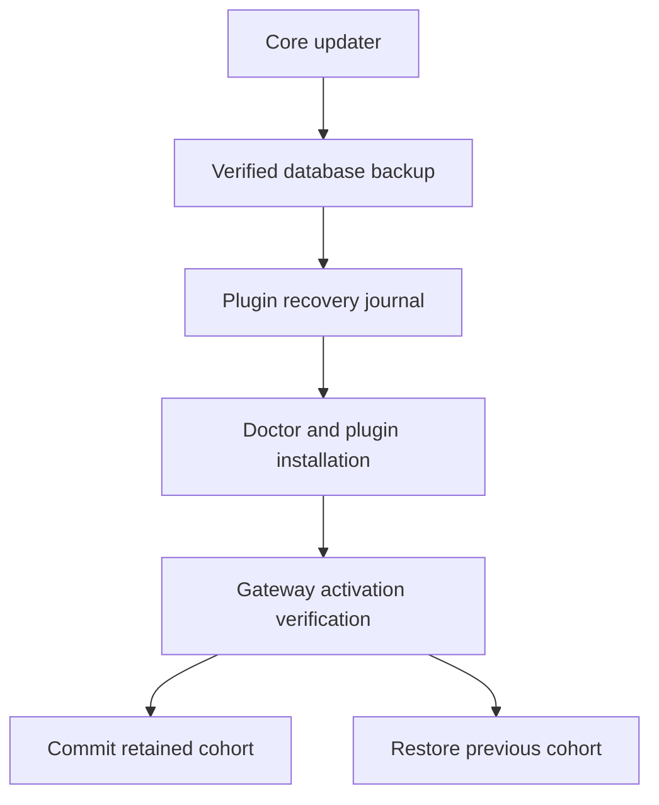

Codex review: blocked before merge.

## What this changes

This PR retains npm plugin artifacts, installation records, and settings so failed core updates can restore compatible plugins.

**Example:** Core rolls back from 2026.9.36 to 2026.9.34 after upgrading plugins.
- **Before:** Plugins requiring API 2026.9.36 remain installed and are skipped by core 2026.9.34.
- **After:** Rollback restores the previous plugin artifacts, records, and matching settings before restarting core.

## Review scores

| Measure | Result | What it means |
|---|---|---|
| **Overall readiness** | 🧂 unranked krab **(1/6)** | The repair is valuable, but verified compatibility and wrapper defects block merge, and the persisted-format upgrade claims lack inspectable result artifacts. |
| **Proof confidence** | 🧂 unranked krab **(1/6)** | Real behavior proof is not required for maintainer- or bot-authored pull requests. |
| **Patch quality** | 🦪 silver shellfish **(2/6)** | 2 actionable review findings remain. |

## Product

**Kind:** Bug fix · **Worth it:** Yes · **Fix scope:** Partial
**User problem:** After a failed update restores older core, installed plugins can remain too new to load.
**Reason:** Compatible plugin restoration has clear user value and maintainer-authored direction; the PR correctly uses Related because it does not resolve the linked report’s lease stall or backport.

## Merge readiness

⛔ **Blocked before merge - 4 items remain**

Keep this PR open: it addresses a confirmed rollback defect, but introduces a shipped-updater compatibility regression and breaks the extracted PR wrapper’s import closure.

**Priority:** P1
**Reviewed head:** `59c8fb01c2e8ad2b7f27ef0a7b9d61567077150c`

## Before merge

- [ ] **Preserve the shipped post-core handoff without a transported executor (P1)** - The published 2026.9.3 updater spawns the candidate’s `update` CLI with `OPENCLAW_UPDATE_POST_CORE=1`, a run ID, and result-file paths, but no executor object. `resumePostCoreUpdate` only acquires an executor for the 2026.9.2 legacy bridge, so the 2026.9.3 route reaches this new guard without `opts.run.executorFence` and fails before plugin convergence. Existing older-parent caller tests fail at this line in exact-head CI. Preserve that shipped route through the existing authority owner; an older installed updater cannot be changed by its candidate.
- [ ] **Include the new config dependency in the extracted wrapper sources (P1)** - This eager import adds `plugin-cohort-publication.ts` and its recovery dependencies to a module included in the trusted PR wrapper, but the PR leaves `scripts/pr-lib/wrapper-components.txt` unchanged. The extracted wrapper therefore cannot resolve this import. Exact-head CI confirms both the unresolved module and missing transitive closure in the wrapper inventory tests. Update the inventory or narrow the dependency boundary so extracted consumers retain a complete runtime graph.
- [ ] **Add data-model compatibility proof** - The review found that existing stored data may not work after upgrade. Show that existing data still loads and works with this change.
- [ ] **Explain or restore the original intent of Shipped post-core completion** - unknown: The published 2026.9.3 caller and existing compatibility tests establish a child-owned post-core handoff without a transported executor; local history could not establish its introduction because older blobs were unavailable.

## Findings

- [P1] Preserve the shipped post-core handoff without a transported executor — `src/cli/update-cli/update-command-resume.ts:521-526`
- [P1] Include the new config dependency in the extracted wrapper sources — `src/config/mutate.include-io.ts:32`

### Provenance

- `Shipped post-core completion` changes intended behavior without addressing why it exists (unknown: The published 2026.9.3 caller and existing compatibility tests establish a child-owned post-core handoff without a transported executor; local history could not establish its introduction because older blobs were unavailable.)

### Tests

- Low-value test `src/cli/update-cli/update-command-convergence-authority.test.ts`: Remove the added adopted-finalization table at lines 137–153: it checks a requiresCohort argument sent to a mocked producer, while the persistence suite exercises actual acceptance and refusal.
- Missing end-to-end proof: Public source-bound output is still needed for the reported latest-stable upgrade and persisted recovery preservation; the shipped 2026.9.3 handoff also needs regression validation after repair.

<strong>Agent review details</strong>

### How this fits together

The updater coordinates package activation, Doctor, plugin installation, database backups, and Gateway readiness; recovery restores owned changes under the existing executor and plugin lifecycle lease.

### Technical review

Best possible solution:

Keep recovery in the existing update, plugin, and config owners while preserving shipped-parent handoffs and completing the wrapper’s source inventory.

Do we have a high-confidence way to reproduce the issue?

The linked report establishes incompatible plugins surviving core rollback, and current-main rollback restores package/config/database state without a retained plugin-cohort restoration path.

Is this the best way to solve the issue?

Durable preimages and fresh lease acquisition address interrupted recovery appropriately, but the new guard must accommodate the verified shipped-parent contract and the config imports must remain available to extracted consumers.

Full review comments:

- [P1] Preserve the shipped post-core handoff without a transported executor — `src/cli/update-cli/update-command-resume.ts:521-526`
  The published 2026.9.3 updater spawns the candidate’s `update` CLI with `OPENCLAW_UPDATE_POST_CORE=1`, a run ID, and result-file paths, but no executor object. `resumePostCoreUpdate` only acquires an executor for the 2026.9.2 legacy bridge, so the 2026.9.3 route reaches this new guard without `opts.run.executorFence` and fails before plugin convergence. Existing older-parent caller tests fail at this line in exact-head CI. Preserve that shipped route through the existing authority owner; an older installed updater cannot be changed by its candidate.
  Confidence: 0.98
- [P1] Include the new config dependency in the extracted wrapper sources — `src/config/mutate.include-io.ts:32`
  This eager import adds `plugin-cohort-publication.ts` and its recovery dependencies to a module included in the trusted PR wrapper, but the PR leaves `scripts/pr-lib/wrapper-components.txt` unchanged. The extracted wrapper therefore cannot resolve this import. Exact-head CI confirms both the unresolved module and missing transitive closure in the wrapper inventory tests. Update the inventory or narrow the dependency boundary so extracted consumers retain a complete runtime graph.
  Confidence: 0.99

Overall correctness: patch is incorrect
Overall confidence: 0.96

AGENTS.md: found and applied where relevant.

Codex review notes: model internal, reasoning medium; reviewed against [6fdd9aaf60cd](https://github.com/openclaw/openclaw/commit/6fdd9aaf60cd92cdc967016ff419a029bbe716a3).

### Provenance checked

- `Package and included-config rollback` keeps the original intent (82bd51a31eb0e78dbaab520a51b38b1cbdf788b0: Restore exact Doctor-owned include changes while preserving later operator edits and changed path ownership.)
- `Plugin install transaction lifetime` keeps the original intent (f1098ee89478d57e43f14e0f98c15427ebbaab50: Retain prior payloads until replacement publication settles and prevent cleanup after ownership changes.)
- `Shared host-link repair orchestration` keeps the original intent (d00678f887044b7070ba2425d0ed164c2c8999bb: Keep managed and registered repairs with one owner and settle admitted siblings before reporting failure.)

### Testing

Proof path: in-process harness.

### Security

None.

### Evidence

Acceptance criteria:

- pnpm test src/cli/update-cli/update-command-doctor-authority-callers.test.ts src/cli/update-cli/update-command-plugins.persistence.test.ts
- pnpm test src/cli/update-cli/update-command-lease.test.ts
- pnpm test test/scripts/eager-import-closure.test.ts test/scripts/pr-wrapper-source-closure.test.ts
- git diff --check

What I checked:

- **Confirmed user impact:** The reporter describes core returning to 2026.9.34 while six npm plugins remain at 2026.9.36 and fail plugin API compatibility checks: https://github.com/openclaw/openclaw/issues/188335.
- **Shipped parent cannot supply the new executor:** The published 2026.9.3 updater spawns the candidate CLI with post-core environment markers and a result-file handoff, without an executor grant. Current resume code only acquires a legacy executor for 2026.9.2, so the added unconditional post-core guard rejects the 2026.9.3 route. ([`src/cli/update-cli/update-command-post-core.ts:368`](https://github.com/openclaw/openclaw/blob/1391f7cd2d40ab5bbcf2f5f831d3a64f520e72d7/src/cli/update-cli/update-command-post-core.ts#L368), [1391f7cd2d40](https://github.com/openclaw/openclaw/commit/1391f7cd2d40ab5bbcf2f5f831d3a64f520e72d7))
- **Exact-head compatibility failures:** CI annotations show existing post-core caller scenarios failing at the newly added executor guard, including older-parent completion scenarios: https://github.com/openclaw/openclaw/actions/runs/41160455087. ([`src/cli/update-cli/update-command-resume.ts:525`](https://github.com/openclaw/openclaw/blob/59c8fb01c2e8ad2b7f27ef0a7b9d61567077150c/src/cli/update-cli/update-command-resume.ts#L525), [59c8fb01c2e8](https://github.com/openclaw/openclaw/commit/59c8fb01c2e8ad2b7f27ef0a7b9d61567077150c))
- **Wrapper runtime closure regression:** Exact-head CI reports an unresolved plugin-cohort-publication import in the extracted wrapper and lists its missing transitive sources; wrapper-components.txt is unchanged. ([`src/config/mutate.include-io.ts:32`](https://github.com/openclaw/openclaw/blob/59c8fb01c2e8ad2b7f27ef0a7b9d61567077150c/src/config/mutate.include-io.ts#L32), [59c8fb01c2e8](https://github.com/openclaw/openclaw/commit/59c8fb01c2e8ad2b7f27ef0a7b9d61567077150c))
- **Recovery preserves existing ownership:** Restoration compares recorded preimages and postimages, reacquires the plugin lease, and restores records through the existing installation owner; configuration restoration uses the existing config writer locks and path guards. ([`src/plugins/update-cohort-recovery.ts:330`](https://github.com/openclaw/openclaw/blob/59c8fb01c2e8ad2b7f27ef0a7b9d61567077150c/src/plugins/update-cohort-recovery.ts#L330), [59c8fb01c2e8](https://github.com/openclaw/openclaw/commit/59c8fb01c2e8ad2b7f27ef0a7b9d61567077150c))
- **Previous recovery intent:** Earlier work deliberately preserved later operator edits, include ownership, deferred retirement, and installed-parent compatibility: https://github.com/openclaw/openclaw/pull/160443 and https://github.com/openclaw/openclaw/pull/147827. ([`src/cli/update-cli/update-command-rollback.ts:246`](https://github.com/openclaw/openclaw/blob/82bd51a31eb0e78dbaab520a51b38b1cbdf788b0/src/cli/update-cli/update-command-rollback.ts#L246), [82bd51a31eb0](https://github.com/openclaw/openclaw/commit/82bd51a31eb0e78dbaab520a51b38b1cbdf788b0))

Likely related people:

- **Peter Steinberger:** Raw commit fd3914e0af3f76ae7545acd75f17d19408e7cd24 adds src/cli/update-cli/update-command-rollback.ts:139 relative to its recorded parents. This identifies author metadata, not feature responsibility or a PR merger. (role: source-line author; confidence: high; commits: [fd3914e0af3f](https://github.com/openclaw/openclaw/commit/fd3914e0af3f76ae7545acd75f17d19408e7cd24); files: `src/cli/update-cli/update-command-rollback.ts`)
- **Vincent Koc:** Raw commit d00678f887044b7070ba2425d0ed164c2c8999bb adds src/plugins/plugin-peer-link.ts:513 relative to its recorded parents. This identifies author metadata, not feature responsibility or a PR merger. (role: source-line author; confidence: high; commits: [d00678f88704](https://github.com/openclaw/openclaw/commit/d00678f887044b7070ba2425d0ed164c2c8999bb); files: `src/plugins/plugin-peer-link.ts`)

### PR surface

PR surface statistics unavailable: the file list is incomplete.

### Review metrics

| Metric | Value | Why it matters |
|---|---|---|
| **Persisted recovery format** | 1 new companion record format; 0 new database tables | The plugin-cohort JSON record is stored beside the existing reservation in config_machine_state, making released-reader and upgrade compatibility material. |

### Labels

Label changes:

- add `P1`: The rollback defect disables installed plugins, and the patch additionally rejects a verified shipped-updater handoff.
- add `merge-risk: 🚨 compatibility`: The new post-core executor requirement rejects the published 2026.9.3 caller.
- add `merge-risk: 🚨 automation`: An added eager config import is absent from the extracted PR wrapper’s runtime source inventory.
- add `rating: 🧂 unranked krab`: Overall readiness is 🧂 unranked krab; proof is 🧂 unranked krab and patch quality is 🦪 silver shellfish.
- add `status: ⏳ waiting on author`: ClawSweeper has contributor-facing work open and is waiting for author action.

Label justifications:

- `P1`: The rollback defect disables installed plugins, and the patch additionally rejects a verified shipped-updater handoff.
- `merge-risk: 🚨 compatibility`: The new post-core executor requirement rejects the published 2026.9.3 caller.
- `merge-risk: 🚨 automation`: An added eager config import is absent from the extracted PR wrapper’s runtime source inventory.
- `rating: 🧂 unranked krab`: Overall readiness is 🧂 unranked krab; proof is 🧂 unranked krab and patch quality is 🦪 silver shellfish.
- `status: ⏳ waiting on author`: ClawSweeper has contributor-facing work open and is waiting for author action.

### Rating scale

6/6 🦀 challenger crab · 5/6 🦞 diamond lobster · 4/6 🐚 platinum hermit · 3/6 🦐 gold shrimp · 2/6 🦪 silver shellfish · 1/6 🧂 unranked krab. Overall follows the weaker of proof and patch quality; ✨ marks media proof (a screenshot, video, or linked artifact) that directly shows the changed behavior.

### Workflow

ClawSweeper edits this one comment on every review. Comment `@clawsweeper re-review` for a fresh review only. Repair and merge execution lanes are retired.

_Reviewed October 30, 2026, 10:56 PM ET / October 31, 2026, 02:56 UTC._

<!-- clawsweeper-verdict:needs-human item=188978 sha=59c8fb01c2e8ad2b7f27ef0a7b9d61567077150c confidence=high updated_at=2026-10-31T02:48:22Z reviewed_at=2026-10-31T02:56:41.351Z lease_owner=github-run-41161520653-1 lease_comment_id=6537994792 source_revision=97485687366c0db5ca9cc0a54e01853a160ec677c33a78d1ef517c20131520db hold=blocked findings=2 -->
<!-- clawsweeper-review-state:blocked item=188978 sha=59c8fb01c2e8ad2b7f27ef0a7b9d61567077150c v=1 -->

<!-- clawsweeper-review-version item=188978 reviewed_at=2026-10-31T02:56:41.351Z sha=59c8fb01c2e8ad2b7f27ef0a7b9d61567077150c source_revision=97485687366c0db5ca9cc0a54e01853a160ec677c33a78d1ef517c20131520db lease_owner=github-run-41161520653-1 lease_comment_id=6537994792 v=1 -->

<!-- clawsweeper-review item=188978 -->