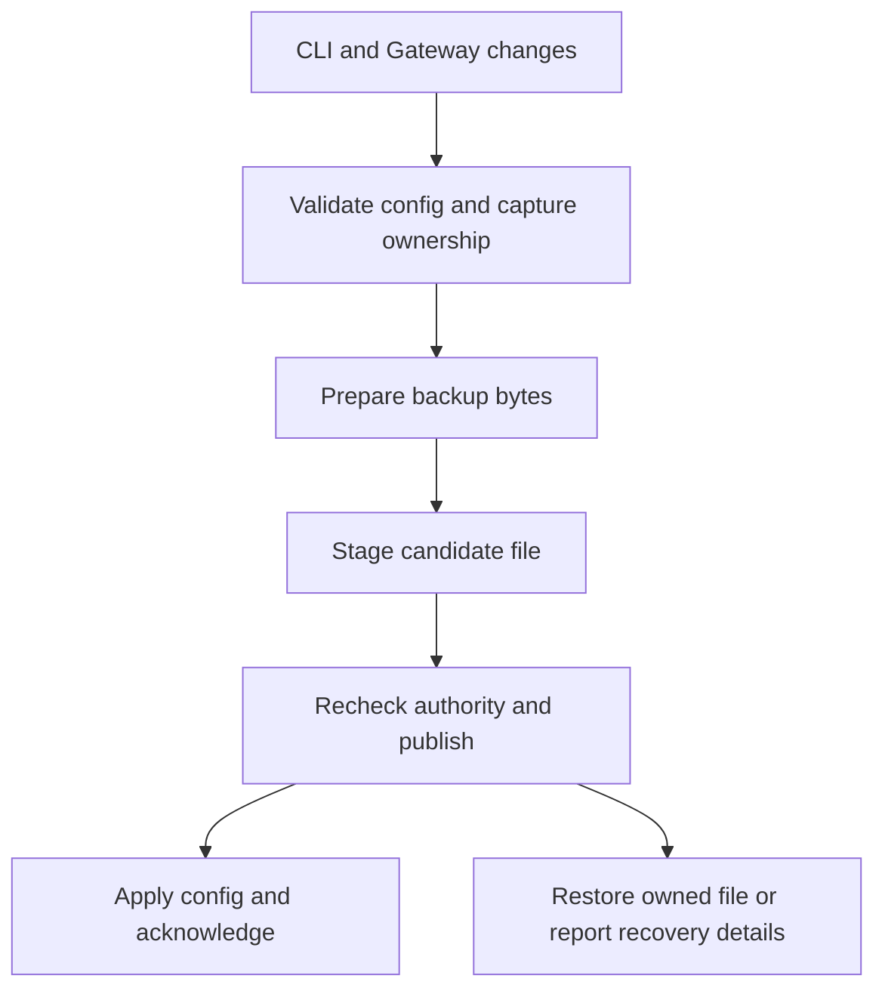

Codex review: blocked before merge. _Reviewed September 12, 2026, 5:34 PM ET / 21:34 UTC (Revision 4)._

# ClawSweeper review

## What this changes

The PR shares config-save staging and recovery across root and included files, preserves backups when staging fails, and reports partial-write recovery outcomes.

## Merge readiness

⛔ **Blocked before merge - 2 items remain**

This remains a useful repair absent from current main. The previous backup-permission finding is addressed, and no new blocking code defect was established; published-updater compatibility evidence remains outstanding.

**Priority:** P1
**Reviewed head:** `606b3d8e94e7423756ed95487870b931eca2fdab`

## Review scores

| Measure | Result | What it means |
|---|---|---|
| **Overall readiness** | 🐚 platinum hermit **(4/6)** | A focused recovery repair with meaningful boundary coverage and no established blocking defect; update integration evidence remains a merge requirement. |
| **Proof confidence** | 🌊 off-meta tidepool | Not applicable: The supplied MEMBER association exempts this PR from the ordinary external-contributor proof gate. Reported CLI/Gateway recovery observations remain useful evidence; the separate published-updater compatibility requirement remains unresolved. |
| **Patch quality** | 🐚 platinum hermit **(4/6)** | No actionable review findings were identified. |

## Verification

| Check | Result | Evidence |
|---|---|---|
| **Real behavior** | Not applicable | Not applicable: The supplied MEMBER association exempts this PR from the ordinary external-contributor proof gate. Reported CLI/Gateway recovery observations remain useful evidence; the separate published-updater compatibility requirement remains unresolved. |
| **Evidence reviewed** | 10 items | Current main still needs the repair: Current main retains maintainConfigBackups, which advances the five-slot ring before copying the current file; the proposed staged-publication owner is absent. Latest release comparison: The v2026.9.4 source also rotates backups before copying the primary backup. This release does not contain the proposed repair. Shared publication and recovery: The root writer records removal separately from completed publication, attempts guarded restoration, and exposes partial publication through ConfigWritePostCommitError; include writes use the same staging and rollback helpers. |
| **Findings** | None | None. |
| **Security** | None | None. |

## How this fits together

OpenClaw’s config writer accepts changes from CLI commands, Gateway requests, login, and setup flows. It publishes configuration files and recovery backups before callers apply the resulting runtime configuration.

## Before merge

- [ ] **Resolve merge risk (P1)** - The shared publication path and service-update authority callbacks lack published-updater compatibility evidence; an integration failure could prevent an existing installation from persisting config during service repair.
- [ ] **Complete next step (P2)** - Attach published-updater × candidate evidence showing existing-config preservation and service recovery through the changed config writer.

<strong>Agent review details</strong>

### Security

None.

### PR surface

Source +132, Tests +538, Docs +6, Other 0. Total +676 across 23 files.

View PR surface stats

| Area | Files | Added | Removed | Net |
|---|---:|---:|---:|---:|
| Source | 11 | 424 | 292 | +132 |
| Tests | 10 | 701 | 163 | +538 |
| Docs | 1 | 6 | 0 | +6 |
| Config | 0 | 0 | 0 | 0 |
| Generated | 0 | 0 | 0 | 0 |
| Other | 1 | 1 | 1 | 0 |
| **Total** | **23** | **1132** | **456** | **+676** |

### Review metrics

| Metric | Value | Why it matters |
|---|---|---|
| **Production versus regression coverage** | Production net +132 lines; tests net +538 lines | Production growth has a stated recovery and path-identity purpose, while most added coverage exercises failure outcomes through config entry points. |

### Merge-risk options

**Maintainer options:**
1. **Complete the updater compatibility evidence (recommended)**  
   Attach a published-updater × candidate result showing existing-config preservation and service recovery through the changed writer.

### Technical review

Best possible solution:

Keep one guarded publication and recovery owner, with demonstrated preservation of existing configuration and successful service recovery when invoked by a published updater.

Do we have a high-confidence way to reproduce the issue?

Yes, source inspection establishes the backup-consumption path, and the PR describes permission-denied fallback and disk-full CLI scenarios. This read-only review did not execute them.

Is this the best way to solve the issue?

Yes, sharing staged publication and guarded restoration is a focused owner-level repair; update compatibility still needs the applicable published-driver evidence.

AGENTS.md: found and applied where relevant.

Codex review notes: model internal, reasoning medium; reviewed against [9b59fe4ef7da](https://github.com/openclaw/openclaw/commit/9b59fe4ef7da6444059d4fe4651b14097f13ab59).

### Labels

Label justifications:

- `P1`: The repair addresses failed saves that can leave the root config absent or consume recovery history.
- `merge-risk: 🚨 compatibility`: Changed service-update authority and config publication need compatibility evidence from a published updater operating on existing state.
- `rating: 🐚 platinum hermit`: Overall readiness is 🐚 platinum hermit; proof is 🌊 off-meta tidepool and patch quality is 🐚 platinum hermit.
- `status: 👀 ready for maintainer look`: ClawSweeper has no concrete contributor-facing blocker left for this PR. Not applicable: The supplied MEMBER association exempts this PR from the ordinary external-contributor proof gate. Reported CLI/Gateway recovery observations remain useful evidence; the separate published-updater compatibility requirement remains unresolved.

### Evidence

What I checked:

- **Current main still needs the repair:** Current main retains maintainConfigBackups, which advances the five-slot ring before copying the current file; the proposed staged-publication owner is absent. ([`src/config/backup-rotation.ts:145`](https://github.com/openclaw/openclaw/blob/9b59fe4ef7da6444059d4fe4651b14097f13ab59/src/config/backup-rotation.ts#L145), [9b59fe4ef7da](https://github.com/openclaw/openclaw/commit/9b59fe4ef7da6444059d4fe4651b14097f13ab59))
- **Latest release comparison:** The v2026.9.4 source also rotates backups before copying the primary backup. This release does not contain the proposed repair. ([`src/config/backup-rotation.ts`](https://github.com/openclaw/openclaw/blob/3a9d69db306cd7f081e06254cb89c4bcc14a7107/src/config/backup-rotation.ts), [3a9d69db306c](https://github.com/openclaw/openclaw/commit/3a9d69db306cd7f081e06254cb89c4bcc14a7107))
- **Shared publication and recovery:** The root writer records removal separately from completed publication, attempts guarded restoration, and exposes partial publication through ConfigWritePostCommitError; include writes use the same staging and rollback helpers. ([`src/config/io.write.ts:481`](https://github.com/openclaw/openclaw/blob/606b3d8e94e7423756ed95487870b931eca2fdab/src/config/io.write.ts#L481), [606b3d8e94e7](https://github.com/openclaw/openclaw/commit/606b3d8e94e7423756ed95487870b931eca2fdab))
- **Previous permission concern addressed:** Backup mutation admits source and destination artifacts through openRootFileSync and changes permissions through the admitted source descriptor. Include path proofs check directory and symlink identities during publication and restoration. ([`src/config/backup-rotation.ts:62`](https://github.com/openclaw/openclaw/blob/606b3d8e94e7423756ed95487870b931eca2fdab/src/config/backup-rotation.ts#L62), [606b3d8e94e7](https://github.com/openclaw/openclaw/commit/606b3d8e94e7423756ed95487870b931eca2fdab))
- **Filesystem dependency boundary:** The changed publication owner calls replaceFileAtomicSync and tempFile through OpenClaw wrappers that directly re-export @openclaw/fs-safe; package.json pins version 0.8.5. This establishes the relevant dependency contract. ([`src/infra/replace-file.ts:5`](https://github.com/openclaw/openclaw/blob/606b3d8e94e7423756ed95487870b931eca2fdab/src/infra/replace-file.ts#L5), [606b3d8e94e7](https://github.com/openclaw/openclaw/commit/606b3d8e94e7423756ed95487870b931eca2fdab))
- **Pinned filesystem contract inspected:** Repository ownership was verified through GitHub. At v0.8.5, synchronous atomic replacement stages the candidate before beforeRename; root-file admission rejects symlinks and hardlinks by default. The annotated tag resolves to the cited dependency commit. ([`src/replace-file.ts`](https://github.com/openclaw/fs-safe/blob/eb2294eeb6af5ab73bba8cf12d44d5b6091f6a95/src/replace-file.ts), [eb2294eeb6af](https://github.com/openclaw/fs-safe/commit/eb2294eeb6af5ab73bba8cf12d44d5b6091f6a95))

Likely related people:

- **obviyus:** Suggested for follow-up; no historical authorship or introduction is verified. (role: unverified routing candidate; confidence: low)
- **Vincent Koc:** Suggested for follow-up; no historical authorship or introduction is verified. (role: unverified routing candidate; confidence: low)

### Rank-up moves

Optional improvements that raise the rating; they are not merge blockers.

- Attach the published-updater × candidate result for existing-config preservation and service recovery.

### Rating scale

| Score | Internal tier | Crab rank | Meaning |
|---:|:---:|---|---|
| **6/6** | S | 🦀 challenger crab | Exceptional readiness |
| **5/6** | A | 🦞 diamond lobster | Very strong readiness |
| **4/6** | B | 🐚 platinum hermit | Good normal PR; ordinary maintainer review |
| **3/6** | C | 🦐 gold shrimp | Useful, but confidence is limited |
| **2/6** | D | 🦪 silver shellfish | Proof or implementation needs work |
| **1/6** | F | 🧂 unranked krab | Not merge-ready |
| N/A | NA | 🌊 off-meta tidepool | Rating does not apply |

Overall follows the weaker of proof and patch quality.
Shiny media proof means a screenshot, video, or linked artifact directly shows the changed behavior. Runtime, network, CSP, and security claims still need visible diagnostics.

### Workflow

- ClawSweeper keeps one durable marker-backed review comment per issue or PR.
- Re-runs edit this comment so the latest verdict, findings, and automation markers stay together instead of adding duplicate bot comments.
- A fresh review can be triggered by eligible `@clawsweeper re-review` comments, exact-item GitHub events, scheduled/background review runs, or manual workflow dispatch.
- PR/issue authors and users with repository write access can comment `@clawsweeper re-review` or `@clawsweeper re-run` on an open PR or issue to request a fresh review only.
- Maintainers can also comment `@clawsweeper review` to request a fresh review only.
- Fresh-review commands do not start repair, autofix, rebase, CI repair, or automerge.
- Maintainer-only repair and merge flows require explicit commands such as `@clawsweeper autofix`, `@clawsweeper automerge`, `@clawsweeper fix ci`, or `@clawsweeper address review`.
- Maintainers can comment `@clawsweeper explain` to ask for more context, or `@clawsweeper stop` to stop active automation.

### History

Review history (3 earlier review cycles)

<!-- clawsweeper-review-history v=1 total=3 -->
- reviewed 2026-09-12T18:31:10.093Z sha fb060c6346dc37f661370fa3888b1da30258f655 :: blocked before merge. :: none
- reviewed 2026-09-12T20:08:27.187Z sha ed1729c62567cb13339b5f3c9a1898abcb7d4989 :: needs real behavior proof before merge. :: [P2] Preserve alias-safe permission handling for include backups
- reviewed 2026-09-12T20:58:52.769Z sha 606b3d8e94e7423756ed95487870b931eca2fdab :: blocked before merge. :: none

<!-- clawsweeper-verdict:needs-human item=146291 sha=606b3d8e94e7423756ed95487870b931eca2fdab confidence=high updated_at=2026-09-12T21:31:27Z reviewed_at=2026-09-12T21:34:45.699Z lease_owner=github-run-34720102374-1 lease_comment_id=5648822993 source_revision=c9d073d754b600b049b24cbab0c2aefa428e5e9b5c30ec416b00a4015e5e66e2 live_verification=absent -->
<!-- clawsweeper-review-state:blocked item=146291 sha=606b3d8e94e7423756ed95487870b931eca2fdab v=1 -->

<!-- clawsweeper-review-version item=146291 reviewed_at=2026-09-12T21:34:45.699Z sha=606b3d8e94e7423756ed95487870b931eca2fdab source_revision=c9d073d754b600b049b24cbab0c2aefa428e5e9b5c30ec416b00a4015e5e66e2 lease_owner=github-run-34720102374-1 lease_comment_id=5648822993 v=1 -->

<!-- clawsweeper-review item=146291 -->