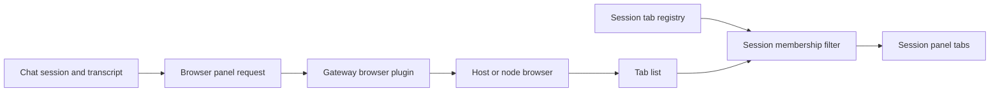

Codex review: needs maintainer review before merge. _Reviewed September 27, 2026, 6:09 PM ET / 22:09 UTC (Revision 2)._

# ClawSweeper review

## What this changes

The branch filters chat Browser panel tabs by session through the Gateway, tracks tabs opened from that panel for session cleanup, and updates the UI requests, documentation, and tests.

## Merge readiness

✅ **Ready for maintainer review**

Keep open for normal merge review. Current main still returns the shared tab list, while the earlier concern about pre-upgrade tabs was explicitly accepted and documented. The prior cleanup-documentation finding is fixed; I found no remaining blocking patch defect.

**Priority:** P2
**Reviewed head:** `92b6eb184ebc93c9e60fe09aa25aae09839035a5`

## Review scores

| Measure | Result | What it means |
|---|---|---|
| **Overall readiness** | 🐚 platinum hermit **(4/6)** | Direct before/after visual proof and focused boundary coverage support a coherent patch whose documented upgrade tradeoff has been accepted. |
| **Proof confidence** | 🦞 diamond lobster **(5/6)** ✨ media proof bonus | Sufficient (screenshot): The changed Gateway browser handler filters /tabs using existing registry membership and chat transcript references. Inspected before/after screenshots from an isolated headless managed Gateway show two sessions changing from the shared list to their respective tabs; the PR body records matching scoped Gateway responses. Node routing has Gateway test coverage but no live node run. The persisted tab-record format is unchanged, so no data-model migration applies. |
| **Patch quality** | 🐚 platinum hermit **(4/6)** | No actionable review findings were identified. |

## Verification

| Check | Result | Evidence |
|---|---|---|
| **Real behavior** | Verified | Sufficient (screenshot): The changed Gateway browser handler filters /tabs using existing registry membership and chat transcript references. Inspected before/after screenshots from an isolated headless managed Gateway show two sessions changing from the shared list to their respective tabs; the PR body records matching scoped Gateway responses. Node routing has Gateway test coverage but no live node run. The persisted tab-record format is unchanged, so no data-model migration applies. |
| **Evidence reviewed** | 9 items | Current main remains unscoped: The fetched main browser handler returns the browser result directly, and its UI request binder has no tabScope path. Gateway session filtering: The introduced Gateway helper combines read-only registry membership with route- and profile-matched transcript references before returning tabs. Existing storage contract: Membership reads existing session-tab records without changing the record schema or cleanup state. |
| **Findings** | None | None. |
| **Security** | None | None. |

## How this fits together

The chat Browser panel sends requests through the Gateway's browser plugin to a browser on the host or a node. The plugin's session-tab registry records owned tabs for cleanup and now helps determine which tab metadata the panel receives.

## Before merge

None.

<strong>Agent review details</strong>

### Security

None.

### PR surface

Source +397, Tests +835, Docs +11. Total +1243 across 23 files.

View PR surface stats

| Area | Files | Added | Removed | Net |
|---|---:|---:|---:|---:|
| Source | 10 | 426 | 29 | +397 |
| Tests | 11 | 838 | 3 | +835 |
| Docs | 2 | 14 | 3 | +11 |
| Config | 0 | 0 | 0 | 0 |
| Generated | 0 | 0 | 0 | 0 |
| Other | 0 | 0 | 0 | 0 |
| **Total** | **23** | **1278** | **35** | **+1243** |

### Review metrics

| Metric | Value | Why it matters |
|---|---|---|
| **Code and test growth** | production +397 net lines; tests +835 net lines | Production growth implements the Gateway-owned filter and panel tracking; the larger test delta covers session, route, and lifecycle boundaries. |

### Technical review

Best possible solution:

Keep session membership with the browser registry, preserve the unscoped dock as the access path for tabs without a known session, and retain the documented cleanup behavior.

Do we have a high-confidence way to reproduce the issue?

Yes. The before screenshots show the shared-tab view, and fetched main still returns the unscoped list; I did not execute current main in this read-only review.

Is this the best way to solve the issue?

Yes. The patch uses the existing browser session-tab registry and filters at the Gateway, with the accepted upgrade behavior explained to users.

AGENTS.md: found and applied where relevant.

Codex review notes: model internal, reasoning high; reviewed against [73880b0befde](https://github.com/openclaw/openclaw/commit/73880b0befdeb7e2dc8fd3b3ecb2ee3ed271c9fe).

### Labels

Label changes:

- add `rating: 🐚 platinum hermit`: Overall readiness is 🐚 platinum hermit; proof is 🦞 diamond lobster and patch quality is 🐚 platinum hermit.
- add `status: 👀 ready for maintainer look`: ClawSweeper has no concrete contributor-facing blocker left for this PR. Sufficient (screenshot): The changed Gateway browser handler filters /tabs using existing registry membership and chat transcript references. Inspected before/after screenshots from an isolated headless managed Gateway show two sessions changing from the shared list to their respective tabs; the PR body records matching scoped Gateway responses. Node routing has Gateway test coverage but no live node run. The persisted tab-record format is unchanged, so no data-model migration applies.
- remove `rating: 🦐 gold shrimp`: Current PR rating is `rating: 🐚 platinum hermit`, so this older rating label is no longer current.
- remove `status: ⏳ waiting on author`: Current PR status label is `status: 👀 ready for maintainer look`.

Label justifications:

- `P2`: This is a bounded improvement to a shared-browser panel with focused user impact.
- `merge-risk: 🚨 compatibility`: Previously untracked panel tabs disappear from session panels after upgrade, an explicitly accepted tradeoff documented with an unscoped dock access path.
- `rating: 🐚 platinum hermit`: Overall readiness is 🐚 platinum hermit; proof is 🦞 diamond lobster and patch quality is 🐚 platinum hermit.
- `status: 👀 ready for maintainer look`: ClawSweeper has no concrete contributor-facing blocker left for this PR. Sufficient (screenshot): The changed Gateway browser handler filters /tabs using existing registry membership and chat transcript references. Inspected before/after screenshots from an isolated headless managed Gateway show two sessions changing from the shared list to their respective tabs; the PR body records matching scoped Gateway responses. Node routing has Gateway test coverage but no live node run. The persisted tab-record format is unchanged, so no data-model migration applies.
- `proof: sufficient`: Contributor real behavior proof is sufficient. The changed Gateway browser handler filters /tabs using existing registry membership and chat transcript references. Inspected before/after screenshots from an isolated headless managed Gateway show two sessions changing from the shared list to their respective tabs; the PR body records matching scoped Gateway responses. Node routing has Gateway test coverage but no live node run. The persisted tab-record format is unchanged, so no data-model migration applies.
- `proof: 📸 screenshot`: Contributor real behavior proof includes screenshot evidence. The changed Gateway browser handler filters /tabs using existing registry membership and chat transcript references. Inspected before/after screenshots from an isolated headless managed Gateway show two sessions changing from the shared list to their respective tabs; the PR body records matching scoped Gateway responses. Node routing has Gateway test coverage but no live node run. The persisted tab-record format is unchanged, so no data-model migration applies.

### Evidence

What I checked:

- **Current main remains unscoped:** The fetched main browser handler returns the browser result directly, and its UI request binder has no tabScope path. ([`extensions/browser/src/gateway/browser-request.ts:450`](https://github.com/openclaw/openclaw/blob/73880b0befdeb7e2dc8fd3b3ecb2ee3ed271c9fe/extensions/browser/src/gateway/browser-request.ts#L450), [73880b0befde](https://github.com/openclaw/openclaw/commit/73880b0befdeb7e2dc8fd3b3ecb2ee3ed271c9fe))
- **Gateway session filtering:** The introduced Gateway helper combines read-only registry membership with route- and profile-matched transcript references before returning tabs. ([`extensions/browser/src/gateway/browser-request-tab-scope.ts:72`](https://github.com/openclaw/openclaw/blob/92b6eb184ebc93c9e60fe09aa25aae09839035a5/extensions/browser/src/gateway/browser-request-tab-scope.ts#L72), [92b6eb184ebc](https://github.com/openclaw/openclaw/commit/92b6eb184ebc93c9e60fe09aa25aae09839035a5))
- **Existing storage contract:** Membership reads existing session-tab records without changing the record schema or cleanup state. ([`extensions/browser/src/browser/session-tab-tracking.ts:198`](https://github.com/openclaw/openclaw/blob/92b6eb184ebc93c9e60fe09aa25aae09839035a5/extensions/browser/src/browser/session-tab-tracking.ts#L198), [92b6eb184ebc](https://github.com/openclaw/openclaw/commit/92b6eb184ebc93c9e60fe09aa25aae09839035a5))
- **Prior findings addressed:** The profiles guide explains where pre-upgrade untracked tabs remain accessible, and the configuration guide now includes panel-opened tabs in cleanup. Public docs: [`docs/tools/browser/profiles.md`](https://docs.openclaw.ai/tools/browser/profiles). ([`docs/tools/browser/profiles.md:38`](https://docs.openclaw.ai/tools/browser/profiles), [92b6eb184ebc](https://github.com/openclaw/openclaw/commit/92b6eb184ebc93c9e60fe09aa25aae09839035a5))
- **Accepted upgrade tradeoff:** The recorded response at https://github.com/openclaw/openclaw/pull/159891#issuecomment-5860021854 accepts leaving previously untracked panel tabs outside the session panel because their ownership cannot be reconstructed; it identifies the unscoped dock as the access path.
- **Real behavior proof:** I inspected the four prepared before/after screenshots linked in the PR body. Both session panels show multiple shared-browser tabs before the change; each shows its own tab afterward. The body also records scoped Gateway /tabs responses from the isolated Gateway run.

Likely related people:

- **Peter Steinberger:** Suggested for follow-up; no historical authorship or introduction is verified. (role: unverified routing candidate; confidence: low)
- **Patrick Erichsen:** Suggested for follow-up; no historical authorship or introduction is verified. (role: unverified routing candidate; confidence: low)

### Rating scale

| Score | Internal tier | Crab rank | Meaning |
|---:|:---:|---|---|
| **6/6** | S | 🦀 challenger crab | Exceptional readiness |
| **5/6** | A | 🦞 diamond lobster | Very strong readiness |
| **4/6** | B | 🐚 platinum hermit | Good normal PR; ordinary maintainer review |
| **3/6** | C | 🦐 gold shrimp | Useful, but confidence is limited |
| **2/6** | D | 🦪 silver shellfish | Proof or implementation needs work |
| **1/6** | F | 🧂 unranked krab | Not merge-ready |
| N/A | NA | 🌊 off-meta tidepool | Rating does not apply |

Overall follows the weaker of proof and patch quality.
Shiny media proof means a screenshot, video, or linked artifact directly shows the changed behavior. Runtime, network, CSP, and security claims still need visible diagnostics.

### Workflow

- ClawSweeper keeps one durable marker-backed review comment per issue or PR.
- Re-runs edit this comment so the latest verdict, findings, and automation markers stay together instead of adding duplicate bot comments.
- A fresh review can be triggered by eligible `@clawsweeper re-review` comments, exact-item GitHub events, scheduled/background review runs, or manual workflow dispatch.
- PR/issue authors and users with repository write access can comment `@clawsweeper re-review` or `@clawsweeper re-run` on an open PR or issue to request a fresh review only.
- Maintainers can also comment `@clawsweeper review` to request a fresh review only.
- Fresh-review commands do not start repair, autofix, rebase, CI repair, or automerge.
- Maintainer-only repair and merge flows require explicit commands such as `@clawsweeper autofix`, `@clawsweeper automerge`, `@clawsweeper fix ci`, or `@clawsweeper address review`.
- Maintainers can comment `@clawsweeper explain` to ask for more context, or `@clawsweeper stop` to stop active automation.

### History

Review history (1 earlier review cycle)

<!-- clawsweeper-review-history v=1 total=1 -->
- reviewed 2026-09-27T21:19:55.858Z sha 8119a80899553d03597a7016ce0782d165e72785 :: blocked before merge. :: [P1] Provide recovery for tabs opened before session tracking | [P2] Update the cleanup contract in the configuration guide

<!-- clawsweeper-verdict:needs-human item=159891 sha=92b6eb184ebc93c9e60fe09aa25aae09839035a5 confidence=high updated_at=2026-09-27T22:06:03Z reviewed_at=2026-09-27T22:09:32.271Z lease_owner=github-run-36353976916-1 lease_comment_id=5860259540 source_revision=23de2772e96a0865edfe496fba488361bad2694f74de060522dc4d997d739e12 live_verification=absent -->
<!-- clawsweeper-review-state:ready item=159891 sha=92b6eb184ebc93c9e60fe09aa25aae09839035a5 v=1 -->

<!-- clawsweeper-review-version item=159891 reviewed_at=2026-09-27T22:09:32.271Z sha=92b6eb184ebc93c9e60fe09aa25aae09839035a5 source_revision=23de2772e96a0865edfe496fba488361bad2694f74de060522dc4d997d739e12 lease_owner=github-run-36353976916-1 lease_comment_id=5860259540 v=1 -->

<!-- clawsweeper-review item=159891 -->