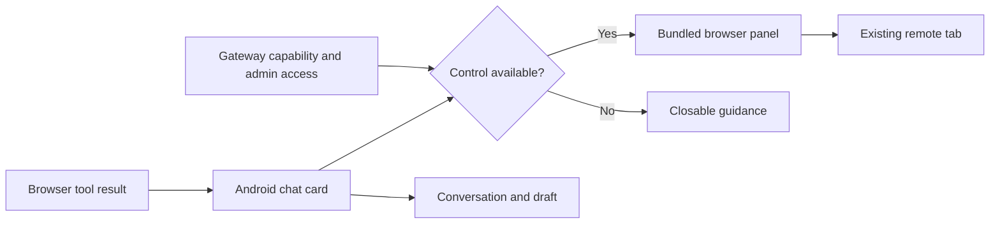

Codex review: needs maintainer review before merge. _Reviewed September 27, 2026, 6:12 PM ET / 22:12 UTC (Revision 7)._

# ClawSweeper review

## What this changes

The branch adds an Android chat card for controlling the agent’s existing browser tab, with a focused Control UI route, Gateway availability signaling, mobile input handling, documentation, and tests.

## Merge readiness

✅ **Ready for maintainer review**

Keep this PR open. Current main lacks the Android in-chat browser control, and the reviewed branch adds a distinct, useful flow. The prior completed review reported no actionable findings; the latest commit changes only test diagnostics.

**Priority:** P2
**Reviewed head:** `847f6d8325c17e1ba08fc4591c2e5e34615aa13c`

## Review scores

| Measure | Result | What it means |
|---|---|---|
| **Overall readiness** | 🐚 platinum hermit **(4/6)** | Direct Android visual proof and focused boundary coverage support a good, coherent patch; the recording inspection limit does not change the observed screenshot result. |
| **Proof confidence** | 🦞 diamond lobster **(5/6)** ✨ media proof bonus | Sufficient (screenshot): The Android chat card and authenticated WebView are shown in PR-attached screenshots from the actual Android app with remote Chromium: the after image shows the selected browser beside a retained draft. The interaction recording was unavailable to this reviewer because ffprobe was missing and browser playback returned a cache miss, so its tap and scroll sequence remains uninspected. The change adds no stored-data contract. |
| **Patch quality** | 🐚 platinum hermit **(4/6)** | No actionable review findings were identified. |

## Verification

| Check | Result | Evidence |
|---|---|---|
| **Real behavior** | Verified | Sufficient (screenshot): The Android chat card and authenticated WebView are shown in PR-attached screenshots from the actual Android app with remote Chromium: the after image shows the selected browser beside a retained draft. The interaction recording was unavailable to this reviewer because ffprobe was missing and browser playback returned a cache miss, so its tap and scroll sequence remains uninspected. The change adds no stored-data contract. |
| **Evidence reviewed** | 10 items | Repository identity: The checkout's origin is the target repository. Android presentation: Chat selects browser-tab metadata from the transcript and mounts the card only for the ready composer owner, with an admin-scope check. Existing browser owner: The focused route passes the selected tab to the existing browser panel; that panel requires a connected Gateway, advertised browser method, and operator admin access. |
| **Findings** | None | None. |
| **Security** | None | None. |

## How this fits together

Android chat receives browser-tab details from agent tool results. The card opens the Gateway’s bundled browser panel for that tab and leaves the conversation and draft in place.

## Before merge

None.

<strong>Agent review details</strong>

### Security

None.

### PR surface

Source +260, Tests +812, Docs +29, Other +417. Total +1518 across 33 files.

View PR surface stats

| Area | Files | Added | Removed | Net |
|---|---:|---:|---:|---:|
| Source | 8 | 292 | 32 | +260 |
| Tests | 13 | 853 | 41 | +812 |
| Docs | 1 | 29 | 0 | +29 |
| Config | 0 | 0 | 0 | 0 |
| Generated | 0 | 0 | 0 | 0 |
| Other | 11 | 424 | 7 | +417 |
| **Total** | **33** | **1598** | **80** | **+1518** |

### Review metrics

| Metric | Value | Why it matters |
|---|---|---|
| **Gateway capability** | 1 added | Android uses the new hello capability to avoid loading an unsupported embedded route on older or custom-UI Gateways. |

### Technical review

Best possible solution:

Use the existing admin-gated browser panel for exact-tab Android control and keep the broader cross-channel pause-and-resume handoff tracked separately.

Do we have a high-confidence way to reproduce the issue?

Not applicable: this PR adds a capability rather than reporting a broken existing contract. The inspected screenshots demonstrate the central after-change visual state.

Is this the best way to solve the issue?

Yes. Reusing the existing browser panel, exact tab selection, and Gateway admin permission is a coherent path for the Android experience.

AGENTS.md: found and applied where relevant.

Codex review notes: model internal, reasoning high; reviewed against [73880b0befde](https://github.com/openclaw/openclaw/commit/73880b0befdeb7e2dc8fd3b3ecb2ee3ed271c9fe).

### Labels

Label changes:

No label changes.

Label justifications:

- `P2`: This is a useful Android workflow improvement with a bounded user-facing scope.
- `rating: 🐚 platinum hermit`: Overall readiness is 🐚 platinum hermit; proof is 🦞 diamond lobster and patch quality is 🐚 platinum hermit.
- `feature: ✨ showcase`: ClawSweeper spotlight: unusually compelling feature idea for maintainer attention. Controlling the agent’s exact remote tab inside Android chat while preserving the conversation and draft removes a substantial mobile workflow interruption.
- `status: 👀 ready for maintainer look`: ClawSweeper has no concrete contributor-facing blocker left for this PR. Sufficient (screenshot): The Android chat card and authenticated WebView are shown in PR-attached screenshots from the actual Android app with remote Chromium: the after image shows the selected browser beside a retained draft. The interaction recording was unavailable to this reviewer because ffprobe was missing and browser playback returned a cache miss, so its tap and scroll sequence remains uninspected. The change adds no stored-data contract.
- `proof: sufficient`: Contributor real behavior proof is sufficient. The Android chat card and authenticated WebView are shown in PR-attached screenshots from the actual Android app with remote Chromium: the after image shows the selected browser beside a retained draft. The interaction recording was unavailable to this reviewer because ffprobe was missing and browser playback returned a cache miss, so its tap and scroll sequence remains uninspected. The change adds no stored-data contract.
- `proof: 📸 screenshot`: Contributor real behavior proof includes screenshot evidence. The Android chat card and authenticated WebView are shown in PR-attached screenshots from the actual Android app with remote Chromium: the after image shows the selected browser beside a retained draft. The interaction recording was unavailable to this reviewer because ffprobe was missing and browser playback returned a cache miss, so its tap and scroll sequence remains uninspected. The change adds no stored-data contract.

### Evidence

What I checked:

- **Repository identity:** The checkout's origin is the target repository. ([847f6d8325c1](https://github.com/openclaw/openclaw/commit/847f6d8325c17e1ba08fc4591c2e5e34615aa13c))
- **Android presentation:** Chat selects browser-tab metadata from the transcript and mounts the card only for the ready composer owner, with an admin-scope check. ([`apps/android/app/src/main/java/ai/openclaw/app/ui/chat/ChatScreen.kt:1078`](https://github.com/openclaw/openclaw/blob/847f6d8325c17e1ba08fc4591c2e5e34615aa13c/apps/android/app/src/main/java/ai/openclaw/app/ui/chat/ChatScreen.kt#L1078), [847f6d8325c1](https://github.com/openclaw/openclaw/commit/847f6d8325c17e1ba08fc4591c2e5e34615aa13c))
- **Existing browser owner:** The focused route passes the selected tab to the existing browser panel; that panel requires a connected Gateway, advertised browser method, and operator admin access. ([`ui/src/app/app-root.ts:500`](https://github.com/openclaw/openclaw/blob/847f6d8325c17e1ba08fc4591c2e5e34615aa13c/ui/src/app/app-root.ts#L500), [847f6d8325c1](https://github.com/openclaw/openclaw/commit/847f6d8325c17e1ba08fc4591c2e5e34615aa13c))
- **Gateway compatibility:** The Gateway advertises browser-focus support only with its enabled bundled Control UI; the tests cover disabled and configured UI roots. ([`src/gateway/server/ws-connection/connect-hello.ts:172`](https://github.com/openclaw/openclaw/blob/847f6d8325c17e1ba08fc4591c2e5e34615aa13c/src/gateway/server/ws-connection/connect-hello.ts#L172), [847f6d8325c1](https://github.com/openclaw/openclaw/commit/847f6d8325c17e1ba08fc4591c2e5e34615aa13c))
- **Forbidden-scope check:** The focused-route test supplies a non-admin operator and expects unavailable guidance with no browser request. ([`ui/src/e2e/browser-route-handoff.e2e.test.ts:115`](https://github.com/openclaw/openclaw/blob/847f6d8325c17e1ba08fc4591c2e5e34615aa13c/ui/src/e2e/browser-route-handoff.e2e.test.ts#L115), [847f6d8325c1](https://github.com/openclaw/openclaw/commit/847f6d8325c17e1ba08fc4591c2e5e34615aa13c))
- **Still needed on main:** Fetched main has ChatScreen but no ChatBrowserCard; its focus contract has no browser route. ([`apps/android/app/src/main/java/ai/openclaw/app/ui/chat/ChatScreen.kt`](https://github.com/openclaw/openclaw/blob/73880b0befdeb7e2dc8fd3b3ecb2ee3ed271c9fe/apps/android/app/src/main/java/ai/openclaw/app/ui/chat/ChatScreen.kt), [73880b0befde](https://github.com/openclaw/openclaw/commit/73880b0befdeb7e2dc8fd3b3ecb2ee3ed271c9fe))

Likely related people:

- **Peter Steinberger:** Suggested for follow-up; no historical authorship or introduction is verified. (role: unverified routing candidate; confidence: low)
- **RoboClaw:** Suggested for follow-up; no historical authorship or introduction is verified. (role: unverified routing candidate; confidence: low)

### Rating scale

| Score | Internal tier | Crab rank | Meaning |
|---:|:---:|---|---|
| **6/6** | S | 🦀 challenger crab | Exceptional readiness |
| **5/6** | A | 🦞 diamond lobster | Very strong readiness |
| **4/6** | B | 🐚 platinum hermit | Good normal PR; ordinary maintainer review |
| **3/6** | C | 🦐 gold shrimp | Useful, but confidence is limited |
| **2/6** | D | 🦪 silver shellfish | Proof or implementation needs work |
| **1/6** | F | 🧂 unranked krab | Not merge-ready |
| N/A | NA | 🌊 off-meta tidepool | Rating does not apply |

Overall follows the weaker of proof and patch quality.
Shiny media proof means a screenshot, video, or linked artifact directly shows the changed behavior. Runtime, network, CSP, and security claims still need visible diagnostics.

### Workflow

- ClawSweeper keeps one durable marker-backed review comment per issue or PR.
- Re-runs edit this comment so the latest verdict, findings, and automation markers stay together instead of adding duplicate bot comments.
- A fresh review can be triggered by eligible `@clawsweeper re-review` comments, exact-item GitHub events, scheduled/background review runs, or manual workflow dispatch.
- PR/issue authors and users with repository write access can comment `@clawsweeper re-review` or `@clawsweeper re-run` on an open PR or issue to request a fresh review only.
- Maintainers can also comment `@clawsweeper review` to request a fresh review only.
- Fresh-review commands do not start repair, autofix, rebase, CI repair, or automerge.
- Maintainer-only repair and merge flows require explicit commands such as `@clawsweeper autofix`, `@clawsweeper automerge`, `@clawsweeper fix ci`, or `@clawsweeper address review`.
- Maintainers can comment `@clawsweeper explain` to ask for more context, or `@clawsweeper stop` to stop active automation.

### History

Review history (6 earlier review cycles)

<!-- clawsweeper-review-history v=1 total=6 -->
- reviewed 2026-09-27T16:32:31.381Z sha db681d3d0abbb478022a9143b6089104bb62e3e2 :: blocked before merge. :: none
- reviewed 2026-09-27T20:26:08.678Z sha 810443102baa5d16af23671bc9c60f695ce1fe8e :: blocked before merge. :: none
- reviewed 2026-09-27T20:57:43.285Z sha 20bd4a35d008df8098cf27f8bc30a8a4212505b1 :: needs maintainer review before merge. :: none
- reviewed 2026-09-27T21:08:37.863Z sha 53442686dea6c0213cc735b401b03837922cc2f9 :: needs maintainer review before merge. :: none
- reviewed 2026-09-27T21:19:54.796Z sha 46cdadcf64ca65093ada61c613ccea81fc60b491 :: needs maintainer review before merge. :: none
- reviewed 2026-09-27T21:40:07.551Z sha bd37f7315afb4a60741f6de5307c51519fb42b2a :: needs maintainer review before merge. :: none

<!-- clawsweeper-verdict:needs-human item=159767 sha=847f6d8325c17e1ba08fc4591c2e5e34615aa13c confidence=high updated_at=2026-09-27T22:09:32Z reviewed_at=2026-09-27T22:12:57.457Z lease_owner=github-run-36354168522-1 lease_comment_id=5860287712 source_revision=81214c576af4dc5b97e961285340bf4f8a7a5df37a5434e082fc57875be98464 live_verification=absent -->
<!-- clawsweeper-review-state:ready item=159767 sha=847f6d8325c17e1ba08fc4591c2e5e34615aa13c v=1 -->

<!-- clawsweeper-review-version item=159767 reviewed_at=2026-09-27T22:12:57.457Z sha=847f6d8325c17e1ba08fc4591c2e5e34615aa13c source_revision=81214c576af4dc5b97e961285340bf4f8a7a5df37a5434e082fc57875be98464 lease_owner=github-run-36354168522-1 lease_comment_id=5860287712 v=1 -->

<!-- clawsweeper-review item=159767 -->