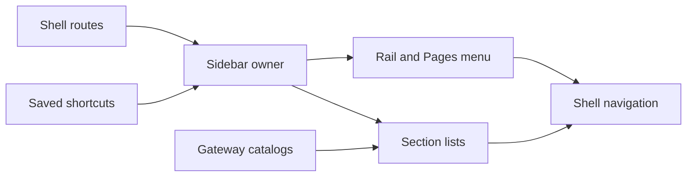

Codex review: blocked before merge.

## What this changes

This PR replaces the Pages sidebar with a rail menu and adds dedicated Dashboards, Users, Automations, and Customize sidebars.

**Example:** Open Customize and choose Skills.
- **Before:** The sidebar remains a Sessions list, and Skills is reached through the page’s header tabs.
- **After:** The sidebar lists Plugins, Skills, Skill workshop, and enabled Templates beside the selected page.

## Review scores

| Measure | Result | What it means |
|---|---|---|
| **Overall readiness** | 🧂 unranked krab **(1/6)** | Useful maintainer-directed work, but the draft has concrete defects and no demonstrated behavior or upgrade proof for saved shortcuts and the changed persisted sidebar navigationView field. |
| **Proof confidence** | 🧂 unranked krab **(1/6)** | Real behavior proof is not required for maintainer- or bot-authored pull requests. |
| **Patch quality** | 🦪 silver shellfish **(2/6)** | 7 actionable review findings remain. |

## Product

**Kind:** Feature · **Worth it:** Yes · **Fix scope:** Complete
**User problem:** Opening a section page leaves users beside a Sessions list instead of that section’s navigation.
**Reason:** Dedicated section navigation has clear user value, and the maintainer-authored PR establishes the direction without requiring another product approval.

## Merge readiness

⛔ **Blocked before merge - 9 items remain**

Keep this maintainer-authored draft open: it adds useful section navigation absent from main, but saved-pin compatibility, automation behavior, and incomplete consumer updates need repair.

**Priority:** P2
**Reviewed head:** `4e4d523fe44f42d0abd37bbee8f5e8705a6cda7e`

## Before merge

- [ ] **\[P1\] Preserve Activity’s persisted shortcut representation (P1)** - Removing Activity here also removes it from PersistedSidebarRoute and isPersistedSidebarRoute. An existing railShortcuts value such as ["route:activity", "route:usage"] now normalizes to ["route:usage"] through both settings loading and server preference extraction, silently dropping the user’s saved choice. Keep Activity accepted by the persistence parser and exclude it only from the Pages menu.
- [ ] **\[P2\] Allow New automation to reopen after cancellation (P2)** - Clicking New automation navigates to ?new and this effect opens the editor. Cancel calls closePanel(), which closes the editor without changing the URL. Clicking the sidebar action again supplies the same routeSearch string, so this effect does not run again and the editor stays closed. Consume or clear the creation query through the existing route/editor owner so every explicit create action works.
- [ ] **\[P2\] Make automations beyond the first page reachable (P2)** - With 201 automations, this requests offset 0 and limit 200, then retains only result.jobs. readCronInventory’s selectPage explicitly slices even a complete cached inventory to that limit. Because the sidebar has no pagination control, automation 201 and later never appear. Retain pagination metadata and expose loading more through the existing inventory reader.
- [ ] **\[P2\] Surface sidebar catalog failures with recovery (P2)** - A rejected cron.list request is converted to null and then an empty jobs array, so users see an apparently empty automation list without an error or Retry action. SidebarCustomize repeats the same pattern for plugins.list and silently removes Installed. Let these failures reach the existing SidebarViewBoundary, or preserve a visible error and retry through the owning reader.
- [ ] **\[P2\] Migrate the remaining consumers of the removed Pages view (P2)** - The narrowed navigationView union leaves direct assignments of "pages" in sidebar-context-controller.test.ts:30, app-sidebar-session-visibility.browser.test.ts:233, and app-sidebar-nav-menus.test.tsx:372. These are no longer assignable to the property type; at runtime they also fall through to Sessions instead of exercising a distinct panel, weakening the scroll and visibility regressions. Update these consumers to an actual replacement view in the same cutover.
- [ ] **\[P2\] Keep route synchronization within the existing effect allowance (P2)** - This adds a second createEffect call in app-sidebar.tsx, but config/control-ui-createEffect-baseline.txt permits one and scripts/check-control-ui-controllers.mts enforces the per-file shrink-only count. The UI guide explicitly forbids increasing that allowance. Fold this route handling into the existing owner/effect lifecycle instead of introducing another effect or raising the baseline.
- [ ] **\[P2\] Avoid closing Customize before exercising its sidebar (P2)** - After loading /plugins, the new route effect already selects the open Customize sidebar. customize.select() then chooses Customize from the Pages menu; revealDestination sees that same section open and toggles it closed. The subsequent Templates wait and desktop Skills click target a hidden sidebar. Remove the redundant selection or have the helper check the current open state before selecting, including the earlier shared desktop flow.
- [ ] **Add data-model compatibility proof** - The review found that existing stored data may not work after upgrade. Show that existing data still loads and works with this change.
- [ ] **Explain or restore the original intent of Persisted Activity shortcuts** - fd018170c94387e843076b259ee54d8998ba935f: Personal shortcut preferences survive navigation changes; removing Activity from the menu does not explain rejecting its previously valid stored pin.

## Findings

- [P1] [P1] Preserve Activity’s persisted shortcut representation — `ui/src/app-navigation.ts:27-29`
- [P2] [P2] Allow New automation to reopen after cancellation — `ui/src/pages/cron/cron-page.tsx:135-140`
- [P2] [P2] Make automations beyond the first page reachable — `ui/src/components/app-sidebar-automations.tsx:49-57`

### Provenance

- `Persisted Activity shortcuts` changes intended behavior without addressing why it exists (fd018170c94387e843076b259ee54d8998ba935f: Personal shortcut preferences survive navigation changes; removing Activity from the menu does not explain rejecting its previously valid stored pin.)

### Tests

- Missing end-to-end proof: The author should supply redacted before/after screenshots and real Control UI navigation evidence for section lists, phone drawer navigation, history, repeated creation, and failed reads, plus a latest-stable upgrade retaining shortcuts and handling existing sidebar snapshots.

<strong>Agent review details</strong>

### How this fits together

The Control UI sidebar consumes shell routes, saved personal shortcuts, and Gateway catalogs, then renders navigation links and section lists through the existing sidebar owner.

### Technical review

Best possible solution:

Keep the existing sidebar and catalog owners, preserve saved shortcuts independently of menu visibility, and repair the new lists and navigation handlers without adding another state manager.

Do we have a high-confidence way to reproduce the issue?

Source inspection establishes the pagination, error-handling, repeated-creation, and consumer-cutover failures; runtime reproduction was not performed.

Is this the best way to solve the issue?

The section split fits the existing architecture, but menu visibility must not redefine persisted preferences, and reads and creation actions must retain their existing recovery and lifecycle contracts.

Full review comments:

- [P1] [P1] Preserve Activity’s persisted shortcut representation — `ui/src/app-navigation.ts:27-29`
  Removing Activity here also removes it from PersistedSidebarRoute and isPersistedSidebarRoute. An existing railShortcuts value such as ["route:activity", "route:usage"] now normalizes to ["route:usage"] through both settings loading and server preference extraction, silently dropping the user’s saved choice. Keep Activity accepted by the persistence parser and exclude it only from the Pages menu.
  Confidence: 0.99
- [P2] [P2] Allow New automation to reopen after cancellation — `ui/src/pages/cron/cron-page.tsx:135-140`
  Clicking New automation navigates to ?new and this effect opens the editor. Cancel calls closePanel(), which closes the editor without changing the URL. Clicking the sidebar action again supplies the same routeSearch string, so this effect does not run again and the editor stays closed. Consume or clear the creation query through the existing route/editor owner so every explicit create action works.
  Confidence: 0.98
- [P2] [P2] Make automations beyond the first page reachable — `ui/src/components/app-sidebar-automations.tsx:49-57`
  With 201 automations, this requests offset 0 and limit 200, then retains only result.jobs. readCronInventory’s selectPage explicitly slices even a complete cached inventory to that limit. Because the sidebar has no pagination control, automation 201 and later never appear. Retain pagination metadata and expose loading more through the existing inventory reader.
  Confidence: 0.99
- [P2] [P2] Surface sidebar catalog failures with recovery — `ui/src/components/app-sidebar-automations.tsx:56-57`
  A rejected cron.list request is converted to null and then an empty jobs array, so users see an apparently empty automation list without an error or Retry action. SidebarCustomize repeats the same pattern for plugins.list and silently removes Installed. Let these failures reach the existing SidebarViewBoundary, or preserve a visible error and retry through the owning reader.
  Confidence: 0.99
- [P2] [P2] Migrate the remaining consumers of the removed Pages view — `ui/src/components/app-sidebar-base.ts:49`
  The narrowed navigationView union leaves direct assignments of "pages" in sidebar-context-controller.test.ts:30, app-sidebar-session-visibility.browser.test.ts:233, and app-sidebar-nav-menus.test.tsx:372. These are no longer assignable to the property type; at runtime they also fall through to Sessions instead of exercising a distinct panel, weakening the scroll and visibility regressions. Update these consumers to an actual replacement view in the same cutover.
  Confidence: 0.99
- [P2] [P2] Keep route synchronization within the existing effect allowance — `ui/src/components/app-sidebar.tsx:92-100`
  This adds a second createEffect call in app-sidebar.tsx, but config/control-ui-createEffect-baseline.txt permits one and scripts/check-control-ui-controllers.mts enforces the per-file shrink-only count. The UI guide explicitly forbids increasing that allowance. Fold this route handling into the existing owner/effect lifecycle instead of introducing another effect or raising the baseline.
  Confidence: 0.99
- [P2] [P2] Avoid closing Customize before exercising its sidebar — `ui/src/e2e/plugins-hub-navigation.e2e.test.ts:593-597`
  After loading /plugins, the new route effect already selects the open Customize sidebar. customize.select() then chooses Customize from the Pages menu; revealDestination sees that same section open and toggles it closed. The subsequent Templates wait and desktop Skills click target a hidden sidebar. Remove the redundant selection or have the helper check the current open state before selecting, including the earlier shared desktop flow.
  Confidence: 0.96

Overall correctness: patch is incorrect
Overall confidence: 0.96

AGENTS.md: found and applied where relevant.

Codex review notes: model internal, reasoning medium; reviewed against [e693b3323e90](https://github.com/openclaw/openclaw/commit/e693b3323e902548a7bf19205e7afdc8aa359049).

### Provenance checked

- `Rail and Pages catalog` changes intended behavior with a stated reason (fd018170c94387e843076b259ee54d8998ba935f: Separate navigation views and personal shortcuts while preserving profile-scoped preferences.)
- `Lazy sidebar rendering` keeps the original intent (e66ae849c4ef7bd19e23e94b98a1ea03c7cde224: Load optional views on selection while retaining the shell and local loading/error recovery.)
- `Plugins and Skills header tabs` changes intended behavior with a stated reason (b280237832a056d42f88ddd13a75526053da4a1b: Unify plugin and skill discovery through a shared workspace and navigation tabs.)
- `MCP catalog placement` changes intended behavior with a stated reason (f7a72c7cc2817bcbcf2547c819e210d3406d33c4: Keep discovery tied to its mounted consumer after removing the catalog bridge; this PR intentionally leaves discovery on the existing Apps page.)

### Testing

Proof path: none.

### Security

None.

### Evidence

What I checked:

- **Reviewed scope and discussion:** Reviewed the pinned five-commit introduction. The author is MEMBER, the PR remains a draft, and its body explicitly defers validation; the two discussion comments contain review-status messages rather than behavior proof. ([4e4d523fe44f](https://github.com/openclaw/openclaw/commit/4e4d523fe44f42d0abd37bbee8f5e8705a6cda7e))
- **Introduced changes:** The introduced diff adds the section renderers and Pages popover while retaining the existing sidebar, navigation, and catalog owners. ([`ui/src/components/app-sidebar-owner.tsx:594`](https://github.com/openclaw/openclaw/blob/4e4d523fe44f42d0abd37bbee8f5e8705a6cda7e/ui/src/components/app-sidebar-owner.tsx#L594), [4e4d523fe44f](https://github.com/openclaw/openclaw/commit/4e4d523fe44f42d0abd37bbee8f5e8705a6cda7e))
- **Main retains the previous navigation:** Fetched main still exposes Pages, Sessions, and Online views and the earlier Plugins hub; it does not implement these dedicated section sidebars. ([`ui/src/components/app-sidebar-rail.tsx:55`](https://github.com/openclaw/openclaw/blob/e693b3323e902548a7bf19205e7afdc8aa359049/ui/src/components/app-sidebar-rail.tsx#L55), [e693b3323e90](https://github.com/openclaw/openclaw/commit/e693b3323e902548a7bf19205e7afdc8aa359049))
- **Saved shortcut contract:** SIDEBAR_NAV_ROUTES also defines accepted persisted route pins. Removing Activity makes parseSidebarEntry reject route:activity, and both browser settings and server preference extraction use that normalization. ([`ui/src/app-navigation.ts:23`](https://github.com/openclaw/openclaw/blob/4e4d523fe44f42d0abd37bbee8f5e8705a6cda7e/ui/src/app-navigation.ts#L23), [4e4d523fe44f](https://github.com/openclaw/openclaw/commit/4e4d523fe44f42d0abd37bbee8f5e8705a6cda7e))
- **Automation inventory boundary:** The sidebar requests only offset 0 with limit 200 and discards pagination metadata. The shared inventory reader explicitly slices its complete inventory to the requested page. ([`ui/src/components/app-sidebar-automations.tsx:49`](https://github.com/openclaw/openclaw/blob/4e4d523fe44f42d0abd37bbee8f5e8705a6cda7e/ui/src/components/app-sidebar-automations.tsx#L49), [4e4d523fe44f](https://github.com/openclaw/openclaw/commit/4e4d523fe44f42d0abd37bbee8f5e8705a6cda7e))
- **Creation lifecycle:** The new query handler opens creation only when routeSearch changes, while closePanel resets the editor without clearing the query. ([`ui/src/pages/cron/cron-page.tsx:134`](https://github.com/openclaw/openclaw/blob/4e4d523fe44f42d0abd37bbee8f5e8705a6cda7e/ui/src/pages/cron/cron-page.tsx#L134), [4e4d523fe44f](https://github.com/openclaw/openclaw/commit/4e4d523fe44f42d0abd37bbee8f5e8705a6cda7e))

### PR surface

Source +607, Tests +93. Total +700 across 69 files. Added test files: 0.

View PR surface stats

| Area | Files | Added | Removed | Net |
|---|---:|---:|---:|---:|
| Source | 30 | 831 | 224 | +607 |
| Tests | 39 | 438 | 345 | +93 |
| Docs | 0 | 0 | 0 | 0 |
| Config | 0 | 0 | 0 | 0 |
| Generated | 0 | 0 | 0 | 0 |
| Other | 0 | 0 | 0 | 0 |
| **Total** | **69** | **1269** | **569** | **+700** |

### Preflight source

Source unknown. Source comparison at the observed PR snapshot only. Completion is self-reported; body, policy, tests, execution, and report bytes are not verified.

### Labels

Label changes:

No label changes.

Label justifications:

- `P2`: This is a normal-priority navigation feature with bounded Control UI defects.
- `merge-risk: 🚨 compatibility`: Removing Activity from the persisted-route catalog causes existing route:activity shortcuts to disappear during preference normalization.
- `rating: 🧂 unranked krab`: Overall readiness is 🧂 unranked krab; proof is 🧂 unranked krab and patch quality is 🦪 silver shellfish.
- `status: ⏳ waiting on author`: ClawSweeper has contributor-facing work open and is waiting for author action.

### Rating scale

6/6 🦀 challenger crab · 5/6 🦞 diamond lobster · 4/6 🐚 platinum hermit · 3/6 🦐 gold shrimp · 2/6 🦪 silver shellfish · 1/6 🧂 unranked krab. Overall follows the weaker of proof and patch quality; ✨ marks media proof (a screenshot, video, or linked artifact) that directly shows the changed behavior.

### Workflow

ClawSweeper edits this one comment on every review. Comment `@clawsweeper re-review` for a fresh review only. Repair and merge execution lanes are retired.

_Reviewed November 15, 2026, 6:05 PM ET / 23:05 UTC._

<!-- clawsweeper-verdict:needs-human item=199825 sha=4e4d523fe44f42d0abd37bbee8f5e8705a6cda7e confidence=high updated_at=2026-11-15T23:00:00Z reviewed_at=2026-11-15T23:05:18.247Z lease_owner=github-run-43772249707-1 lease_comment_id=6902806003 source_revision=922ec5fc54064edafd19e4ecaa88a582a66b33808b93968e2d017579e0c8e36b hold=blocked findings=7 -->
<!-- clawsweeper-review-state:blocked item=199825 sha=4e4d523fe44f42d0abd37bbee8f5e8705a6cda7e v=1 -->

<!-- clawsweeper-review-version item=199825 reviewed_at=2026-11-15T23:05:18.247Z sha=4e4d523fe44f42d0abd37bbee8f5e8705a6cda7e source_revision=922ec5fc54064edafd19e4ecaa88a582a66b33808b93968e2d017579e0c8e36b lease_owner=github-run-43772249707-1 lease_comment_id=6902806003 v=1 -->

<!-- clawsweeper-review item=199825 -->