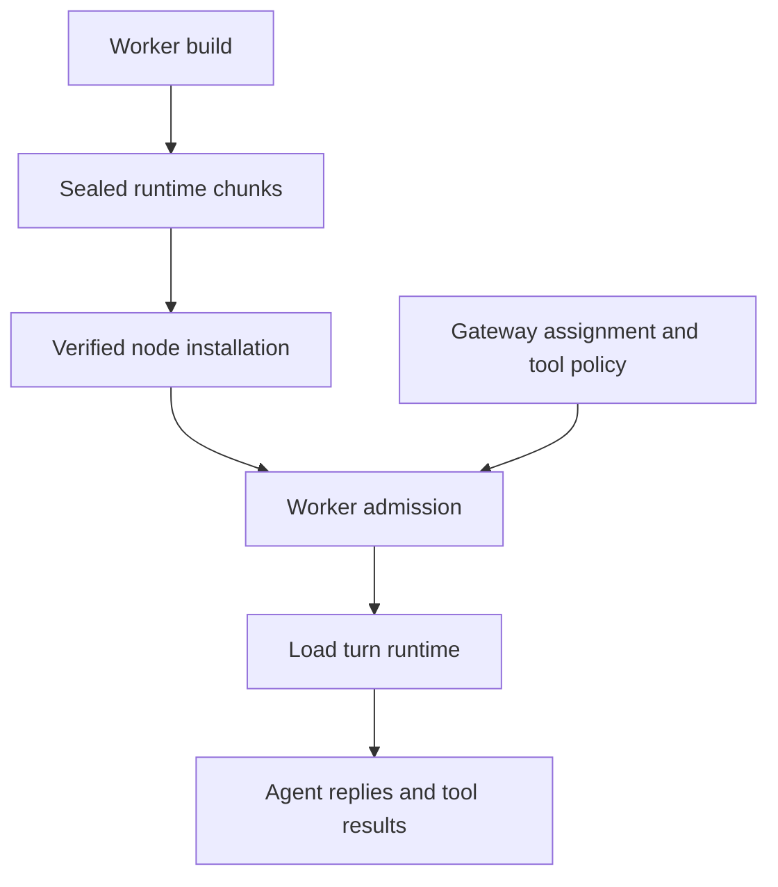

Codex review: needs maintainer review before merge. _Reviewed October 2, 2026, 4:33 PM ET / 20:33 UTC (Revision 103)._

# ClawSweeper review

## What this changes

The PR splits node-worker code into verified runtime chunks and loads turn-specific code after admission, with matching installation, import-boundary, and test updates.

## Merge readiness

✅ **Ready for maintainer review**

The optimization remains useful on current main. The pinned patch has no actionable correctness or security findings, and its recorded production comparison supports the performance benefit.

**Priority:** P2
**Reviewed head:** `d0ab325a9aa39de0d4ce32093833aab32e492651`

## Review scores

| Measure | Result | What it means |
|---|---|---|
| **Overall readiness** | 🦞 diamond lobster **(5/6)** | A coherent optimization with meaningful production measurements, preserved ownership boundaries, and broad recorded validation. |
| **Proof confidence** | 🦞 diamond lobster **(5/6)** | Sufficient (live_output): The captured Linux production comparison exercises the changed worker admission/runtime path and shows faster hello, lower retained memory, successful text replies, and exec/read continuity. The recorded patch-identical rebase preserves that evidence; artifact tests and exact-head CI supplement it. Persisted data contracts are unchanged. |
| **Patch quality** | 🦞 diamond lobster **(5/6)** | No actionable review findings were identified. |

## Verification

| Check | Result | Evidence |
|---|---|---|
| **Real behavior** | Verified | Sufficient (live_output): The captured Linux production comparison exercises the changed worker admission/runtime path and shows faster hello, lower retained memory, successful text replies, and exec/read continuity. The recorded patch-identical rebase preserves that evidence; artifact tests and exact-head CI supplement it. Persisted data contracts are unchanged. |
| **Evidence reviewed** | 9 items | Pinned change ownership: Reviewed the introduced delta from merge base 49135a709150d4b9760146a795bb841d4e2e0e64 to the original PR head d0ab325a9aa39de0d4ce32093833aab32e492651. Raw test-merge records separately confirm the ordered main and PR-head parents; unrelated base-only changes were not attributed to this PR. Still necessary on main: Inspected fetched main's worker runtime and bundle staging: runtime preparation still begins through the admission-request callback, and staging still collects only the fixed artifact list. The proposed deferred loading and split-chunk packaging are therefore distinct remaining work. Related merged tool-policy work at https://github.com/openclaw/openclaw/pull/160444 does not replace this optimization. Runtime preparation and cleanup: The changed runtime checks accepted admission and the required tool surface before starting turn preparation. Both module loading and workspace preparation settle before environment cleanup; explicit prewarming calls the same runtime loader. |
| **Findings** | None | None. |
| **Security** | None | None. |

## How this fits together

Node workers execute agent turns assigned by the Gateway. Their deployment artifact supplies the runtime, while Gateway admission supplies the current tool policy and execution context.

## Before merge

None.

<strong>Agent review details</strong>

### Security

None.

### PR surface

Source -50, Tests -8, Docs +2, Other +48. Total -8 across 68 files.

View PR surface stats

| Area | Files | Added | Removed | Net |
|---|---:|---:|---:|---:|
| Source | 48 | 247 | 297 | -50 |
| Tests | 16 | 315 | 323 | -8 |
| Docs | 1 | 3 | 1 | +2 |
| Config | 0 | 0 | 0 | 0 |
| Generated | 0 | 0 | 0 | 0 |
| Other | 3 | 74 | 26 | +48 |
| **Total** | **68** | **639** | **647** | **-8** |

### Review metrics

| Metric | Value | Why it matters |
|---|---|---|
| **Controlled cold-worker comparison** | Accepted hello 744 → 209 ms; retained RSS 426.2 → 243.6 MiB | The same-machine production observation demonstrates the intended startup and memory improvement without claiming a general latency guarantee. |

### Technical review

Best possible solution:

Preserve the existing admission, artifact-integrity, and cleanup owners while keeping optional runtime loading off cold worker startup.

Do we have a high-confidence way to reproduce the issue?

Not applicable as a bug reproduction: this is a performance optimization, supported by a controlled comparison through real cold-worker admission and retained turns.

Is this the best way to solve the issue?

Yes. The patch reuses the existing artifact and lifecycle owners, preserves public exports, and removes superseded loading shims rather than introducing another runtime manager.

AGENTS.md: found and applied where relevant.

Codex review notes: model internal, reasoning medium; reviewed against [5e6982748add](https://github.com/openclaw/openclaw/commit/5e6982748add3903116d1da54c8b82f2bca18233).

### Labels

Label changes:

No label changes.

Label justifications:

- `P2`: This is a bounded worker startup and memory optimization with demonstrated benefit and no urgent user-facing regression.
- `rating: 🦞 diamond lobster`: Overall readiness is 🦞 diamond lobster; proof is 🦞 diamond lobster and patch quality is 🦞 diamond lobster.
- `status: 👀 ready for maintainer look`: ClawSweeper has no concrete contributor-facing blocker left for this PR. Sufficient (live_output): The captured Linux production comparison exercises the changed worker admission/runtime path and shows faster hello, lower retained memory, successful text replies, and exec/read continuity. The recorded patch-identical rebase preserves that evidence; artifact tests and exact-head CI supplement it. Persisted data contracts are unchanged.
- `proof: sufficient`: Contributor real behavior proof is sufficient. The captured Linux production comparison exercises the changed worker admission/runtime path and shows faster hello, lower retained memory, successful text replies, and exec/read continuity. The recorded patch-identical rebase preserves that evidence; artifact tests and exact-head CI supplement it. Persisted data contracts are unchanged.

### Evidence

What I checked:

- **Pinned change ownership:** Reviewed the introduced delta from merge base 49135a709150d4b9760146a795bb841d4e2e0e64 to the original PR head d0ab325a9aa39de0d4ce32093833aab32e492651. Raw test-merge records separately confirm the ordered main and PR-head parents; unrelated base-only changes were not attributed to this PR. ([d0ab325a9aa3](https://github.com/openclaw/openclaw/commit/d0ab325a9aa39de0d4ce32093833aab32e492651))
- **Still necessary on main:** Inspected fetched main's worker runtime and bundle staging: runtime preparation still begins through the admission-request callback, and staging still collects only the fixed artifact list. The proposed deferred loading and split-chunk packaging are therefore distinct remaining work. Related merged tool-policy work at https://github.com/openclaw/openclaw/pull/160444 does not replace this optimization. ([`src/worker/worker.runtime.ts`](https://github.com/openclaw/openclaw/blob/5e6982748add3903116d1da54c8b82f2bca18233/src/worker/worker.runtime.ts), [5e6982748add](https://github.com/openclaw/openclaw/commit/5e6982748add3903116d1da54c8b82f2bca18233))
- **Runtime preparation and cleanup:** The changed runtime checks accepted admission and the required tool surface before starting turn preparation. Both module loading and workspace preparation settle before environment cleanup; explicit prewarming calls the same runtime loader. ([`src/worker/worker.runtime.ts:217`](https://github.com/openclaw/openclaw/blob/d0ab325a9aa39de0d4ce32093833aab32e492651/src/worker/worker.runtime.ts#L217), [d0ab325a9aa3](https://github.com/openclaw/openclaw/commit/d0ab325a9aa39de0d4ce32093833aab32e492651))
- **Artifact integrity and compatibility:** Chunk names are restricted to a flat filename pattern, included in the canonical sorted manifest, and checked by the existing archive hash owner. SSH/npm installation selects and verifies those chunks. Added coverage exercises relocated execution, reuse, tamper repair, missing dependencies, and symlink rejection. The v1 manifest format, stored session shapes, configuration, and protocol contracts remain unchanged. ([`src/gateway/worker-environments/bundle-staging.ts:82`](https://github.com/openclaw/openclaw/blob/d0ab325a9aa39de0d4ce32093833aab32e492651/src/gateway/worker-environments/bundle-staging.ts#L82), [d0ab325a9aa3](https://github.com/openclaw/openclaw/commit/d0ab325a9aa39de0d4ce32093833aab32e492651))
- **Captured production proof:** The full PR body was retrieved and its SHA-256 matched the supplied snapshot identity b777530b5dd0a168d242428edd0e8e53684bb7925eca702098d920b698bc888f. It records the same AWS Linux setup comparing main a324281c67173594b56acad3322c9cd1e35b2131 with candidate a68e5db402bf37cb44f2dc1cf9535be34e275e77: accepted hello improved from 744 ms to 209 ms, and retained RSS after three text turns from 426.2 MiB to 243.6 MiB. Six expected text replies and successive exec/read turns completed with file continuity. The body explicitly identifies the current rebase as patch-identical and limits the measurements to single controlled observations. ([a68e5db402bf](https://github.com/openclaw/openclaw/commit/a68e5db402bf37cb44f2dc1cf9535be34e275e77))
- **Prior finding resolved:** Raw-target tab closing now lives in a private lazily imported runtime. The registry retains its cleanup reservation and rechecks the selected registration after loading; the cold-maintenance test covers registration replacement during that load. This resolves the retained earlier finding without adding a public plugin API. ([`extensions/browser/src/browser/session-tab-registry.ts:104`](https://github.com/openclaw/openclaw/blob/d0ab325a9aa39de0d4ce32093833aab32e492651/extensions/browser/src/browser/session-tab-registry.ts#L104), [d0ab325a9aa3](https://github.com/openclaw/openclaw/commit/d0ab325a9aa39de0d4ce32093833aab32e492651))

Likely related people:

- **steipete:** Suggested for follow-up; no historical authorship or introduction is verified. (role: unverified routing candidate; confidence: low)

### Rating scale

| Score | Internal tier | Crab rank | Meaning |
|---:|:---:|---|---|
| **6/6** | S | 🦀 challenger crab | Exceptional readiness |
| **5/6** | A | 🦞 diamond lobster | Very strong readiness |
| **4/6** | B | 🐚 platinum hermit | Good normal PR; ordinary maintainer review |
| **3/6** | C | 🦐 gold shrimp | Useful, but confidence is limited |
| **2/6** | D | 🦪 silver shellfish | Proof or implementation needs work |
| **1/6** | F | 🧂 unranked krab | Not merge-ready |
| N/A | NA | 🌊 off-meta tidepool | Rating does not apply |

Overall follows the weaker of proof and patch quality.
Shiny media proof means a screenshot, video, or linked artifact directly shows the changed behavior. Runtime, network, CSP, and security claims still need visible diagnostics.

### Workflow

- ClawSweeper keeps one durable marker-backed review comment per issue or PR.
- Re-runs edit this comment so the latest verdict, findings, and automation markers stay together instead of adding duplicate bot comments.
- A fresh review can be triggered by eligible `@clawsweeper re-review` comments, exact-item GitHub events, scheduled/background review runs, or manual workflow dispatch.
- PR/issue authors and users with repository write access can comment `@clawsweeper re-review` or `@clawsweeper re-run` on an open PR or issue to request a fresh review only.
- Maintainers can also comment `@clawsweeper review` to request a fresh review only.
- Fresh-review commands do not start repair, autofix, rebase, CI repair, or automerge.
- Maintainer-only repair and merge flows require explicit commands such as `@clawsweeper autofix`, `@clawsweeper automerge`, `@clawsweeper fix ci`, or `@clawsweeper address review`.
- Maintainers can comment `@clawsweeper explain` to ask for more context, or `@clawsweeper stop` to stop active automation.

### History

Review history (102 earlier review cycles; latest 8 shown)

<!-- clawsweeper-review-history v=1 total=102 -->
- reviewed 2026-10-02T16:20:17.821Z sha 1ac860e350dbbc96a6f6998733aa3b1d00220681 :: blocked before merge. :: [P2] [P2] Keep raw-tab closing behind a private lazy import
- reviewed 2026-10-02T17:06:48.883Z sha 09b3ec65a06197d28b6111b120e1d5c8f15eb09c :: needs changes before merge. :: none
- reviewed 2026-10-02T17:35:47.887Z sha a68e5db402bf37cb44f2dc1cf9535be34e275e77 :: needs changes before merge. :: none
- reviewed 2026-10-02T17:43:06.892Z sha a68e5db402bf37cb44f2dc1cf9535be34e275e77 :: needs maintainer review before merge. :: none
- reviewed 2026-10-02T18:00:03.611Z sha a68e5db402bf37cb44f2dc1cf9535be34e275e77 :: needs changes before merge. :: none
- reviewed 2026-10-02T18:19:40.639Z sha a68e5db402bf37cb44f2dc1cf9535be34e275e77 :: needs changes before merge. :: none
- reviewed 2026-10-02T19:47:22.911Z sha d0ab325a9aa39de0d4ce32093833aab32e492651 :: needs maintainer review before merge. :: none
- reviewed 2026-10-02T20:18:16.420Z sha d0ab325a9aa39de0d4ce32093833aab32e492651 :: needs maintainer review before merge. :: none

<!-- clawsweeper-verdict:needs-human item=160442 sha=d0ab325a9aa39de0d4ce32093833aab32e492651 confidence=high updated_at=2026-10-02T20:29:56Z reviewed_at=2026-10-02T20:33:14.358Z lease_owner=github-run-37060832147-1 lease_comment_id=5960955834 source_revision=3193e12e51b1fba542bbeaa58d7990ba1a7ca82c496f577355696565be999c56 live_verification=absent -->
<!-- clawsweeper-review-state:ready item=160442 sha=d0ab325a9aa39de0d4ce32093833aab32e492651 v=1 -->

<!-- clawsweeper-review-version item=160442 reviewed_at=2026-10-02T20:33:14.358Z sha=d0ab325a9aa39de0d4ce32093833aab32e492651 source_revision=3193e12e51b1fba542bbeaa58d7990ba1a7ca82c496f577355696565be999c56 lease_owner=github-run-37060832147-1 lease_comment_id=5960955834 v=1 -->

<!-- clawsweeper-review item=160442 -->