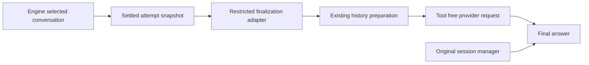

Codex review: needs maintainer review before merge.

## What this changes

This PR makes isolated final answers reuse the settled engine-selected conversation instead of reopening raw history.

**Example:** A completed workspace write receives an empty assistant response and triggers isolated finalization.
- **Before:** The finalizer sends 52,085 bytes, including old history excluded by the context engine.
- **After:** The finalizer sends 2,490 bytes, retaining the selected summary and write receipt with zero tools.

## Review scores

| Measure | Result | What it means |
|---|---|---|
| **Overall readiness** | 🦞 diamond lobster **(5/6)** | Focused owner-approved repair with shipped Gateway proof, retained regression contracts, and no actionable findings. |
| **Proof confidence** | 🦞 diamond lobster **(5/6)** | Sufficient (live_output): The reviewed head was exercised through rebuilt Linux Gateways with real session RPCs, a committed workspace write, an empty post-tool response, a synthetic selected context engine, and a recording SSE provider; captured finalizer requests retain the summary and receipt while excluding raw canary history, offering zero tools, and adding no engine lifecycle calls. |
| **Patch quality** | 🦞 diamond lobster **(5/6)** | No actionable review findings were identified. |

## Product

**Kind:** Bug fix · **Worth it:** Yes · **Fix scope:** Complete
**User problem:** A short recovery answer can unexpectedly resend large amounts of excluded conversation history and consume provider quota.
**Reason:** The maintainer approved this bounded-context repair and its separation from delivery admission; source and Gateway evidence support the user benefit.

## Merge readiness

✅ **Ready for maintainer review**

Keep open: this PR repairs a confirmed finalization-context bug with no actionable findings; current-head CI remains pending.

**Priority:** P1
**Reviewed head:** `a8cad32e618122fbe474a5102890fe34e5fc9b57`

## Before merge

None.

## Findings

None.

<strong>Agent review details</strong>

### How this fits together

The built-in agent harness passes settled conversation context to embedded history preparation, which bounds and sanitizes the tool-free provider request while the original session manager retains transcript writes.

### Technical review

Best possible solution:

Land the frozen-view handoff through the existing history owner once the reviewed head satisfies its normal CI gates.

Do we have a high-confidence way to reproduce the issue?

Supplied built-Gateway comparisons reproduce excluded history returning on main and disappearing on the candidate through actual isolated finalization; this review executed no target code.

Is this the best way to solve the issue?

The smallest complete repair transports the existing frozen selected view to history preparation, preserving its bounds and transcript custody without restoring the live engine or introducing a second context owner.

AGENTS.md: found and applied where relevant.

Codex review notes: model internal, reasoning medium; reviewed against [41b50b4dbcba](https://github.com/openclaw/openclaw/commit/41b50b4dbcbae199224d2e6aa2c54edaf39d8d43).

### Provenance checked

- `Restricted built-in finalization` keeps the original intent (6eea20ce181ecfcb9ff4cf24f85ef54f8580a690: Finalize settled work through an isolated capability-free request without replaying completed effects.)
- `History preparation ownership` keeps the original intent (cbcc1df2b32b04327dfca2c10d88a3733b10b406: Keep history preparation separate while carrying canonical prepared attempt state through execution and recovery.)
- `Detached transcript custody` keeps the original intent (8f924bff5d680ef80e96ae960245847c782f2ff4: Retain the receipt-bearing session manager across finalization and preserve hidden recovery prompts.)
- `Existing finalization tests` keeps the original intent (https://github.com/openclaw/openclaw/pull/184459: Remove duplicate setup and low-value assertions while retaining distinct lifecycle and persistence contracts.)

### Testing

Proof path: shipped entry point.

### Security

None.

### Evidence

What I checked:

- **Verified introduced changes:** The pinned introduced diff adds a private settled-view handoff, bounds it through existing history policy, and consolidates the existing regression suites. ([a8cad32e6181](https://github.com/openclaw/openclaw/commit/a8cad32e618122fbe474a5102890fe34e5fc9b57))
- **Frozen context selection:** The adapter accepts the OpenClaw transcript capture or canonical messagesSnapshot, rejects explicitly unavailable or foreign projections, and preserves the restricted execution allowlist. ([`src/agents/harness/builtin-openclaw.ts:109`](https://github.com/openclaw/openclaw/blob/a8cad32e618122fbe474a5102890fe34e5fc9b57/src/agents/harness/builtin-openclaw.ts#L109), [a8cad32e6181](https://github.com/openclaw/openclaw/commit/a8cad32e618122fbe474a5102890fe34e5fc9b57))
- **Existing bounds and transcript ownership:** History preparation reuses selectBoundedModelRequests and the existing finalizer limits, including tool-result omission; even an empty selected view replaces hydrated history without replacing the transcript writer. ([`src/agents/embedded-agent-runner/run/attempt-history-prepare.ts:26`](https://github.com/openclaw/openclaw/blob/a8cad32e618122fbe474a5102890fe34e5fc9b57/src/agents/embedded-agent-runner/run/attempt-history-prepare.ts#L26), [a8cad32e6181](https://github.com/openclaw/openclaw/commit/a8cad32e618122fbe474a5102890fe34e5fc9b57))
- **Current main still needs the repair:** Fetched main finalizes through the restricted adapter without transporting the settled selected view. ([`src/agents/harness/builtin-openclaw.ts:108`](https://github.com/openclaw/openclaw/blob/41b50b4dbcbae199224d2e6aa2c54edaf39d8d43/src/agents/harness/builtin-openclaw.ts#L108), [41b50b4dbcba](https://github.com/openclaw/openclaw/commit/41b50b4dbcbae199224d2e6aa2c54edaf39d8d43))
- **Maintainer-approved scope:** Peter Steinberger endorsed reusing the frozen assembled snapshot and explicitly separated duplicate-delivery admission into https://github.com/openclaw/openclaw/issues/179003: https://github.com/openclaw/openclaw/pull/186288#issuecomment-6454269644.
- **Exact-head Gateway evidence:** Ayaan Zaidi supplied rebuilt Linux Gateway comparison evidence for the reviewed head: 52,085 versus 2,490 finalizer request bytes, excluded canary absent after the fix, summary and receipt retained, zero tools, successful completion, and unchanged engine lifecycle counters: https://github.com/openclaw/openclaw/pull/186288#issuecomment-6456933305. ([a8cad32e6181](https://github.com/openclaw/openclaw/commit/a8cad32e618122fbe474a5102890fe34e5fc9b57))

Likely related people:

- **Peter Steinberger:** Raw commit 8f924bff5d680ef80e96ae960245847c782f2ff4 adds src/agents/harness/builtin-openclaw.ts:58 relative to its recorded parents. This identifies author metadata, not feature responsibility or a PR merger. (role: source-line author; confidence: high; commits: [8f924bff5d68](https://github.com/openclaw/openclaw/commit/8f924bff5d680ef80e96ae960245847c782f2ff4); files: `src/agents/harness/builtin-openclaw.ts`)

### PR surface

Source +60, Tests 0. Total +60 across 5 files. Added test files: 0.

View PR surface stats

| Area | Files | Added | Removed | Net |
|---|---:|---:|---:|---:|
| Source | 3 | 65 | 5 | +60 |
| Tests | 2 | 104 | 104 | 0 |
| Docs | 0 | 0 | 0 | 0 |
| Config | 0 | 0 | 0 | 0 |
| Generated | 0 | 0 | 0 | 0 |
| Other | 0 | 0 | 0 | 0 |
| **Total** | **5** | **169** | **109** | **+60** |

### Review metrics

| Metric | Value | Why it matters |
|---|---|---|
| **Production versus test LOC** | Production +65/-5; tests +104/-104 | Production growth carries the private selected view and adapts it to the existing bounded selector; regression coverage is consolidated without net test growth. |

### Labels

Label changes:

No label changes.

Label justifications:

- `P1`: The confirmed recovery-path bug restores excluded historical context and can consume substantial provider quota during active agent workflows.
- `rating: 🦞 diamond lobster`: Overall readiness is 🦞 diamond lobster; proof is 🦞 diamond lobster and patch quality is 🦞 diamond lobster.
- `status: 👀 ready for maintainer look`: ClawSweeper has no concrete contributor-facing blocker left for this PR.
- `proof: sufficient`: Contributor real behavior proof is sufficient.

### Rating scale

6/6 🦀 challenger crab · 5/6 🦞 diamond lobster · 4/6 🐚 platinum hermit · 3/6 🦐 gold shrimp · 2/6 🦪 silver shellfish · 1/6 🧂 unranked krab. Overall follows the weaker of proof and patch quality; ✨ marks media proof (a screenshot, video, or linked artifact) that directly shows the changed behavior.

### Workflow

ClawSweeper edits this one comment on every review. Comment `@clawsweeper re-review` for a fresh review only. Repair and merge execution lanes are retired.

### History

Review history (3 earlier review cycles)

<!-- clawsweeper-review-history v=1 total=3 -->
- reviewed 2026-10-27T21:03:31.085Z sha c665be256f4a0f69894a26fb4a1b5d08372f7859 :: needs real behavior proof before merge. :: none
- reviewed 2026-10-27T23:08:08.159Z sha f616ee3a246c95c0d44521687495ab828a880516 :: needs maintainer review before merge. :: none
- reviewed 2026-10-27T23:56:30.204Z sha a037f29b1bad9717aca3a3db9559b941534e4efd :: needs maintainer review before merge. :: none

_Reviewed October 27, 2026, 8:14 PM ET / October 28, 2026, 00:14 UTC (Revision 4)._

<!-- clawsweeper-verdict:needs-human item=186288 sha=a8cad32e618122fbe474a5102890fe34e5fc9b57 confidence=high updated_at=2026-10-28T00:10:30Z reviewed_at=2026-10-28T00:14:50.329Z lease_owner=github-run-40606987502-1 lease_comment_id=6456945704 source_revision=dc789e5696400cf15259de72ffada8501ec4a13e39b2b212564e20fc7c0a551e hold=not_opted_in findings=0 -->
<!-- clawsweeper-review-state:ready item=186288 sha=a8cad32e618122fbe474a5102890fe34e5fc9b57 v=1 -->

<!-- clawsweeper-review-version item=186288 reviewed_at=2026-10-28T00:14:50.329Z sha=a8cad32e618122fbe474a5102890fe34e5fc9b57 source_revision=dc789e5696400cf15259de72ffada8501ec4a13e39b2b212564e20fc7c0a551e lease_owner=github-run-40606987502-1 lease_comment_id=6456945704 v=1 -->

<!-- clawsweeper-review item=186288 -->