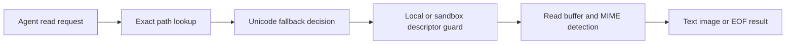

Codex review: needs maintainer review before merge. _Reviewed August 10, 2026, 6:04 AM ET / 10:04 UTC._

# ClawSweeper review

## What this changes

The PR makes local and sandboxed agent file reads reject special files without blocking, resolve one unambiguous Unicode-equivalent filename, reuse read buffers for MIME detection, and report empty or EOF results explicitly.

## Merge readiness

⚠️ **Ready for maintainer review - 5 items remain**

Keep open: the final source repair is coherent and addresses the earlier MIME and blank/EOF findings, but this protected sandbox-boundary PR still needs after-fix operational proof, complete exact-head CI, and sandbox-owner review. Likely related people: @steipete and @openclaw-secops.

**Priority:** P1
**Reviewed head:** `fda6868e8efb5679bc9a94780881f283c4a36e6e`
**Owner decision:** Required. See [Decision needed](#decision-needed).

## Review scores

| Measure | Result | What it means |
|---|---|---|
| **Overall readiness** | 🐚 platinum hermit **(4/6)** | PR readiness rating was derived from proof quality, review findings, security review, and reviewer confidence. |
| **Proof confidence** | 🌊 off-meta tidepool | Not applicable: Real behavior proof is not required for maintainer- or bot-authored pull requests. |
| **Patch quality** | 🐚 platinum hermit **(4/6)** | No actionable review findings were identified. |

## Verification

| Check | Result | Evidence |
|---|---|---|
| **Real behavior** | Not applicable | Not applicable: Real behavior proof is not required for maintainer- or bot-authored pull requests. |
| **Evidence reviewed** | 8 items | Local read owner path: The final head checks regular-file identity before and after a nonblocking descriptor open, then reads that same handle. Unicode and explicit-result behavior: Exact access is attempted first; variants are considered only after ENOENT/ENOTDIR, while empty, blank, and EOF outcomes are returned as visible text. Sandbox MIME preservation: Sandbox MIME detection now consumes the already-read buffer through the existing full detector, preserving AVIF classification without a second bridge read. |
| **Findings** | None | None. |
| **Security** | None | None. |

## How this fits together

Agent read tools turn local or sandboxed paths into bounded text or image results for the model. Sandbox filesystem guards validate the host descriptor before the bridge reads it, while the session read tool formats the resulting content and pagination guidance.

## Decision needed

| Question | Recommendation |
|---|---|
| Does the sandbox owner approve the descriptor-opening change after reviewing the exact-head proof and completed checks? | **Approve after boundary proof:** Have the sandbox owner review the completed FIFO/descriptor proof and exact-head checks, then proceed with normal merge review. |

Why: The changed sandbox filesystem boundary is CODEOWNERS-protected and changes the flags used before descriptor validation; source review found no vulnerability, but the ownership decision is human.

## Before merge

- [ ] **Resolve merge risk (P2)** - The PR body links a pre-fix timeout but does not retain observable after-fix terminal or artifact output for the FIFO/read path.
- [ ] **Resolve merge risk (P1)** - One exact-head baseline check is failing and the check set is incomplete, so merge readiness is not established.
- [ ] **Resolve merge risk (P1)** - This bug fix adds about 95 net production lines; the local and sandbox guards have distinct owners, but the final review should confirm no duplicate safe-read policy remains.
- [ ] **Complete next step (P2)** - The protected sandbox boundary and missing after-fix evidence require human merge review rather than an automated repair.

<strong>Agent review details</strong>

### Security

None.

### PR surface

Source +95, Tests +305. Total +400 across 11 files.

View PR surface stats

| Area | Files | Added | Removed | Net |
|---|---:|---:|---:|---:|
| Source | 7 | 257 | 162 | +95 |
| Tests | 4 | 317 | 12 | +305 |
| Docs | 0 | 0 | 0 | 0 |
| Config | 0 | 0 | 0 | 0 |
| Generated | 0 | 0 | 0 | 0 |
| Other | 0 | 0 | 0 | 0 |
| **Total** | **11** | **574** | **174** | **+400** |

### Review metrics

| Metric | Value | Why it matters |
|---|---|---|
| **Production vs test LOC** | production +257/-162 (net +95); tests +317/-12 (net +305) | The added production logic implements distinct local and sandbox descriptor boundaries, but the net growth is material for a bug fix. |

### Stored data model

Persistent data-model change detected: `serialized state: src/agents/agent-tools.create-openclaw-coding-tools.test.ts`, `serialized state: src/agents/sandbox/fs-bridge.boundary.test.ts`, `serialized state: src/agents/sessions/tools/path-utils.ts`, `serialized state: src/agents/sessions/tools/read.test.ts`, `serialized state: src/agents/sessions/tools/read.ts`, `unknown-data-model-change: src/agents/sessions/tools/path-utils.ts`, and 2 more. Confirm migration or upgrade compatibility proof before merge.

### Merge-risk options

**Maintainer options:**
1. **Complete merge proof (recommended)**  
   Attach redacted after-fix terminal or linked-action evidence for FIFO refusal and normal reads, finish exact-head checks, and obtain sandbox-owner approval.
2. **Accept source-only evidence**  
   Maintainers may accept the current source and focused-test review despite the missing retained runtime artifact.

### Technical review

Best possible solution:

Retain the single-buffer, descriptor-validated read flow with exact-first Unicode matching, then merge only after an after-fix FIFO trace, complete exact-head checks, and sandbox-owner approval.

Do we have a high-confidence way to reproduce the issue?

Yes, source-reproducible: current main uses separate access/MIME/read operations, while the final head contains focused FIFO, descriptor-swap, Unicode, blank-file, and EOF cases. The review did not execute the contributor branch.

Is this the best way to solve the issue?

Yes, subject to the remaining proof gates: validating one descriptor-backed buffer at the read owner avoids the original blocking and duplicate-read paths while preserving sandbox MIME detection.

AGENTS.md: found and applied where relevant.

Codex review notes: model internal, reasoning high; reviewed against [c034670b7299](https://github.com/openclaw/openclaw/commit/c034670b7299f552a4c6cde42c67ed4b0fbf0278).

### Labels

Label changes:

- add `merge-risk: 🚨 security-boundary`: It changes descriptor flags used by the sandbox path-validation boundary before a file is accepted for reading.
- add `rating: 🐚 platinum hermit`: Overall readiness is 🐚 platinum hermit; proof is 🌊 off-meta tidepool and patch quality is 🐚 platinum hermit.
- add `status: 👀 ready for maintainer look`: ClawSweeper has no concrete contributor-facing blocker left for this PR. Not applicable: Real behavior proof is not required for maintainer- or bot-authored pull requests.
- remove `rating: 🦐 gold shrimp`: Current PR rating is `rating: 🐚 platinum hermit`, so this older rating label is no longer current.
- remove `status: ⏳ waiting on author`: Current PR status label is `status: 👀 ready for maintainer look`.

Label justifications:

- `P1`: The PR repairs agent file reads that can currently stall an active agent workflow on a special file.
- `merge-risk: 🚨 compatibility`: It changes established filename resolution and visible empty, blank, and EOF read output.
- `merge-risk: 🚨 security-boundary`: It changes descriptor flags used by the sandbox path-validation boundary before a file is accepted for reading.
- `rating: 🐚 platinum hermit`: Overall readiness is 🐚 platinum hermit; proof is 🌊 off-meta tidepool and patch quality is 🐚 platinum hermit.
- `status: 👀 ready for maintainer look`: ClawSweeper has no concrete contributor-facing blocker left for this PR. Not applicable: Real behavior proof is not required for maintainer- or bot-authored pull requests.

### Evidence

What I checked:

- **Local read owner path:** The final head checks regular-file identity before and after a nonblocking descriptor open, then reads that same handle. ([`src/agents/sessions/tools/read.ts:153`](https://github.com/openclaw/openclaw/blob/fda6868e8efb/src/agents/sessions/tools/read.ts#L153), [fda6868e8efb](https://github.com/openclaw/openclaw/commit/fda6868e8efb))
- **Unicode and explicit-result behavior:** Exact access is attempted first; variants are considered only after ENOENT/ENOTDIR, while empty, blank, and EOF outcomes are returned as visible text. ([`src/agents/sessions/tools/read.ts:345`](https://github.com/openclaw/openclaw/blob/fda6868e8efb/src/agents/sessions/tools/read.ts#L345), [fda6868e8efb](https://github.com/openclaw/openclaw/commit/fda6868e8efb))
- **Sandbox MIME preservation:** Sandbox MIME detection now consumes the already-read buffer through the existing full detector, preserving AVIF classification without a second bridge read. ([`src/agents/agent-tools.read.ts:1047`](https://github.com/openclaw/openclaw/blob/fda6868e8efb/src/agents/agent-tools.read.ts#L1047), [fda6868e8efb](https://github.com/openclaw/openclaw/commit/fda6868e8efb))
- **Boundary regression coverage:** The final head adds real FIFO, descriptor-swap, Unicode, AVIF, blank-file, and EOF regression cases at the owner boundaries. ([`src/agents/sessions/tools/read.test.ts:137`](https://github.com/openclaw/openclaw/blob/fda6868e8efb/src/agents/sessions/tools/read.test.ts#L137), [fda6868e8efb](https://github.com/openclaw/openclaw/commit/fda6868e8efb))
- **Current-main provenance:** Current main still contains the pre-PR separate access/MIME/read flow, and the PR head is not an ancestor of current main; no local release tag contains the PR head. ([`src/agents/sessions/tools/read.ts:156`](https://github.com/openclaw/openclaw/blob/c034670b7299/src/agents/sessions/tools/read.ts#L156), [c034670b7299](https://github.com/openclaw/openclaw/commit/c034670b7299))
- **Area provenance:** The current read and path behavior traces to the recent main commit by Peter Steinberger; older history is unavailable in this partial checkout. ([`src/agents/sessions/tools/read.ts:420`](https://github.com/openclaw/openclaw/blob/0e74a1bd8670/src/agents/sessions/tools/read.ts#L420), [0e74a1bd8670](https://github.com/openclaw/openclaw/commit/0e74a1bd8670))

Likely related people:

- **steipete:** Current read, path-resolution, and wrapper lines blame to Peter Steinberger's recent main commit. (role: recent area contributor; confidence: medium; commits: [0e74a1bd8670](https://github.com/openclaw/openclaw/commit/0e74a1bd86703007610bc79c12185e33217218ae); files: `src/agents/sessions/tools/read.ts`, `src/agents/sessions/tools/path-utils.ts`, `src/agents/agent-tools.read.ts`)
- **openclaw-secops:** CODEOWNERS assigns the changed sandbox filesystem boundary subtree to this review owner. (role: CODEOWNERS reviewer; confidence: high; files: `src/agents/sandbox/fs-bridge-path-safety.ts`, `src/agents/sandbox/fs-bridge.ts`)

### Rank-up moves

Optional improvements that raise the rating; they are not merge blockers.

- Tighten the PR description with what changed, how it was validated, and any remaining risk.

### Rating scale

| Score | Internal tier | Crab rank | Meaning |
|---:|:---:|---|---|
| **6/6** | S | 🦀 challenger crab | Exceptional readiness |
| **5/6** | A | 🦞 diamond lobster | Very strong readiness |
| **4/6** | B | 🐚 platinum hermit | Good normal PR; ordinary maintainer review |
| **3/6** | C | 🦐 gold shrimp | Useful, but confidence is limited |
| **2/6** | D | 🦪 silver shellfish | Proof or implementation needs work |
| **1/6** | F | 🧂 unranked krab | Not merge-ready |
| N/A | NA | 🌊 off-meta tidepool | Rating does not apply |

Overall follows the weaker of proof and patch quality.
Shiny media proof means a screenshot, video, or linked artifact directly shows the changed behavior. Runtime, network, CSP, and security claims still need visible diagnostics.

### Workflow

- ClawSweeper keeps one durable marker-backed review comment per issue or PR.
- Re-runs edit this comment so the latest verdict, findings, and automation markers stay together instead of adding duplicate bot comments.
- A fresh review can be triggered by eligible `@clawsweeper re-review` comments, exact-item GitHub events, scheduled/background review runs, or manual workflow dispatch.
- PR/issue authors and users with repository write access can comment `@clawsweeper re-review` or `@clawsweeper re-run` on an open PR or issue to request a fresh review only.
- Maintainers can also comment `@clawsweeper review` to request a fresh review only.
- Fresh-review commands do not start repair, autofix, rebase, CI repair, or automerge.
- Maintainer-only repair and merge flows require explicit commands such as `@clawsweeper autofix`, `@clawsweeper automerge`, `@clawsweeper fix ci`, or `@clawsweeper address review`.
- Maintainers can comment `@clawsweeper explain` to ask for more context, or `@clawsweeper stop` to stop active automation.

### History

Review history (1 earlier review cycle)

<!-- clawsweeper-review-history v=1 total=1 -->
- reviewed 2026-08-10T08:49:57.281Z sha 5a0dedc6f1328262d4bdd0af2b6620208ec02245 :: found issues before merge. :: [P1] Preserve sandbox image MIME detection | [P2] Report newline-only files explicitly

<!-- clawsweeper-verdict:needs-human item=121508 sha=fda6868e8efb5679bc9a94780881f283c4a36e6e confidence=high updated_at=2026-08-10T10:00:09Z reviewed_at=2026-08-10T10:04:11.412Z lease_owner=github-run-31377068588-1 lease_comment_id=5238685483 source_revision=d000c2b6e2a56dea6ecee97f80e1b7b45e2583aead14c87fe7d051e2f41eee27 -->

<!-- clawsweeper-review-version item=121508 reviewed_at=2026-08-10T10:04:11.412Z sha=fda6868e8efb5679bc9a94780881f283c4a36e6e source_revision=d000c2b6e2a56dea6ecee97f80e1b7b45e2583aead14c87fe7d051e2f41eee27 lease_owner=github-run-31377068588-1 lease_comment_id=5238685483 v=1 -->

<!-- clawsweeper-review item=121508 -->