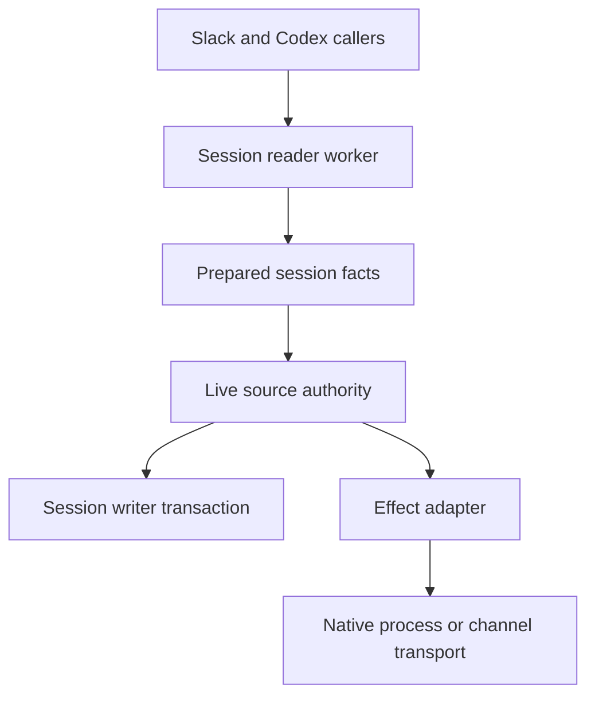

Codex review: needs real behavior proof before merge.

## What this changes

This PR moves bundled session currentness reads into existing workers and prepares fresh completion authority at effect boundaries.

**Example:** A completion for session physical-one writes its own recovery receipt before sending a reply.
- **Before:** The retained earlier snapshot can reject the later action after the run's successful write.
- **After:** The reply prepares current source facts and checks the receipt immediately before dispatch.

## Review scores

| Measure | Result | What it means |
|---|---|---|
| **Overall readiness** | 🧂 unranked krab **(1/6)** | The implementation has useful boundary coverage, but the required authority evidence does not cover the later repairs. |
| **Proof confidence** | 🧂 unranked krab **(1/6)** | Real behavior proof is necessary before merge. See [Before merge](#before-merge). |
| **Patch quality** | 🦐 gold shrimp **(3/6)** | Security review found an item that needs attention. |

## Product

**Kind:** Refactor · **Worth it:** Yes · **Fix scope:** Complete
**User problem:** Synchronous session reads occupy the Gateway thread, and completion actions can reject their own successfully updated source.
**Reason:** The maintainer-authored change follows the established worker migration direction and records the accepted preparation and post-success tradeoffs.

## Merge readiness

⛔ **Blocked before merge - 3 items remain**

Keep this maintainer-authored PR open: it completes a useful worker cutover, and no concrete introduced defect was established in the inspected paths.

**Priority:** P2
**Reviewed head:** `1aec560dd3ecc1e59368e85a550df7c539df58ef`

## Before merge

- [ ] **Add real behavior proof** - Authority-chain proof required: the reported live Gateway workload exercises ordinary turns at 22bf8aa966027a499abbeb784f6e2aab9e44a397, before later authority repairs. Provide redacted logs or terminal output showing allowed execution and refusal after policy revocation or conversation reassignment before native writes, permission replies, cancellation, recovered child receipt persistence, and queued replay, including changes during awaited preparation. Redact credentials, IP addresses, phone numbers, and non-public endpoints. After adding proof, update the PR body; ClawSweeper should re-review automatically. If it does not, the PR author or someone with repository write access can comment `@clawsweeper re-review`.
- [ ] **Resolve security concern: Validate authority after asynchronous preparation** - Prepared source authority reaches native writes, permission decisions, cancellation, and recovered delivery. The supplied ordinary-turn run predates later authority repairs and does not establish rejection of revoked or reassigned callers at these final effects.
- [ ] **Resolve merge risk** - Before merge, establish that recovered source receipts and effect scopes cannot authorize native or cross-user effects after revocation or reassignment during awaited preparation.

## Findings

- [medium] Validate authority after asynchronous preparation — `src/agents/agent-harness-completion-recovery.ts:477`

### Tests

- Missing end-to-end proof: Missing final-effect traces covering the later authority repairs, with allowed execution and refusal of revoked or reassigned callers before I/O.

<strong>Agent review details</strong>

### How this fits together

Session readers supply entry and conversation facts to Slack, Codex, and agent execution; writer transactions and effect adapters consume those facts alongside live caller authority.

### Technical review

Best possible solution:

Complete the existing reader-worker cutover while preserving live final-effect authorization and the documented SDK compatibility window.

Do we have a high-confidence way to reproduce the issue?

Current-main source shows synchronous entry and conversation reads in the retained currentness callback; no runtime reproduction was performed during this read-only review.

Is this the best way to solve the issue?

Reusing the existing readers, writer predicates, and receipt authority is a coherent solution, with accepted preparation-only edge cases documented by the maintainer.

AGENTS.md: found and applied where relevant.

Codex review notes: model internal, reasoning medium; reviewed against [2cddf96f6c97](https://github.com/openclaw/openclaw/commit/2cddf96f6c97c5a50b39b1cf4df867865c050abc).

### Merge-risk options

**Maintainer options:**
1. **Prove final-effect authority (recommended)**  
   Provide allowed and nearest-forbidden execution traces through the changed native and recovery boundaries, including revocation or reassignment during awaited preparation.

### Provenance checked

- `Bundled currentness and SDK compatibility` keeps the original intent (ad3c93078e7fca4eb8733185479a627d5bea4988: Carry source predicates into worker transactions while preserving live host grants and released callback compatibility.)
- `Completion recovery authority` changes intended behavior with a stated reason (https://github.com/openclaw/openclaw/pull/147903: Recover admitted native completions after restart under exact requester and delivery custody; later refactors moved the owner out of Tasks.)
- `Rejected queued handoffs` keeps the original intent (https://github.com/openclaw/openclaw/pull/149370: Prevent rejected handoffs from becoming replayable while retaining ordinary transient retries.)
- `Retained completion source lifetime` changes intended behavior with a stated reason (79e33e8471a5ffdb8cf5b6405d11097d4bf8b576: Retain inactive incognito source authority; this PR explains replacing the durable retained snapshot with fresh effect-scoped facts while keeping incognito custody.)

### Testing

Proof path: in-process harness.

### Security

Needs attention: The changed authority chain needs final-effect validation; source inspection established no concrete bypass.

### Evidence

Security concerns:

- [medium] Validate authority after asynchronous preparation — `src/agents/agent-harness-completion-recovery.ts:477`
  Prepared source authority reaches native writes, permission decisions, cancellation, and recovered delivery. The supplied ordinary-turn run predates later authority repairs and does not establish rejection of revoked or reassigned callers at these final effects.
  Confidence: 0.9

What I checked:

- **Pinned change and current-main boundary:** The pinned introduction diff adds worker-backed currentness checks; fetched main still returns the synchronous currentness callbacks. ([`src/config/sessions/session-entry-current-check.ts:357`](https://github.com/openclaw/openclaw/blob/1aec560dd3ecc1e59368e85a550df7c539df58ef/src/config/sessions/session-entry-current-check.ts#L357), [1aec560dd3ec](https://github.com/openclaw/openclaw/commit/1aec560dd3ecc1e59368e85a550df7c539df58ef))
- **SDK compatibility retained:** The synchronous SDK method remains available with a warning and removal scheduled for the next SDK major; bundled production references use the asynchronous method. The maintainer-authored PR records this compatibility choice. ([`src/plugin-sdk/session-binding-runtime.ts:16`](https://github.com/openclaw/openclaw/blob/1aec560dd3ecc1e59368e85a550df7c539df58ef/src/plugin-sdk/session-binding-runtime.ts#L16), [1aec560dd3ec](https://github.com/openclaw/openclaw/commit/1aec560dd3ecc1e59368e85a550df7c539df58ef))
- **Currentness provenance:** The verified patch for commit ad3c930 introduced the currentness owner to carry source predicates into worker transactions while preserving live host grants and released callback compatibility. ([`src/config/sessions/session-entry-current-check.ts:103`](https://github.com/openclaw/openclaw/blob/ad3c93078e7fca4eb8733185479a627d5bea4988/src/config/sessions/session-entry-current-check.ts#L103), [ad3c93078e7f](https://github.com/openclaw/openclaw/commit/ad3c93078e7fca4eb8733185479a627d5bea4988))
- **Completion authority:** Completion scopes prepare the existing requester receipt and compare its scoped write token at the external-effect callback; cross-store entry commits enter the same source scope. ([`src/agents/agent-harness-completion-recovery.ts:477`](https://github.com/openclaw/openclaw/blob/1aec560dd3ecc1e59368e85a550df7c539df58ef/src/agents/agent-harness-completion-recovery.ts#L477), [1aec560dd3ec](https://github.com/openclaw/openclaw/commit/1aec560dd3ecc1e59368e85a550df7c539df58ef))
- **Queued rejection intent preserved:** https://github.com/openclaw/openclaw/pull/149370 established permanent settlement of rejected handoffs while preserving transient retries; the changed adapter still runs its final authority assertion when asynchronous preparation fails. ([`src/infra/outbound/deliver-channel.ts:240`](https://github.com/openclaw/openclaw/blob/6cf521932af06af674a90e2319ccbd6212261e5d/src/infra/outbound/deliver-channel.ts#L240), [6cf521932af0](https://github.com/openclaw/openclaw/commit/6cf521932af06af674a90e2319ccbd6212261e5d))
- **Supplied behavior evidence:** The complete PR body reports ordinary live Gateway turns, child completion, cron, compaction, and shutdown on 22bf8aa966027a499abbeb784f6e2aab9e44a397, and separately identifies later authority repairs. It supplies no final-effect revocation or reassignment trace covering those repairs. ([1aec560dd3ec](https://github.com/openclaw/openclaw/commit/1aec560dd3ecc1e59368e85a550df7c539df58ef))

### PR surface

PR surface statistics unavailable: the file list is incomplete.

### Labels

Label changes:

No label changes.

Label justifications:

- `P2`: This is a useful session-worker and completion-authority improvement without an established urgent user-facing regression.
- `merge-risk: 🚨 compatibility`: The public SDK adds asynchronous currentness semantics and deprecates synchronous callbacks; the maintainer-recorded compatibility window preserves the old API.
- `merge-risk: 🚨 security-boundary`: The patch changes when authority is prepared and consumed before native execution, permission replies, cancellation, and recovered effects.
- `rating: 🧂 unranked krab`: Overall readiness is 🧂 unranked krab; proof is 🧂 unranked krab and patch quality is 🦐 gold shrimp.
- `status: 📣 needs proof`: The PR needs real behavior proof before ClawSweeper can clear the contributor ask.

### Rank-up moves

Optional improvements that raise the rating; they are not merge blockers.

- Add final-effect proof for allowed and nearest-forbidden principals, including revocation or reassignment during awaited preparation and recovery.

### Rating scale

6/6 🦀 challenger crab · 5/6 🦞 diamond lobster · 4/6 🐚 platinum hermit · 3/6 🦐 gold shrimp · 2/6 🦪 silver shellfish · 1/6 🧂 unranked krab. Overall follows the weaker of proof and patch quality; ✨ marks media proof (a screenshot, video, or linked artifact) that directly shows the changed behavior.

### Workflow

ClawSweeper edits this one comment on every review. Comment `@clawsweeper re-review` for a fresh review only. Repair and merge execution lanes are retired.

### History

Review history (7 earlier review cycles)

<!-- clawsweeper-review-history v=1 total=7 -->
- reviewed 2026-10-12T05:51:17.822Z sha eb67173f8cdb4dc6bb419d1c3801845065017af2 :: needs real behavior proof before merge. :: none
- reviewed 2026-10-12T08:12:39.442Z sha 22bf8aa966027a499abbeb784f6e2aab9e44a397 :: needs real behavior proof before merge. :: [P2] Make fresh completion receipts validate before admitting recovery | [P2] Migrate the remaining caller of the moved currentness reader | [P2] Migrate the incognito harness to effect-scoped completion authority
- reviewed 2026-10-12T08:57:05.774Z sha 025d1d8f176da33ab3dfc667a8ddd18b9723beba :: needs real behavior proof before merge. :: [P2] Extract the growth rejected by the required line-count ratchet
- reviewed 2026-10-12T09:48:37.659Z sha a4393bd6a46227f3f6d4774ffa2f291e9fd55f8a :: needs real behavior proof before merge. :: [P1] Preserve permanent rejection when awaited handoff authority refuses | [P2] Extract the growth rejected by the line-count ratchet
- reviewed 2026-10-12T10:45:36.603Z sha 6ba95d2497eae5ac719409001f331efcf7d249b2 :: needs real behavior proof before merge. :: none
- reviewed 2026-10-12T11:36:41.770Z sha 6ba95d2497eae5ac719409001f331efcf7d249b2 :: needs real behavior proof before merge. :: none
- reviewed 2026-10-12T12:08:12.906Z sha a0c1c269b807e16b0dc801316dbceaa172f95b5c :: needs real behavior proof before merge. :: none

_Reviewed October 12, 2026, 8:54 AM ET / 12:54 UTC (Revision 8)._

<!-- clawsweeper-security:security-sensitive item=169646 sha=1aec560dd3ecc1e59368e85a550df7c539df58ef confidence=high updated_at=2026-10-12T12:47:35Z reviewed_at=2026-10-12T12:54:01.243Z lease_owner=github-run-38251144740-1 lease_comment_id=6124561175 source_revision=34418864afba1029f3b3044056742765d1696c81bb6d38c2438b22e9a149e96f -->
<!-- clawsweeper-verdict:needs-human item=169646 sha=1aec560dd3ecc1e59368e85a550df7c539df58ef confidence=high updated_at=2026-10-12T12:47:35Z reviewed_at=2026-10-12T12:54:01.243Z lease_owner=github-run-38251144740-1 lease_comment_id=6124561175 source_revision=34418864afba1029f3b3044056742765d1696c81bb6d38c2438b22e9a149e96f hold=security findings=0 -->
<!-- clawsweeper-review-state:blocked item=169646 sha=1aec560dd3ecc1e59368e85a550df7c539df58ef v=1 -->

<!-- clawsweeper-review-version item=169646 reviewed_at=2026-10-12T12:54:01.243Z sha=1aec560dd3ecc1e59368e85a550df7c539df58ef source_revision=34418864afba1029f3b3044056742765d1696c81bb6d38c2438b22e9a149e96f lease_owner=github-run-38251144740-1 lease_comment_id=6124561175 v=1 -->

<!-- clawsweeper-review item=169646 -->