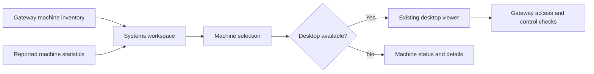

Codex review: blocked before merge. _Reviewed September 14, 2026, 2:27 PM ET / 18:27 UTC (Revision 8)._

# ClawSweeper review

## What this changes

Adds a Systems workspace with contextual machine navigation, reported statistics, and a full-size desktop viewer using the existing connection controls.

## Merge readiness

⛔ **Blocked before merge - 1 item remains**

Keep open: this maintainer-requested workspace remains distinct from current main. The previous namespace and subtitle findings are resolved, and no new blocking code defect was identified.

**Priority:** P2
**Reviewed head:** `dff427fc15776955d53fabc3ed904c1941fb45b6`

## Review scores

| Measure | Result | What it means |
|---|---|---|
| **Overall readiness** | 🐚 platinum hermit **(4/6)** | A useful, coherent implementation with inspected real-setup visual proof and resolved prior findings; hosted checks remain a separate landing gate. |
| **Proof confidence** | 🦞 diamond lobster **(5/6)** ✨ media proof bonus | Sufficient (screenshot): Inspected before/after images and the captured real Gateway/RFB installation account support the Systems machine list and enlarged desktop presentation at b1651b3afaa099abcdfe06d4d04f71ac8630df67; later source changes retain that behavior, with focused tests providing supplemental coverage. |
| **Patch quality** | 🐚 platinum hermit **(4/6)** | No actionable review findings were identified. |

## Verification

| Check | Result | Evidence |
|---|---|---|
| **Real behavior** | Verified | Sufficient (screenshot): Inspected before/after images and the captured real Gateway/RFB installation account support the Systems machine list and enlarged desktop presentation at b1651b3afaa099abcdfe06d4d04f71ac8630df67; later source changes retain that behavior, with focused tests providing supplemental coverage. |
| **Evidence reviewed** | 9 items | Pinned introduced changes: Reviewed the local merge-base-to-head changes against abbdd5287afc59899721285bca79fdfd8e6d289d. The checkout matches the supplied original head, and git status remained clean. The stale test merge was not used to attribute removals or regressions. Still necessary on main: The fetched main route table has no Systems destination, and its tree has no ui/src/pages/systems directory. The corresponding directory is also absent from v2026.9.4. No merged replacement is established by the supplied related-item context. Canonical feature request: https://github.com/openclaw/openclaw/issues/147217 remains open and requests this contextual sidebar and desktop workspace. Its body explicitly calls for reusing desktop ownership and preserving settings and pairing authority; this PR is its implementation candidate. |
| **Findings** | None | None. |
| **Security** | None | None. |

## How this fits together

The Control UI receives machine inventory and telemetry from the Gateway. Systems presents those machines beside the existing desktop viewer, while the Gateway continues to authorize desktop access and control.

## Before merge

- [ ] **Resolve merge risk (P1)** - Exact-head hosted validation is incomplete because preflight failed before the UI suites; the detailed failure cause remains unverified.

<strong>Agent review details</strong>

### Security

None.

### PR surface

Source +1794, Tests +684, Docs +27, Other +3. Total +2508 across 50 files.

View PR surface stats

| Area | Files | Added | Removed | Net |
|---|---:|---:|---:|---:|
| Source | 29 | 1951 | 157 | +1794 |
| Tests | 16 | 706 | 22 | +684 |
| Docs | 3 | 27 | 0 | +27 |
| Config | 0 | 0 | 0 | 0 |
| Generated | 0 | 0 | 0 | 0 |
| Other | 2 | 4 | 1 | +3 |
| **Total** | **50** | **2688** | **180** | **+2508** |

### Review metrics

| Metric | Value | Why it matters |
|---|---|---|
| **Production versus test growth** | Production/tooling +1,797 net lines; tests/support +684 net lines | Growth implements the requested workspace and its states while retaining the existing desktop transport owner. |
| **Navigation default** | 1 added default pinned destination; saved lists preserved | Existing customized sidebars discover Systems through Edit pinned items without an automatic preference rewrite. |

### Root-cause cluster

Relationship: `fixed_by_candidate`
Canonical: https://github.com/openclaw/openclaw/issues/147217
Summary: This PR implements the open contextual Systems workspace request; the issue should remain open until its implementation lands.

Members:
- `canonical`: https://github.com/openclaw/openclaw/issues/147217 - The linked request describes the same machine sidebar, full-height desktop, and preserved conversation navigation.

Proposal only: this assessment does not dispatch repair, suppress jobs, mutate sibling items, close, or merge anything.

### Merge-risk options

**Maintainer options:**
1. **Decide the mitigation before merge**  
   Keep Systems as a route-owned presentation of canonical Gateway inventory and the shared desktop viewer, preserving customized navigation and existing access controls.
2. **Pause or close**  
   Do not merge this PR until maintainers decide whether the risk is worth taking.

### Technical review

Best possible solution:

Keep Systems as a route-owned presentation of canonical Gateway inventory and the shared desktop viewer, preserving customized navigation and existing access controls.

Do we have a high-confidence way to reproduce the issue?

Not applicable: this adds a requested workspace rather than repairing an established behavior; source inspection confirms the previous review defects are corrected.

Is this the best way to solve the issue?

Yes: composing canonical inventory with the existing desktop viewer addresses the requested layout without introducing a competing transport, permission system, or persistence model.

AGENTS.md: found and applied where relevant.

Codex review notes: model internal, reasoning medium; reviewed against [5cc4537a456f](https://github.com/openclaw/openclaw/commit/5cc4537a456fd0c0eaf952e66761514e760d0d65).

### Labels

Label justifications:

- `P2`: This is a concrete operator-workspace improvement with existing desktop alternatives and no demonstrated urgent user regression.
- `rating: 🐚 platinum hermit`: Overall readiness is 🐚 platinum hermit; proof is 🦞 diamond lobster and patch quality is 🐚 platinum hermit.
- `status: 👀 ready for maintainer look`: ClawSweeper has no concrete contributor-facing blocker left for this PR. Sufficient (screenshot): Inspected before/after images and the captured real Gateway/RFB installation account support the Systems machine list and enlarged desktop presentation at b1651b3afaa099abcdfe06d4d04f71ac8630df67; later source changes retain that behavior, with focused tests providing supplemental coverage.
- `proof: sufficient`: Contributor real behavior proof is sufficient. Inspected before/after images and the captured real Gateway/RFB installation account support the Systems machine list and enlarged desktop presentation at b1651b3afaa099abcdfe06d4d04f71ac8630df67; later source changes retain that behavior, with focused tests providing supplemental coverage.
- `proof: 📸 screenshot`: Contributor real behavior proof includes screenshot evidence. Inspected before/after images and the captured real Gateway/RFB installation account support the Systems machine list and enlarged desktop presentation at b1651b3afaa099abcdfe06d4d04f71ac8630df67; later source changes retain that behavior, with focused tests providing supplemental coverage.

### Evidence

What I checked:

- **Pinned introduced changes:** Reviewed the local merge-base-to-head changes against abbdd5287afc59899721285bca79fdfd8e6d289d. The checkout matches the supplied original head, and git status remained clean. The stale test merge was not used to attribute removals or regressions. ([dff427fc1577](https://github.com/openclaw/openclaw/commit/dff427fc15776955d53fabc3ed904c1941fb45b6))
- **Still necessary on main:** The fetched main route table has no Systems destination, and its tree has no ui/src/pages/systems directory. The corresponding directory is also absent from v2026.9.4. No merged replacement is established by the supplied related-item context. ([`ui/src/app-route-paths.ts:83`](https://github.com/openclaw/openclaw/blob/5cc4537a456fd0c0eaf952e66761514e760d0d65/ui/src/app-route-paths.ts#L83), [5cc4537a456f](https://github.com/openclaw/openclaw/commit/5cc4537a456fd0c0eaf952e66761514e760d0d65))
- **Canonical feature request:** https://github.com/openclaw/openclaw/issues/147217 remains open and requests this contextual sidebar and desktop workspace. Its body explicitly calls for reusing desktop ownership and preserving settings and pairing authority; this PR is its implementation candidate.
- **Previous findings resolved:** The navigation assertion and English catalog both use “Machines and desktops.” The shared URL contract reserves systems, with a direct catalog-share rejection case. The supplied latest commit discussion reports 91 focused UI tests passing; this read-only review did not rerun tests. ([`ui/src/app-navigation.test.ts:272`](https://github.com/openclaw/openclaw/blob/dff427fc15776955d53fabc3ed904c1941fb45b6/ui/src/app-navigation.test.ts#L272), [dff427fc1577](https://github.com/openclaw/openclaw/commit/dff427fc15776955d53fabc3ed904c1941fb45b6))
- **Existing preferences preserved:** Settings loading prefers normalized persisted sidebar entries over defaults. The persistence test retains a customized Tasks/Automations list and exercises fallback to the new default only for invalid data. No storage schema or migration is introduced. ([`ui/src/app/settings.ts:573`](https://github.com/openclaw/openclaw/blob/dff427fc15776955d53fabc3ed904c1941fb45b6/ui/src/app/settings.ts#L573), [dff427fc1577](https://github.com/openclaw/openclaw/commit/dff427fc15776955d53fabc3ed904c1941fb45b6))
- **Shared desktop and scoped inventory owners:** Systems scopes results to the Gateway presentation and connection generation, aborts departed work, and preserves explicit selection. Its embedded panel consumes supplied inventory and connects view-only through the existing desktop.observe path; the shell dock is suppressed while Systems is active. Existing administrator gating and Gateway authorization remain in place. ([`ui/src/pages/systems/systems-controller.ts:19`](https://github.com/openclaw/openclaw/blob/dff427fc15776955d53fabc3ed904c1941fb45b6/ui/src/pages/systems/systems-controller.ts#L19), [dff427fc1577](https://github.com/openclaw/openclaw/commit/dff427fc15776955d53fabc3ed904c1941fb45b6))

Likely related people:

- **steipete:** Suggested for follow-up; no historical authorship or introduction is verified. (role: unverified routing candidate; confidence: low)
- **vincentkoc:** Suggested for follow-up; no historical authorship or introduction is verified. (role: unverified routing candidate; confidence: low)

### Rating scale

| Score | Internal tier | Crab rank | Meaning |
|---:|:---:|---|---|
| **6/6** | S | 🦀 challenger crab | Exceptional readiness |
| **5/6** | A | 🦞 diamond lobster | Very strong readiness |
| **4/6** | B | 🐚 platinum hermit | Good normal PR; ordinary maintainer review |
| **3/6** | C | 🦐 gold shrimp | Useful, but confidence is limited |
| **2/6** | D | 🦪 silver shellfish | Proof or implementation needs work |
| **1/6** | F | 🧂 unranked krab | Not merge-ready |
| N/A | NA | 🌊 off-meta tidepool | Rating does not apply |

Overall follows the weaker of proof and patch quality.
Shiny media proof means a screenshot, video, or linked artifact directly shows the changed behavior. Runtime, network, CSP, and security claims still need visible diagnostics.

### Workflow

- ClawSweeper keeps one durable marker-backed review comment per issue or PR.
- Re-runs edit this comment so the latest verdict, findings, and automation markers stay together instead of adding duplicate bot comments.
- A fresh review can be triggered by eligible `@clawsweeper re-review` comments, exact-item GitHub events, scheduled/background review runs, or manual workflow dispatch.
- PR/issue authors and users with repository write access can comment `@clawsweeper re-review` or `@clawsweeper re-run` on an open PR or issue to request a fresh review only.
- Maintainers can also comment `@clawsweeper review` to request a fresh review only.
- Fresh-review commands do not start repair, autofix, rebase, CI repair, or automerge.
- Maintainer-only repair and merge flows require explicit commands such as `@clawsweeper autofix`, `@clawsweeper automerge`, `@clawsweeper fix ci`, or `@clawsweeper address review`.
- Maintainers can comment `@clawsweeper explain` to ask for more context, or `@clawsweeper stop` to stop active automation.

### History

Review history (7 earlier review cycles)

<!-- clawsweeper-review-history v=1 total=7 -->
- reviewed 2026-09-13T23:09:47.549Z sha a9ff5cffc0b5988c0111a3567af7ae001696d5c9 :: blocked before merge. :: [P2] Reserve Systems in the shared URL contract
- reviewed 2026-09-14T00:08:17.012Z sha f92c8c2e910f028a93a031f911204c5e7eb04db7 :: blocked before merge. :: [P2] Reserve Systems in the shared URL contract
- reviewed 2026-09-14T00:37:30.784Z sha b1651b3afaa099abcdfe06d4d04f71ac8630df67 :: blocked before merge. :: none
- reviewed 2026-09-14T00:55:32.423Z sha b1651b3afaa099abcdfe06d4d04f71ac8630df67 :: needs maintainer review before merge. :: none
- reviewed 2026-09-14T03:32:18.678Z sha 58cd3b47b5cc96ca3dc74c2fa39083d8276420fc :: blocked before merge. :: none
- reviewed 2026-09-14T04:46:09.050Z sha ddfd356b1221ef0f986637ab323c6de20576f1e5 :: needs maintainer review before merge. :: none
- reviewed 2026-09-14T06:53:46.148Z sha c95fe66dd2586b715f50909b1d37fb8f5a5c2955 :: needs changes before merge. :: [P2] [P2] Align the Systems subtitle assertion with the English catalog

<!-- clawsweeper-verdict:needs-human item=147519 sha=dff427fc15776955d53fabc3ed904c1941fb45b6 confidence=high updated_at=2026-09-14T18:24:25Z reviewed_at=2026-09-14T18:27:47.217Z lease_owner=github-run-34880452241-1 lease_comment_id=5668683275 source_revision=16340268fd4ab537526f95a824228f090998864c107b130090becd341172b69f live_verification=absent -->
<!-- clawsweeper-review-state:blocked item=147519 sha=dff427fc15776955d53fabc3ed904c1941fb45b6 v=1 -->

<!-- clawsweeper-review-version item=147519 reviewed_at=2026-09-14T18:27:47.217Z sha=dff427fc15776955d53fabc3ed904c1941fb45b6 source_revision=16340268fd4ab537526f95a824228f090998864c107b130090becd341172b69f lease_owner=github-run-34880452241-1 lease_comment_id=5668683275 v=1 -->

<!-- clawsweeper-review item=147519 -->