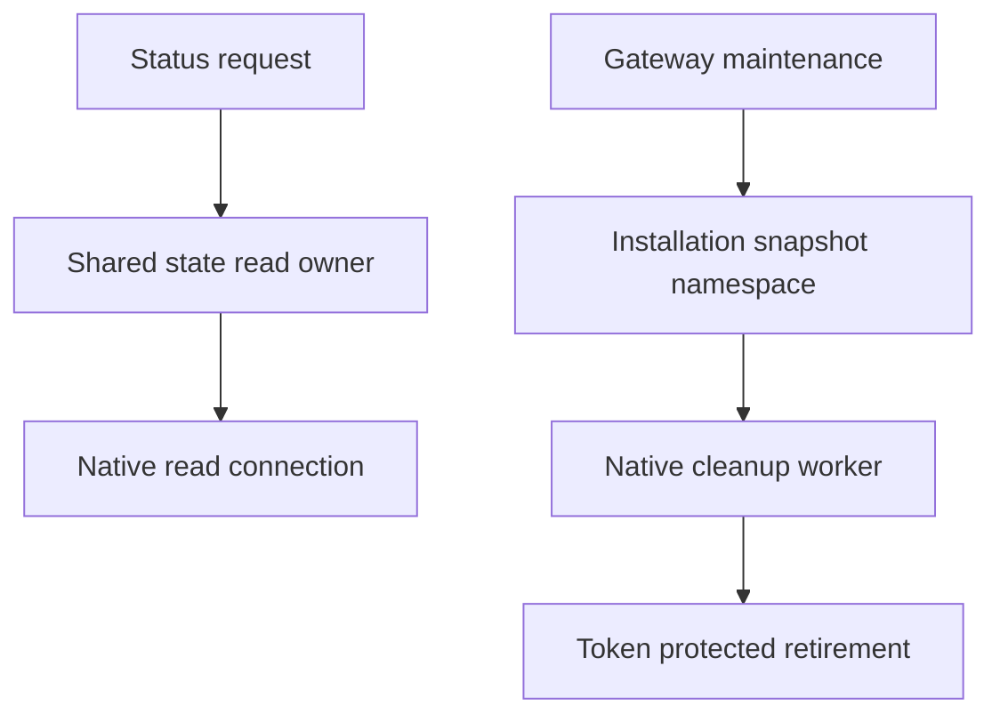

Codex review: needs maintainer review before merge.

## What this changes

This PR reclaims abandoned installation-scoped database snapshots and avoids unnecessary copies during ordinary status reads.

**Example:** A snapshot creator is killed after copying 596 MiB.
- **Before:** The abandoned copy remains without automatic Gateway reclamation.
- **After:** Delayed maintenance can reclaim it after 15 minutes of inactivity, while live tokens prevent deletion.

## Review scores

| Measure | Result | What it means |
|---|---|---|
| **Overall readiness** | 🐚 platinum hermit **(4/6)** | Useful, focused repair with native fault evidence and no concrete introduced defect; broad CI attribution remains unresolved. |
| **Proof confidence** | 🐚 platinum hermit **(4/6)** | The maintainer-authored proof exemption applies; supplied production-owner measurements cover interrupted native copies, live custody, reclamation, and zero unnecessary status snapshots. |
| **Patch quality** | 🐚 platinum hermit **(4/6)** | No actionable review findings were identified. |

## Product

**Kind:** Bug fix · **Worth it:** Yes · **Fix scope:** Complete
**User problem:** Killed readers leave large disposable copies behind, and ordinary status can unnecessarily copy the shared database.
**Reason:** The maintainer-authored direction addresses demonstrated waste while deliberately retaining offline ownership of historical shared-cache copies.

## Merge readiness

✅ **Ready for maintainer review**

Keep open: this PR addresses concrete snapshot leaks and unnecessary status copies using existing owners; no introduced correctness defect was found, but failing CI checks remain unattributed.

**Priority:** P2
**Reviewed head:** `81087a9ae3f82c244f00060d9a74d921ac37cc99`

## Before merge

None.

## Findings

None.

### Tests

- Missing end-to-end proof: Supplied measurements exercise production owners and native processes, rather than a complete plain-status CLI and scheduled Gateway lifecycle.

<strong>Agent review details</strong>

### How this fits together

Status and update inspection use the shared SQLite read infrastructure; Gateway maintenance sends abandoned snapshot directories through the existing native worker and token-protected retirement owner.

### Technical review

Best possible solution:

Keep the installation-scoped sweep in the existing maintenance worker and preserve explicit inspection custody and legacy-cache boundaries.

Do we have a high-confidence way to reproduce the issue?

Current-main source establishes both paths, and the supplied evidence reports parent-failing regressions and real interrupted-copy measurements; this review executed no target code.

Is this the best way to solve the issue?

The change uses the existing read, maintenance, worker, and retirement owners, with necessary namespace isolation and inspection custody rather than a competing cleanup system.

AGENTS.md: found and applied where relevant.

Codex review notes: model internal, reasoning medium; reviewed against [003f1f6ed569](https://github.com/openclaw/openclaw/commit/003f1f6ed5693fcd1ee93a5cb61d2392077de245).

### Provenance checked

- `Gateway abandoned-snapshot maintenance` changes intended behavior with a stated reason (e68dfaf78a587b8be63168e397fc52290ea3eff0: Removed shared-cache scanning because cleanup can stall the filesystem and copies span independently owned installations.)
- `Status artifact-preserving reads` changes intended behavior with a stated reason (5ff5fb278348bb6d2280bfbfb7e5cd3a66e74712: Moved history reads into workers while preserving cold-read artifacts and warm polling behavior.)
- `Nested snapshot retirement` keeps the original intent (b25f3d82963cbf42f35914136e1ce6f203e2d39a: Reclaim disposable bytes under exclusive parent and descendant custody before allocating retirement markers.)

### Testing

Proof path: in-process harness.

### Security

None.

### Evidence

What I checked:

- **Current main still needs the repair:** Fetched main retains the artifact-preserving wrapper around status reads and has no scheduled SQLite snapshot sweep. ([`src/infra/update-run-reader.ts:188`](https://github.com/openclaw/openclaw/blob/003f1f6ed5693fcd1ee93a5cb61d2392077de245/src/infra/update-run-reader.ts#L188), [003f1f6ed569](https://github.com/openclaw/openclaw/commit/003f1f6ed5693fcd1ee93a5cb61d2392077de245))
- **Scoped cleanup and existing custody:** The sweep selects installation-scoped directories and delegates eligibility, nested token acquisition, and payload retirement to existing owners. ([`src/infra/sqlite-snapshot-reclamation.ts:61`](https://github.com/openclaw/openclaw/blob/81087a9ae3f82c244f00060d9a74d921ac37cc99/src/infra/sqlite-snapshot-reclamation.ts#L61), [81087a9ae3f8](https://github.com/openclaw/openclaw/commit/81087a9ae3f82c244f00060d9a74d921ac37cc99))
- **Prior review finding addressed:** The discussion identifies fixed-prefix starvation; the reviewed head removes both fixed entry limits and adds coverage mixing 257 eligible copies with 256 missing-token directories. ([`src/gateway/server-maintenance.sqlite-snapshots.test.ts:44`](https://github.com/openclaw/openclaw/blob/81087a9ae3f82c244f00060d9a74d921ac37cc99/src/gateway/server-maintenance.sqlite-snapshots.test.ts#L44), [81087a9ae3f8](https://github.com/openclaw/openclaw/commit/81087a9ae3f82c244f00060d9a74d921ac37cc99))
- **Prior intent and accepted scope:** https://github.com/openclaw/openclaw/pull/190918 removed shared-cache scanning because of filesystem stalls and ambiguous installation ownership; this maintainer-authored PR explicitly limits automatic cleanup to new namespaces and acknowledges delayed filesystem work. Public docs: [`docs/reference/database-schemas/integrity-and-recovery.md`](https://docs.openclaw.ai/reference/database-schemas/integrity-and-recovery). ([`docs/reference/database-schemas/integrity-and-recovery.md:678`](https://docs.openclaw.ai/reference/database-schemas/integrity-and-recovery), [e68dfaf78a58](https://github.com/openclaw/openclaw/commit/e68dfaf78a587b8be63168e397fc52290ea3eff0))
- **Supplied behavior evidence:** The full PR body reports native SIGSTOP/SIGKILL measurements preserving live parent and nested custody, reclaiming dead copies, and reducing status snapshots from one to zero; the committed workloads exercise those production owners. ([`scripts/perf/sqlite-staging-reclamation-measure.mts:145`](https://github.com/openclaw/openclaw/blob/81087a9ae3f82c244f00060d9a74d921ac37cc99/scripts/perf/sqlite-staging-reclamation-measure.mts#L145), [81087a9ae3f8](https://github.com/openclaw/openclaw/commit/81087a9ae3f82c244f00060d9a74d921ac37cc99))
- **CI attribution remains incomplete:** Exact-head checks report type, package-boundary, and ratchet failures in https://github.com/openclaw/openclaw/actions/runs/41739591548; annotations lack compiler diagnostics and log downloads were blocked by the network allowlist, so those failures cannot all be classified as inherited or introduced. ([81087a9ae3f8](https://github.com/openclaw/openclaw/commit/81087a9ae3f82c244f00060d9a74d921ac37cc99))

Likely related people:

- **Vincent Koc:** Raw commit b25f3d82963cbf42f35914136e1ce6f203e2d39a adds src/infra/sqlite-snapshot-retirement.ts:74 relative to its recorded parents. This identifies author metadata, not feature responsibility or a PR merger. (role: source-line author; confidence: high; commits: [b25f3d82963c](https://github.com/openclaw/openclaw/commit/b25f3d82963cbf42f35914136e1ce6f203e2d39a); files: `src/infra/sqlite-snapshot-retirement.ts`)

### PR surface

Source +164, Tests +282, Docs +14, Other +570. Total +1030 across 31 files. Added test files: 2.

View PR surface stats

| Area | Files | Added | Removed | Net |
|---|---:|---:|---:|---:|
| Source | 10 | 180 | 16 | +164 |
| Tests | 13 | 315 | 33 | +282 |
| Docs | 3 | 25 | 11 | +14 |
| Config | 0 | 0 | 0 | 0 |
| Generated | 0 | 0 | 0 | 0 |
| Other | 5 | 570 | 0 | +570 |
| **Total** | **31** | **1090** | **60** | **+1030** |

### Labels

Label changes:

- add `P2`: Abandoned copies waste disk space and ordinary status can copy a large database; this is a focused storage and responsiveness repair.
- add `rating: 🐚 platinum hermit`: Overall readiness is 🐚 platinum hermit; proof is 🐚 platinum hermit and patch quality is 🐚 platinum hermit.
- add `status: 👀 ready for maintainer look`: ClawSweeper has no concrete contributor-facing blocker left for this PR.

Label justifications:

- `P2`: Abandoned copies waste disk space and ordinary status can copy a large database; this is a focused storage and responsiveness repair.
- `rating: 🐚 platinum hermit`: Overall readiness is 🐚 platinum hermit; proof is 🐚 platinum hermit and patch quality is 🐚 platinum hermit.
- `status: 👀 ready for maintainer look`: ClawSweeper has no concrete contributor-facing blocker left for this PR.

### Rating scale

6/6 🦀 challenger crab · 5/6 🦞 diamond lobster · 4/6 🐚 platinum hermit · 3/6 🦐 gold shrimp · 2/6 🦪 silver shellfish · 1/6 🧂 unranked krab. Overall follows the weaker of proof and patch quality; ✨ marks media proof (a screenshot, video, or linked artifact) that directly shows the changed behavior.

### Workflow

ClawSweeper edits this one comment on every review. Comment `@clawsweeper re-review` for a fresh review only. Repair and merge execution lanes are retired.

_Reviewed November 3, 2026, 6:47 PM ET / 23:47 UTC._

<!-- clawsweeper-verdict:needs-human item=192368 sha=81087a9ae3f82c244f00060d9a74d921ac37cc99 confidence=high updated_at=2026-11-03T23:42:49Z reviewed_at=2026-11-03T23:47:57.320Z lease_owner=github-run-41741153489-1 lease_comment_id=6618352289 source_revision=c559a26cec3f1d16fb2c808e527964f3f931597fff37bb21120814c59197a3b7 hold=not_opted_in findings=0 -->
<!-- clawsweeper-review-state:ready item=192368 sha=81087a9ae3f82c244f00060d9a74d921ac37cc99 v=1 -->

<!-- clawsweeper-review-version item=192368 reviewed_at=2026-11-03T23:47:57.320Z sha=81087a9ae3f82c244f00060d9a74d921ac37cc99 source_revision=c559a26cec3f1d16fb2c808e527964f3f931597fff37bb21120814c59197a3b7 lease_owner=github-run-41741153489-1 lease_comment_id=6618352289 v=1 -->

<!-- clawsweeper-review item=192368 -->