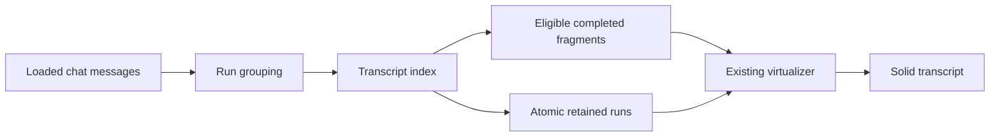

Codex review: needs maintainer review before merge.

## What this changes

This PR splits eligible large completed chat runs into virtualized fragments while preserving attribution, navigation, and final-answer actions.

**Example:** Open a completed, widget-free run containing 2,000 messages.
- **Before:** The entire run mounts inside one virtual row.
- **After:** The existing virtualizer mounts a bounded fragment window as the reader scrolls.

## Review scores

| Measure | Result | What it means |
|---|---|---|
| **Overall readiness** | 🦐 gold shrimp **(3/6)** | Useful implementation with inspected browser evidence and focused regressions; unresolved exact-head CI failures limit validation confidence. |
| **Proof confidence** | 🐚 platinum hermit **(4/6)** ✨ media proof bonus | Sufficient (screenshot): The changed transcript renderer is exercised through the production browser UI with synthetic Gateway data: inspected integrated before/after captures retain final content and actions, and the body records completed-run opening, paging, disclosure, search, switching, and streaming results. Historical performance measurements are explicitly separated from integrated correctness results. |
| **Patch quality** | 🦐 gold shrimp **(3/6)** | No actionable review findings were identified. |

## Product

**Kind:** Performance · **Worth it:** Yes · **Fix scope:** Complete
**User problem:** Opening a large completed tool-using run can freeze the transcript while thousands of rich elements mount.
**Reason:** The maintainer-authored direction accepts the documented rendering tradeoffs for a substantial large-run DOM and opening-cost reduction.

## Merge readiness

✅ **Ready for maintainer review**

Keep open: this maintainer-authored PR addresses a demonstrated rendering bottleneck that current main retains; no definite introduced defect was established.

**Priority:** P2
**Reviewed head:** `183c902ef0587f80e048c35746f8b0bbb08990eb`

## Before merge

None.

## Findings

None.

<strong>Agent review details</strong>

### How this fits together

The Control UI projects loaded chat messages into run frames, indexes their navigation targets, and passes rows to the existing virtualizer and Solid renderer.

### Technical review

Best possible solution:

Keep bounded completed-run rendering within the existing transcript owners while preserving atomic widget lifetimes and terminal-answer identity.

Do we have a high-confidence way to reproduce the issue?

Current-main source shows an entire completed run assigned to one virtual row; the supplied production-renderer comparison demonstrates the resulting large retained DOM without this review executing target code.

Is this the best way to solve the issue?

Fragmenting eligible runs at the existing transcript index is a coherent fix, and the added geometry, navigation, and teardown changes support that same boundary without introducing a parallel renderer.

AGENTS.md: found and applied where relevant.

Codex review notes: model internal, reasoning medium; reviewed against [c0140ebfa468](https://github.com/openclaw/openclaw/commit/c0140ebfa4689cba7bc3652e961431584890e8a7).

### Provenance checked

- `Run-frame composition` changes intended behavior with a stated reason (2a87667bb256536e31120cbae485aa780df5bf9b: Keep one semantic response per run, preserve boundaries, and reserve actions for the terminal answer.)
- `End reconciliation scheduling` changes intended behavior with a stated reason (1d0d6db702187d833f1c3e0cde8ac859cb33a1e4: Reconcile measured content after commit while retaining a frame fallback and reader-follow policy.)
- `Transcript overscan` changes intended behavior with a stated reason (169c8fe75f2d75a03a80eaf6bf215967e256525f: Reduce offscreen rendering while preserving native scrolling, cancellation, and disclosure behavior.)
- `Retained Solid frame and widget ownership` keeps the original intent (5dd456acfa35575c342b43b944a9d0dbb911b68e: Use retained Solid rendering while plain owners preserve lifecycle and connected widget custody.)
- `Team-scale benchmark` keeps the original intent (5559404e2da9eb32abe8bbfd74f159d605630f57: Provide a reusable synthetic production-renderer workload without connecting to real accounts or Gateways.)

### Testing

Proof path: shipped entry point.

### Security

None.

### Evidence

What I checked:

- **Current main retains atomic run rows:** Current main adds each agent-run frame as one transcript row, and its frame renderer mounts expanded work groups within that row. ([`ui/src/pages/chat/components/chat-transcript-message-index.ts:274`](https://github.com/openclaw/openclaw/blob/c0140ebfa4689cba7bc3652e961431584890e8a7/ui/src/pages/chat/components/chat-transcript-message-index.ts#L274), [c0140ebfa468](https://github.com/openclaw/openclaw/commit/c0140ebfa4689cba7bc3652e961431584890e8a7))
- **Scoped fragment implementation:** The pinned introduced diff uses the existing transcript index and virtualizer, retains the canonical final row key, and excludes active, answerless, late-output, and Canvas-bearing runs. ([`ui/src/pages/chat/components/chat-transcript-message-index.ts:382`](https://github.com/openclaw/openclaw/blob/183c902ef0587f80e048c35746f8b0bbb08990eb/ui/src/pages/chat/components/chat-transcript-message-index.ts#L382), [183c902ef058](https://github.com/openclaw/openclaw/commit/183c902ef0587f80e048c35746f8b0bbb08990eb))
- **Supplied behavior evidence and accepted tradeoffs:** The full PR body, captured with sourceBodySha256 1ad604a893c73ae838613258de916932637679082fc07660c1eacc3b00346a12, distinguishes historical timing from integrated correctness evidence. The maintainer-authored direction explicitly records increased scroll-time work and missed long-task goals. Both attached synthetic before/after images were inspected and retain final content, actions, and composer. ([183c902ef058](https://github.com/openclaw/openclaw/commit/183c902ef0587f80e048c35746f8b0bbb08990eb))
- **Proof build matches production changes:** The production chat and stylesheet diff between the recorded integrated build and reviewed head is empty. ([183c902ef058](https://github.com/openclaw/openclaw/commit/183c902ef0587f80e048c35746f8b0bbb08990eb))
- **Exact-head CI remains unresolved:** The selected core test-types stripe, UI unit shard, sidebar E2E shard, and real-Gateway E2E shard failed in https://github.com/openclaw/openclaw/actions/runs/40226734072. An annotation records the unchanged typing-growth test expecting scrollTop 904 and receiving 804. Other annotations identify sidebar color and diff-folding pointer-interception failures; their attribution is unestablished. Main runs inspected skipped the corresponding UI jobs, so their green conclusions supply no matching baseline proof. Job-log redirects were blocked by the environment. ([`ui/src/pages/chat/components/chat-transcript-follow-continuity.test.tsx:117`](https://github.com/openclaw/openclaw/blob/183c902ef0587f80e048c35746f8b0bbb08990eb/ui/src/pages/chat/components/chat-transcript-follow-continuity.test.tsx#L117), [183c902ef058](https://github.com/openclaw/openclaw/commit/183c902ef0587f80e048c35746f8b0bbb08990eb))
- **Original run-frame contract:** https://github.com/openclaw/openclaw/pull/126278 established one semantic response per run and terminal-only actions; this PR retains those responsibilities while changing physical row placement. ([`ui/src/pages/chat/chat-agent-run-grouping.ts:25`](https://github.com/openclaw/openclaw/blob/2a87667bb256536e31120cbae485aa780df5bf9b/ui/src/pages/chat/chat-agent-run-grouping.ts#L25), [2a87667bb256](https://github.com/openclaw/openclaw/commit/2a87667bb256536e31120cbae485aa780df5bf9b))

Likely related people:

- **Peter Steinberger:** Raw commit 1d0d6db702187d833f1c3e0cde8ac859cb33a1e4 adds ui/src/pages/chat/components/chat-transcript-end-anchor.ts:44 relative to its recorded parents. This identifies author metadata, not feature responsibility or a PR merger. (role: source-line author; confidence: high; commits: [1d0d6db70218](https://github.com/openclaw/openclaw/commit/1d0d6db702187d833f1c3e0cde8ac859cb33a1e4); files: `ui/src/pages/chat/components/chat-transcript-end-anchor.ts`)
- **Vyctor H. Brzezowski:** Raw commit 2a87667bb256536e31120cbae485aa780df5bf9b adds ui/src/pages/chat/chat-agent-run-grouping.ts:16 relative to its recorded parents. This identifies author metadata, not feature responsibility or a PR merger. (role: source-line author; confidence: high; commits: [2a87667bb256](https://github.com/openclaw/openclaw/commit/2a87667bb256536e31120cbae485aa780df5bf9b); files: `ui/src/pages/chat/chat-agent-run-grouping.ts`)

### PR surface

Source +286, Tests +1025, Docs +76, Other +882. Total +2269 across 34 files. Added test files: 1.

View PR surface stats

| Area | Files | Added | Removed | Net |
|---|---:|---:|---:|---:|
| Source | 17 | 393 | 107 | +286 |
| Tests | 14 | 1146 | 121 | +1025 |
| Docs | 1 | 76 | 0 | +76 |
| Config | 0 | 0 | 0 | 0 |
| Generated | 0 | 0 | 0 | 0 |
| Other | 2 | 891 | 9 | +882 |
| **Total** | **34** | **2506** | **237** | **+2269** |

### Review metrics

| Metric | Value | Why it matters |
|---|---|---|
| **Benchmark options** | 2 new flags | --long-session and --long-session-scenario extend the benchmark; they add no persisted user setting. |

### Labels

Label changes:

- add `P2`: The improvement addresses substantial opening and memory costs for a limited class of large completed conversations.
- add `proof: sufficient`: Contributor real behavior proof is sufficient.
- add `proof: 📸 screenshot`: Contributor real behavior proof includes screenshot evidence.
- add `rating: 🦐 gold shrimp`: Overall readiness is 🦐 gold shrimp; proof is 🐚 platinum hermit and patch quality is 🦐 gold shrimp.
- add `status: 👀 ready for maintainer look`: ClawSweeper has no concrete contributor-facing blocker left for this PR.

Label justifications:

- `P2`: The improvement addresses substantial opening and memory costs for a limited class of large completed conversations.
- `rating: 🦐 gold shrimp`: Overall readiness is 🦐 gold shrimp; proof is 🐚 platinum hermit and patch quality is 🦐 gold shrimp.
- `status: 👀 ready for maintainer look`: ClawSweeper has no concrete contributor-facing blocker left for this PR.
- `proof: sufficient`: Contributor real behavior proof is sufficient.
- `proof: 📸 screenshot`: Contributor real behavior proof includes screenshot evidence.

### Rating scale

6/6 🦀 challenger crab · 5/6 🦞 diamond lobster · 4/6 🐚 platinum hermit · 3/6 🦐 gold shrimp · 2/6 🦪 silver shellfish · 1/6 🧂 unranked krab. Overall follows the weaker of proof and patch quality; ✨ marks media proof (a screenshot, video, or linked artifact) that directly shows the changed behavior.

### Workflow

ClawSweeper edits this one comment on every review. Comment `@clawsweeper re-review` for a fresh review only. Repair and merge execution lanes are retired.

_Reviewed October 25, 2026, 3:52 PM ET / 19:52 UTC._

<!-- clawsweeper-verdict:needs-human item=183800 sha=183c902ef0587f80e048c35746f8b0bbb08990eb confidence=high updated_at=2026-10-25T19:46:41Z reviewed_at=2026-10-25T19:52:15.967Z lease_owner=github-run-40227536693-1 lease_comment_id=6402323289 source_revision=ca82c0795140c88d0abd4deb4e49475265733f59b353d7ca68089d29b39d784f hold=not_opted_in findings=0 -->
<!-- clawsweeper-review-state:ready item=183800 sha=183c902ef0587f80e048c35746f8b0bbb08990eb v=1 -->

<!-- clawsweeper-review-version item=183800 reviewed_at=2026-10-25T19:52:15.967Z sha=183c902ef0587f80e048c35746f8b0bbb08990eb source_revision=ca82c0795140c88d0abd4deb4e49475265733f59b353d7ca68089d29b39d784f lease_owner=github-run-40227536693-1 lease_comment_id=6402323289 v=1 -->

<!-- clawsweeper-review item=183800 -->