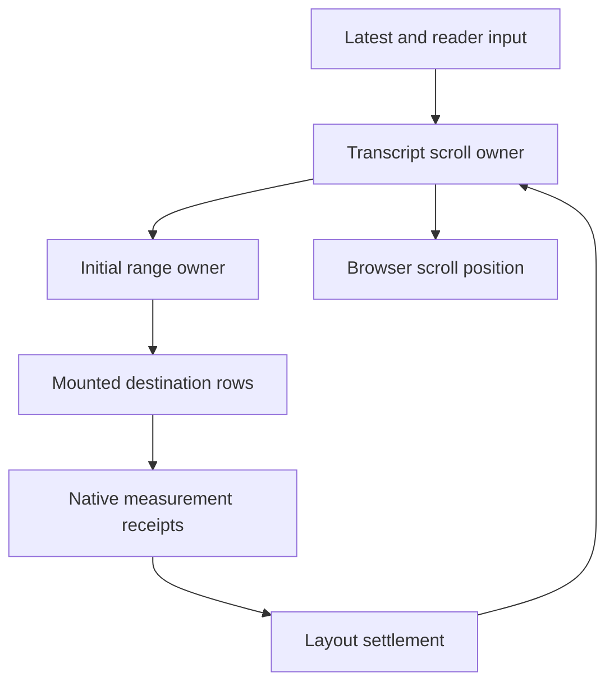

Codex review: needs changes before merge.

## What this changes

This PR retains Latest destination rows until their measurements and native scrolling settle.

**Example:** Press PageUp during a 200-tool turn, activate Latest, and receive eight growing answer chunks.
- **Before:** Scrolling can stop above the final answer after its destination leaves the mounted range.
- **After:** The destination stays mounted until it is measured and rests within 8 pixels of the end for three idle frames.

## Review scores

| Measure | Result | What it means |
|---|---|---|
| **Overall readiness** | 🦪 silver shellfish **(2/6)** | Useful and visibly demonstrated, but the reviewed head reintroduces two established scroll-behavior failures. |
| **Proof confidence** | 🦞 diamond lobster **(5/6)** ✨ media proof bonus | Sufficient (screenshot): Inspected before/after browser screenshots show the transcript stopping above later growth chunks on main and displaying checkpoint 8 after repair; the body records the 200-tool PageUp-to-Latest scenario in Chromium and Firefox. |
| **Patch quality** | 🦪 silver shellfish **(2/6)** | 2 actionable review findings remain. |

## Product

**Kind:** Bug fix · **Worth it:** Yes · **Fix scope:** Complete
**User problem:** Latest can stop above the final answer after navigating upward during a large tool turn.
**Reason:** The supplied browser evidence establishes a useful correction, and maintainer authorship supplies direction for the bounded settlement change.

## Merge readiness

⛔ **Needs changes before merge - 3 items remain**

This PR addresses a real Latest failure, but introduced reader-position and automatic-follow regressions need repair before merge.

**Priority:** P2
**Reviewed head:** `a1892971526c024269b138b795f4305e54e37c95`

## Before merge

- [ ] **Wait for destination measurements before retargeting automatic follow (P2)** - When appended history changes the native extent while an end command remains active, this branch calls scrollToEnd immediately and bypasses prepareEnd's rowsMeasured check. Newly appended 120-pixel estimates are followed before their actual 97/71-pixel sizes arrive, restoring the backtracking that https://github.com/openclaw/openclaw/pull/193217 removed. The exact-head warm-reload annotations show offset 6353 reversing to 6281 or 6318 and 70–144 pixels of excess movement. Retarget the existing command through the native measurement stage while preserving its identity.
- [ ] **Preserve reader departure while an arrived command awaits idle (P2)** - The new completion condition leaves an already-arrived command active until native idle plus three frames, including smooth commands that no longer yield to unclassified backward movement. A reader departure followed by a temporary 400-to-500-pixel viewport clamp can consequently be treated as completion of Latest; cancelScroll(true) then restores end following and pulls the reader down when the viewport returns. The existing resize regressions fail on this exact head with offset 960 instead of 860, and native-departure cases retain maintenance ownership. Preserve destination measurement without allowing the delayed completion to reclaim that departed reader.
- [ ] **Explain or restore the original intent of Automatic follow during replacement measurements** - 4c6f043aba48d2cc73968ed16186a506a492ea2c: Automatic follow waits until mounted destination rows and native measurements agree to prevent visible backward corrections.

## Findings

- [P2] Wait for destination measurements before retargeting automatic follow — `ui/src/pages/chat/components/chat-transcript-offset-observer.ts:103-108`
- [P2] Preserve reader departure while an arrived command awaits idle — `ui/src/pages/chat/components/chat-transcript-end-anchor.ts:29-35`

### Provenance

- `Automatic follow during replacement measurements` changes intended behavior without addressing why it exists (4c6f043aba48d2cc73968ed16186a506a492ea2c: Automatic follow waits until mounted destination rows and native measurements agree to prevent visible backward corrections.)

### Tests

- Missing end-to-end proof: The supplied Latest screenshots cover the intended fix, while existing exact-head browser and warm-reload checks expose sibling regressions.

<strong>Agent review details</strong>

### How this fits together

The Control UI transcript converts Latest requests, native input, and row measurements into virtual ranges and browser scroll positions.

### Technical review

Best possible solution:

Keep destination retention in the existing range owner while preserving measured automatic retargeting and reader takeover after genuine arrival.

Do we have a high-confidence way to reproduce the issue?

Current-main source releases the destination before smooth scrolling starts, supported by the supplied before screenshot and reported failing destination-retention regression; this review ran no target code.

Is this the best way to solve the issue?

Retaining the destination through the existing owner is appropriate, but completion and growth retargeting must preserve the earlier measured-follow and reader-position contracts.

Full review comments:

- [P2] Wait for destination measurements before retargeting automatic follow — `ui/src/pages/chat/components/chat-transcript-offset-observer.ts:103-108`
  When appended history changes the native extent while an end command remains active, this branch calls scrollToEnd immediately and bypasses prepareEnd's rowsMeasured check. Newly appended 120-pixel estimates are followed before their actual 97/71-pixel sizes arrive, restoring the backtracking that https://github.com/openclaw/openclaw/pull/193217 removed. The exact-head warm-reload annotations show offset 6353 reversing to 6281 or 6318 and 70–144 pixels of excess movement. Retarget the existing command through the native measurement stage while preserving its identity.
  Confidence: 0.97
- [P2] Preserve reader departure while an arrived command awaits idle — `ui/src/pages/chat/components/chat-transcript-end-anchor.ts:29-35`
  The new completion condition leaves an already-arrived command active until native idle plus three frames, including smooth commands that no longer yield to unclassified backward movement. A reader departure followed by a temporary 400-to-500-pixel viewport clamp can consequently be treated as completion of Latest; cancelScroll(true) then restores end following and pulls the reader down when the viewport returns. The existing resize regressions fail on this exact head with offset 960 instead of 860, and native-departure cases retain maintenance ownership. Preserve destination measurement without allowing the delayed completion to reclaim that departed reader.
  Confidence: 0.96

Overall correctness: patch is incorrect
Overall confidence: 0.96

AGENTS.md: found and applied where relevant.

Codex review notes: model internal, reasoning medium; reviewed against [ce7788f5a24e](https://github.com/openclaw/openclaw/commit/ce7788f5a24e5e2d0ef146a5dcea3ef4d0bb0983).

### Provenance checked

- `Destination range retention` changes intended behavior with a stated reason (34e607682be52d3a35419daf8ba923ac10c49a1e: Bounded transcript preparation measures destination rows before smooth navigation without mounting the full history.)
- `Arrival retirement and temporary native clamps` changes intended behavior with a stated reason (a1b45a465550858c084425333a3b265dd23ad29c: Completion requires agreement between the issued target and native end while retaining earlier protection against delayed idle reclaiming a reader.)
- `Skipped measurements during smooth retargeting` changes intended behavior with a stated reason (ac5891921c3480e761681f3be830088c94038578: Replay sizes suppressed during smooth scrolling when automatic following switches to a non-smooth command.)
- `Chat asset ceiling` changes intended behavior with a stated reason (07a098faddb09c2a937bff3d1f0370381c05fd35: Record the measured warm-page implementation cost under an accepted bounded allowance.)

### Testing

Proof path: shipped entry point.

### Security

None.

### Evidence

Acceptance criteria:

- pnpm test ui/src/pages/chat/components/chat-transcript-initial-range.test.ts ui/src/pages/chat/components/chat-transcript-offset-observer.test.ts ui/src/pages/chat/components/chat-transcript-scroll-ownership.test.tsx ui/src/pages/chat/components/chat-transcript-controller.test.tsx --maxWorkers=1
- pnpm test ui/src/pages/chat/components/chat-transcript-end-follow.browser.test.ts --maxWorkers=1
- pnpm test ui/src/e2e/chat-snapshot-text-fidelity.e2e.test.ts --maxWorkers=1
- pnpm tsgo:ui
- Verify the shipped browser PageUp → Latest flow through all eight answer-growth checkpoints.

What I checked:

- **Pinned introduction and current-main behavior:** The introduced diff retains the destination beyond prepareEnd and replaces immediate completion with measured settlement; fetched main retains the premature finishEnd call, and its four affected runtime modules match the merge-base versions. ([`ui/src/pages/chat/components/chat-transcript-initial-range.ts:284`](https://github.com/openclaw/openclaw/blob/a1892971526c024269b138b795f4305e54e37c95/ui/src/pages/chat/components/chat-transcript-initial-range.ts#L284), [a1892971526c](https://github.com/openclaw/openclaw/commit/a1892971526c024269b138b795f4305e54e37c95))
- **Exact-head reader-position failures:** CI annotations for the reviewed head report four resize-clamp assertions receiving offset 960 instead of 860 and two native-departure assertions receiving maintenance ownership when false was expected: https://github.com/openclaw/openclaw/actions/runs/42675277431/job/129355733351. ([`ui/src/pages/chat/components/chat-transcript-end-follow.browser.test.ts:657`](https://github.com/openclaw/openclaw/blob/a1892971526c024269b138b795f4305e54e37c95/ui/src/pages/chat/components/chat-transcript-end-follow.browser.test.ts#L657), [a1892971526c](https://github.com/openclaw/openclaw/commit/a1892971526c024269b138b795f4305e54e37c95))
- **Exact-head automatic-follow backtracking:** The warm-reload trace follows provisional appended rows to offset 6353 and then reverses to 6281 or 6318 as measurements land, reporting 144 or 70 pixels of excess movement: https://github.com/openclaw/openclaw/actions/runs/42675277431/job/129355733521. ([`ui/src/e2e/chat-snapshot-text-fidelity.e2e.test.ts:165`](https://github.com/openclaw/openclaw/blob/a1892971526c024269b138b795f4305e54e37c95/ui/src/e2e/chat-snapshot-text-fidelity.e2e.test.ts#L165), [a1892971526c](https://github.com/openclaw/openclaw/commit/a1892971526c024269b138b795f4305e54e37c95))
- **Inspected browser proof:** Both downloaded screenshots were inspected: the before image stops around growth checkpoint 4, while the after image shows checkpoint 8 above the composer; the PR describes Chromium and Firefox exercising PageUp, Latest, answer growth, and navigation with synthetic data. ([a1892971526c](https://github.com/openclaw/openclaw/commit/a1892971526c024269b138b795f4305e54e37c95))
- **Prior contracts explain the regressions:** https://github.com/openclaw/openclaw/pull/193217 deliberately waits for native destination measurements to prevent backtracking; https://github.com/openclaw/openclaw/pull/162411 retires arrived commands before delayed idle can reclaim a resize-clamped reader. ([`ui/src/pages/chat/components/chat-transcript-offset-observer.ts:103`](https://github.com/openclaw/openclaw/blob/ce7788f5a24e5e2d0ef146a5dcea3ef4d0bb0983/ui/src/pages/chat/components/chat-transcript-offset-observer.ts#L103), [ce7788f5a24e](https://github.com/openclaw/openclaw/commit/ce7788f5a24e5e2d0ef146a5dcea3ef4d0bb0983))
- **Accepted scope and budget adjustment:** The maintainer-authored direction retains the existing range/layout lifecycle and records a measured 213-byte Chat increase with the corresponding cap adjustment; no additional product approval is needed for that recorded choice. ([`scripts/check-control-ui-performance.mts:63`](https://github.com/openclaw/openclaw/blob/a1892971526c024269b138b795f4305e54e37c95/scripts/check-control-ui-performance.mts#L63), [a1892971526c](https://github.com/openclaw/openclaw/commit/a1892971526c024269b138b795f4305e54e37c95))

Likely related people:

- **Peter Steinberger:** Raw commit 2a3aee2181a8ed2761e104d4c45165bc32439d77 adds ui/src/pages/chat/components/chat-transcript-offset-observer.ts:83 relative to its recorded parents. This identifies author metadata, not feature responsibility or a PR merger. (role: source-line author; confidence: high; commits: [2a3aee2181a8](https://github.com/openclaw/openclaw/commit/2a3aee2181a8ed2761e104d4c45165bc32439d77); files: `ui/src/pages/chat/components/chat-transcript-offset-observer.ts`)
- **RoboClaw:** Raw commit 796adfffb32b6a8684de2207293434835e59fa37 adds ui/src/pages/chat/components/chat-transcript-end-anchor.ts:22 relative to its recorded parents. This identifies author metadata, not feature responsibility or a PR merger. (role: source-line author; confidence: medium; commits: [796adfffb32b](https://github.com/openclaw/openclaw/commit/796adfffb32b6a8684de2207293434835e59fa37); files: `ui/src/pages/chat/components/chat-transcript-end-anchor.ts`)

### PR surface

Source +34, Tests +100, Other 0. Total +134 across 10 files. Added test files: 0.

View PR surface stats

| Area | Files | Added | Removed | Net |
|---|---:|---:|---:|---:|
| Source | 4 | 91 | 57 | +34 |
| Tests | 3 | 179 | 79 | +100 |
| Docs | 0 | 0 | 0 | 0 |
| Config | 0 | 0 | 0 | 0 |
| Generated | 0 | 0 | 0 | 0 |
| Other | 3 | 7 | 7 | 0 |
| **Total** | **10** | **277** | **143** | **+134** |

### Preflight source

Source unknown. Source comparison at the observed PR snapshot only. Completion is self-reported; body, policy, tests, execution, and report bytes are not verified.

### Review metrics

| Metric | Value | Why it matters |
|---|---|---|
| **Production versus regression coverage** | Production +94/-60 lines; tests +179/-79 lines. | The net production growth retains destination ownership and samples settlement through the existing layout queue; added coverage targets retention, cancellation, parking, and growth. |

### Labels

Label changes:

- add `P2`: Latest and reader-position correctness affect long-chat navigation without evidence of message loss or an unusable core workflow.
- add `proof: sufficient`: Contributor real behavior proof is sufficient.
- add `proof: 📸 screenshot`: Contributor real behavior proof includes screenshot evidence.
- add `rating: 🦪 silver shellfish`: Overall readiness is 🦪 silver shellfish; proof is 🦞 diamond lobster and patch quality is 🦪 silver shellfish.
- add `status: ⏳ waiting on author`: ClawSweeper has contributor-facing work open and is waiting for author action.

Label justifications:

- `P2`: Latest and reader-position correctness affect long-chat navigation without evidence of message loss or an unusable core workflow.
- `rating: 🦪 silver shellfish`: Overall readiness is 🦪 silver shellfish; proof is 🦞 diamond lobster and patch quality is 🦪 silver shellfish.
- `status: ⏳ waiting on author`: ClawSweeper has contributor-facing work open and is waiting for author action.
- `proof: sufficient`: Contributor real behavior proof is sufficient.
- `proof: 📸 screenshot`: Contributor real behavior proof includes screenshot evidence.

### Rating scale

6/6 🦀 challenger crab · 5/6 🦞 diamond lobster · 4/6 🐚 platinum hermit · 3/6 🦐 gold shrimp · 2/6 🦪 silver shellfish · 1/6 🧂 unranked krab. Overall follows the weaker of proof and patch quality; ✨ marks media proof (a screenshot, video, or linked artifact) that directly shows the changed behavior.

### Workflow

ClawSweeper edits this one comment on every review. Comment `@clawsweeper re-review` for a fresh review only. Repair and merge execution lanes are retired.

_Reviewed November 9, 2026, 1:53 PM ET / 18:53 UTC._

<!-- clawsweeper-verdict:needs-changes item=196181 sha=a1892971526c024269b138b795f4305e54e37c95 confidence=high updated_at=2026-11-09T18:48:46Z reviewed_at=2026-11-09T18:53:18.036Z lease_owner=github-run-42677149702-1 lease_comment_id=6748461646 source_revision=a6b94fcc757bd9b59c1f53596602dc02ed4bddc15c4c39b675d82b7f1839f066 -->
<!-- clawsweeper-review-state:needs-changes item=196181 sha=a1892971526c024269b138b795f4305e54e37c95 v=1 -->

<!-- clawsweeper-review-version item=196181 reviewed_at=2026-11-09T18:53:18.036Z sha=a1892971526c024269b138b795f4305e54e37c95 source_revision=a6b94fcc757bd9b59c1f53596602dc02ed4bddc15c4c39b675d82b7f1839f066 lease_owner=github-run-42677149702-1 lease_comment_id=6748461646 v=1 -->

<!-- clawsweeper-review item=196181 -->