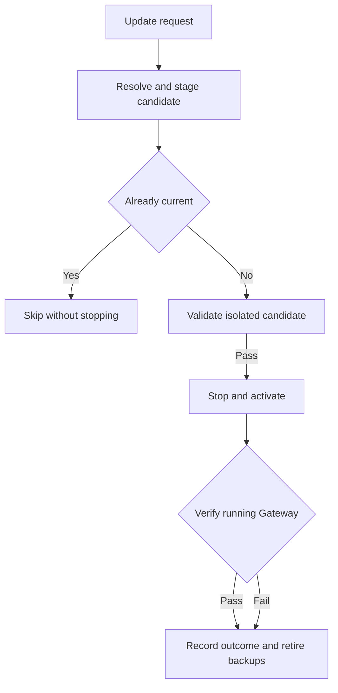

Codex review: blocked before merge. _Reviewed September 6, 2026, 2:16 AM ET / 06:16 UTC._

# ClawSweeper review

## What this changes

The updater stages and validates candidates while the Gateway serves, skips unchanged packages, and verifies activation or compatible rollback before retiring recovery backups.

## Merge readiness

⛔ **Blocked before merge - 1 item remains**

This remains useful work: current main still separates service shutdown from candidate validation. The earlier backup findings are addressed in the pinned source, and no new actionable defect was established. The maintainer-authored support decision does not need another approval request.

**Priority:** P1
**Reviewed head:** `7cfd4a24f757b2be6c3a62471bcd610c92c8cd2a`

## Review scores

| Measure | Result | What it means |
|---|---|---|
| **Overall readiness** | 🐚 platinum hermit **(4/6)** | Useful lifecycle repair with substantive behavior evidence and addressed prior findings; the supplied platform and historical-proof limits remain explicit. |
| **Proof confidence** | 🐚 platinum hermit **(4/6)** | Sufficient (live_output): Recorded real-manager staging/restoration and AWS/systemd update observations exercise the changed transaction boundary, including unchanged serving PIDs before activation and verified rollback. These retain their historical source identities and do not claim native Windows or live-provider qualification. |
| **Patch quality** | 🐚 platinum hermit **(4/6)** | No actionable review findings were identified. |

## Verification

| Check | Result | Evidence |
|---|---|---|
| **Real behavior** | Verified | Sufficient (live_output): Recorded real-manager staging/restoration and AWS/systemd update observations exercise the changed transaction boundary, including unchanged serving PIDs before activation and verified rollback. These retain their historical source identities and do not claim native Windows or live-provider qualification. |
| **Evidence reviewed** | 9 items | Current main still needs the transaction change: Current main computes the package-version match separately and performs post-stop schema preflight before package activation. The supplied merged history/reporting PRs provide foundations, not this staged activation implementation. No merged replacement for the central change is established; the supplied latest release is v2026.9.2. No-op and validation precede activation: The package owner verifies the staged artifact, returns already-current before the swap, and rejects failed candidate validation before invoking the activation callback. Earlier backup findings addressed: Recovery inventory is captured and compared at installTarget.packageRoot. Completion retains the backup unless activation or restoration is verified; focused filesystem tests cover partial cleanup and successful retirement. |
| **Findings** | None | None. |
| **Security** | None | None. |

## How this fits together

OpenClaw’s updater coordinates package managers, configuration migrations, and the managed Gateway service. CLI and control-plane update requests produce a verified running installation and a durable outcome report.

## Before merge

- [ ] **Review config compatibility** - Confirm compatibility and upgrade impact for the changed config or default surface before merge.

<strong>Agent review details</strong>

### Security

None.

### PR surface

PR surface statistics unavailable: the file list is incomplete.

### Review metrics

| Metric | Value | Why it matters |
|---|---|---|
| **Production versus test growth** | Production/tooling net +3,758; tests/support net +5,519 | Production growth supplies staged activation, isolated rehearsal and retained recovery ownership; tests cover the corresponding failure boundaries. |

### Stored data model

Persistent data-model change detected: `migration/backfill/repair: src/cli/update-cli/update-command-convergence.ts`, `migration/backfill/repair: src/cli/update-cli/update-command-fresh-doctor.ts`, `migration/backfill/repair: src/cli/update-cli/update-command-resume.ts`, `serialized state: src/infra/update-runner-git-commands.ts`, `serialized state: src/infra/update-runtime-relocation.ts`, `unknown-data-model-change: src/cli/update-cli/update-command-fresh-doctor.ts`, and 3 more. Migration or upgrade compatibility proof is recorded; maintainers should verify it before merge.

### Root-cause cluster

Relationship: `fixed_by_candidate`
Canonical: https://github.com/openclaw/openclaw/issues/136997
Summary: This PR is the candidate fix for no-op shutdown and also addresses the broader update-outage campaign.

Members:
- `canonical`: https://github.com/openclaw/openclaw/issues/136997 - The explicit linked report defines the no-op shutdown defect.
- `partial_overlap`: https://github.com/openclaw/openclaw/issues/137580 - Online preparation reduces its reported offline finalization window.
- `partial_overlap`: https://github.com/openclaw/openclaw/issues/124396 - The umbrella request includes broader checkpoint and whole-product recovery guarantees.
- `adjacent_distinct`: https://github.com/openclaw/openclaw/pull/139495 - The open dependent PR adds bounded repair integration rather than replacing this transaction owner.

Proposal only: this assessment does not dispatch repair, suppress jobs, mutate sibling items, close, or merge anything.

### Technical review

Best possible solution:

Keep one transaction owner for candidate validation, exclusive live migration, verified service recovery and backup retirement, preserving the documented legacy-target and Bun-on-Windows boundaries.

Do we have a high-confidence way to reproduce the issue?

Yes, from source: main’s package update reaches the stop boundary before candidate activation, while the linked reports supply concrete no-op and prolonged-outage scenarios. No runtime reproduction was executed in this review.

Is this the best way to solve the issue?

Yes. Moving preparation ahead of shutdown and retaining rollback ownership addresses the lifecycle defect directly; inspected guards preserve migration safety and previous-generation verification.

AGENTS.md: found and applied where relevant.

Codex review notes: model internal, reasoning medium; reviewed against [e19a7694cef6](https://github.com/openclaw/openclaw/commit/e19a7694cef6d38140033f798215103dd638fafb).

### Labels

Label justifications:

- `P1`: The linked reports describe unnecessary or prolonged loss of the managed Gateway and its channels during supported updates.
- `rating: 🐚 platinum hermit`: Overall readiness is 🐚 platinum hermit; proof is 🐚 platinum hermit and patch quality is 🐚 platinum hermit.
- `status: 👀 ready for maintainer look`: ClawSweeper has no concrete contributor-facing blocker left for this PR. Sufficient (live_output): Recorded real-manager staging/restoration and AWS/systemd update observations exercise the changed transaction boundary, including unchanged serving PIDs before activation and verified rollback. These retain their historical source identities and do not claim native Windows or live-provider qualification.
- `proof: sufficient`: Contributor real behavior proof is sufficient. Recorded real-manager staging/restoration and AWS/systemd update observations exercise the changed transaction boundary, including unchanged serving PIDs before activation and verified rollback. These retain their historical source identities and do not claim native Windows or live-provider qualification.
- `proof: telegram-e2e`: This PR needs Telegram Test Server proof with the repository E2E skill. The shared update acknowledgment and final report wording are visible in Telegram-originated update conversations.

### Evidence

What I checked:

- **Current main still needs the transaction change:** Current main computes the package-version match separately and performs post-stop schema preflight before package activation. The supplied merged history/reporting PRs provide foundations, not this staged activation implementation. No merged replacement for the central change is established; the supplied latest release is v2026.9.2. ([`src/cli/update-cli/update-command-execution.ts:255`](https://github.com/openclaw/openclaw/blob/e19a7694cef6d38140033f798215103dd638fafb/src/cli/update-cli/update-command-execution.ts#L255), [e19a7694cef6](https://github.com/openclaw/openclaw/commit/e19a7694cef6d38140033f798215103dd638fafb))
- **No-op and validation precede activation:** The package owner verifies the staged artifact, returns already-current before the swap, and rejects failed candidate validation before invoking the activation callback. ([`src/infra/package-update-steps.ts:1071`](https://github.com/openclaw/openclaw/blob/7cfd4a24f757b2be6c3a62471bcd610c92c8cd2a/src/infra/package-update-steps.ts#L1071), [7cfd4a24f757](https://github.com/openclaw/openclaw/commit/7cfd4a24f757b2be6c3a62471bcd610c92c8cd2a))
- **Earlier backup findings addressed:** Recovery inventory is captured and compared at installTarget.packageRoot. Completion retains the backup unless activation or restoration is verified; focused filesystem tests cover partial cleanup and successful retirement. ([`src/infra/package-update-swap.ts:444`](https://github.com/openclaw/openclaw/blob/7cfd4a24f757b2be6c3a62471bcd610c92c8cd2a/src/infra/package-update-swap.ts#L444), [7cfd4a24f757](https://github.com/openclaw/openclaw/commit/7cfd4a24f757b2be6c3a62471bcd610c92c8cd2a))
- **Candidate isolation and downgrade behavior:** The canary redirects state, configuration, workspace and temporary paths, strips continuation selectors, suppresses autonomous services, and bounds startup/readiness checks. Missing legacy continuation records an advisory; a present invalid contract still fails. ([`src/infra/update-candidate-canary.ts:180`](https://github.com/openclaw/openclaw/blob/7cfd4a24f757b2be6c3a62471bcd610c92c8cd2a/src/infra/update-candidate-canary.ts#L180), [7cfd4a24f757](https://github.com/openclaw/openclaw/commit/7cfd4a24f757b2be6c3a62471bcd610c92c8cd2a))
- **Activation authority and cancellation:** The helper rechecks requester ownership after validation and checks live lease and parent identity around native service inspection. Inspected lifecycle cases assert no mutating service commands after requester revocation or cancellation during activation checks. ([`src/infra/update-managed-service-handoff.ts:1115`](https://github.com/openclaw/openclaw/blob/7cfd4a24f757b2be6c3a62471bcd610c92c8cd2a/src/infra/update-managed-service-handoff.ts#L1115), [7cfd4a24f757](https://github.com/openclaw/openclaw/commit/7cfd4a24f757b2be6c3a62471bcd610c92c8cd2a))
- **Captured behavior proof and its limits:** Captured body SHA-256 b69380d4843c21a6a9c47ec1a7616d6e3f3bf9c094d6587e999fb55eab48af5e records real-manager staging, promotion and restoration, plus historical AWS/systemd observations: unchanged PID for no-op and rejected validation, and a verified previous generation after rollback. Campaign source was 8a4db45aff48f6fc7b44add16e5756505450e26f, not the pinned head. Native Windows and external inference are expressly unqualified. The remaining 5,821 omitted body units could not be retrieved; no absence-of-proof conclusion is drawn from that gap.

Likely related people:

- **steipete:** Suggested for follow-up; no historical authorship or introduction is verified. (role: unverified routing candidate; confidence: low)

### Rating scale

| Score | Internal tier | Crab rank | Meaning |
|---:|:---:|---|---|
| **6/6** | S | 🦀 challenger crab | Exceptional readiness |
| **5/6** | A | 🦞 diamond lobster | Very strong readiness |
| **4/6** | B | 🐚 platinum hermit | Good normal PR; ordinary maintainer review |
| **3/6** | C | 🦐 gold shrimp | Useful, but confidence is limited |
| **2/6** | D | 🦪 silver shellfish | Proof or implementation needs work |
| **1/6** | F | 🧂 unranked krab | Not merge-ready |
| N/A | NA | 🌊 off-meta tidepool | Rating does not apply |

Overall follows the weaker of proof and patch quality.
Shiny media proof means a screenshot, video, or linked artifact directly shows the changed behavior. Runtime, network, CSP, and security claims still need visible diagnostics.

### Workflow

- ClawSweeper keeps one durable marker-backed review comment per issue or PR.
- Re-runs edit this comment so the latest verdict, findings, and automation markers stay together instead of adding duplicate bot comments.
- A fresh review can be triggered by eligible `@clawsweeper re-review` comments, exact-item GitHub events, scheduled/background review runs, or manual workflow dispatch.
- PR/issue authors and users with repository write access can comment `@clawsweeper re-review` or `@clawsweeper re-run` on an open PR or issue to request a fresh review only.
- Maintainers can also comment `@clawsweeper review` to request a fresh review only.
- Fresh-review commands do not start repair, autofix, rebase, CI repair, or automerge.
- Maintainer-only repair and merge flows require explicit commands such as `@clawsweeper autofix`, `@clawsweeper automerge`, `@clawsweeper fix ci`, or `@clawsweeper address review`.
- Maintainers can comment `@clawsweeper explain` to ask for more context, or `@clawsweeper stop` to stop active automation.

### History

Review history (14 earlier review cycles; latest 8 shown)

<!-- clawsweeper-review-history v=1 total=14 -->
- reviewed 2026-09-05T21:03:42.940Z sha 1f7644022e09d1f3f24fb92b955c0917a2bcf741 :: blocked before merge. :: none
- reviewed 2026-09-05T21:17:46.225Z sha c0297906773074d024551865db37752d294c8e79 :: blocked before merge. :: none
- reviewed 2026-09-05T23:52:43.816Z sha 381fdefd17221ee0b4a6e40289e18abb96e154db :: blocked before merge. :: none
- reviewed 2026-09-06T00:58:15.444Z sha ea3c10e3cff23346814d62d539dda60cc6886a81 :: blocked before merge. :: none
- reviewed 2026-09-06T01:05:26.152Z sha ea3c10e3cff23346814d62d539dda60cc6886a81 :: blocked before merge. :: none
- reviewed 2026-09-06T01:31:13.722Z sha 73227014489400afd4bda7ad3b77db2c1abcedc8 :: blocked before merge. :: [P1] Preserve the backup when failed activation never attempts rollback | [P2] Read recovery inventory from the previous package root
- reviewed 2026-09-06T03:33:34.964Z sha bdfe4dffead59d167f6c536b9bec8317e05befba :: blocked before merge. :: [P1] [P1] Preserve backups when incomplete activation skips rollback | [P2] [P2] Capture and compare inventory at the previous package root
- reviewed 2026-09-06T05:47:31.433Z sha 1bf753d986ce67f2d7e5d2f3970eeafd7b0d6cce :: blocked before merge. :: none

<!-- clawsweeper-verdict:needs-human item=138839 sha=7cfd4a24f757b2be6c3a62471bcd610c92c8cd2a confidence=high updated_at=2026-09-06T06:12:52Z reviewed_at=2026-09-06T06:16:14.885Z lease_owner=github-run-34015834357-1 lease_comment_id=5557385037 source_revision=592cbd52eb246b59deeb636e46b7193b77df0389244925e70188e052b1d710b6 live_verification=absent -->
<!-- clawsweeper-review-state:blocked item=138839 sha=7cfd4a24f757b2be6c3a62471bcd610c92c8cd2a v=1 -->

<!-- clawsweeper-review-version item=138839 reviewed_at=2026-09-06T06:16:14.885Z sha=7cfd4a24f757b2be6c3a62471bcd610c92c8cd2a source_revision=592cbd52eb246b59deeb636e46b7193b77df0389244925e70188e052b1d710b6 lease_owner=github-run-34015834357-1 lease_comment_id=5557385037 v=1 -->

<!-- clawsweeper-review item=138839 -->