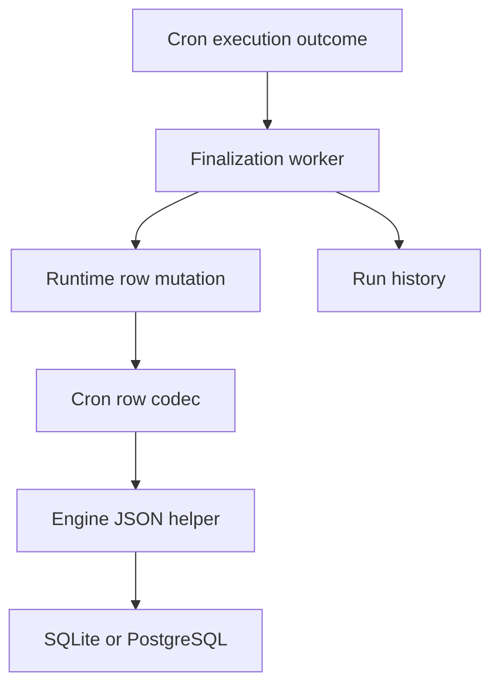

Codex review: needs maintainer review before merge.

## What this changes

This PR uses engine-aware JSON mutation when cron runtime updates enable or disable a job.

**Example:** A PostgreSQL-backed one-shot job named one-shot finishes successfully with deleteAfterRun: false.
- **Before:** Finalization calls SQLite json_set, fails with PostgreSQL error 42883, and leaves the job marked as running.
- **After:** Finalization records the successful result and stores enabled: false while retaining the job's authored configuration.

## Review scores

| Measure | Result | What it means |
|---|---|---|
| **Overall readiness** | 🦐 gold shrimp **(3/6)** | The focused patch is correct on inspection and has meaningful cross-engine regression coverage; the supplied after-fix evidence remains at the in-process boundary. |
| **Proof confidence** | 🦐 gold shrimp **(3/6)** | The maintainer-authored PR is outside the ordinary contributor proof gate; supplied evidence reports a real-Gateway failure and passing owner-level regressions, while final-head live scheduled execution remains pending. |
| **Patch quality** | 🐚 platinum hermit **(4/6)** | No actionable review findings were identified. |

## Product

**Kind:** Bug fix · **Worth it:** Yes · **Fix scope:** Complete
**User problem:** A successfully executed retained one-shot remains marked as running because PostgreSQL rejects its finalization statement.
**Reason:** The maintainer-authored repair restores existing behavior through the established engine abstraction without adding settings or changing product policy.

## Merge readiness

✅ **Ready for maintainer review**

This PR fixes a concrete PostgreSQL failure still present on current main, preserves the existing cron storage contract, and introduces no actionable correctness findings.

**Priority:** P2
**Reviewed head:** `14193c8663ce803eaa5a478624be6c90b8131a6f`

## Before merge

None.

## Findings

None.

### Tests

- Missing end-to-end proof: Final-head scheduled execution through a real PostgreSQL-backed Gateway is described as pending, with no after-fix runtime trace supplied.

<strong>Agent review details</strong>

### How this fits together

Cron execution outcomes enter the existing transactional finalization worker, which updates job runtime state and run history through the shared row codec and database-engine SQL helpers.

### Technical review

Best possible solution:

Retain the focused helper substitution and its cross-engine finalization regression.

Do we have a high-confidence way to reproduce the issue?

Current-main source directly exposes the SQLite-only call during retained one-shot finalization, matching the reported PostgreSQL 42883 failure; this read-only review ran no target code.

Is this the best way to solve the issue?

The patch is the smallest complete repair: reuse the existing dialect owner while preserving the transaction, enablement policy, and authored fields.

AGENTS.md: found and applied where relevant.

Codex review notes: model internal, reasoning medium; reviewed against [6cc605dfe204](https://github.com/openclaw/openclaw/commit/6cc605dfe2044a2d2649dea02458e7982739d493).

### Provenance checked

- `Runtime enablement mutation` keeps the original intent (d89da7595d0d6c51f4e17b5631114023e49f931b: Preserve authored cron definitions during runtime changes and leave legacy normalization to backed-up Doctor repairs.)

### Testing

Proof path: in-process harness.

### Security

None.

### Evidence

What I checked:

- **Verified introduced change:** The pinned introduction replaces the SQLite-only JSON mutation with the existing jsonSetPath helper and supplies its JSON-value flag. ([`src/cron/store/row-codec.ts:660`](https://github.com/openclaw/openclaw/blob/14193c8663ce803eaa5a478624be6c90b8131a6f/src/cron/store/row-codec.ts#L660), [14193c8663ce](https://github.com/openclaw/openclaw/commit/14193c8663ce803eaa5a478624be6c90b8131a6f))
- **Current-main defect remains:** Current main still invokes json_set when previousEnabled differs from the completed job's enablement. ([`src/cron/store/row-codec.ts:659`](https://github.com/openclaw/openclaw/blob/6cc605dfe2044a2d2649dea02458e7982739d493/src/cron/store/row-codec.ts#L659), [6cc605dfe204](https://github.com/openclaw/openclaw/commit/6cc605dfe2044a2d2649dea02458e7982739d493))
- **Existing engine owner:** jsonSetPath preserves SQLite's JSON expression and emits PostgreSQL jsonb_set with JSON-valued replacement and text output. ([`src/infra/database-engine/json-values.ts:199`](https://github.com/openclaw/openclaw/blob/14193c8663ce803eaa5a478624be6c90b8131a6f/src/infra/database-engine/json-values.ts#L199), [14193c8663ce](https://github.com/openclaw/openclaw/commit/14193c8663ce803eaa5a478624be6c90b8131a6f))
- **Transactional regression coverage:** The added test exercises the real finalization owner on both engines, checking terminal history, boolean disablement, retained custom configuration, and subsequent reenabling; PostgreSQL requires the configured conformance connection. ([`src/infra/database-engine/cron-runtime-row.postgres.test.ts:26`](https://github.com/openclaw/openclaw/blob/14193c8663ce803eaa5a478624be6c90b8131a6f/src/infra/database-engine/cron-runtime-row.postgres.test.ts#L26), [14193c8663ce](https://github.com/openclaw/openclaw/commit/14193c8663ce803eaa5a478624be6c90b8131a6f))
- **Preserved historical intent:** https://github.com/openclaw/openclaw/pull/160448 introduced the narrow enablement mutation to preserve authored definitions and keep legacy repairs with Doctor; this PR retains that boundary. ([`src/cron/store/row-codec.ts:641`](https://github.com/openclaw/openclaw/blob/d89da7595d0d6c51f4e17b5631114023e49f931b/src/cron/store/row-codec.ts#L641), [d89da7595d0d](https://github.com/openclaw/openclaw/commit/d89da7595d0d6c51f4e17b5631114023e49f931b))
- **Discussion and validation status:** The complete body and comments contain a reported real-Gateway reproduction and passing database regressions, but describe final-head live execution as pending; PostgreSQL conformance checks were also still running. ([14193c8663ce](https://github.com/openclaw/openclaw/commit/14193c8663ce803eaa5a478624be6c90b8131a6f))

### PR surface

Source +3, Tests +148. Total +151 across 2 files. Added test files: 1.

View PR surface stats

| Area | Files | Added | Removed | Net |
|---|---:|---:|---:|---:|
| Source | 1 | 5 | 2 | +3 |
| Tests | 1 | 148 | 0 | +148 |
| Docs | 0 | 0 | 0 | 0 |
| Config | 0 | 0 | 0 | 0 |
| Generated | 0 | 0 | 0 | 0 |
| Other | 0 | 0 | 0 | 0 |
| **Total** | **2** | **153** | **2** | **+151** |

### Labels

Label changes:

- add `P2`: Retained one-shot jobs on PostgreSQL cannot durably finalize after execution; the failure is concrete and limited to the affected backend and runtime transition.
- add `rating: 🦐 gold shrimp`: Overall readiness is 🦐 gold shrimp; proof is 🦐 gold shrimp and patch quality is 🐚 platinum hermit.
- add `status: 👀 ready for maintainer look`: ClawSweeper has no concrete contributor-facing blocker left for this PR.

Label justifications:

- `P2`: Retained one-shot jobs on PostgreSQL cannot durably finalize after execution; the failure is concrete and limited to the affected backend and runtime transition.
- `rating: 🦐 gold shrimp`: Overall readiness is 🦐 gold shrimp; proof is 🦐 gold shrimp and patch quality is 🐚 platinum hermit.
- `status: 👀 ready for maintainer look`: ClawSweeper has no concrete contributor-facing blocker left for this PR.

### Rating scale

6/6 🦀 challenger crab · 5/6 🦞 diamond lobster · 4/6 🐚 platinum hermit · 3/6 🦐 gold shrimp · 2/6 🦪 silver shellfish · 1/6 🧂 unranked krab. Overall follows the weaker of proof and patch quality; ✨ marks media proof (a screenshot, video, or linked artifact) that directly shows the changed behavior.

### Workflow

ClawSweeper edits this one comment on every review. Comment `@clawsweeper re-review` for a fresh review only. Repair and merge execution lanes are retired.

_Reviewed October 23, 2026, 2:06 PM ET / 18:06 UTC._

<!-- clawsweeper-verdict:needs-human item=181802 sha=14193c8663ce803eaa5a478624be6c90b8131a6f confidence=high updated_at=2026-10-23T18:04:01Z reviewed_at=2026-10-23T18:06:58.527Z lease_owner=github-run-40000069872-1 lease_comment_id=6371462877 source_revision=c9fbeb45d2d98d2485b1f46e8267ac3e3328ee806adf527cb49f0c317abb4ac7 hold=not_opted_in findings=0 -->
<!-- clawsweeper-review-state:ready item=181802 sha=14193c8663ce803eaa5a478624be6c90b8131a6f v=1 -->

<!-- clawsweeper-review-version item=181802 reviewed_at=2026-10-23T18:06:58.527Z sha=14193c8663ce803eaa5a478624be6c90b8131a6f source_revision=c9fbeb45d2d98d2485b1f46e8267ac3e3328ee806adf527cb49f0c317abb4ac7 lease_owner=github-run-40000069872-1 lease_comment_id=6371462877 v=1 -->

<!-- clawsweeper-review item=181802 -->