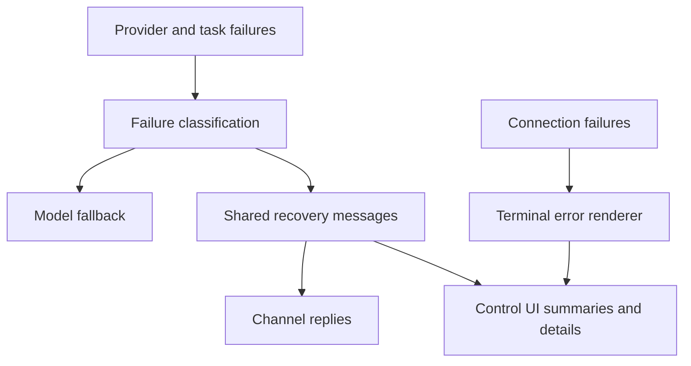

Codex review: blocked before merge. _Reviewed October 2, 2026, 4:59 AM ET / 08:59 UTC (Revision 3)._

# ClawSweeper review

## What this changes

This PR makes chat, terminal, and Control UI errors lead with recovery guidance, keeps diagnostics available separately, and preserves model fallback independently of displayed wording.

## Merge readiness

⛔ **Blocked before merge - 5 items remain**

The PR remains useful and has no identified blocking code defect. Current main still exposes the diagnostic-heavy output, and the member-authored implementation retains meaningful work beyond the separately merged test repair.

**Priority:** P2
**Reviewed head:** `0e5e0977c6f5cad6cad29c6b6375073837e0bd4a`

## Review scores

| Measure | Result | What it means |
|---|---|---|
| **Overall readiness** | 🐚 platinum hermit **(4/6)** | Useful, coherent implementation with convincing visible chat proof and no concrete blocking defect; focused validation documentation and updater verification remain. |
| **Proof confidence** | 🦞 diamond lobster **(5/6)** ✨ media proof bonus | Sufficient (screenshot): Inspected mocked-Gateway browser before/after captures directly demonstrate the changed chat-notice presentation, supported by reported browser checks. No live provider or Telegram run is claimed; maintainer authorship exempts ordinary external-contributor proof. Failed-panel after-image inspection remains a reviewer limitation, and updater verification is separate pending work. Existing WeakMap metadata and the optional Stop-reason value change no stored-data model. |
| **Patch quality** | 🐚 platinum hermit **(4/6)** | No actionable review findings were identified. |

## Verification

| Check | Result | Evidence |
|---|---|---|
| **Real behavior** | Verified | Sufficient (screenshot): Inspected mocked-Gateway browser before/after captures directly demonstrate the changed chat-notice presentation, supported by reported browser checks. No live provider or Telegram run is claimed; maintainer authorship exempts ordinary external-contributor proof. Failed-panel after-image inspection remains a reviewer limitation, and updater verification is separate pending work. Existing WeakMap metadata and the optional Stop-reason value change no stored-data model. |
| **Evidence reviewed** | 11 items | Pinned scope and clean checkout: Reviewed the merge-base-to-head introduced changes. The exact original head records parent 73901888b9a6c96bfcd58038f3e6eb1fae417d5d; the supplied test merge is stale and was not used to infer removal of main-branch behavior. Final git status remained clean. Still necessary on current main: Fetched main's root CLI renderer still prints the Reason line and exposes Gateway transport messages directly; the PR's concise connection and recovery output is therefore distinct remaining work. Fallback facts remain separate from copy: Payload construction records classified provider failures in existing WeakMap metadata; the fallback classifier reads those facts while retaining text classification for unclassified external payloads. Delivered-output, hook-block, abort, and replay-safety guards remain ahead of fallback. |
| **Findings** | None | None. |
| **Security** | None | None. |

## How this fits together

OpenClaw converts provider, task, and connection failures into replies and terminal output. Shared error renderers feed channel messages and Control UI notices, while model fallback consumes the underlying failure facts.

## Before merge

- [ ] **Resolve merge risk (P1)** - Published-updater-to-candidate verification remains pending for the changed terminal formatter, which also supplies captured recovery diagnostics.
- [ ] **Resolve merge risk (P2)** - The failed-panel after screenshot could not be inspected because preparation returned HTTP 504 and browser fallback failed; verify the embedded image before landing.
- [ ] **Complete next step (P2)** - Update Evidence with final focused validation results and measured regression-test costs, record published-updater-to-candidate verification, and verify the failed-panel after attachment renders.
- [ ] **Review config compatibility** - Confirm compatibility and upgrade impact for the changed config or default surface before merge.
- [ ] **Add data-model compatibility proof** - Confirm migration or upgrade compatibility proof before merge.

<strong>Agent review details</strong>

### Security

None.

### PR surface

PR surface statistics unavailable: the file list is incomplete.

### Review metrics

| Metric | Value | Why it matters |
|---|---|---|
| **Production versus test growth** | production +61, tests and test support +131 net lines | Production growth supports failure metadata, concise output, and diagnostic disclosure; regression changes preserve the affected boundaries. |

### Stored data model

Persistent data-model change detected: `migration/backfill/repair: src/agents/failover/user-copy.ts`, `unknown-truncated-pull-files`. Confirm migration or upgrade compatibility proof before merge.

### Root-cause cluster

Relationship: `fixed_by_candidate`
Canonical: https://github.com/openclaw/openclaw/issues/163368
Summary: This PR is the implementation candidate for the linked error-presentation issue; the merged Codex test repair is adjacent validation work.

Members:
- `canonical`: https://github.com/openclaw/openclaw/issues/163368 - The report defines the diagnostic-heavy output and recovery-guidance contract addressed by this branch.
- `adjacent_distinct`: https://github.com/openclaw/openclaw/pull/163387 - The merged repair updates pre-existing Codex request-order assertions without changing error presentation.

Proposal only: this assessment does not dispatch repair, suppress jobs, mutate sibling items, close, or merge anything.

### Merge-risk options

**Maintainer options:**
1. **Verify the shipped updater boundary (recommended)**  
   Record the published-driver-to-candidate result showing captured recovery reasons survive the concise formatter.

### Technical review

Best possible solution:

Keep shared recovery copy, original fallback facts, expandable diagnostics, and visible warnings about possibly completed work, with verified updater compatibility.

Do we have a high-confidence way to reproduce the issue?

Yes: current-main CLI source exposes connection diagnostics directly, and the linked report identifies focused terminal and mocked-browser reproduction paths. This read-only review did not execute them.

Is this the best way to solve the issue?

Yes: extending existing renderers and retaining typed failure facts avoids wording-dependent fallback without introducing another state owner or configuration mode.

AGENTS.md: found and applied where relevant.

Codex review notes: model internal, reasoning medium; reviewed against [a9442b7a6da4](https://github.com/openclaw/openclaw/commit/a9442b7a6da45613c1c9b0c08986bee4fa9dbf5d).

### Labels

Label changes:

- add `merge-risk: 🚨 compatibility`: The root terminal formatter participates in existing updater recovery diagnostics, and published-driver compatibility proof is still pending.

Label justifications:

- `P2`: This improves common failure recovery with no demonstrated urgent runtime or delivery regression.
- `merge-risk: 🚨 compatibility`: The root terminal formatter participates in existing updater recovery diagnostics, and published-driver compatibility proof is still pending.
- `rating: 🐚 platinum hermit`: Overall readiness is 🐚 platinum hermit; proof is 🦞 diamond lobster and patch quality is 🐚 platinum hermit.
- `status: 👀 ready for maintainer look`: ClawSweeper has no concrete contributor-facing blocker left for this PR. Sufficient (screenshot): Inspected mocked-Gateway browser before/after captures directly demonstrate the changed chat-notice presentation, supported by reported browser checks. No live provider or Telegram run is claimed; maintainer authorship exempts ordinary external-contributor proof. Failed-panel after-image inspection remains a reviewer limitation, and updater verification is separate pending work. Existing WeakMap metadata and the optional Stop-reason value change no stored-data model.
- `proof: sufficient`: Contributor real behavior proof is sufficient. Inspected mocked-Gateway browser before/after captures directly demonstrate the changed chat-notice presentation, supported by reported browser checks. No live provider or Telegram run is claimed; maintainer authorship exempts ordinary external-contributor proof. Failed-panel after-image inspection remains a reviewer limitation, and updater verification is separate pending work. Existing WeakMap metadata and the optional Stop-reason value change no stored-data model.
- `proof: 📸 screenshot`: Contributor real behavior proof includes screenshot evidence. Inspected mocked-Gateway browser before/after captures directly demonstrate the changed chat-notice presentation, supported by reported browser checks. No live provider or Telegram run is claimed; maintainer authorship exempts ordinary external-contributor proof. Failed-panel after-image inspection remains a reviewer limitation, and updater verification is separate pending work. Existing WeakMap metadata and the optional Stop-reason value change no stored-data model.
- `proof: telegram-e2e`: This PR needs Telegram Test Server proof with the repository E2E skill. Shared failure replies and command-error wording change text that Telegram users can observe.

### Evidence

What I checked:

- **Pinned scope and clean checkout:** Reviewed the merge-base-to-head introduced changes. The exact original head records parent 73901888b9a6c96bfcd58038f3e6eb1fae417d5d; the supplied test merge is stale and was not used to infer removal of main-branch behavior. Final git status remained clean. ([0e5e0977c6f5](https://github.com/openclaw/openclaw/commit/0e5e0977c6f5cad6cad29c6b6375073837e0bd4a))
- **Still necessary on current main:** Fetched main's root CLI renderer still prints the Reason line and exposes Gateway transport messages directly; the PR's concise connection and recovery output is therefore distinct remaining work. ([`src/cli/failure-output.ts:194`](https://github.com/openclaw/openclaw/blob/a9442b7a6da45613c1c9b0c08986bee4fa9dbf5d/src/cli/failure-output.ts#L194), [a9442b7a6da4](https://github.com/openclaw/openclaw/commit/a9442b7a6da45613c1c9b0c08986bee4fa9dbf5d))
- **Fallback facts remain separate from copy:** Payload construction records classified provider failures in existing WeakMap metadata; the fallback classifier reads those facts while retaining text classification for unclassified external payloads. Delivered-output, hook-block, abort, and replay-safety guards remain ahead of fallback. ([`src/agents/embedded-agent-runner/result-fallback-classifier.ts:254`](https://github.com/openclaw/openclaw/blob/0e5e0977c6f5cad6cad29c6b6375073837e0bd4a/src/agents/embedded-agent-runner/result-fallback-classifier.ts#L254), [0e5e0977c6f5](https://github.com/openclaw/openclaw/commit/0e5e0977c6f5cad6cad29c6b6375073837e0bd4a))
- **No stored-data contract change:** The new providerFailure field uses the existing process-local WeakMap and metadata-copy owner. The deferred Stop warning adds a value to the existing optional stopReason field; no schema, configuration default, or migration is introduced. ([`src/auto-reply/reply-payload.ts:333`](https://github.com/openclaw/openclaw/blob/0e5e0977c6f5cad6cad29c6b6375073837e0bd4a/src/auto-reply/reply-payload.ts#L333), [0e5e0977c6f5](https://github.com/openclaw/openclaw/commit/0e5e0977c6f5cad6cad29c6b6375073837e0bd4a))
- **Inspected visual proof and inspection limitation:** Prepared chat before/after screenshots directly show diagnostic-heavy collapsed copy replaced by a short recovery summary. The failed-panel before image was also inspected. Its after attachment, https://github.com/user-attachments/assets/a9fb7d3b-bda6-4a7f-a7e4-680a24f3709f, failed preparation with HTTP 504; browser fallback returned Cache miss, so that image remains unverified by this reviewer. This is an inspection limitation, not evidence that contributor proof is absent. ([`ui/src/pages/chat/chat-view-notices.ts:195`](https://github.com/openclaw/openclaw/blob/0e5e0977c6f5cad6cad29c6b6375073837e0bd4a/ui/src/pages/chat/chat-view-notices.ts#L195), [0e5e0977c6f5](https://github.com/openclaw/openclaw/commit/0e5e0977c6f5cad6cad29c6b6375073837e0bd4a))
- **Re-review continuity:** The captured body now embeds failed-panel before/after GitHub links, addressing the prior local-path request. It reports seven browser tests in 18.70 seconds, but explicitly leaves final browser and published-version update results pending; final focused results and measured costs for materially changed regression files remain incomplete. ([0e5e0977c6f5](https://github.com/openclaw/openclaw/commit/0e5e0977c6f5cad6cad29c6b6375073837e0bd4a))

Likely related people:

- **vincentkoc:** Suggested for follow-up; no historical authorship or introduction is verified. (role: unverified routing candidate; confidence: low)
- **Peter Steinberger:** Suggested for follow-up; no historical authorship or introduction is verified. (role: unverified routing candidate; confidence: low)

### Rank-up moves

Optional improvements that raise the rating; they are not merge blockers.

- Record final focused validation results and measured costs for materially changed regression files.
- Record published-updater-to-candidate verification and confirm the failed-panel after image renders.

### Rating scale

| Score | Internal tier | Crab rank | Meaning |
|---:|:---:|---|---|
| **6/6** | S | 🦀 challenger crab | Exceptional readiness |
| **5/6** | A | 🦞 diamond lobster | Very strong readiness |
| **4/6** | B | 🐚 platinum hermit | Good normal PR; ordinary maintainer review |
| **3/6** | C | 🦐 gold shrimp | Useful, but confidence is limited |
| **2/6** | D | 🦪 silver shellfish | Proof or implementation needs work |
| **1/6** | F | 🧂 unranked krab | Not merge-ready |
| N/A | NA | 🌊 off-meta tidepool | Rating does not apply |

Overall follows the weaker of proof and patch quality.
Shiny media proof means a screenshot, video, or linked artifact directly shows the changed behavior. Runtime, network, CSP, and security claims still need visible diagnostics.

### Workflow

- ClawSweeper keeps one durable marker-backed review comment per issue or PR.
- Re-runs edit this comment so the latest verdict, findings, and automation markers stay together instead of adding duplicate bot comments.
- A fresh review can be triggered by eligible `@clawsweeper re-review` comments, exact-item GitHub events, scheduled/background review runs, or manual workflow dispatch.
- PR/issue authors and users with repository write access can comment `@clawsweeper re-review` or `@clawsweeper re-run` on an open PR or issue to request a fresh review only.
- Maintainers can also comment `@clawsweeper review` to request a fresh review only.
- Fresh-review commands do not start repair, autofix, rebase, CI repair, or automerge.
- Maintainer-only repair and merge flows require explicit commands such as `@clawsweeper autofix`, `@clawsweeper automerge`, `@clawsweeper fix ci`, or `@clawsweeper address review`.
- Maintainers can comment `@clawsweeper explain` to ask for more context, or `@clawsweeper stop` to stop active automation.

### History

Review history (2 earlier review cycles)

<!-- clawsweeper-review-history v=1 total=2 -->
- reviewed 2026-10-02T08:21:12.052Z sha 45610a4e708665a4867f8b9c3adf9c9c02e8622f :: blocked before merge. :: none
- reviewed 2026-10-02T08:40:21.945Z sha e97104eeee824ec872ad1a6ff0b2610619839c10 :: blocked before merge. :: none

<!-- clawsweeper-verdict:needs-human item=163381 sha=0e5e0977c6f5cad6cad29c6b6375073837e0bd4a confidence=high updated_at=2026-10-02T08:54:10Z reviewed_at=2026-10-02T08:59:00.117Z lease_owner=github-run-36986597926-1 lease_comment_id=5948565946 source_revision=11864f88479254d68844e32c3c61f9b59577f59b537421131ee8c96d326d0dd1 live_verification=absent -->
<!-- clawsweeper-review-state:blocked item=163381 sha=0e5e0977c6f5cad6cad29c6b6375073837e0bd4a v=1 -->

<!-- clawsweeper-review-version item=163381 reviewed_at=2026-10-02T08:59:00.117Z sha=0e5e0977c6f5cad6cad29c6b6375073837e0bd4a source_revision=11864f88479254d68844e32c3c61f9b59577f59b537421131ee8c96d326d0dd1 lease_owner=github-run-36986597926-1 lease_comment_id=5948565946 v=1 -->

<!-- clawsweeper-review item=163381 -->