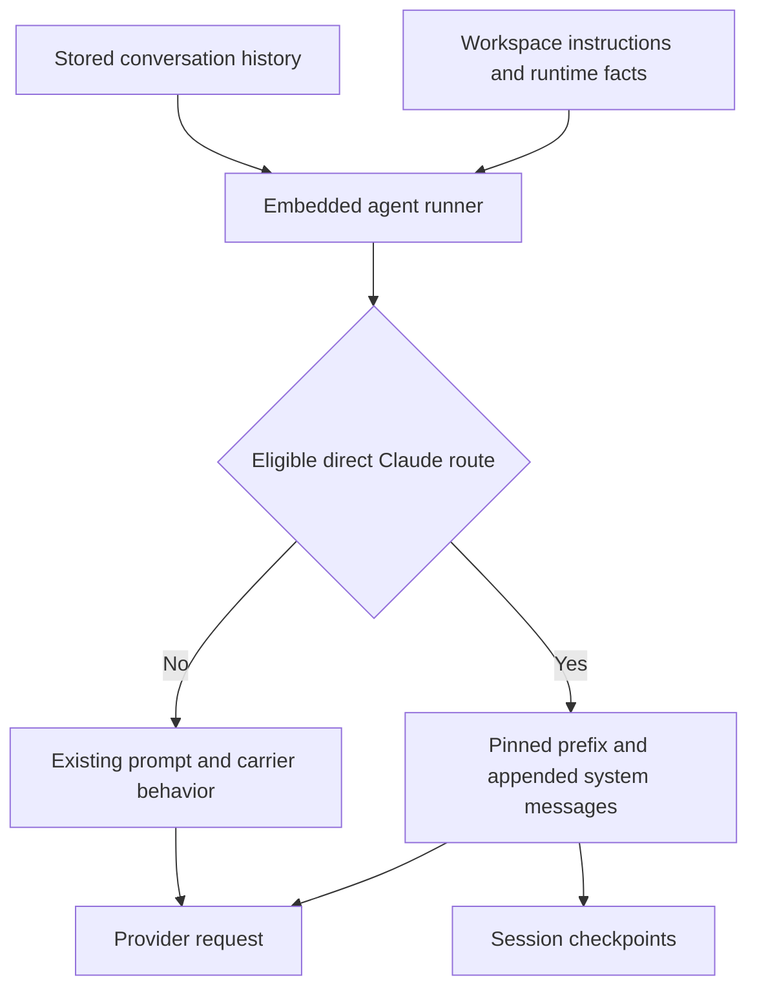

Codex review: needs maintainer review before merge. _Reviewed October 2, 2026, 10:53 AM ET / 14:53 UTC (Revision 9)._

# ClawSweeper review

## What this changes

The branch preserves Claude’s cached system prefix by appending instruction updates and temporary runtime context to conversation history, with session checkpoints and supporting replay and plugin-lifecycle changes.

## Merge readiness

✅ **Ready for maintainer review**

The PR remains useful: fetched main lacks the prompt-series implementation, and recorded live runs demonstrate preserved Claude cache reuse. No concrete introduced correctness or security blocker was found.

**Priority:** P2
**Reviewed head:** `45cf10158d3ca7009b88afeef4af4a5d03f38f12`

## Review scores

| Measure | Result | What it means |
|---|---|---|
| **Overall readiness** | 🐚 platinum hermit **(4/6)** | Strong provider proof and meaningful lifecycle coverage support a normally mergeable patch with no concrete blocking finding. |
| **Proof confidence** | 🦞 diamond lobster **(5/6)** | Sufficient (live_output): Recorded direct Anthropic runs exercise the embedded runner and request conversion after workspace edits, tool results, and image turns, showing unchanged cached prefix bytes and accepted persistent and temporary system messages. The separately reported teardown failure does not negate those observations. Existing custom-entry storage, absent-checkpoint startup, restart recovery, and reopened durable views provide compatibility coverage. |
| **Patch quality** | 🐚 platinum hermit **(4/6)** | No actionable review findings were identified. |

## Verification

| Check | Result | Evidence |
|---|---|---|
| **Real behavior** | Verified | Sufficient (live_output): Recorded direct Anthropic runs exercise the embedded runner and request conversion after workspace edits, tool results, and image turns, showing unchanged cached prefix bytes and accepted persistent and temporary system messages. The separately reported teardown failure does not negate those observations. Existing custom-entry storage, absent-checkpoint startup, restart recovery, and reopened durable views provide compatibility coverage. |
| **Evidence reviewed** | 10 items | Pinned introduction boundary: Reviewed the supplied merge-base-to-head delta, 2aa2bd669e3aa18f9e7f36cb7c7c3ad6b862a236..45cf10158d3ca7009b88afeef4af4a5d03f38f12. The stale test merge was not used to infer removal of current-main behavior. Still necessary on main: Fetched main retains tool-result projection state but lacks stable-prefix series preparation and checkpoint persistence. The related merged PR https://github.com/openclaw/openclaw/pull/163379 adds history observability and interrupted-tool guidance, rather than this provider capability. Latest-release check: The session-prompt-state source retrieved through GitHub at v2026.9.7 also lacks prepareSessionSystemPrompt; the central capability is not established as shipped in that release. |
| **Findings** | None | None. |
| **Security** | None | None. |

## How this fits together

OpenClaw’s embedded agent runner combines workspace instructions, runtime facts, and stored conversation history into provider requests. This change controls how eligible Claude routes receive those inputs across turns, restarts, and compaction.

## Before merge

None.

<strong>Agent review details</strong>

### Security

None.

### PR surface

Source +810, Tests +2540, Docs +41, Other +1. Total +3392 across 73 files.

View PR surface stats

| Area | Files | Added | Removed | Net |
|---|---:|---:|---:|---:|
| Source | 42 | 1232 | 422 | +810 |
| Tests | 26 | 2806 | 266 | +2540 |
| Docs | 3 | 55 | 14 | +41 |
| Config | 0 | 0 | 0 | 0 |
| Generated | 0 | 0 | 0 | 0 |
| Other | 2 | 3 | 2 | +1 |
| **Total** | **73** | **4096** | **704** | **+3392** |

### Review metrics

| Metric | Value | Why it matters |
|---|---|---|
| **Provider protocol surface** | 1 replay capability; 1 conditional beta header; 0 user settings | The capability is constrained by authenticated route eligibility without adding configuration or changing excluded routes. |

### Stored data model

Persistent data-model change detected: `serialized state: src/agents/embedded-agent-runner/run/attempt-permission-prompt.ts`, `unknown-data-model-change: src/agents/embedded-agent-runner/run/attempt-permission-prompt.ts`. Migration or upgrade compatibility proof is recorded; maintainers should verify it before merge.

### Technical review

Best possible solution:

Keep one session-owned pinned-prefix implementation with ordered operator updates on eligible routes and existing replay behavior elsewhere.

Do we have a high-confidence way to reproduce the issue?

Not applicable as a new provider capability; the motivating cache behavior has a concrete two-turn live scenario with a workspace-instruction edit and captured requests.

Is this the best way to solve the issue?

Yes. The branch extends existing session and replay owners, preserves excluded routes, and demonstrates the intended provider behavior without a competing implementation.

AGENTS.md: found and applied where relevant.

Codex review notes: model internal, reasoning medium; reviewed against [553c6bde778c](https://github.com/openclaw/openclaw/commit/553c6bde778c0c55b7418a5908d5fdeef735cf82).

### Labels

Label changes:

- remove `merge-risk: 🚨 compatibility`: Current PR review selected no merge-risk labels.

Label justifications:

- `P2`: This is a bounded provider-cache and context improvement with positive live evidence and no demonstrated emergency regression.
- `rating: 🐚 platinum hermit`: Overall readiness is 🐚 platinum hermit; proof is 🦞 diamond lobster and patch quality is 🐚 platinum hermit.
- `status: 👀 ready for maintainer look`: ClawSweeper has no concrete contributor-facing blocker left for this PR. Sufficient (live_output): Recorded direct Anthropic runs exercise the embedded runner and request conversion after workspace edits, tool results, and image turns, showing unchanged cached prefix bytes and accepted persistent and temporary system messages. The separately reported teardown failure does not negate those observations. Existing custom-entry storage, absent-checkpoint startup, restart recovery, and reopened durable views provide compatibility coverage.
- `proof: sufficient`: Contributor real behavior proof is sufficient. Recorded direct Anthropic runs exercise the embedded runner and request conversion after workspace edits, tool results, and image turns, showing unchanged cached prefix bytes and accepted persistent and temporary system messages. The separately reported teardown failure does not negate those observations. Existing custom-entry storage, absent-checkpoint startup, restart recovery, and reopened durable views provide compatibility coverage.

### Evidence

What I checked:

- **Pinned introduction boundary:** Reviewed the supplied merge-base-to-head delta, 2aa2bd669e3aa18f9e7f36cb7c7c3ad6b862a236..45cf10158d3ca7009b88afeef4af4a5d03f38f12. The stale test merge was not used to infer removal of current-main behavior. ([45cf10158d3c](https://github.com/openclaw/openclaw/commit/45cf10158d3ca7009b88afeef4af4a5d03f38f12))
- **Still necessary on main:** Fetched main retains tool-result projection state but lacks stable-prefix series preparation and checkpoint persistence. The related merged PR https://github.com/openclaw/openclaw/pull/163379 adds history observability and interrupted-tool guidance, rather than this provider capability. ([`src/agents/embedded-agent-runner/session-prompt-state.ts:23`](https://github.com/openclaw/openclaw/blob/553c6bde778c0c55b7418a5908d5fdeef735cf82/src/agents/embedded-agent-runner/session-prompt-state.ts#L23), [553c6bde778c](https://github.com/openclaw/openclaw/commit/553c6bde778c0c55b7418a5908d5fdeef735cf82))
- **Latest-release check:** The session-prompt-state source retrieved through GitHub at v2026.9.7 also lacks prepareSessionSystemPrompt; the central capability is not established as shipped in that release. ([`src/agents/embedded-agent-runner/session-prompt-state.ts`](https://github.com/openclaw/openclaw/blob/c074824a27c96d3983043f9eeb33823cd1772d8c/src/agents/embedded-agent-runner/session-prompt-state.ts), [c074824a27c9](https://github.com/openclaw/openclaw/commit/c074824a27c96d3983043f9eeb33823cd1772d8c))
- **Live provider proof:** Captured reports https://github.com/openclaw/openclaw/pull/163461#issuecomment-5952200117 and https://github.com/openclaw/openclaw/pull/163461#issuecomment-5952528727 exercise real direct-API-key requests through the embedded runner. After a workspace edit, unchanged prefix bytes yielded 20,229 cached tokens and 62 uncached input tokens; tool and image follow-up probes passed with temporary-system clearing and renewal. The prefix case’s separate teardown failure was reported as reproducing on unmodified main. ([`src/agents/embedded-agent-runner.cache.live.test.ts:1187`](https://github.com/openclaw/openclaw/blob/0d6d3a5c757773d3c4b6b114e90a201a199b25b8/src/agents/embedded-agent-runner.cache.live.test.ts#L1187), [0d6d3a5c7577](https://github.com/openclaw/openclaw/commit/0d6d3a5c757773d3c4b6b114e90a201a199b25b8))
- **Complete captured body inspected:** Retrieved the complete PR body and verified that its SHA-256 matches the supplied snapshot, 73e59b43e0f2251a4d9c459aa06cfc0a639b78857b10c853cd498dd0f7b2cc6b, at 13,448 UTF-16 units. The omitted sections contain validation details, timings, live-proof links, and route limitations. Embedded commands were not executed.
- **Route and plugin compatibility:** Eligibility requires a direct API key, Anthropic Messages transport, direct endpoint, and capable model. The host constrains plugin policy to that eligibility; inspected tests cover excluded authentication and cloud/proxy routes. Replay additions are optional, existing helper arguments remain valid, and provider docs explain the behavior. ([`src/agents/transcript-policy.ts:262`](https://github.com/openclaw/openclaw/blob/45cf10158d3ca7009b88afeef4af4a5d03f38f12/src/agents/transcript-policy.ts#L262), [45cf10158d3c](https://github.com/openclaw/openclaw/commit/45cf10158d3ca7009b88afeef4af4a5d03f38f12))

Likely related people:

- **steipete:** Suggested for follow-up; no historical authorship or introduction is verified. (role: unverified routing candidate; confidence: low)
- **RomneyDa:** Suggested for follow-up; no historical authorship or introduction is verified. (role: unverified routing candidate; confidence: low)

### Rating scale

| Score | Internal tier | Crab rank | Meaning |
|---:|:---:|---|---|
| **6/6** | S | 🦀 challenger crab | Exceptional readiness |
| **5/6** | A | 🦞 diamond lobster | Very strong readiness |
| **4/6** | B | 🐚 platinum hermit | Good normal PR; ordinary maintainer review |
| **3/6** | C | 🦐 gold shrimp | Useful, but confidence is limited |
| **2/6** | D | 🦪 silver shellfish | Proof or implementation needs work |
| **1/6** | F | 🧂 unranked krab | Not merge-ready |
| N/A | NA | 🌊 off-meta tidepool | Rating does not apply |

Overall follows the weaker of proof and patch quality.
Shiny media proof means a screenshot, video, or linked artifact directly shows the changed behavior. Runtime, network, CSP, and security claims still need visible diagnostics.

### Workflow

- ClawSweeper keeps one durable marker-backed review comment per issue or PR.
- Re-runs edit this comment so the latest verdict, findings, and automation markers stay together instead of adding duplicate bot comments.
- A fresh review can be triggered by eligible `@clawsweeper re-review` comments, exact-item GitHub events, scheduled/background review runs, or manual workflow dispatch.
- PR/issue authors and users with repository write access can comment `@clawsweeper re-review` or `@clawsweeper re-run` on an open PR or issue to request a fresh review only.
- Maintainers can also comment `@clawsweeper review` to request a fresh review only.
- Fresh-review commands do not start repair, autofix, rebase, CI repair, or automerge.
- Maintainer-only repair and merge flows require explicit commands such as `@clawsweeper autofix`, `@clawsweeper automerge`, `@clawsweeper fix ci`, or `@clawsweeper address review`.
- Maintainers can comment `@clawsweeper explain` to ask for more context, or `@clawsweeper stop` to stop active automation.

### History

Review history (8 earlier review cycles)

<!-- clawsweeper-review-history v=1 total=8 -->
- reviewed 2026-10-02T10:56:17.259Z sha 2f6dc57a377b70d1594b7cc97c52aa90bb0eebbe :: blocked before merge. :: none
- reviewed 2026-10-02T11:02:24.182Z sha 2f6dc57a377b70d1594b7cc97c52aa90bb0eebbe :: blocked before merge. :: none
- reviewed 2026-10-02T12:08:39.953Z sha ffc0d1b81fd6d465c28feeed52c66bc52adfbe59 :: blocked before merge. :: none
- reviewed 2026-10-02T12:27:28.213Z sha 0d6d3a5c757773d3c4b6b114e90a201a199b25b8 :: blocked before merge. :: none
- reviewed 2026-10-02T13:32:19.941Z sha c4ffe93e6aec82a6e2811e12da6a45af825e6f97 :: blocked before merge. :: none
- reviewed 2026-10-02T13:48:24.270Z sha 329391b9df569dac13689395f02c96b4839a23f2 :: blocked before merge. :: none
- reviewed 2026-10-02T14:00:34.929Z sha cff36c6e59abb816cbab9aa255828fc16e353b63 :: needs maintainer review before merge. :: none
- reviewed 2026-10-02T14:31:19.112Z sha d09c3a3992da7ace36fd123a7f07db841618e67e :: needs maintainer review before merge. :: none

<!-- clawsweeper-verdict:needs-human item=163461 sha=45cf10158d3ca7009b88afeef4af4a5d03f38f12 confidence=high updated_at=2026-10-02T14:49:31Z reviewed_at=2026-10-02T14:53:27.385Z lease_owner=github-run-37022475126-1 lease_comment_id=5954985955 source_revision=f2cb7eafe0560a2ccaec86b6a4007ac2899c8e2035eb02b4241665580e2ab3a4 live_verification=absent -->
<!-- clawsweeper-review-state:ready item=163461 sha=45cf10158d3ca7009b88afeef4af4a5d03f38f12 v=1 -->

<!-- clawsweeper-review-version item=163461 reviewed_at=2026-10-02T14:53:27.385Z sha=45cf10158d3ca7009b88afeef4af4a5d03f38f12 source_revision=f2cb7eafe0560a2ccaec86b6a4007ac2899c8e2035eb02b4241665580e2ab3a4 lease_owner=github-run-37022475126-1 lease_comment_id=5954985955 v=1 -->

<!-- clawsweeper-review item=163461 -->