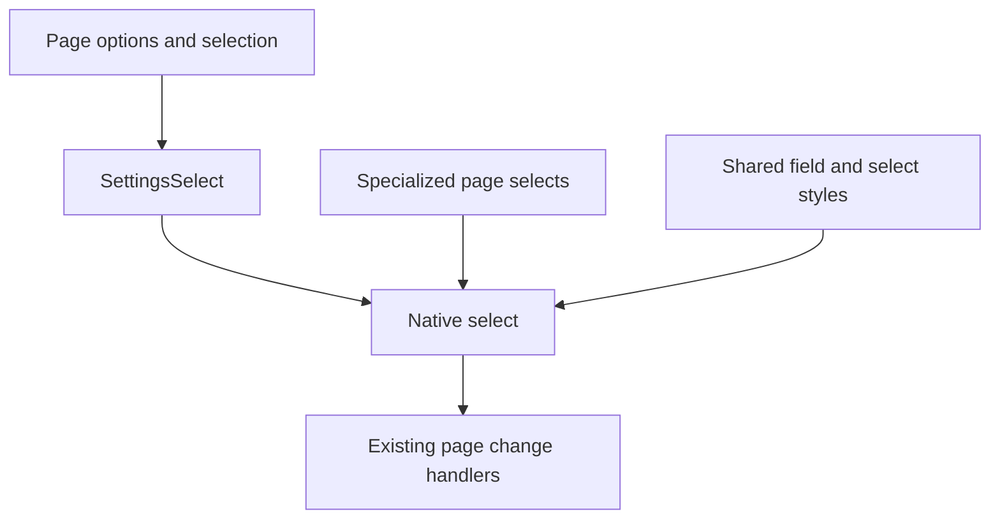

Codex review: needs maintainer review before merge.

## What this changes

The PR preserves shared select classes and replaces competing page-specific styling with the existing select family.

**Example:** Sessions displays the “25 per page” selector.
- **Before:** The caller’s class replaces settings-select, leaving a small browser-default control.
- **After:** Both classes remain, giving the selector shared field styling at its intended 30px height.

## Review scores

| Measure | Result | What it means |
|---|---|---|
| **Overall readiness** | 🦞 diamond lobster **(5/6)** | A focused owner-level repair with directly inspected visual evidence, useful regression coverage, and no actionable findings. |
| **Proof confidence** | 🦞 diamond lobster **(5/6)** ✨ media proof bonus | Sufficient (screenshot): Inspected browser screenshots exercise the actual Sessions and Systems controls with synthetic Gateway data, showing shared chrome after the fix in light, dark, mobile CRT, and Safari presentations; they establish visible styling, not open-popup interaction. |
| **Patch quality** | 🦞 diamond lobster **(5/6)** | No actionable review findings were identified. |

## Product

**Kind:** Bug fix · **Worth it:** Yes · **Fix scope:** Complete
**User problem:** Several native selects lose shared styling or use inconsistent corners and arrows.
**Reason:** The source-backed class defect violates the established shared-control contract, and the maintainer-authored styling changes continue the existing design direction.

## Merge readiness

✅ **Ready for maintainer review**

Keep open: this maintainer-authored PR repairs a verified shared-select styling defect that remains on main; no actionable regression was found.

**Priority:** P3
**Reviewed head:** `91ca3451e2f014c747b27cdd70d81517cfe9ff5c`

## Before merge

None.

## Findings

None.

<strong>Agent review details</strong>

### How this fits together

Control UI pages supply options, selected values, and handlers to native selects; shared components and CSS render the controls while existing page owners handle selection changes.

### Technical review

Best possible solution:

Retain the shared class at the renderer and let existing select styles own chrome while callers retain only necessary geometry.

Do we have a high-confidence way to reproduce the issue?

Current-main source shows the class overwrite and four affected callers; supplied before/after screenshots corroborate its visible effect without executing target code during this review.

Is this the best way to solve the issue?

The patch fixes the producer, reuses existing styling owners, removes competing declarations, and adds one distinct class-preservation regression without unnecessary machinery.

AGENTS.md: found and applied where relevant.

Codex review notes: model internal, reasoning medium; reviewed against [e97c9d3d7417](https://github.com/openclaw/openclaw/commit/e97c9d3d74178e0d96f654f1b6f5ea5bafb581f9).

### Provenance checked

- `Shared native select renderer` keeps the original intent (325c87d4688898e63343e0867c1b468206549d52: https://github.com/openclaw/openclaw/pull/182796 consolidated repeated option rendering while promising to preserve caller classes and behavior.)
- `Select popup and chevron family` keeps the original intent (07fae10c385a11513085ed8c37aa5c890af5b9a6: https://github.com/openclaw/openclaw/pull/188283 gave native and custom selects shared styling with browser-appropriate fallbacks.)
- `Field tokens and page-specific chrome` keeps the original intent (880bdcd2fdd4e5f49c2ad9b4a392e1a1ba388c30: https://github.com/openclaw/openclaw/pull/189632 standardized field appearance; older page designs supplied local geometry that this PR preserves where needed.)

### Testing

Proof path: shipped entry point.

### Security

None.

### Evidence

What I checked:

- **Current-main defect:** Fetched main still spreads caller attributes after class="settings-select", allowing caller classes to replace the shared class. ([`ui/src/components/solid/settings-select.tsx:12`](https://github.com/openclaw/openclaw/blob/e97c9d3d74178e0d96f654f1b6f5ea5bafb581f9/ui/src/components/solid/settings-select.tsx#L12), [e97c9d3d7417](https://github.com/openclaw/openclaw/commit/e97c9d3d74178e0d96f654f1b6f5ea5bafb581f9))
- **Focused owner-level repair:** The introduced diff excludes class from the spread, composes both classes, adopts the shared family in specialized controls, and removes their competing chrome without changing selection handlers. ([`ui/src/components/solid/settings-select.tsx:10`](https://github.com/openclaw/openclaw/blob/91ca3451e2f014c747b27cdd70d81517cfe9ff5c/ui/src/components/solid/settings-select.tsx#L10), [91ca3451e2f0](https://github.com/openclaw/openclaw/commit/91ca3451e2f014c747b27cdd70d81517cfe9ff5c))
- **Inspected visual evidence:** Inspected the four prepared Sessions screenshots and the additional linked mobile CRT before/after and Safari images. They show the corrected pager, grouping controls, machine picker, theme corners, and desktop sizing chrome in the running UI with synthetic data. ([91ca3451e2f0](https://github.com/openclaw/openclaw/commit/91ca3451e2f014c747b27cdd70d81517cfe9ff5c))
- **Original renderer contract:** The original addition and https://github.com/openclaw/openclaw/pull/182796 establish that the shared renderer should preserve native controls, caller classes, attributes, and handlers; the repair restores that intent. ([`ui/src/components/solid/settings-select.tsx:12`](https://github.com/openclaw/openclaw/blob/325c87d4688898e63343e0867c1b468206549d52/ui/src/components/solid/settings-select.tsx#L12), [325c87d46888](https://github.com/openclaw/openclaw/commit/325c87d4688898e63343e0867c1b468206549d52))
- **Established visual direction:** https://github.com/openclaw/openclaw/pull/188283 established the select family, and https://github.com/openclaw/openclaw/pull/189632 established shared field tokens; this PR continues both designs while retaining dense-control heights. ([`ui/src/styles/components.css:1097`](https://github.com/openclaw/openclaw/blob/07fae10c385a11513085ed8c37aa5c890af5b9a6/ui/src/styles/components.css#L1097), [07fae10c385a](https://github.com/openclaw/openclaw/commit/07fae10c385a11513085ed8c37aa5c890af5b9a6))
- **Review state and validation:** GitHub reports the reviewed head as mergeable and clean. Supplied checks have no failures, the live head check-run query returned no failing or pending runs, and the checkout remained clean. ([91ca3451e2f0](https://github.com/openclaw/openclaw/commit/91ca3451e2f014c747b27cdd70d81517cfe9ff5c))

Likely related people:

- **Vyctor H. Brzezowski:** Raw commit 880bdcd2fdd4e5f49c2ad9b4a392e1a1ba388c30 adds ui/src/styles/usage.css:225 relative to its recorded parents. This identifies author metadata, not feature responsibility or a PR merger. (role: source-line author; confidence: high; commits: [880bdcd2fdd4](https://github.com/openclaw/openclaw/commit/880bdcd2fdd4e5f49c2ad9b4a392e1a1ba388c30); files: `ui/src/styles/usage.css`)
- **Peter Steinberger:** Raw commit 325c87d4688898e63343e0867c1b468206549d52 adds ui/src/components/solid/settings-select.tsx:19 relative to its recorded parents. This identifies author metadata, not feature responsibility or a PR merger. (role: source-line author; confidence: high; commits: [325c87d46888](https://github.com/openclaw/openclaw/commit/325c87d4688898e63343e0867c1b468206549d52); files: `ui/src/components/solid/settings-select.tsx`)

### PR surface

Source -26, Tests +15. Total -11 across 12 files. Added test files: 0.

View PR surface stats

| Area | Files | Added | Removed | Net |
|---|---:|---:|---:|---:|
| Source | 11 | 35 | 61 | -26 |
| Tests | 1 | 15 | 0 | +15 |
| Docs | 0 | 0 | 0 | 0 |
| Config | 0 | 0 | 0 | 0 |
| Generated | 0 | 0 | 0 | 0 |
| Other | 0 | 0 | 0 | 0 |
| **Total** | **12** | **50** | **61** | **-11** |

### Labels

Label changes:

- add `P3`: This is a low-risk visual consistency repair; existing selection actions remain available.
- add `proof: sufficient`: Contributor real behavior proof is sufficient.
- add `proof: 📸 screenshot`: Contributor real behavior proof includes screenshot evidence.
- add `rating: 🦞 diamond lobster`: Overall readiness is 🦞 diamond lobster; proof is 🦞 diamond lobster and patch quality is 🦞 diamond lobster.
- add `status: 👀 ready for maintainer look`: ClawSweeper has no concrete contributor-facing blocker left for this PR.

Label justifications:

- `P3`: This is a low-risk visual consistency repair; existing selection actions remain available.
- `rating: 🦞 diamond lobster`: Overall readiness is 🦞 diamond lobster; proof is 🦞 diamond lobster and patch quality is 🦞 diamond lobster.
- `status: 👀 ready for maintainer look`: ClawSweeper has no concrete contributor-facing blocker left for this PR.
- `proof: sufficient`: Contributor real behavior proof is sufficient.
- `proof: 📸 screenshot`: Contributor real behavior proof includes screenshot evidence.

### Rating scale

6/6 🦀 challenger crab · 5/6 🦞 diamond lobster · 4/6 🐚 platinum hermit · 3/6 🦐 gold shrimp · 2/6 🦪 silver shellfish · 1/6 🧂 unranked krab. Overall follows the weaker of proof and patch quality; ✨ marks media proof (a screenshot, video, or linked artifact) that directly shows the changed behavior.

### Workflow

ClawSweeper edits this one comment on every review. Comment `@clawsweeper re-review` for a fresh review only. Repair and merge execution lanes are retired.

_Reviewed November 1, 2026, 10:26 AM ET / 15:26 UTC._

<!-- clawsweeper-verdict:needs-human item=190446 sha=91ca3451e2f014c747b27cdd70d81517cfe9ff5c confidence=high updated_at=2026-11-01T15:22:43Z reviewed_at=2026-11-01T15:26:05.971Z lease_owner=github-run-41320826125-1 lease_comment_id=6559910302 source_revision=48c7db50ced701c346fa9452e46872970455571c77fb7dc3b6515d62181efb60 hold=not_opted_in findings=0 -->
<!-- clawsweeper-review-state:ready item=190446 sha=91ca3451e2f014c747b27cdd70d81517cfe9ff5c v=1 -->

<!-- clawsweeper-review-version item=190446 reviewed_at=2026-11-01T15:26:05.971Z sha=91ca3451e2f014c747b27cdd70d81517cfe9ff5c source_revision=48c7db50ced701c346fa9452e46872970455571c77fb7dc3b6515d62181efb60 lease_owner=github-run-41320826125-1 lease_comment_id=6559910302 v=1 -->

<!-- clawsweeper-review item=190446 -->