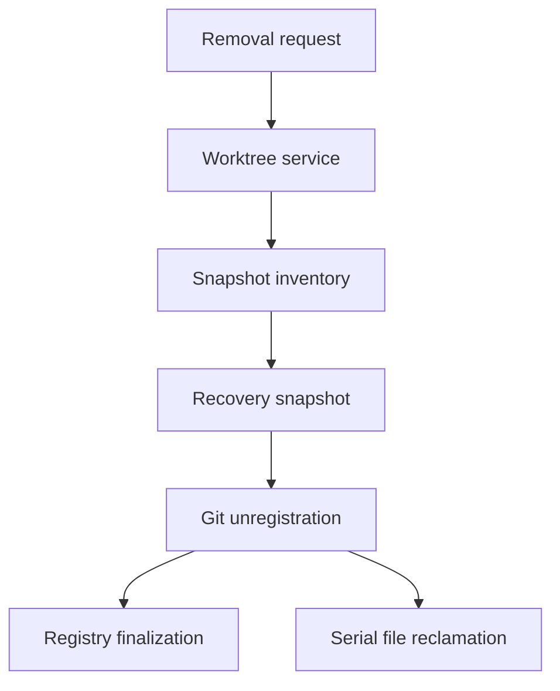

Codex review: needs changes before merge.

## What this changes

This PR skips private-index construction for clean worktree snapshots and moves ordinary checkout file deletion into a serial background process.

**Example:** Remove a managed checkout containing 54,270 tracked files and 10,000 ignored dependency files.
- **Before:** Removal prepares a private snapshot index and waits for native Git to delete the file tree.
- **After:** A clean snapshot reuses HEAD’s tree, and Git unregisters a small stub while the renamed tree is reclaimed separately.

## Review scores

| Measure | Result | What it means |
|---|---|---|
| **Overall readiness** | 🦐 gold shrimp **(3/6)** | Useful, focused optimization with service-level evidence, but a confirmed cancellation-fixture regression prevents a clean correctness verdict. |
| **Proof confidence** | 🦐 gold shrimp **(3/6)** | The maintainer-authored PR supplies paired synthetic Linux service benchmarks and real-Git integration results; the ordinary contributor proof gate does not apply. |
| **Patch quality** | 🦐 gold shrimp **(3/6)** | 1 actionable review finding remain. |

## Product

**Kind:** Performance · **Worth it:** Yes · **Fix scope:** Complete
**User problem:** Large managed-worktree cleanup sweeps spend avoidable time preparing clean snapshots and deleting checkout files.
**Reason:** The maintainer-authored direction has measured value, reduces production code, and preserves established recovery contracts.

## Merge readiness

⛔ **Needs changes before merge - 1 item remains**

Keep this PR open for a focused CI fixture repair; its useful performance changes remain distinct from current main.

**Priority:** P2
**Reviewed head:** `2d11aa9c46ee44200a75093d218da31b5296ff4c`

## Before merge

- [ ] **Adapt the cancellation fixture to the renamed checkout (P2)** - Renaming the checkout before invoking Git leaves only `.git` at the original path. The existing cancellation test in `src/agents/worktrees/service.diagnostics.test.ts:215` intercepts that invocation and starts a real child that unlinks `created.path/README.md`; it now exits with ENOENT before reporting readiness. Current-head `checks-node-changed-compact-large-8` confirms this failure and consequently fails the CI gate. Update that fixture to hold the stub-unregistration boundary without unlinking a source file that has moved, preserving cancellation, child-exit, finalization, and snapshot-restoration assertions. This finding is established by newly available current-head CI evidence.

## Findings

- [P2] Adapt the cancellation fixture to the renamed checkout — `src/agents/worktrees/removal-git.ts:138-142`

### Tests

- Missing end-to-end proof: The supplied synthetic benchmarks and service tests do not identify a shipped CLI or Gateway removal-and-restore trace; this maintainer-authored PR is outside the ordinary contributor proof gate.

<strong>Agent review details</strong>

### How this fits together

CLI, Gateway, and cleanup requests enter the managed-worktree service, which captures recovery contents, unregisters checkouts, and records removal outcomes.

### Technical review

Best possible solution:

Retain the optimizations and adapt the cancellation fixture to stub unregistration while preserving child settlement and snapshot recovery assertions.

Do we have a high-confidence way to reproduce the issue?

Current-main source confirms private-index preparation and synchronous native file deletion; the supplied paired benchmarks support their performance cost.

Is this the best way to solve the issue?

The optimization stays within the existing snapshot and removal owners, preserves native lossless and recovery paths, and explicitly records its reclamation tradeoff.

Full review comments:

- [P2] Adapt the cancellation fixture to the renamed checkout — `src/agents/worktrees/removal-git.ts:138-142`
  Renaming the checkout before invoking Git leaves only `.git` at the original path. The existing cancellation test in `src/agents/worktrees/service.diagnostics.test.ts:215` intercepts that invocation and starts a real child that unlinks `created.path/README.md`; it now exits with ENOENT before reporting readiness. Current-head `checks-node-changed-compact-large-8` confirms this failure and consequently fails the CI gate. Update that fixture to hold the stub-unregistration boundary without unlinking a source file that has moved, preserving cancellation, child-exit, finalization, and snapshot-restoration assertions. This finding is established by newly available current-head CI evidence.
  Confidence: 1

Overall correctness: patch is incorrect
Overall confidence: 0.99

AGENTS.md: found and applied where relevant.

Codex review notes: model internal, reasoning medium; reviewed against [5a1f8c692e94](https://github.com/openclaw/openclaw/commit/5a1f8c692e9474323c8cbbf6c4d985ed2a1b6f0b).

### Provenance checked

- `Private snapshot index preparation` changes intended behavior with a stated reason (6c963300bbf6d92679a573eb5a77dd4a29dc9332: Reuse Git stat information while preserving racy-edit detection and clearing flags that hide edits.)
- `Joined checkout deletion` changes intended behavior with a stated reason (3c66417c08e3d96ab14930262aa3cd47feaa42ac: Bound ordinary deletion and join child cleanup while retaining deadline-free explicit recovery.)
- `Source-only Git configuration` keeps the original intent (a5fe21a5e742533538f2fe7f25719e62ff9793fe: Preserve filesystem interpretation while excluding repository programs from isolated content operations.)
- `Clean snapshot tree reuse` keeps the original intent (f24dd3fbb7271413231b5225b9b2437a63b148d2: Avoid rebuilding unchanged trees while retaining required-object validation and recovery refs.)
- `Snapshot index-copy assertions` changes intended behavior with a stated reason (2c383ca39f1f6d1c8ffafd277e70c5dcf4b9792c: Verify independent native index copies and timestamp safety; those assertions are retired alongside the copy operation while content and mode checks remain.)

### Testing

Proof path: in-process harness.

### Security

None.

### Evidence

Acceptance criteria:

- pnpm test src/agents/worktrees/service.diagnostics.test.ts --maxWorkers=1
- pnpm test src/agents/worktrees/service.removal-safety.test.ts src/agents/worktrees/service.removal-budget.test.ts --maxWorkers=1
- pnpm test src/infra/git-content-budget.test.ts --maxWorkers=1
- git diff --check

What I checked:

- **Confirmed current-head fixture failure:** GitHub’s failure annotation reports ENOENT unlinking cancel-removal/README.md before child readiness in service.diagnostics.test.ts. The introduced rename leaves only a Git marker at that original path. Failure: https://github.com/openclaw/openclaw/actions/runs/38219939927/job/114713871350. ([`src/agents/worktrees/service.diagnostics.test.ts:215`](https://github.com/openclaw/openclaw/blob/2d11aa9c46ee44200a75093d218da31b5296ff4c/src/agents/worktrees/service.diagnostics.test.ts#L215), [2d11aa9c46ee](https://github.com/openclaw/openclaw/commit/2d11aa9c46ee44200a75093d218da31b5296ff4c))
- **Prior finding resolved:** The latest commit selects the native lossless branch for the filesystem-independent content-budget fixture; its current-head small-13 CI shard passes. ([`src/infra/git-content-budget.test.ts:150`](https://github.com/openclaw/openclaw/blob/2d11aa9c46ee44200a75093d218da31b5296ff4c/src/infra/git-content-budget.test.ts#L150), [2d11aa9c46ee](https://github.com/openclaw/openclaw/commit/2d11aa9c46ee44200a75093d218da31b5296ff4c))
- **Unique implementation remains necessary:** Fetched main retains private-index seeding and joined native checkout deletion; the pinned introduced diff removes those costs. ([`src/agents/worktrees/snapshot-inventory.ts:301`](https://github.com/openclaw/openclaw/blob/5a1f8c692e9474323c8cbbf6c4d985ed2a1b6f0b/src/agents/worktrees/snapshot-inventory.ts#L301), [5a1f8c692e94](https://github.com/openclaw/openclaw/commit/5a1f8c692e9474323c8cbbf6c4d985ed2a1b6f0b))
- **Accepted reclamation tradeoff:** The maintainer-authored body explicitly accepts inspectable sibling directories after crashes or failed background deletion, documents that behavior, and reports paired synthetic Linux benchmarks. Public docs: [`docs/concepts/managed-worktrees.md`](https://docs.openclaw.ai/concepts/managed-worktrees). ([`docs/concepts/managed-worktrees.md:416`](https://docs.openclaw.ai/concepts/managed-worktrees), [2d11aa9c46ee](https://github.com/openclaw/openclaw/commit/2d11aa9c46ee44200a75093d218da31b5296ff4c))
- **Related optimization has narrower scope:** https://github.com/openclaw/openclaw/pull/168682 reused clean snapshot trees but retained index preparation and foreground file deletion, so it does not supersede this PR. ([`src/agents/worktrees/snapshot-inventory.ts:378`](https://github.com/openclaw/openclaw/blob/f24dd3fbb7271413231b5225b9b2437a63b148d2/src/agents/worktrees/snapshot-inventory.ts#L378), [f24dd3fbb727](https://github.com/openclaw/openclaw/commit/f24dd3fbb7271413231b5225b9b2437a63b148d2))
- **Existing-state compatibility:** Snapshot ref names, commit ancestry, provisioned-state serialization, and restore formats remain unchanged; no stored-format migration is required. ([`src/agents/worktrees/snapshot-inventory.ts:546`](https://github.com/openclaw/openclaw/blob/2d11aa9c46ee44200a75093d218da31b5296ff4c/src/agents/worktrees/snapshot-inventory.ts#L546), [2d11aa9c46ee](https://github.com/openclaw/openclaw/commit/2d11aa9c46ee44200a75093d218da31b5296ff4c))

Likely related people:

- **Peter Steinberger:** Raw commit 3c66417c08e3d96ab14930262aa3cd47feaa42ac adds src/agents/worktrees/removal-git.ts:99 relative to its recorded parents. This identifies author metadata, not feature responsibility or a PR merger. (role: source-line author; confidence: high; commits: [3c66417c08e3](https://github.com/openclaw/openclaw/commit/3c66417c08e3d96ab14930262aa3cd47feaa42ac); files: `src/agents/worktrees/removal-git.ts`)

### PR surface

Source -24, Tests +6, Docs +2. Total -16 across 8 files. Added test files: 0.

View PR surface stats

| Area | Files | Added | Removed | Net |
|---|---:|---:|---:|---:|
| Source | 3 | 155 | 179 | -24 |
| Tests | 4 | 62 | 56 | +6 |
| Docs | 1 | 3 | 1 | +2 |
| Config | 0 | 0 | 0 | 0 |
| Generated | 0 | 0 | 0 | 0 |
| Other | 0 | 0 | 0 | 0 |
| **Total** | **8** | **220** | **236** | **-16** |

### Review metrics

| Metric | Value | Why it matters |
|---|---|---|
| **Production versus test LOC** | Production +155/-179, net −24; tests +62/-56, net +6 | Removing index-copy machinery offsets background-deletion code while retaining focused snapshot and recovery coverage. |

### Labels

Label changes:

No label changes.

Label justifications:

- `P2`: Large-repository cleanup benefits from this optimization, and the remaining blocker is a bounded test-fixture regression.
- `rating: 🦐 gold shrimp`: Overall readiness is 🦐 gold shrimp; proof is 🦐 gold shrimp and patch quality is 🦐 gold shrimp.
- `status: ⏳ waiting on author`: ClawSweeper has contributor-facing work open and is waiting for author action.

### Rating scale

6/6 🦀 challenger crab · 5/6 🦞 diamond lobster · 4/6 🐚 platinum hermit · 3/6 🦐 gold shrimp · 2/6 🦪 silver shellfish · 1/6 🧂 unranked krab. Overall follows the weaker of proof and patch quality; ✨ marks media proof (a screenshot, video, or linked artifact) that directly shows the changed behavior.

### Workflow

ClawSweeper edits this one comment on every review. Comment `@clawsweeper re-review` for a fresh review only. Repair and merge execution lanes are retired.

### History

Review history (3 earlier review cycles)

<!-- clawsweeper-review-history v=1 total=3 -->
- reviewed 2026-10-12T06:56:30.429Z sha de3c40684a84250618e63223afb89b1a34194895 :: needs changes before merge. :: none
- reviewed 2026-10-12T07:02:54.113Z sha de3c40684a84250618e63223afb89b1a34194895 :: needs maintainer review before merge. :: none
- reviewed 2026-10-12T07:34:43.119Z sha e8efd36ad7a876047e2b466d38d5ef1711527819 :: needs changes before merge. :: [P2] Adapt the content-budget fixture to filesystem-backed removal

_Reviewed October 12, 2026, 4:05 AM ET / 08:05 UTC (Revision 4)._

<!-- clawsweeper-verdict:needs-changes item=169690 sha=2d11aa9c46ee44200a75093d218da31b5296ff4c confidence=high updated_at=2026-10-12T08:01:10Z reviewed_at=2026-10-12T08:05:01.141Z lease_owner=github-run-38220913443-1 lease_comment_id=6120185461 source_revision=5a60a8c0605e96c79706c30f7c09a9ed5f9f625abfd0adb154c4edbea0a7447b -->
<!-- clawsweeper-review-state:needs-changes item=169690 sha=2d11aa9c46ee44200a75093d218da31b5296ff4c v=1 -->

<!-- clawsweeper-review-version item=169690 reviewed_at=2026-10-12T08:05:01.141Z sha=2d11aa9c46ee44200a75093d218da31b5296ff4c source_revision=5a60a8c0605e96c79706c30f7c09a9ed5f9f625abfd0adb154c4edbea0a7447b lease_owner=github-run-38220913443-1 lease_comment_id=6120185461 v=1 -->

<!-- clawsweeper-review item=169690 -->