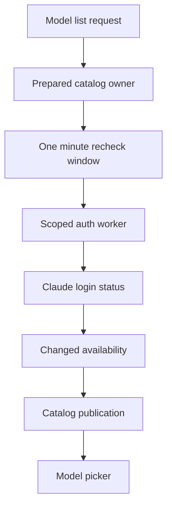

Codex review: needs maintainer review before merge. _Reviewed October 6, 2026, 6:41 PM ET / 22:41 UTC (Revision 5)._

# ClawSweeper review

## What this changes

The PR refreshes Claude CLI login availability during model-list reads, publishes changed availability, and adds documentation and login/logout regression coverage.

## Merge readiness

✅ **Ready for maintainer review**

The PR remains useful: current main still retains startup login availability during ordinary model-list reads. No actionable patch defect remains, the earlier polling finding is resolved, and the inspected live evidence supports the fix.

**Priority:** P2
**Reviewed head:** `eddbf2d2db141ec689285d6ab3bf53fdf74f0749`

## Review scores

| Measure | Result | What it means |
|---|---|---|
| **Overall readiness** | 🐚 platinum hermit **(4/6)** | A focused owner-level repair with convincing paired live proof and no remaining actionable findings. |
| **Proof confidence** | 🦞 diamond lobster **(5/6)** ✨ media proof bonus | Sufficient (screenshot): The catalog owner's ordinary-read refresh is exercised by paired isolated Mac Gateways using the real Claude executable. Inspected screenshots show disabled rows before login and enabled branch rows afterward, while main stays disabled; the captured narrative also records logout recovery and bounded probe counts. No stored-data contract changes. |
| **Patch quality** | 🐚 platinum hermit **(4/6)** | No actionable review findings were identified. |

## Verification

| Check | Result | Evidence |
|---|---|---|
| **Real behavior** | Verified | Sufficient (screenshot): The catalog owner's ordinary-read refresh is exercised by paired isolated Mac Gateways using the real Claude executable. Inspected screenshots show disabled rows before login and enabled branch rows afterward, while main stays disabled; the captured narrative also records logout recovery and bounded probe counts. No stored-data contract changes. |
| **Evidence reviewed** | 8 items | Pinned introduced change: Reviewed the merge-base-to-head delta. The latest commit only removes two obsolete mock-baseline entries; it does not change the previously reviewed production implementation. Scoped refresh and lifecycle checks: The recheck selects eligible manifest-declared CLI backends, limits attempts to the one-minute window, reuses worker auth loading, and publishes only changed auth modes. The shared refresh preserves provider scope and checks owner currency after awaited work; publication checks currency again. Current main still needs the repair: At fetched main, ordinary renewal only checks provider inventory expiration; it contains no native-login recheck. Explicit auth refresh remains available but does not solve ordinary picker reads automatically. |
| **Findings** | None | None. |
| **Security** | None | None. |

## How this fits together

The prepared model catalog combines configured models with provider authentication facts. Gateway model-list requests consume that catalog to determine which models the picker can offer.

## Before merge

None.

<strong>Agent review details</strong>

### Security

None.

### PR surface

Source +79, Tests +48, Docs +2, Other -2. Total +127 across 8 files.

View PR surface stats

| Area | Files | Added | Removed | Net |
|---|---:|---:|---:|---:|
| Source | 2 | 104 | 25 | +79 |
| Tests | 4 | 51 | 3 | +48 |
| Docs | 1 | 3 | 1 | +2 |
| Config | 0 | 0 | 0 | 0 |
| Generated | 0 | 0 | 0 | 0 |
| Other | 1 | 0 | 2 | -2 |
| **Total** | **8** | **158** | **31** | **+127** |

### Review metrics

| Metric | Value | Why it matters |
|---|---|---|
| **Production versus test growth** | production +104/-25; tests and test support +51/-3 | Production growth provides bounded background renewal and consolidates the existing scoped-auth merge. |

### Technical review

Best possible solution:

Keep login availability fresh through the existing catalog owner while preserving bounded probes, native credential ownership, and unchanged model-routing preferences.

Do we have a high-confidence way to reproduce the issue?

Yes: start the Gateway logged out, log Claude in afterward, and reread the model picker without explicit refresh. Current-main source and the contributor's paired live observations establish the stale availability path; this review did not execute it.

Is this the best way to solve the issue?

Yes: extending the existing catalog renewal owner avoids a separate refresh loop and retains scoped auth loading, lifecycle checks, and publication semantics.

AGENTS.md: found and applied where relevant.

Codex review notes: model internal, reasoning medium; reviewed against [dd619529b24a](https://github.com/openclaw/openclaw/commit/dd619529b24acf32cdf35258852e13cf9e9c4792).

### Labels

Label changes:

No label changes.

Label justifications:

- `P2`: This repairs stale Claude model availability after login or logout with limited impact and an existing explicit-refresh workaround.
- `rating: 🐚 platinum hermit`: Overall readiness is 🐚 platinum hermit; proof is 🦞 diamond lobster and patch quality is 🐚 platinum hermit.
- `status: 👀 ready for maintainer look`: ClawSweeper has no concrete contributor-facing blocker left for this PR. Sufficient (screenshot): The catalog owner's ordinary-read refresh is exercised by paired isolated Mac Gateways using the real Claude executable. Inspected screenshots show disabled rows before login and enabled branch rows afterward, while main stays disabled; the captured narrative also records logout recovery and bounded probe counts. No stored-data contract changes.
- `proof: sufficient`: Contributor real behavior proof is sufficient. The catalog owner's ordinary-read refresh is exercised by paired isolated Mac Gateways using the real Claude executable. Inspected screenshots show disabled rows before login and enabled branch rows afterward, while main stays disabled; the captured narrative also records logout recovery and bounded probe counts. No stored-data contract changes.
- `proof: 📸 screenshot`: Contributor real behavior proof includes screenshot evidence. The catalog owner's ordinary-read refresh is exercised by paired isolated Mac Gateways using the real Claude executable. Inspected screenshots show disabled rows before login and enabled branch rows afterward, while main stays disabled; the captured narrative also records logout recovery and bounded probe counts. No stored-data contract changes.

### Evidence

What I checked:

- **Pinned introduced change:** Reviewed the merge-base-to-head delta. The latest commit only removes two obsolete mock-baseline entries; it does not change the previously reviewed production implementation. ([`config/test-mock-exports-baseline.txt:3094`](https://github.com/openclaw/openclaw/blob/eddbf2d2db141ec689285d6ab3bf53fdf74f0749/config/test-mock-exports-baseline.txt#L3094), [eddbf2d2db14](https://github.com/openclaw/openclaw/commit/eddbf2d2db141ec689285d6ab3bf53fdf74f0749))
- **Scoped refresh and lifecycle checks:** The recheck selects eligible manifest-declared CLI backends, limits attempts to the one-minute window, reuses worker auth loading, and publishes only changed auth modes. The shared refresh preserves provider scope and checks owner currency after awaited work; publication checks currency again. ([`src/agents/prepared-model-runtime.catalog-auth.ts:440`](https://github.com/openclaw/openclaw/blob/eddbf2d2db141ec689285d6ab3bf53fdf74f0749/src/agents/prepared-model-runtime.catalog-auth.ts#L440), [eddbf2d2db14](https://github.com/openclaw/openclaw/commit/eddbf2d2db141ec689285d6ab3bf53fdf74f0749))
- **Current main still needs the repair:** At fetched main, ordinary renewal only checks provider inventory expiration; it contains no native-login recheck. Explicit auth refresh remains available but does not solve ordinary picker reads automatically. ([`src/agents/prepared-model-runtime.catalog-access.ts:561`](https://github.com/openclaw/openclaw/blob/dd619529b24acf32cdf35258852e13cf9e9c4792/src/agents/prepared-model-runtime.catalog-access.ts#L561), [dd619529b24a](https://github.com/openclaw/openclaw/commit/dd619529b24acf32cdf35258852e13cf9e9c4792))
- **Latest release context:** The latest release's Anthropic discovery implementation shares login observations by config, environment, and capture signal. This establishes the existing native-login contract, rather than a shipped ordinary-read refresh equivalent to this PR. ([`extensions/anthropic/provider-discovery.ts:18`](https://github.com/openclaw/openclaw/blob/fc23bc864e4553c2d215e479eeec47b67a0bf943/extensions/anthropic/provider-discovery.ts#L18), [fc23bc864e45](https://github.com/openclaw/openclaw/commit/fc23bc864e4553c2d215e479eeec47b67a0bf943))
- **Inspected real picker proof:** Inspected all four downloaded screenshots. Both before images and the main-after image show two disabled Anthropic rows; the branch-after image shows six enabled rows. The captured PR body describes isolated Mac Gateways using the real Claude executable, post-startup login/logout, no page reload, and measured probe counts. Source snapshot identity: 43e3bfb12b9c0dff69327516d27b045f11c229d4eb746c56255fd99eaf9db07c.
- **Prior finding resolved:** The Gateway regression observes catalog publication for login and logout transitions instead of polling responses. It also verifies that reads inside the window add no probe and each transition adds exactly one probe. Tests were inspected, not executed during this read-only review. ([`src/gateway/server.chat-cli-auth.test.ts:437`](https://github.com/openclaw/openclaw/blob/eddbf2d2db141ec689285d6ab3bf53fdf74f0749/src/gateway/server.chat-cli-auth.test.ts#L437), [eddbf2d2db14](https://github.com/openclaw/openclaw/commit/eddbf2d2db141ec689285d6ab3bf53fdf74f0749))

Likely related people:

- **steipete:** Suggested for follow-up; no historical authorship or introduction is verified. (role: unverified routing candidate; confidence: low)
- **Ayaan Zaidi:** Suggested for follow-up; no historical authorship or introduction is verified. (role: unverified routing candidate; confidence: low)

### Rating scale

| Score | Internal tier | Crab rank | Meaning |
|---:|:---:|---|---|
| **6/6** | S | 🦀 challenger crab | Exceptional readiness |
| **5/6** | A | 🦞 diamond lobster | Very strong readiness |
| **4/6** | B | 🐚 platinum hermit | Good normal PR; ordinary maintainer review |
| **3/6** | C | 🦐 gold shrimp | Useful, but confidence is limited |
| **2/6** | D | 🦪 silver shellfish | Proof or implementation needs work |
| **1/6** | F | 🧂 unranked krab | Not merge-ready |
| N/A | NA | 🌊 off-meta tidepool | Rating does not apply |

Overall follows the weaker of proof and patch quality.
Shiny media proof means a screenshot, video, or linked artifact directly shows the changed behavior. Runtime, network, CSP, and security claims still need visible diagnostics.

### Workflow

- ClawSweeper keeps one durable marker-backed review comment per issue or PR.
- Re-runs edit this comment so the latest verdict, findings, and automation markers stay together instead of adding duplicate bot comments.
- A fresh review can be triggered by eligible `@clawsweeper re-review` comments, exact-item GitHub events, scheduled/background review runs, or manual workflow dispatch.
- PR/issue authors and users with repository write access can comment `@clawsweeper re-review` or `@clawsweeper re-run` on an open PR or issue to request a fresh review only.
- Maintainers can also comment `@clawsweeper review` to request a fresh review only.
- Fresh-review commands do not start repair, autofix, rebase, CI repair, or automerge.
- Maintainer-only repair and merge flows require explicit commands such as `@clawsweeper autofix`, `@clawsweeper automerge`, `@clawsweeper fix ci`, or `@clawsweeper address review`.
- Maintainers can comment `@clawsweeper explain` to ask for more context, or `@clawsweeper stop` to stop active automation.

### History

Review history (4 earlier review cycles)

<!-- clawsweeper-review-history v=1 total=4 -->
- reviewed 2026-10-06T21:28:25.850Z sha 205a1b72d2b312ffae9b707753a9a2c1885beb99 :: needs changes before merge. :: [P3] Await catalog publication instead of polling model-list responses
- reviewed 2026-10-06T21:46:39.651Z sha 95b44d68654c66b9c17b9c3a436b8a390391bf55 :: needs changes before merge. :: [P3] Await catalog publication instead of polling model-list responses
- reviewed 2026-10-06T21:56:57.577Z sha 95b44d68654c66b9c17b9c3a436b8a390391bf55 :: needs changes before merge. :: [P3] Await catalog publication instead of polling model-list responses
- reviewed 2026-10-06T22:24:43.620Z sha be5ebe4628211c1720330e8e137f5090bfa831b3 :: needs maintainer review before merge. :: none

<!-- clawsweeper-verdict:needs-human item=166305 sha=eddbf2d2db141ec689285d6ab3bf53fdf74f0749 confidence=high updated_at=2026-10-06T22:38:46Z reviewed_at=2026-10-06T22:41:15.363Z lease_owner=github-run-37541783256-1 lease_comment_id=6026694108 source_revision=43e3bfb12b9c0dff69327516d27b045f11c229d4eb746c56255fd99eaf9db07c live_verification=absent -->
<!-- clawsweeper-review-state:ready item=166305 sha=eddbf2d2db141ec689285d6ab3bf53fdf74f0749 v=1 -->

<!-- clawsweeper-review-version item=166305 reviewed_at=2026-10-06T22:41:15.363Z sha=eddbf2d2db141ec689285d6ab3bf53fdf74f0749 source_revision=43e3bfb12b9c0dff69327516d27b045f11c229d4eb746c56255fd99eaf9db07c lease_owner=github-run-37541783256-1 lease_comment_id=6026694108 v=1 -->

<!-- clawsweeper-review item=166305 -->