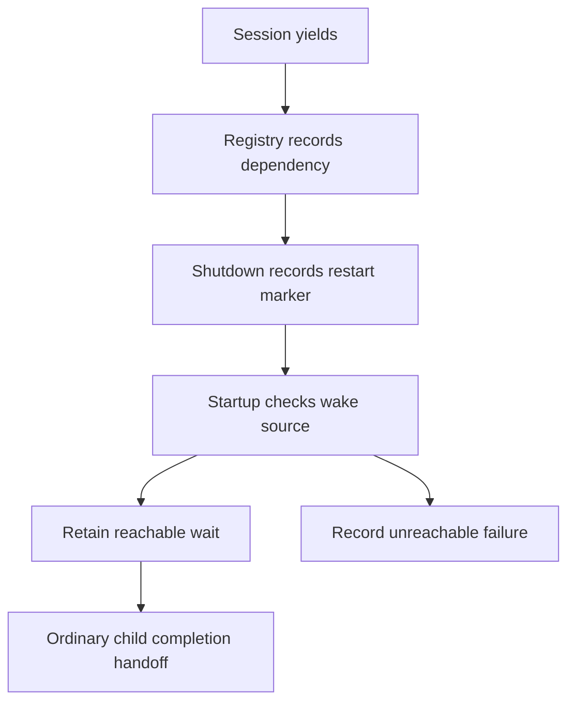

Codex review: blocked before merge.

## What this changes

This PR preserves reachable yielded sessions across Gateway restarts and records failures when their continuation source disappears.

**Example:** A dashboard session yields while its child executes, then the Gateway restarts and stops that child.
- **Before:** The dashboard root can lose its restart marker and be treated as an orphan.
- **After:** The original yielded run receives a visible, run-correlated failure without another root model call.

## Review scores

| Measure | Result | What it means |
|---|---|---|
| **Overall readiness** | 🦪 silver shellfish **(2/6)** | Useful owner-aligned repair, with a verified consumer-test failure, incomplete failure presentation, and an unresolved upgrade gate. |
| **Proof confidence** | 🦪 silver shellfish **(2/6)** | Real behavior proof is not required for maintainer- or bot-authored pull requests. |
| **Patch quality** | 🦪 silver shellfish **(2/6)** | 2 actionable review findings remain. |

## Product

**Kind:** Bug fix · **Worth it:** Yes · **Fix scope:** Complete
**User problem:** Yielded conversations can be orphaned after restart or remain active indefinitely after a failed child-completion handoff.
**Reason:** The maintainer-authored direction repairs an existing session lifecycle contract without adding configuration or replaying stopped executions.

## Merge readiness

⛔ **Blocked before merge - 3 items remain**

Keep this PR open: it addresses a source-confirmed restart recovery gap, but an existing restart test contradicts the new behavior and failed-handoff notices need actionable copy.

**Priority:** P1
**Reviewed head:** `b6376657406aa24308d9a6dc668eb2bda6e171f6`

## Before merge

- [ ] **Update the existing restart E2E for unreachable yielded parents (P2)** - The existing gateway-restart-resume E2E yields its parent while leaving its child executing, then still expects RESUMED_0_parent after shutdown. The new unreachable branch intentionally records a failure instead of admitting that model turn. Exact-head checks-node-changed now fails on this expectation. Update this consumer scenario to assert the run-correlated failure and absence of an extra parent model call, while retaining resume assertions for genuinely interrupted executions.
- [ ] **Provide an actionable notice for failed completion handoffs (P2)** - A permanently undelivered yielded batch now terminalizes its requester with only data.error. For an unclassified error, including the new fallback text, recordGatewaySessionRunFailure renders only "Your request couldn't be completed." The user loses the child-handoff explanation and has no recovery instruction. Supply a safe errorNotice explaining that saved child work remains available and asking the user to inspect it before sending a new message, as the restart-failure branch already does.
- [ ] **Add data-model compatibility proof** - The review found that existing stored data may not work after upgrade. Show that existing data still loads and works with this change.

## Findings

- [P2] Update the existing restart E2E for unreachable yielded parents — `test/gateway-restart-resume.e2e.test.ts:1249-1252`
- [P2] Provide an actionable notice for failed completion handoffs — `src/agents/subagents/registry/subagent-registry-requester-wake-mutation.ts:238-241`

### Tests

- Missing end-to-end proof: Supply latest-stable upgrade evidence with retained settings, transcripts, and pre-existing yield batches; surviving dashboard-root continuation is currently covered only at the restart owner.

<strong>Agent review details</strong>

### How this fits together

The subagent registry records yield dependencies and completion handoffs; Gateway shutdown and startup consume those facts to preserve waits or settle their exact session lifecycle.

### Technical review

Best possible solution:

Retain the existing registry and lifecycle owners, update the affected restart consumer test, and give failed handoffs a clear recovery instruction.

Do we have a high-confidence way to reproduce the issue?

Main's shutdown discovery omits fully drained yielded roots; the PR describes a matching actual-Gateway baseline failure, although no reproduction was run during this read-only review.

Is this the best way to solve the issue?

The fix uses the right existing owners and removes the relocated settlement implementation; simplification review found no unnecessary parallel recovery mechanism.

Full review comments:

- [P2] Update the existing restart E2E for unreachable yielded parents — `test/gateway-restart-resume.e2e.test.ts:1249-1252`
  The existing gateway-restart-resume E2E yields its parent while leaving its child executing, then still expects RESUMED_0_parent after shutdown. The new unreachable branch intentionally records a failure instead of admitting that model turn. Exact-head checks-node-changed now fails on this expectation. Update this consumer scenario to assert the run-correlated failure and absence of an extra parent model call, while retaining resume assertions for genuinely interrupted executions.
  Confidence: 0.99
- [P2] Provide an actionable notice for failed completion handoffs — `src/agents/subagents/registry/subagent-registry-requester-wake-mutation.ts:238-241`
  A permanently undelivered yielded batch now terminalizes its requester with only data.error. For an unclassified error, including the new fallback text, recordGatewaySessionRunFailure renders only "Your request couldn't be completed." The user loses the child-handoff explanation and has no recovery instruction. Supply a safe errorNotice explaining that saved child work remains available and asking the user to inspect it before sending a new message, as the restart-failure branch already does.
  Confidence: 0.97

Overall correctness: patch is incorrect
Overall confidence: 0.95

AGENTS.md: found and applied where relevant.

Codex review notes: model internal, reasoning medium; reviewed against [1bc50e0517ad](https://github.com/openclaw/openclaw/commit/1bc50e0517adf5c4cb8bd025802d55208e9c6318).

### Provenance checked

- `Recorded yield waits` keeps the original intent (9464adbe62538155914abe4eef3d6958d5cea5af: Preserve live message waits across restart without restoring old execution or delivery authority.)
- `Yielded root restart policy` changes intended behavior with a stated reason (9344233e7a66fe36479d55b7f7ae8e10eb886586: Replace execution reconstruction with one ordinary root resume input after shutdown.)
- `Requester settlement receipts` keeps the original intent (6671f14afee7216e0d3dafefa8a56b8a0b2c714c: Reconcile committed outcomes after ownership turnover without replaying delivery or consuming newer work.)
- `Unreachable yielded settlement` keeps the original intent (e02ae3ecb66fd7333160bd7dd89d6072b1860f38: Settle unreachable yielded runs through the completion owner while preserving outcomes, timestamps, and cancellation ownership.)

### Testing

Proof path: in-process harness.

### Security

None.

### Evidence

Acceptance criteria:

- pnpm test:e2e:gateway test/gateway-restart-resume.e2e.test.ts test/gateway-yield-restart.e2e.test.ts --maxWorkers=1
- pnpm test src/agents/subagents/registry/subagent-registry.requester-wake.e2e.test.ts --maxWorkers=1
- git diff --check
- Verify latest-stable upgrade with existing yield batches, settings, and transcripts intact.

What I checked:

- **Pinned introduction and policy:** Reviewed the merge-base-to-head diff and applicable root, agents, Gateway, docs, and test policies; the maintainer-notes directory is absent. ([`AGENTS.md:1`](https://github.com/openclaw/openclaw/blob/b6376657406aa24308d9a6dc668eb2bda6e171f6/AGENTS.md#L1), [b6376657406a](https://github.com/openclaw/openclaw/commit/b6376657406aa24308d9a6dc668eb2bda6e171f6))
- **Distinct current-main gap:** Current main recognizes recorded message-waiting children, while the PR additionally discovers yielded requesters and follows their child dependency chains. ([`src/agents/subagents/registry/subagent-registry-read.ts:114`](https://github.com/openclaw/openclaw/blob/1bc50e0517adf5c4cb8bd025802d55208e9c6318/src/agents/subagents/registry/subagent-registry-read.ts#L114), [1bc50e0517ad](https://github.com/openclaw/openclaw/commit/1bc50e0517adf5c4cb8bd025802d55208e9c6318))
- **Exact lifecycle settlement:** The existing lifecycle projection checks session identity, lifecycle revision, run ownership, and yielded state before accepting the new terminal write. ([`src/config/sessions/session-run-lifecycle-projection.ts:366`](https://github.com/openclaw/openclaw/blob/b6376657406aa24308d9a6dc668eb2bda6e171f6/src/config/sessions/session-run-lifecycle-projection.ts#L366), [b6376657406a](https://github.com/openclaw/openclaw/commit/b6376657406aa24308d9a6dc668eb2bda6e171f6))
- **Diff-caused consumer test failure:** The exact-head checks-node-changed job fails in the existing restart E2E while awaiting RESUMED_0_parent; that fixture yields its parent and leaves its child executing, which the new policy intentionally terminalizes after restart. Job: https://github.com/openclaw/openclaw/actions/runs/42560407210/job/128975911251. Annotations were readable; the full log redirect was blocked by the network allowlist. ([`test/gateway-restart-resume.e2e.test.ts:1252`](https://github.com/openclaw/openclaw/blob/b6376657406aa24308d9a6dc668eb2bda6e171f6/test/gateway-restart-resume.e2e.test.ts#L1252), [b6376657406a](https://github.com/openclaw/openclaw/commit/b6376657406aa24308d9a6dc668eb2bda6e171f6))
- **Failed-handoff presentation:** The new handoff failure supplies error without errorNotice; an unclassified diagnostic falls through the existing notice renderer to a generic failure. ([`src/agents/subagents/registry/subagent-registry-requester-wake-mutation.ts:238`](https://github.com/openclaw/openclaw/blob/b6376657406aa24308d9a6dc668eb2bda6e171f6/src/agents/subagents/registry/subagent-registry-requester-wake-mutation.ts#L238), [b6376657406a](https://github.com/openclaw/openclaw/commit/b6376657406aa24308d9a6dc668eb2bda6e171f6))
- **Related work remains distinct:** https://github.com/openclaw/openclaw/pull/195387 established retained message waits; https://github.com/openclaw/openclaw/pull/195420 addresses premature abandonment after requester notices; https://github.com/openclaw/openclaw/pull/192845 owns delivery fallback after an admitted parent stalls.

Likely related people:

- **Peter Steinberger:** Raw commit 9464adbe62538155914abe4eef3d6958d5cea5af adds src/agents/subagents/registry/subagent-registry-sweep-settle.ts:31 relative to its recorded parents. This identifies author metadata, not feature responsibility or a PR merger. (role: source-line author; confidence: high; commits: [9464adbe6253](https://github.com/openclaw/openclaw/commit/9464adbe62538155914abe4eef3d6958d5cea5af); files: `src/agents/subagents/registry/subagent-registry-sweep-settle.ts`)
- **Mitchell Etzel:** Raw commit e02ae3ecb66fd7333160bd7dd89d6072b1860f38 adds src/agents/subagents/registry/subagent-registry-sweep-settle.ts:93 relative to its recorded parents. This identifies author metadata, not feature responsibility or a PR merger. (role: source-line author; confidence: medium; commits: [e02ae3ecb66f](https://github.com/openclaw/openclaw/commit/e02ae3ecb66fd7333160bd7dd89d6072b1860f38); files: `src/agents/subagents/registry/subagent-registry-sweep-settle.ts`)

### PR surface

Source +205, Tests +284, Docs +18, Other +3. Total +510 across 20 files. Added test files: 0.

View PR surface stats

| Area | Files | Added | Removed | Net |
|---|---:|---:|---:|---:|
| Source | 12 | 336 | 131 | +205 |
| Tests | 5 | 305 | 21 | +284 |
| Docs | 2 | 29 | 11 | +18 |
| Config | 0 | 0 | 0 | 0 |
| Generated | 0 | 0 | 0 | 0 |
| Other | 1 | 3 | 0 | +3 |
| **Total** | **20** | **673** | **163** | **+510** |

### Preflight source

Source unknown. Source comparison at the observed PR snapshot only. Completion is self-reported; body, policy, tests, execution, and report bytes are not verified.

### Review metrics

| Metric | Value | Why it matters |
|---|---|---|
| **Production versus test growth** | Production +336/-131; tests +405/-21 | Production growth follows dependency reachability and exact lifecycle settlement; test growth covers restart, restored-state, failed-handoff, and stale-writer boundaries. |

### Labels

Label changes:

- add `P1`: Yielded root sessions can lose their continuation after a real Gateway restart, breaking an existing delegated-work workflow.
- add `rating: 🦪 silver shellfish`: Overall readiness is 🦪 silver shellfish; proof is 🦪 silver shellfish and patch quality is 🦪 silver shellfish.
- add `status: ⏳ waiting on author`: ClawSweeper has contributor-facing work open and is waiting for author action.

Label justifications:

- `P1`: Yielded root sessions can lose their continuation after a real Gateway restart, breaking an existing delegated-work workflow.
- `rating: 🦪 silver shellfish`: Overall readiness is 🦪 silver shellfish; proof is 🦪 silver shellfish and patch quality is 🦪 silver shellfish.
- `status: ⏳ waiting on author`: ClawSweeper has contributor-facing work open and is waiting for author action.

### Rating scale

6/6 🦀 challenger crab · 5/6 🦞 diamond lobster · 4/6 🐚 platinum hermit · 3/6 🦐 gold shrimp · 2/6 🦪 silver shellfish · 1/6 🧂 unranked krab. Overall follows the weaker of proof and patch quality; ✨ marks media proof (a screenshot, video, or linked artifact) that directly shows the changed behavior.

### Workflow

ClawSweeper edits this one comment on every review. Comment `@clawsweeper re-review` for a fresh review only. Repair and merge execution lanes are retired.

_Reviewed November 8, 2026, 11:30 PM ET / November 9, 2026, 04:30 UTC._

<!-- clawsweeper-verdict:needs-human item=195661 sha=b6376657406aa24308d9a6dc668eb2bda6e171f6 confidence=high updated_at=2026-11-09T04:24:48Z reviewed_at=2026-11-09T04:30:04.238Z lease_owner=github-run-42561521447-1 lease_comment_id=6732196162 source_revision=53ddf789e7b48512b83a7872818094ce65401dc52c25d894986e315b5178c57c hold=blocked findings=2 -->
<!-- clawsweeper-review-state:blocked item=195661 sha=b6376657406aa24308d9a6dc668eb2bda6e171f6 v=1 -->

<!-- clawsweeper-review-version item=195661 reviewed_at=2026-11-09T04:30:04.238Z sha=b6376657406aa24308d9a6dc668eb2bda6e171f6 source_revision=53ddf789e7b48512b83a7872818094ce65401dc52c25d894986e315b5178c57c lease_owner=github-run-42561521447-1 lease_comment_id=6732196162 v=1 -->

<!-- clawsweeper-review item=195661 -->