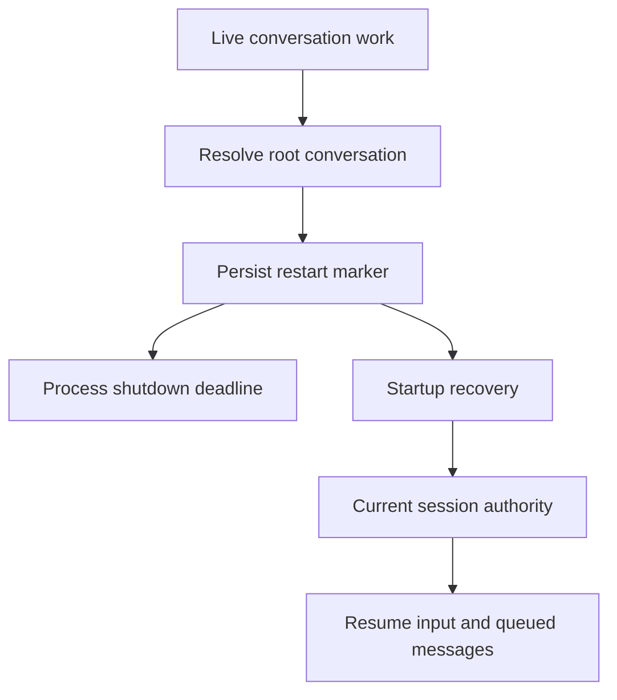

Codex review: needs changes before merge.

## What this changes

This PR preserves ordinary conversations as their own restart targets, gives marker writes the process shutdown budget, and logs recovery outcomes.

**Example:** Restart while agent:other:main:thread:123.456 is running and its session database writer is held for 1.4 seconds.
- **Before:** The one-second persistence timeout can leave the conversation without a restart marker.
- **After:** Marker persistence can finish within the lifecycle deadline, allowing the conversation to receive its normal continuation.

## Review scores

| Measure | Result | What it means |
|---|---|---|
| **Overall readiness** | 🦐 gold shrimp **(3/6)** | Useful owner-level production repair with focused reported process proof, held back by an observed fault-fixture failure. |
| **Proof confidence** | 🐚 platinum hermit **(4/6)** | The ordinary contributor proof gate is exempt for this maintainer-authored PR; supplied evidence describes isolated real-Gateway delayed-writer restart runs, with synthetic model responses and no claim of Slack delivery. |
| **Patch quality** | 🦐 gold shrimp **(3/6)** | 1 actionable review finding remain. |

## Product

**Kind:** Bug fix · **Worth it:** Yes · **Fix scope:** Complete
**User problem:** Running main and channel-thread conversations can remain inactive after a graceful restart.
**Reason:** The maintainer-authored direction restores the documented restart contract using existing session, database, and lifecycle owners.

## Regression provenance

Possible regression — suspected (reviewed change). No predecessor PR is attributed.

## Merge readiness

⛔ **Needs changes before merge - 1 item remains**

This PR addresses source-confirmed restart failures and merits keeping open, but the shared-store fault fixture needs a focused repair before merge.

**Priority:** P1
**Reviewed head:** `ee76bc98b3149ad3aba02a9ab8b0584a83538728`

## Before merge

- [ ] **Wait for the live writer before acquiring the fixture lock (P2)** - The new SIGTERM branch opens the actively used shared session database with a default DatabaseSync connection and immediately executes BEGIN IMMEDIATE. When the Gateway already holds a write transaction, lock acquisition throws before SIGTERM is sent, so the regression never exercises delayed marker persistence. The exact-head check reports `database is locked` at line 533: https://github.com/openclaw/openclaw/actions/runs/41068599197/job/124107316675. Configure a bounded SQLite busy wait on this fixture connection before acquiring the lock, then send SIGTERM only after acquisition succeeds.

## Findings

- [P2] Wait for the live writer before acquiring the fixture lock — `test/gateway-restart-resume.e2e.test.ts:527-531`

<strong>Agent review details</strong>

### How this fits together

Gateway shutdown captures live session work into existing SQLite session markers; startup consumes those markers through ordinary session-event admission and queued-input recovery.

### Technical review

Best possible solution:

Keep the existing recovery owners and production fix, and make the fault fixture acquire its SQLite lock with a bounded wait before signaling shutdown.

Do we have a high-confidence way to reproduce the issue?

Current-main source exposes both lost-marker paths, and the PR records baseline failures; this read-only review ran no target code.

Is this the best way to solve the issue?

Restricting ancestry traversal and reusing the lifecycle deadline fixes the responsible owners without adding recovery machinery; the test lock acquisition needs correction.

Full review comments:

- [P2] Wait for the live writer before acquiring the fixture lock — `test/gateway-restart-resume.e2e.test.ts:527-531`
  The new SIGTERM branch opens the actively used shared session database with a default DatabaseSync connection and immediately executes BEGIN IMMEDIATE. When the Gateway already holds a write transaction, lock acquisition throws before SIGTERM is sent, so the regression never exercises delayed marker persistence. The exact-head check reports `database is locked` at line 533: https://github.com/openclaw/openclaw/actions/runs/41068599197/job/124107316675. Configure a bounded SQLite busy wait on this fixture connection before acquiring the lock, then send SIGTERM only after acquisition succeeds.
  Confidence: 0.96

Overall correctness: patch is incorrect
Overall confidence: 0.95

AGENTS.md: found and applied where relevant.

Codex review notes: model internal, reasoning medium; reviewed against [63dbee6a5145](https://github.com/openclaw/openclaw/commit/63dbee6a514580948082dc20cb930c7e748c019e).

### Provenance checked

- `Requester ancestry` keeps the original intent (9344233e7a66fe36479d55b7f7ae8e10eb886586: The restart redesign follows root requesters so running subagents do not resume independently.)
- `Marker persistence deadline` changes intended behavior with a stated reason (9344233e7a66fe36479d55b7f7ae8e10eb886586: The redesign bounded marker persistence before promptly cancelling active work; this PR documents why the fixed one-second allowance loses markers under writer contention.)
- `Physical-store batching` changes intended behavior with a stated reason (9344233e7a66fe36479d55b7f7ae8e10eb886586: The redesign grouped markers into one write per physical store; this PR explicitly accepts per-selector commits to avoid an upfront discovery pass delaying all writes.)
- `Startup marker consumption` keeps the original intent (9bf3231d2535d854c409de70df2863385df64809: Recovery shares the database startup owner, waits for preparation, and preserves current-authority and queued-input admission.)

### Testing

Proof path: shipped entry point.

### Security

None.

### Evidence

Acceptance criteria:

- pnpm test:e2e:gateway test/gateway-restart-resume.e2e.test.ts --maxWorkers=1
- Verify lock acquisition waits for an existing writer before SIGTERM and retains the delayed-marker assertions.
- git diff --check

What I checked:

- **Pinned change:** The introduced diff limits requester traversal to subagent keys and replaces the fixed marker timeout with the existing process cleanup deadline. ([`src/gateway/server-run-shutdown.ts:52`](https://github.com/openclaw/openclaw/blob/ee76bc98b3149ad3aba02a9ab8b0584a83538728/src/gateway/server-run-shutdown.ts#L52), [ee76bc98b314](https://github.com/openclaw/openclaw/commit/ee76bc98b3149ad3aba02a9ab8b0584a83538728))
- **Current main still contains the reported causes:** Fetched main retains unconditional requester traversal and the one-second marker timeout; its affected production files match the introduction base. ([`src/gateway/server-run-shutdown.ts:53`](https://github.com/openclaw/openclaw/blob/63dbee6a514580948082dc20cb930c7e748c019e/src/gateway/server-run-shutdown.ts#L53), [63dbee6a5145](https://github.com/openclaw/openclaw/commit/63dbee6a514580948082dc20cb930c7e748c019e))
- **Exact-head CI failure:** The check annotation reports ERR_SQLITE_ERROR: database is locked at the fixture's BEGIN IMMEDIATE, before SIGTERM. See https://github.com/openclaw/openclaw/actions/runs/41068599197/job/124107316675. ([`test/gateway-restart-resume.e2e.test.ts:533`](https://github.com/openclaw/openclaw/blob/ee76bc98b3149ad3aba02a9ab8b0584a83538728/test/gateway-restart-resume.e2e.test.ts#L533), [ee76bc98b314](https://github.com/openclaw/openclaw/commit/ee76bc98b3149ad3aba02a9ab8b0584a83538728))
- **Fault setup now targets an active session store:** The new SIGTERM branch opens sharedStore directly without configuring a busy timeout, then immediately attempts to acquire its write lock. ([`test/gateway-restart-resume.e2e.test.ts:527`](https://github.com/openclaw/openclaw/blob/ee76bc98b3149ad3aba02a9ab8b0584a83538728/test/gateway-restart-resume.e2e.test.ts#L527), [ee76bc98b314](https://github.com/openclaw/openclaw/commit/ee76bc98b3149ad3aba02a9ab8b0584a83538728))
- **Original restart contract:** https://github.com/openclaw/openclaw/pull/185730 established ordinary resume inputs under current session authority, captured-input FIFO ordering, and intentional loss after SIGKILL; this PR preserves those decisions. ([`src/gateway/session-restart-resume.ts:55`](https://github.com/openclaw/openclaw/blob/9344233e7a66fe36479d55b7f7ae8e10eb886586/src/gateway/session-restart-resume.ts#L55), [9344233e7a66](https://github.com/openclaw/openclaw/commit/9344233e7a66fe36479d55b7f7ae8e10eb886586))
- **Existing startup recovery owner:** https://github.com/openclaw/openclaw/pull/187822 owns recovery after database preparation; the patch retains its physical-store deduplication and current-authority admission. ([`src/gateway/session-restart-resume.ts:374`](https://github.com/openclaw/openclaw/blob/9bf3231d2535d854c409de70df2863385df64809/src/gateway/session-restart-resume.ts#L374), [9bf3231d2535](https://github.com/openclaw/openclaw/commit/9bf3231d2535d854c409de70df2863385df64809))

### PR surface

Source +78, Tests 0, Docs +3. Total +81 across 8 files. Added test files: 0.

View PR surface stats

| Area | Files | Added | Removed | Net |
|---|---:|---:|---:|---:|
| Source | 4 | 264 | 186 | +78 |
| Tests | 3 | 104 | 104 | 0 |
| Docs | 1 | 3 | 0 | +3 |
| Config | 0 | 0 | 0 | 0 |
| Generated | 0 | 0 | 0 | 0 |
| Other | 0 | 0 | 0 | 0 |
| **Total** | **8** | **371** | **290** | **+81** |

### Review metrics

| Metric | Value | Why it matters |
|---|---|---|
| **Production versus test growth** | Production +78 LOC; tests net 0 LOC | Growth supports marker outcome reporting and lifecycle deadline handling while removing duplicate store discovery; existing regression suites are extended. |

### Labels

Label changes:

- add `P1`: The underlying bug prevents running conversations from continuing after ordinary graceful restarts.
- add `rating: 🦐 gold shrimp`: Overall readiness is 🦐 gold shrimp; proof is 🐚 platinum hermit and patch quality is 🦐 gold shrimp.
- add `status: ⏳ waiting on author`: ClawSweeper has contributor-facing work open and is waiting for author action.

Label justifications:

- `P1`: The underlying bug prevents running conversations from continuing after ordinary graceful restarts.
- `rating: 🦐 gold shrimp`: Overall readiness is 🦐 gold shrimp; proof is 🐚 platinum hermit and patch quality is 🦐 gold shrimp.
- `status: ⏳ waiting on author`: ClawSweeper has contributor-facing work open and is waiting for author action.

### Rating scale

6/6 🦀 challenger crab · 5/6 🦞 diamond lobster · 4/6 🐚 platinum hermit · 3/6 🦐 gold shrimp · 2/6 🦪 silver shellfish · 1/6 🧂 unranked krab. Overall follows the weaker of proof and patch quality; ✨ marks media proof (a screenshot, video, or linked artifact) that directly shows the changed behavior.

### Workflow

ClawSweeper edits this one comment on every review. Comment `@clawsweeper re-review` for a fresh review only. Repair and merge execution lanes are retired.

_Reviewed October 30, 2026, 10:20 AM ET / 14:20 UTC._

<!-- clawsweeper-verdict:needs-changes item=188402 sha=ee76bc98b3149ad3aba02a9ab8b0584a83538728 confidence=high updated_at=2026-10-30T14:15:48Z reviewed_at=2026-10-30T14:20:21.033Z lease_owner=github-run-41070119778-1 lease_comment_id=6524947528 source_revision=a8ec578269ddf7464f5fb26d1758bed53eadcd24fc3f938f939ba7583691101a -->
<!-- clawsweeper-review-state:needs-changes item=188402 sha=ee76bc98b3149ad3aba02a9ab8b0584a83538728 v=1 -->

<!-- clawsweeper-review-version item=188402 reviewed_at=2026-10-30T14:20:21.033Z sha=ee76bc98b3149ad3aba02a9ab8b0584a83538728 source_revision=a8ec578269ddf7464f5fb26d1758bed53eadcd24fc3f938f939ba7583691101a lease_owner=github-run-41070119778-1 lease_comment_id=6524947528 v=1 -->

<!-- clawsweeper-review item=188402 -->