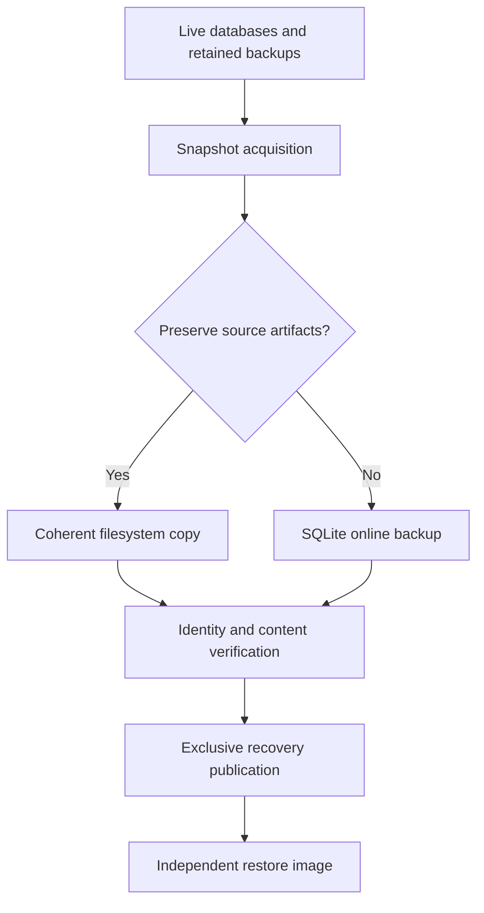

Codex review: needs maintainer review before merge. _Reviewed October 1, 2026, 8:27 AM ET / 12:27 UTC (Revision 10)._

# ClawSweeper review

## What this changes

The branch shares unchanged SQLite pages across independent update recovery files using filesystem cloning, preserves acquisition and publication checks, updates regression coverage and wrapper imports, and normalizes pnpm bootstrap metadata.

## Merge readiness

✅ **Ready for maintainer review**

This PR remains useful and is not superseded by the merged rehearsal optimizations. No actionable introduced defect remains; the latest correction has real boundary proof and the previously failing Windows shard now passes.

**Priority:** P2
**Reviewed head:** `b4d8b4aa9a4aa17b149a94e451b6c7be3aceb6e5`

## Review scores

| Measure | Result | What it means |
|---|---|---|
| **Overall readiness** | 🦞 diamond lobster **(5/6)** | Strong production-boundary and published-updater evidence accompanies a cohesive implementation with no remaining actionable finding. |
| **Proof confidence** | 🦞 diamond lobster **(5/6)** | Sufficient (live_output): Production capture/restore API evidence on APFS demonstrates shared extents, independent mutations and refusal safety; the latest real external-writer probe covers corrected acquisition. Published 9.7 installation evidence verifies preserved existing state at its original 0e7642 revision, and the replacement-head Windows shard passes. No stored format or schema changes require migration, and the accepted scope excludes full-update allocation and end-to-end rollback claims. |
| **Patch quality** | 🦞 diamond lobster **(5/6)** | No actionable review findings were identified. |

## Verification

| Check | Result | Evidence |
|---|---|---|
| **Real behavior** | Verified | Sufficient (live_output): Production capture/restore API evidence on APFS demonstrates shared extents, independent mutations and refusal safety; the latest real external-writer probe covers corrected acquisition. Published 9.7 installation evidence verifies preserved existing state at its original 0e7642 revision, and the replacement-head Windows shard passes. No stored format or schema changes require migration, and the accepted scope excludes full-update allocation and end-to-end rollback claims. |
| **Evidence reviewed** | 9 items | Pinned introduced change: Reviewed the merge-base-to-head production, test, wrapper and lockfile hunks. The original head has the recorded parent 5b88b07b9aa7c9bb61e9b940cb209c6a2af8510e. The stale test merge was not used to infer removal of current-main behavior. Latest acquisition correction: The latest commit removes preserveRowIds from the isolated raw-acquisition selector. Explicit artifact preservation still selects coherent raw copying; ordinary acquisition retains online backup, while row-ID preservation continues to control compaction. Complete captured proof inspected: Retrieved the entire 19,934-unit body and verified SHA-256 77e435b8cd443c9c872951ab28b6f396406215809764845e9ac17eaf4971ee60 against the supplied snapshot. It records APFS extent sharing, independent mutations, restore-history preservation and refusal controls. The latest actual-API probe with an external SQLite writer preserved rowid 71 and integrity in 0.070s; explicit artifact preservation still refused forced WAL resets without publishing. |
| **Findings** | None | None. |
| **Security** | None | None. |

## How this fits together

OpenClaw’s SQLite snapshot subsystem captures databases for update rehearsals and recovery. It turns live or retained database files into verified, independently writable images used by backup and restore owners.

## Before merge

None.

<strong>Agent review details</strong>

### Security

None.

### PR surface

Source +141, Tests +417, Other -24. Total +534 across 14 files.

View PR surface stats

| Area | Files | Added | Removed | Net |
|---|---:|---:|---:|---:|
| Source | 6 | 247 | 106 | +141 |
| Tests | 6 | 622 | 205 | +417 |
| Docs | 0 | 0 | 0 | 0 |
| Config | 0 | 0 | 0 | 0 |
| Generated | 0 | 0 | 0 | 0 |
| Other | 2 | 1 | 25 | -24 |
| **Total** | **14** | **870** | **336** | **+534** |

### Review metrics

| Metric | Value | Why it matters |
|---|---|---|
| **Production and regression growth** | production net +141 lines; tests net +417 lines | Production growth supplies the shared native copy adapter and coherence drivers; regressions cover independent lifetimes, WAL coherence and exact file identities. |

### Technical review

Best possible solution:

Keep coherent acquisition and verified publication under their existing owners, sharing filesystem extents where supported while preserving independent recovery lifetimes and ordinary-copy fallback.

Do we have a high-confidence way to reproduce the issue?

Yes: current main performs physical retained-image copies, and the captured APFS before/after evidence measures the duplication and subsequent page sharing through production recovery APIs. This reviewer inspected source and supplied results without executing a reproduction.

Is this the best way to solve the issue?

Yes: the patch reuses the filesystem copy owner and existing SQLite coherence/publication owners, and the latest correction restores online acquisition for active WAL writers.

AGENTS.md: found and applied where relevant.

Codex review notes: model internal, reasoning medium; reviewed against [9faca1d10477](https://github.com/openclaw/openclaw/commit/9faca1d10477a5f9b879b2901bee55c23ee5675c).

### Labels

Label changes:

No label changes.

Label justifications:

- `P2`: This is a bounded update-storage improvement with demonstrated allocation savings, without changing disk-space admission.
- `merge-risk: 🚨 compatibility`: Recovery-copy mechanics affect upgrades; accepted API and published-driver evidence covers the scoped change while explicitly excluding a new rollback or capacity guarantee.
- `rating: 🦞 diamond lobster`: Overall readiness is 🦞 diamond lobster; proof is 🦞 diamond lobster and patch quality is 🦞 diamond lobster.
- `status: 👀 ready for maintainer look`: ClawSweeper has no concrete contributor-facing blocker left for this PR. Sufficient (live_output): Production capture/restore API evidence on APFS demonstrates shared extents, independent mutations and refusal safety; the latest real external-writer probe covers corrected acquisition. Published 9.7 installation evidence verifies preserved existing state at its original 0e7642 revision, and the replacement-head Windows shard passes. No stored format or schema changes require migration, and the accepted scope excludes full-update allocation and end-to-end rollback claims.
- `proof: sufficient`: Contributor real behavior proof is sufficient. Production capture/restore API evidence on APFS demonstrates shared extents, independent mutations and refusal safety; the latest real external-writer probe covers corrected acquisition. Published 9.7 installation evidence verifies preserved existing state at its original 0e7642 revision, and the replacement-head Windows shard passes. No stored format or schema changes require migration, and the accepted scope excludes full-update allocation and end-to-end rollback claims.

### Evidence

What I checked:

- **Pinned introduced change:** Reviewed the merge-base-to-head production, test, wrapper and lockfile hunks. The original head has the recorded parent 5b88b07b9aa7c9bb61e9b940cb209c6a2af8510e. The stale test merge was not used to infer removal of current-main behavior. ([`src/infra/sqlite-snapshot.ts:600`](https://github.com/openclaw/openclaw/blob/b4d8b4aa9a4aa17b149a94e451b6c7be3aceb6e5/src/infra/sqlite-snapshot.ts#L600), [b4d8b4aa9a4a](https://github.com/openclaw/openclaw/commit/b4d8b4aa9a4aa17b149a94e451b6c7be3aceb6e5))
- **Latest acquisition correction:** The latest commit removes preserveRowIds from the isolated raw-acquisition selector. Explicit artifact preservation still selects coherent raw copying; ordinary acquisition retains online backup, while row-ID preservation continues to control compaction. ([`src/infra/sqlite-snapshot.ts:620`](https://github.com/openclaw/openclaw/blob/b4d8b4aa9a4aa17b149a94e451b6c7be3aceb6e5/src/infra/sqlite-snapshot.ts#L620), [b4d8b4aa9a4a](https://github.com/openclaw/openclaw/commit/b4d8b4aa9a4aa17b149a94e451b6c7be3aceb6e5))
- **Complete captured proof inspected:** Retrieved the entire 19,934-unit body and verified SHA-256 77e435b8cd443c9c872951ab28b6f396406215809764845e9ac17eaf4971ee60 against the supplied snapshot. It records APFS extent sharing, independent mutations, restore-history preservation and refusal controls. The latest actual-API probe with an external SQLite writer preserved rowid 71 and integrity in 0.070s; explicit artifact preservation still refused forced WAL resets without publishing. ([b4d8b4aa9a4a](https://github.com/openclaw/openclaw/commit/b4d8b4aa9a4aa17b149a94e451b6c7be3aceb6e5))
- **Published updater compatibility and accepted scope:** The captured body records the published openclaw@2026.9.7 Linux arm64 base/manual cell against 0e7642eb5acb92b5471b25c5a080a32b8a11ba2b: all 11,340 installed records matched, with update, migration, state/config preservation, Doctor, health, readiness and RPC passing. The MEMBER author explicitly accepts API recovery proof plus that compatibility cell and head-bound gates, without an additional forced-failure scenario. Older package evidence retains its original identity; no reduced capacity requirement, whole-update allocation bound or end-to-end rollback claim is made. ([0e7642eb5acb](https://github.com/openclaw/openclaw/commit/0e7642eb5acb92b5471b25c5a080a32b8a11ba2b))
- **Original Windows failure covered on replacement head:** The checks-windows-node-test-2 check completed successfully on the exact reviewed head: https://github.com/openclaw/openclaw/actions/runs/36861035259/job/110365427854. Other pending checks remain routine gate work and are not claimed as passing coverage. ([`src/infra/update-candidate-state.online-backup.process.test.ts:53`](https://github.com/openclaw/openclaw/blob/b4d8b4aa9a4aa17b149a94e451b6c7be3aceb6e5/src/infra/update-candidate-state.online-backup.process.test.ts#L53), [b4d8b4aa9a4a](https://github.com/openclaw/openclaw/commit/b4d8b4aa9a4aa17b149a94e451b6c7be3aceb6e5))
- **Restore and publication invariants:** Restore preparation uses an independent copy, verifies baseline hash, size and schema version, and preserves the existing raw update-history transfer. Snapshot publication retains exclusive publication, source mutation checks and exact bigint identity checks for copied stages. ([`src/infra/update-database-restore-source.ts:29`](https://github.com/openclaw/openclaw/blob/b4d8b4aa9a4aa17b149a94e451b6c7be3aceb6e5/src/infra/update-database-restore-source.ts#L29), [b4d8b4aa9a4a](https://github.com/openclaw/openclaw/commit/b4d8b4aa9a4aa17b149a94e451b6c7be3aceb6e5))

Likely related people:

- **fuller-stack-dev:** Suggested for follow-up; no historical authorship or introduction is verified. (role: unverified routing candidate; confidence: low)
- **steipete:** Suggested for follow-up; no historical authorship or introduction is verified. (role: unverified routing candidate; confidence: low)

### Rating scale

| Score | Internal tier | Crab rank | Meaning |
|---:|:---:|---|---|
| **6/6** | S | 🦀 challenger crab | Exceptional readiness |
| **5/6** | A | 🦞 diamond lobster | Very strong readiness |
| **4/6** | B | 🐚 platinum hermit | Good normal PR; ordinary maintainer review |
| **3/6** | C | 🦐 gold shrimp | Useful, but confidence is limited |
| **2/6** | D | 🦪 silver shellfish | Proof or implementation needs work |
| **1/6** | F | 🧂 unranked krab | Not merge-ready |
| N/A | NA | 🌊 off-meta tidepool | Rating does not apply |

Overall follows the weaker of proof and patch quality.
Shiny media proof means a screenshot, video, or linked artifact directly shows the changed behavior. Runtime, network, CSP, and security claims still need visible diagnostics.

### Workflow

- ClawSweeper keeps one durable marker-backed review comment per issue or PR.
- Re-runs edit this comment so the latest verdict, findings, and automation markers stay together instead of adding duplicate bot comments.
- A fresh review can be triggered by eligible `@clawsweeper re-review` comments, exact-item GitHub events, scheduled/background review runs, or manual workflow dispatch.
- PR/issue authors and users with repository write access can comment `@clawsweeper re-review` or `@clawsweeper re-run` on an open PR or issue to request a fresh review only.
- Maintainers can also comment `@clawsweeper review` to request a fresh review only.
- Fresh-review commands do not start repair, autofix, rebase, CI repair, or automerge.
- Maintainer-only repair and merge flows require explicit commands such as `@clawsweeper autofix`, `@clawsweeper automerge`, `@clawsweeper fix ci`, or `@clawsweeper address review`.
- Maintainers can comment `@clawsweeper explain` to ask for more context, or `@clawsweeper stop` to stop active automation.

### History

Review history (9 earlier review cycles; latest 8 shown)

<!-- clawsweeper-review-history v=1 total=9 -->
- reviewed 2026-10-01T06:44:18.751Z sha 2ab5e0df7af9ed8848e358c65ab03f0de68f8f02 :: blocked before merge. :: none
- reviewed 2026-10-01T09:23:22.878Z sha 1d8b294293260a419a10f9a87e26cf0d5935bb72 :: blocked before merge. :: none
- reviewed 2026-10-01T09:34:51.900Z sha eda7389a7f8f25d4fed9e58dbac7bb7ab4b27054 :: blocked before merge. :: none
- reviewed 2026-10-01T10:04:46.055Z sha 0f8efc2dec759bbb3c7e74e2858e066dd0e018a3 :: blocked before merge. :: none
- reviewed 2026-10-01T10:14:27.668Z sha 0f8efc2dec759bbb3c7e74e2858e066dd0e018a3 :: blocked before merge. :: none
- reviewed 2026-10-01T11:24:42.220Z sha 0e7642eb5acb92b5471b25c5a080a32b8a11ba2b :: blocked before merge. :: none
- reviewed 2026-10-01T11:54:15.815Z sha 0e7642eb5acb92b5471b25c5a080a32b8a11ba2b :: needs maintainer review before merge. :: none
- reviewed 2026-10-01T12:07:57.963Z sha 5b88b07b9aa7c9bb61e9b940cb209c6a2af8510e :: needs maintainer review before merge. :: none

<!-- clawsweeper-verdict:needs-human item=162466 sha=b4d8b4aa9a4aa17b149a94e451b6c7be3aceb6e5 confidence=high updated_at=2026-10-01T12:22:58Z reviewed_at=2026-10-01T12:27:18.018Z lease_owner=github-run-36861226418-1 lease_comment_id=5931352644 source_revision=108722b4f89f9b0f829a064c10edd8c7ee2a99124ab0e9a398ff8a168253a006 live_verification=absent -->
<!-- clawsweeper-review-state:ready item=162466 sha=b4d8b4aa9a4aa17b149a94e451b6c7be3aceb6e5 v=1 -->

<!-- clawsweeper-review-version item=162466 reviewed_at=2026-10-01T12:27:18.018Z sha=b4d8b4aa9a4aa17b149a94e451b6c7be3aceb6e5 source_revision=108722b4f89f9b0f829a064c10edd8c7ee2a99124ab0e9a398ff8a168253a006 lease_owner=github-run-36861226418-1 lease_comment_id=5931352644 v=1 -->

<!-- clawsweeper-review item=162466 -->