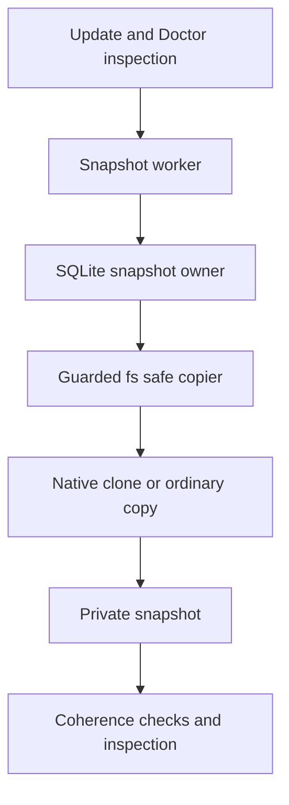

Codex review: needs changes before merge.

## What this changes

This PR enables guarded copy-on-write copying for synchronous SQLite snapshots and upgrades fs-safe to support Btrfs NOCOW sources.

**Example:** An artifact-preserving SQLite inspection copies a 32 MiB database on clone-capable Btrfs.
- **Before:** The synchronous snapshot owner streams the entire database into staging.
- **After:** The owner requests an independent clone, retaining ordinary copying when cloning is unavailable.

## Review scores

| Measure | Result | What it means |
|---|---|---|
| **Overall readiness** | 🦐 gold shrimp **(3/6)** | Focused implementation with meaningful independence and failure-path coverage; physical savings are demonstrated at the copier boundary, with broader updater evidence retained at its historical revision. |
| **Proof confidence** | 🦐 gold shrimp **(3/6)** | This maintainer-authored PR is outside the ordinary contributor proof gate; supplied evidence covers the published Btrfs copier and a successful historical published-updater cell, without claiming whole-update I/O savings or current-head qualification. |
| **Patch quality** | 🐚 platinum hermit **(4/6)** | No actionable review findings were identified. |

## Product

**Kind:** Performance · **Worth it:** Yes · **Fix scope:** Complete
**User problem:** Strict update and Doctor inspection can rewrite large private SQLite images even when the filesystem supports sharing unchanged storage.
**Reason:** The maintainer-authored direction has clear storage-I/O value and reuses an existing guarded primitive with bounded production growth.

## Merge readiness

⛔ **Needs changes before merge - 1 item remains**

Keep this useful, maintainer-authored PR open; no actionable introduced defect was found, but failing current-head checks still need attribution before landing.

**Priority:** P2
**Reviewed head:** `d5c8e058991566b12603127cd3fded4bd2819b2b`

## Before merge

- [ ] **Complete next step** - Determine the causes of check-lint-core-2 and checks-node-changed-compact-large-12; request author repairs only for failures caused by this PR.

## Findings

None.

### Tests

- Missing end-to-end proof: The supplied Btrfs physical-I/O measurement exercises fs-safe directly rather than the OpenClaw artifact-preserving snapshot entry point.

<strong>Agent review details</strong>

### How this fits together

Update, Doctor, and recovery inspection request private SQLite snapshots; the snapshot owner copies admitted database files, verifies family coherence, and returns an independently writable location with owned cleanup.

### Technical review

Best possible solution:

Use the released guarded copier at the existing snapshot owner while preserving coherence checks, independent files, and ordinary-copy fallback.

Do we have a high-confidence way to reproduce the issue?

Current main visibly forces synchronous snapshot bytes through copyFileDescriptorSync; the supplied Btrfs measurements establish the dependency's prior NOCOW mismatch fallback, but this review ran no reproduction.

Is this the best way to solve the issue?

The change uses the existing guarded copy capability and snapshot owner, preserving SQLite-specific coherence instead of introducing a parallel implementation.

AGENTS.md: found and applied where relevant.

Codex review notes: model internal, reasoning medium; reviewed against [33d25c8cb5b2](https://github.com/openclaw/openclaw/commit/33d25c8cb5b22e4f70af588eff4b1903daf35c8a).

### Provenance checked

- `Synchronous snapshot copying` keeps the original intent (140b6026c7cb7d038266c468292ff32a6105c3e1: Consolidated infrastructure filesystem primitives while retaining source pinning, private permissions, fsync, and revalidation; this is a known refactor, not a proven introduction.)
- `Snapshot coherence and staging volume` keeps the original intent (https://github.com/openclaw/openclaw/pull/141773: Retain one private copy and compare a complete pinned source read rather than retaining two copies.)
- `Ambiguous guarded-copy failures` changes intended behavior with a stated reason (https://github.com/openclaw/openclaw/pull/153839: Retry source instability without hiding genuine inspection or recovery failures; this PR explicitly explains why ambiguous helper failures remain terminal.)
- `fs-safe dependency pins and release-age exemptions` keeps the original intent (91b06cd253245433bec2e725367e355b3ce10533: Keep direct consumers aligned with a reviewed published release and narrowly scoped temporary release-age exemptions.)

### Testing

Proof path: in-process harness.

### Security

None.

### Evidence

What I checked:

- **Introduced change and current-main behavior:** The pinned introduced diff replaces descriptor streaming with copyRootFileSync using the pinned source identity, clone auto, explicit hardlink admission, private mode, fsync, and original-path revalidation. Fetched main retains descriptor streaming in this function. ([`src/infra/sqlite-readonly-location.ts:178`](https://github.com/openclaw/openclaw/blob/d5c8e058991566b12603127cd3fded4bd2819b2b/src/infra/sqlite-readonly-location.ts#L178), [d5c8e0589915](https://github.com/openclaw/openclaw/commit/d5c8e058991566b12603127cd3fded4bd2819b2b))
- **Applicable dependency contract:** The patch directly imports and executes copyRootFileSync, making this dependency's guarded-copy contract applicable. Its released implementation verifies source identity, exclusively creates the destination, checks destination identity and link count, and preserves cleanup errors. The v0.26.6 tag resolves to the merged repair at https://github.com/openclaw/fs-safe/pull/991. ([`src/copy-root-file-sync.ts:54`](https://github.com/openclaw/fs-safe/blob/9445e65094f6255c4c1b9679bdbb8175866d7b63/src/copy-root-file-sync.ts#L54), [9445e65094f6](https://github.com/openclaw/fs-safe/commit/9445e65094f6255c4c1b9679bdbb8175866d7b63))
- **Btrfs policy and fallback:** The release changes NOCOW only on the newly created empty destination, verifies flag readback, and recreates an ordinary destination for automatic fallback. Successful NOCOW clones lack data checksums and compression; the linked dependency repair explicitly records that tradeoff. ([`native/src/file_clone_linux.rs:38`](https://github.com/openclaw/fs-safe/blob/9445e65094f6255c4c1b9679bdbb8175866d7b63/native/src/file_clone_linux.rs#L38), [9445e65094f6](https://github.com/openclaw/fs-safe/commit/9445e65094f6255c4c1b9679bdbb8175866d7b63))
- **Preserved snapshot invariants:** The existing generator still owns WAL-prefix handling, sidecar comparisons, complete main-file comparison, private journal recovery, publication, and cleanup. Added tests exercise alias retargeting, terminal helper failures, independent mutation, and native-disabled copying. ([`src/infra/sqlite-readonly-location.ts:308`](https://github.com/openclaw/openclaw/blob/d5c8e058991566b12603127cd3fded4bd2819b2b/src/infra/sqlite-readonly-location.ts#L308), [d5c8e0589915](https://github.com/openclaw/openclaw/commit/d5c8e058991566b12603127cd3fded4bd2819b2b))
- **Accepted source-drift behavior:** The maintainer-authored body explicitly accepts stopping on ambiguous guarded-copy admission errors rather than masking destination, I/O, or cleanup failures with retries; unambiguous source-only drift retains bounded retries. ([`src/infra/sqlite-readonly-location.ts:176`](https://github.com/openclaw/openclaw/blob/d5c8e058991566b12603127cd3fded4bd2819b2b/src/infra/sqlite-readonly-location.ts#L176), [d5c8e0589915](https://github.com/openclaw/openclaw/commit/d5c8e058991566b12603127cd3fded4bd2819b2b))
- **Historical updater evidence:** The linked published-driver update job succeeded at b0c49e57fcf6bc350437d542fd3a0ee85729f5bb: https://github.com/openclaw/openclaw/actions/runs/38849728164/job/116813081924. GitHub blob comparisons confirm all three touched test files are unchanged; the production module additionally incorporates main's single-read header classifier. ([`src/infra/sqlite-readonly-location.ts:125`](https://github.com/openclaw/openclaw/blob/b0c49e57fcf6bc350437d542fd3a0ee85729f5bb/src/infra/sqlite-readonly-location.ts#L125), [b0c49e57fcf6](https://github.com/openclaw/openclaw/commit/b0c49e57fcf6bc350437d542fd3a0ee85729f5bb))

### PR surface

Source +21, Tests +140, Config 0, Other 0. Total +161 across 19 files. Added test files: 0.

View PR surface stats

| Area | Files | Added | Removed | Net |
|---|---:|---:|---:|---:|
| Source | 1 | 27 | 6 | +21 |
| Tests | 3 | 161 | 21 | +140 |
| Docs | 0 | 0 | 0 | 0 |
| Config | 14 | 25 | 25 | 0 |
| Generated | 0 | 0 | 0 | 0 |
| Other | 1 | 69 | 69 | 0 |
| **Total** | **19** | **282** | **121** | **+161** |

### Review metrics

| Metric | Value | Why it matters |
|---|---|---|
| **Production versus test growth** | Production +27/−6 lines; tests +161/−21 lines. | Production growth preserves alias admission and error ownership while replacing streaming; tests cover source drift, failure propagation, and independent clone/copy behavior. |

### Labels

Label changes:

- add `rating: 🦐 gold shrimp`: Overall readiness is 🦐 gold shrimp; proof is 🦐 gold shrimp and patch quality is 🐚 platinum hermit.
- add `status: ⏳ waiting on author`: ClawSweeper has contributor-facing work open and is waiting for author action.
- remove `rating: 🦪 silver shellfish`: Current PR rating is `rating: 🦐 gold shrimp`, so this older rating label is no longer current.
- remove `status: 👀 ready for maintainer look`: Current PR status label is `status: ⏳ waiting on author`.

Label justifications:

- `P2`: Reduces snapshot write amplification on supported filesystems without changing configuration or database formats.
- `rating: 🦐 gold shrimp`: Overall readiness is 🦐 gold shrimp; proof is 🦐 gold shrimp and patch quality is 🐚 platinum hermit.
- `status: ⏳ waiting on author`: ClawSweeper has contributor-facing work open and is waiting for author action.

### Rating scale

6/6 🦀 challenger crab · 5/6 🦞 diamond lobster · 4/6 🐚 platinum hermit · 3/6 🦐 gold shrimp · 2/6 🦪 silver shellfish · 1/6 🧂 unranked krab. Overall follows the weaker of proof and patch quality; ✨ marks media proof (a screenshot, video, or linked artifact) that directly shows the changed behavior.

### Workflow

ClawSweeper edits this one comment on every review. Comment `@clawsweeper re-review` for a fresh review only. Repair and merge execution lanes are retired.

### History

Review history (3 earlier review cycles)

<!-- clawsweeper-review-history v=1 total=3 -->
- reviewed 2026-10-16T01:42:42.725Z sha e5154362502310ada799dd66df7b68fa24130ef7 :: needs maintainer review before merge. :: none
- reviewed 2026-10-16T03:15:00.053Z sha c4ce26f2e1e92590e27e05b97cecde6e3b35b75e :: needs maintainer review before merge. :: none
- reviewed 2026-10-16T04:24:55.182Z sha b0c49e57fcf6bc350437d542fd3a0ee85729f5bb :: needs maintainer review before merge. :: none

_Reviewed October 16, 2026, 3:22 AM ET / 07:22 UTC (Revision 4)._

<!-- clawsweeper-verdict:needs-changes item=172763 sha=d5c8e058991566b12603127cd3fded4bd2819b2b confidence=high updated_at=2026-10-16T07:16:36Z reviewed_at=2026-10-16T07:22:20.424Z lease_owner=github-run-38866082586-1 lease_comment_id=6210206813 source_revision=0b7db307506917fdcce61d5e0937e86b7d2da4ed6696925f5a0775399d6b0579 -->
<!-- clawsweeper-review-state:needs-changes item=172763 sha=d5c8e058991566b12603127cd3fded4bd2819b2b v=1 -->

<!-- clawsweeper-review-version item=172763 reviewed_at=2026-10-16T07:22:20.424Z sha=d5c8e058991566b12603127cd3fded4bd2819b2b source_revision=0b7db307506917fdcce61d5e0937e86b7d2da4ed6696925f5a0775399d6b0579 lease_owner=github-run-38866082586-1 lease_comment_id=6210206813 v=1 -->

<!-- clawsweeper-review item=172763 -->