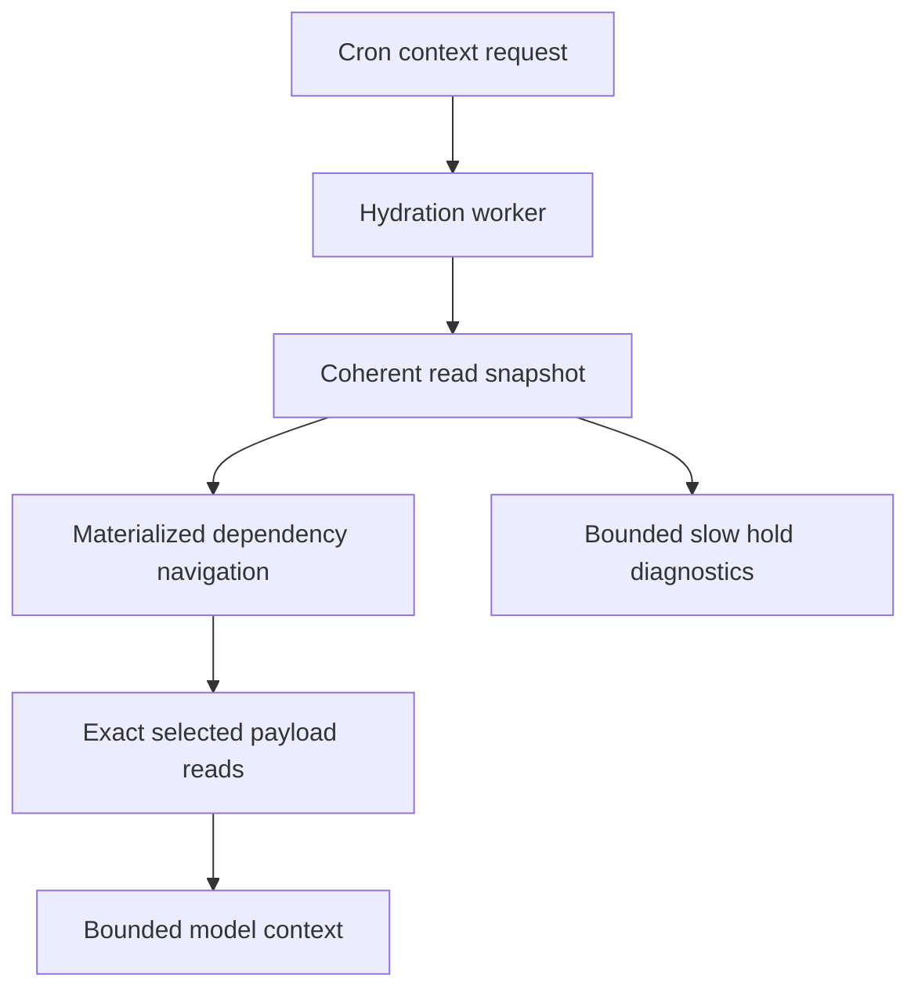

Codex review: needs maintainer review before merge.

## What this changes

This PR evaluates transcript dependency navigation once per candidate and adds bounded statement, row, and GC attribution to slow hydration warnings.

**Example:** Select a 50-event context from a synthetic cron session with 50,000 background-heavy history entries.
- **Before:** The reported owner benchmark takes 1,466 ms median and repeatedly evaluates dependency navigation.
- **After:** The reported median is 364 ms with matching returned-event digests and one navigation projection per candidate.

## Review scores

| Measure | Result | What it means |
|---|---|---|
| **Overall readiness** | 🦐 gold shrimp **(3/6)** | Focused, useful implementation with meaningful native-owner measurements and regression coverage; supplied behavior evidence remains below the shipped Gateway entry point. |
| **Proof confidence** | 🦐 gold shrimp **(3/6)** | This maintainer-authored PR is outside the ordinary contributor proof gate; its self-contained benchmark reports native owner results, preserved event digests, and forced-GC scope separation, without claiming deployed Gateway causality. |
| **Patch quality** | 🐚 platinum hermit **(4/6)** | No actionable review findings were identified. |

## Product

**Kind:** Performance · **Worth it:** Yes · **Fix scope:** Complete
**User problem:** Long-lived cron sessions can spend seconds preparing a small context window, while existing warnings cannot identify the expensive portion.
**Reason:** The maintainer-authored direction has a concrete measured benefit, preserves context behavior, and explicitly accepts its peak-memory cost.

## Merge readiness

✅ **Ready for maintainer review**

Keep open: this maintainer-authored PR addresses remaining hydration work on current main, and inspection found no actionable introduced defect.

**Priority:** P2
**Reviewed head:** `dfe76c8ec6049cef28fe380a245c7d376828371b`

## Before merge

None.

## Findings

None.

### Tests

- Missing end-to-end proof: The supplied measurements exercise the native hydration owner directly; a Gateway cron run demonstrating the changed warning and latency is not supplied.

<strong>Agent review details</strong>

### How this fits together

The hydration worker reads a session's active transcript under a coherent database snapshot and returns bounded context with required background results; transaction observation records slow native execution without logging payloads.

### Technical review

Best possible solution:

Retain the focused query repair and existing diagnostic owners, with unchanged transcript semantics and the documented memory tradeoff.

Do we have a high-confidence way to reproduce the issue?

Current-main source expands the same guarded navigation expression across dependency predicates; the supplied native regression reports seven evaluations before and one after, without reviewer execution.

Is this the best way to solve the issue?

Materializing navigation within the existing query removes repeated work while preserving selection ownership, and the diagnostic extension reuses existing observation and GC lifecycles.

AGENTS.md: found and applied where relevant.

Codex review notes: model internal, reasoning medium; reviewed against [d921a2bfcc4e](https://github.com/openclaw/openclaw/commit/d921a2bfcc4e0aeeec199381b73403d51cced607).

### Provenance checked

- `Background-result dependency selection` keeps the original intent (074b316e9ec8a4f9330f1ca3619bc8a53c1799c4: Record background-result placement and retain required artifacts through bounded replay and compaction.)
- `Ordinary-history exclusion` keeps the original intent (3e6e5a7a5dc96fe1e42c7caaa8655fff6c0044a3: Avoid inspecting unrelated ordinary payloads while retaining missing-identity fallbacks and read fences.)
- `Exact dependency payload lookups` keeps the original intent (ad1a025f8ac6dc1318b758981ff476f8d06bfc0a: Filter metadata before exact sequence lookups to avoid whole-session payload range scans.)
- `Slow transaction attribution` keeps the original intent (ce908375fed062dd75abab62d57fc840b96a144e: Distinguish native execution from remaining callback time without exposing SQL or bindings.)

### Testing

Proof path: in-process harness.

### Security

None.

### Evidence

What I checked:

- **Pinned introduction and current main:** Reviewed the merge-base-to-head hunks across all seven paths. Fetched main retains the base versions of the existing affected files, so the repeated-navigation repair is still distinct work. ([`src/config/sessions/session-accessor.sqlite-active-context.ts:480`](https://github.com/openclaw/openclaw/blob/dfe76c8ec6049cef28fe380a245c7d376828371b/src/config/sessions/session-accessor.sqlite-active-context.ts#L480), [dfe76c8ec604](https://github.com/openclaw/openclaw/commit/dfe76c8ec6049cef28fe380a245c7d376828371b))
- **Selection invariants preserved:** The materialized query retains session scoping, metadata exclusion, exact sequence joins, read fencing, dependency predicates, and active-position ordering; existing dependency fitting still owns pending-result retention and byte limits. ([`src/config/sessions/session-accessor.sqlite-active-context.ts:482`](https://github.com/openclaw/openclaw/blob/dfe76c8ec6049cef28fe380a245c7d376828371b/src/config/sessions/session-accessor.sqlite-active-context.ts#L482), [dfe76c8ec604](https://github.com/openclaw/openclaw/commit/dfe76c8ec6049cef28fe380a245c7d376828371b))
- **Earlier optimization remains intact:** https://github.com/openclaw/openclaw/pull/191236 removed whole-session payload range scans; this PR preserves its exact lookup contract and addresses repeated navigation evaluation instead. ([`src/config/sessions/session-accessor.sqlite-history-query-plan.test.ts:207`](https://github.com/openclaw/openclaw/blob/ad1a025f8ac6dc1318b758981ff476f8d06bfc0a/src/config/sessions/session-accessor.sqlite-history-query-plan.test.ts#L207), [ad1a025f8ac6](https://github.com/openclaw/openclaw/commit/ad1a025f8ac6dc1318b758981ff476f8d06bfc0a))
- **Existing diagnostic and GC owners reused:** Hydration inherits its operation label, reuses native statement observation and the isolate GC sampler, stops collection in finally, and emits hashed statement identities with bounded ranked groups. ([`src/infra/sqlite-transaction.ts:473`](https://github.com/openclaw/openclaw/blob/dfe76c8ec6049cef28fe380a245c7d376828371b/src/infra/sqlite-transaction.ts#L473), [dfe76c8ec604](https://github.com/openclaw/openclaw/commit/dfe76c8ec6049cef28fe380a245c7d376828371b))
- **Measured tradeoff accepted:** The maintainer-authored body explicitly accepts 6.9% greater peak process RSS for approximately 75% lower owner wall and CPU time, distinguishes owner measurements from Gateway latency, and reports matching event digests. ([`scripts/perf/cron-hydration-statement-measure.ts:1`](https://github.com/openclaw/openclaw/blob/dfe76c8ec6049cef28fe380a245c7d376828371b/scripts/perf/cron-hydration-statement-measure.ts#L1), [dfe76c8ec604](https://github.com/openclaw/openclaw/commit/dfe76c8ec6049cef28fe380a245c7d376828371b))
- **Exact-head checks remain pending:** All three PostgreSQL conformance shards remain in progress; their pending state establishes no patch-caused failure or conflict. ([dfe76c8ec604](https://github.com/openclaw/openclaw/commit/dfe76c8ec6049cef28fe380a245c7d376828371b))

Likely related people:

- **Peter Steinberger:** Raw commit 074b316e9ec8a4f9330f1ca3619bc8a53c1799c4 adds src/config/sessions/session-accessor.sqlite-active-context.ts:458 relative to its recorded parents. This identifies author metadata, not feature responsibility or a PR merger. (role: source-line author; confidence: high; commits: [074b316e9ec8](https://github.com/openclaw/openclaw/commit/074b316e9ec8a4f9330f1ca3619bc8a53c1799c4); files: `src/config/sessions/session-accessor.sqlite-active-context.ts`)
- **Vincent Koc:** Raw commit ad1a025f8ac6dc1318b758981ff476f8d06bfc0a adds src/config/sessions/session-accessor.sqlite-history-query-plan.test.ts:205 relative to its recorded parents. This identifies author metadata, not feature responsibility or a PR merger. (role: source-line author; confidence: high; commits: [ad1a025f8ac6](https://github.com/openclaw/openclaw/commit/ad1a025f8ac6dc1318b758981ff476f8d06bfc0a); files: `src/config/sessions/session-accessor.sqlite-history-query-plan.test.ts`)

### PR surface

Source +72, Tests 0, Docs +19, Other +408. Total +499 across 7 files. Added test files: 0.

View PR surface stats

| Area | Files | Added | Removed | Net |
|---|---:|---:|---:|---:|
| Source | 3 | 133 | 61 | +72 |
| Tests | 2 | 113 | 113 | 0 |
| Docs | 1 | 19 | 0 | +19 |
| Config | 0 | 0 | 0 | 0 |
| Generated | 0 | 0 | 0 | 0 |
| Other | 1 | 408 | 0 | +408 |
| **Total** | **7** | **673** | **174** | **+499** |

### Review metrics

| Metric | Value | Why it matters |
|---|---|---|
| **Production versus regression code** | Production +72 net lines; tests 0 net lines. | Ten lines support the query repair and 62 extend existing attribution; the separate measurement script provides rerunnable performance evidence. |

### Labels

Label changes:

- add `P2`: Repeated navigation work delays hydration of long background-heavy sessions, with a focused repair and no demonstrated service-wide outage.
- add `rating: 🦐 gold shrimp`: Overall readiness is 🦐 gold shrimp; proof is 🦐 gold shrimp and patch quality is 🐚 platinum hermit.
- add `status: 👀 ready for maintainer look`: ClawSweeper has no concrete contributor-facing blocker left for this PR.

Label justifications:

- `P2`: Repeated navigation work delays hydration of long background-heavy sessions, with a focused repair and no demonstrated service-wide outage.
- `rating: 🦐 gold shrimp`: Overall readiness is 🦐 gold shrimp; proof is 🦐 gold shrimp and patch quality is 🐚 platinum hermit.
- `status: 👀 ready for maintainer look`: ClawSweeper has no concrete contributor-facing blocker left for this PR.

### Rating scale

6/6 🦀 challenger crab · 5/6 🦞 diamond lobster · 4/6 🐚 platinum hermit · 3/6 🦐 gold shrimp · 2/6 🦪 silver shellfish · 1/6 🧂 unranked krab. Overall follows the weaker of proof and patch quality; ✨ marks media proof (a screenshot, video, or linked artifact) that directly shows the changed behavior.

### Workflow

ClawSweeper edits this one comment on every review. Comment `@clawsweeper re-review` for a fresh review only. Repair and merge execution lanes are retired.

_Reviewed November 3, 2026, 1:34 AM ET / 06:34 UTC._

<!-- clawsweeper-verdict:needs-human item=191711 sha=dfe76c8ec6049cef28fe380a245c7d376828371b confidence=high updated_at=2026-11-03T06:31:28Z reviewed_at=2026-11-03T06:34:28.365Z lease_owner=github-run-41590301801-1 lease_comment_id=6597075286 source_revision=b41f78d2879b10d9b560f5bede163a4f7a83ef0cd18387d4c073b6ca9241a8cb hold=not_opted_in findings=0 -->
<!-- clawsweeper-review-state:ready item=191711 sha=dfe76c8ec6049cef28fe380a245c7d376828371b v=1 -->

<!-- clawsweeper-review-version item=191711 reviewed_at=2026-11-03T06:34:28.365Z sha=dfe76c8ec6049cef28fe380a245c7d376828371b source_revision=b41f78d2879b10d9b560f5bede163a4f7a83ef0cd18387d4c073b6ca9241a8cb lease_owner=github-run-41590301801-1 lease_comment_id=6597075286 v=1 -->

<!-- clawsweeper-review item=191711 -->