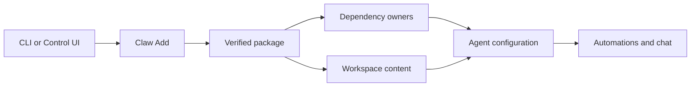

Codex review: needs real behavior proof before merge.

## What this changes

This PR replaces installed-Claw lifecycle management with Add that creates ordinary agents, workspace content, dependencies, and automations.

**Example:** Add the Research briefing Claw twice.
- **Before:** The existing agent identity prevents a second installation.
- **After:** Add creates Research briefing and Research briefing 2 as separate agents.

## Review scores

| Measure | Result | What it means |
|---|---|---|
| **Overall readiness** | 🧂 unranked krab **(1/6)** | Earlier real media supports the feature, but the pinned-runtime regression and verified cutover defects make this head unready. |
| **Proof confidence** | 🦐 gold shrimp **(3/6)** | Real behavior proof is necessary before merge. See [Before merge](#before-merge). |
| **Patch quality** | 🧂 unranked krab **(1/6)** | Security review found an item that needs attention. |

## Product

**Kind:** Feature · **Worth it:** Yes · **Fix scope:** Complete
**User problem:** Users must manage a separate installed-Claw lifecycle instead of adding an ordinary agent they can immediately use.
**Reason:** The maintainer-authored classification establishes direction, and inspected real screenshots demonstrate useful discovery-to-chat behavior.

## Merge readiness

⛔ **Blocked before merge - 20 items remain**

Keep this maintainer-directed feature open; twelve verified findings still block this head, including broken Lobster approval continuation and incomplete lifecycle cutover.

**Priority:** P2
**Reviewed head:** `e13615fbcd0fa37ea75d6b6eeef01239818be8ed`

## Before merge

- [ ] **Add real behavior proof** - Authority-chain proof required: inspected earlier screenshots show real Add-to-chat success, and the added Gateway harness covers installation admission, but recorded allowed, read-only, and revoked Add outcomes at the installation boundary and retired Lobster continuation rejection before workflow I/O are not established. Supply production-boundary logs or a recording, including Telegram approval outcomes, with credentials, IPs, phone numbers, and non-public endpoints redacted; also provide a latest-stable upgrade preserving existing configuration and data. After adding proof, update the PR body; ClawSweeper should re-review automatically. If it does not, the PR author or someone with repository write access can comment `@clawsweeper re-review`.
- [ ] **Keep Lobster approvals compatible with the pinned runtime (P1)** - Every Allow once continuation reaches this guard, but @clawdbot/lobster 2026.9.16 drops assertInvocationCurrent in createToolContext. Approved workflows therefore throw before resumeToolRequest; exact-head real-runtime CI confirms the failure. Use a supported continuation contract while preserving authority checks at the actual effect boundary.
- [ ] **Recognize numbered copies from 10 onward (P2)** - The suffix expression rejects 10–19 and larger numbers beginning with 1. With the base agent and copies 2 through 10 present, the next Add selects the occupied suffix 10 and is blocked; copy 10 also loses its numbered display name. Parse canonical positive integers and require a value of at least 2.
- [ ] **Read the deletion journal through its worker operation (P2)** - Gateway Add calls this synchronous SQLite reader on the Gateway main thread. This introduces database access prohibited by root policy and can stall unrelated requests. Await readAgentDeletionJournalAsync while retaining the deletion lease and subsequent authority check.
- [ ] **Complete both extension-preflight fixtures (P2)** - planClawExtensions now requires capabilityGrantsByPluginId, but both retained fixtures provide only aggregate declarations and grants. The valid mapping becomes invalid, and the collision case gains extension_provenance_incomplete; exact-head CI confirms both failures. Add the per-plugin grant evidence to both fixtures.
- [ ] **Remove the obsolete cron removal argument assertion (P2)** - The changed removal handler forwards expectedConfigRevision for current-job self-management, but this exact mock assertion accepts only commitGuard. Exact-head CI fails despite the expected successful removal result. Remove the incidental call-shape assertion or assert the revision-aware contract.
- [ ] **Retire the consumer of the removed Claw Doctor check (P2)** - This PR removes core/doctor/claws-state and its implementation but retains this test and its mock of the deleted module. Exact-head CI fails because the requested check is undefined. Remove the obsolete consumer or preserve its hosted-read invariant under a surviving owner.
- [ ] **Remove the deleted adoption test from both inventories (P2)** - The PR deletes src/state/claw-package-adoption.test.ts but retains it in databaseWorkerCoreTestFiles and scripts/lib/ci-proof-test-inventory.mts. The test-plan contract still requires admission of this nonexistent file and fails in exact-head CI. Remove both retired entries.
- [ ] **Preserve the staging export used by Linux packaging tests (P2)** - apps/linux/scripts/test-stage-package.mjs still imports stageInstalledPackage as a named export. Removing the export makes ESM instantiation fail before staging tests execute. Restore the export or migrate its consumers together.
- [ ] **Keep inventory readers independent of Add orchestration (P2)** - The introduced source graph contains inventory-read.kernel.ts → workspace.ts → add-state-write.ts → inventory-read.ts → inventory-read.kernel.ts, with the closing edge importing ClawInventory as a type. The required checker includes static type imports, so this graph violates its acyclic contract; exact-head architecture CI fails. Import the existing leaf storage readers and separate inventory types from orchestration.
- [ ] **Keep historical provenance normalization in Doctor (P2)** - A supported historical database missing extension-provenance columns now receives NULL aliases from this runtime compatibility path, and each inventory read repeats column probes. This restores the parallel reader deliberately removed by backed-up Doctor migration and violates canonical-state and once-per-load schema-check policy. Reuse canonical projections and retain repair at the Doctor owner.
- [ ] **Remove the test-only private child control option (P3)** - The only consumer of onPrivateControlChild is the new exec test. The option adds fd3, IPC configuration, callback invocation, and error handling to shared production execution without a shipped caller, violating the test-audit prohibition on test-only production seams. Remove the option and its test.
- [ ] **Remove factory assertions that reject valid arguments (P2)** - createOpenClawToolsAsync receives options and an authority object, but this new toHaveBeenCalledWith assertion expects only options. Exact-head CI fails otherwise successful WebSocket authorization cases. Remove these incidental mock assertions and retain observable reviewer-routing coverage.
- [ ] **Resolve security concern: Verify retirement across delayed approval continuation** - The host bridge admits trusted-plugin approval requests from write-authorized callers and retained operator contexts. Supplied evidence does not establish that retiring invocation or operator authority while approval is pending prevents the eventual workflow effect.
- [ ] **Resolve merge risk** - The new write-scope approval bridge carries authority across a human wait; retirement of that authority before the eventual workflow effect remains unresolved.
- [ ] **Improve patch quality** - Add final-effect proof for read-only and revoked Add callers, and prove retiring Lobster invocation or operator authority invalidates delayed continuation before workflow I/O.
- [ ] **Add data-model compatibility proof** - The review found that existing stored data may not work after upgrade. Show that existing data still loads and works with this change.
- [ ] **Explain or restore the original intent of Lobster approval continuation** - https://github.com/openclaw/openclaw/pull/162003: The earlier change explicitly preserved existing approval calls and bearer-capability continuation; this PR’s Add rationale does not explain the separate approval API replacement.
- [ ] **Explain or restore the original intent of Canonical provenance reads** - https://github.com/openclaw/openclaw/pull/163137: Supported historical columns were repaired through backed-up Doctor migration, and runtime compatibility projections were deliberately removed.
- [ ] **Explain or restore the original intent of Linux staging export** - 61ed7497922beb4013a4b2bfa599904cc75e3681: The exported helper supports same-commit desktop staging verification and remains imported by packaging tests; its removal has no stated connection to Add.

## Findings

- [P1] Keep Lobster approvals compatible with the pinned runtime — `extensions/lobster/src/lobster-runner.ts:294-297`
- [P2] Recognize numbered copies from 10 onward — `src/claws/add-agent-id.ts:10`
- [P2] Read the deletion journal through its worker operation — `src/claws/add-stateless.ts:366`
- [medium] Verify retirement across delayed approval continuation — `src/gateway/server-plugin-in-process-authority.ts:454`

### Provenance

- `Lobster approval continuation` changes intended behavior without addressing why it exists (https://github.com/openclaw/openclaw/pull/162003: The earlier change explicitly preserved existing approval calls and bearer-capability continuation; this PR’s Add rationale does not explain the separate approval API replacement.)
- `Canonical provenance reads` changes intended behavior without addressing why it exists (https://github.com/openclaw/openclaw/pull/163137: Supported historical columns were repaired through backed-up Doctor migration, and runtime compatibility projections were deliberately removed.)
- `Linux staging export` changes intended behavior without addressing why it exists (61ed7497922beb4013a4b2bfa599904cc75e3681: The exported helper supports same-commit desktop staging verification and remains imported by packaging tests; its removal has no stated connection to Add.)

### Tests

- Low-value test `src/process/exec.test.ts`: The private-control failure test is the sole consumer of a new production execution option; remove this test-only seam and its test.
- Low-value test `src/gateway/tools-invoke-authorization.test.ts`: Added factory call-shape assertions reject the supported second argument and duplicate reviewer-routing coverage.
- Missing end-to-end proof: Recorded allowed, read-only, revoked Add, retired Lobster continuation, Telegram approval outcomes, and latest-stable upgrade preservation are not established; no base-fail/head-pass regression run is supplied.

<strong>Agent review details</strong>

### How this fits together

CLI and Gateway Add consume verified Claw packages, provision resources through existing owners, and return the new agent identity for the companion UI’s chat handoff.

### Technical review

Best possible solution:

Complete the ordinary-resource cutover with canonical state readers and a compatible approval runtime that enforces live authority before effects.

Do we have a high-confidence way to reproduce the issue?

Source establishes the numbering and pinned-runtime failures, and exact-head CI corroborates approval and consumer defects; no target code was executed during this review.

Is this the best way to solve the issue?

Ordinary agent and dependency owners fit the approved direction, but the implementation must complete consumer cutover and preserve approval, storage, and upgrade contracts.

Full review comments:

- [P1] Keep Lobster approvals compatible with the pinned runtime — `extensions/lobster/src/lobster-runner.ts:294-297`
  Every Allow once continuation reaches this guard, but @clawdbot/lobster 2026.9.16 drops assertInvocationCurrent in createToolContext. Approved workflows therefore throw before resumeToolRequest; exact-head real-runtime CI confirms the failure. Use a supported continuation contract while preserving authority checks at the actual effect boundary.
  Confidence: 1
- [P2] Recognize numbered copies from 10 onward — `src/claws/add-agent-id.ts:10`
  The suffix expression rejects 10–19 and larger numbers beginning with 1. With the base agent and copies 2 through 10 present, the next Add selects the occupied suffix 10 and is blocked; copy 10 also loses its numbered display name. Parse canonical positive integers and require a value of at least 2.
  Confidence: 1
- [P2] Read the deletion journal through its worker operation — `src/claws/add-stateless.ts:366`
  Gateway Add calls this synchronous SQLite reader on the Gateway main thread. This introduces database access prohibited by root policy and can stall unrelated requests. Await readAgentDeletionJournalAsync while retaining the deletion lease and subsequent authority check.
  Confidence: 0.99
- [P2] Complete both extension-preflight fixtures — `src/cli/claws-cli.inspect.test.ts:90-92`
  planClawExtensions now requires capabilityGrantsByPluginId, but both retained fixtures provide only aggregate declarations and grants. The valid mapping becomes invalid, and the collision case gains extension_provenance_incomplete; exact-head CI confirms both failures. Add the per-plugin grant evidence to both fixtures.
  Confidence: 1
- [P2] Remove the obsolete cron removal argument assertion — `src/gateway/server-methods/cron.validation.test.ts:1581-1583`
  The changed removal handler forwards expectedConfigRevision for current-job self-management, but this exact mock assertion accepts only commitGuard. Exact-head CI fails despite the expected successful removal result. Remove the incidental call-shape assertion or assert the revision-aware contract.
  Confidence: 1
- [P2] Retire the consumer of the removed Claw Doctor check — `src/commands/doctor-hosted-gateway.test.ts:154-155`
  This PR removes core/doctor/claws-state and its implementation but retains this test and its mock of the deleted module. Exact-head CI fails because the requested check is undefined. Remove the obsolete consumer or preserve its hosted-read invariant under a surviving owner.
  Confidence: 1
- [P2] Remove the deleted adoption test from both inventories — `test/vitest/vitest.database-worker-core-paths.mjs:669`
  The PR deletes src/state/claw-package-adoption.test.ts but retains it in databaseWorkerCoreTestFiles and scripts/lib/ci-proof-test-inventory.mts. The test-plan contract still requires admission of this nonexistent file and fails in exact-head CI. Remove both retired entries.
  Confidence: 1
- [P2] Preserve the staging export used by Linux packaging tests — `apps/linux/scripts/stage-package.mjs:23`
  apps/linux/scripts/test-stage-package.mjs still imports stageInstalledPackage as a named export. Removing the export makes ESM instantiation fail before staging tests execute. Restore the export or migrate its consumers together.
  Confidence: 1
- [P2] Keep inventory readers independent of Add orchestration — `src/claws/inventory-read.kernel.ts:2-5`
  The introduced source graph contains inventory-read.kernel.ts → workspace.ts → add-state-write.ts → inventory-read.ts → inventory-read.kernel.ts, with the closing edge importing ClawInventory as a type. The required checker includes static type imports, so this graph violates its acyclic contract; exact-head architecture CI fails. Import the existing leaf storage readers and separate inventory types from orchestration.
  Confidence: 0.99
- [P2] Keep historical provenance normalization in Doctor — `src/claws/provenance-legacy-columns.ts:25-30`
  A supported historical database missing extension-provenance columns now receives NULL aliases from this runtime compatibility path, and each inventory read repeats column probes. This restores the parallel reader deliberately removed by backed-up Doctor migration and violates canonical-state and once-per-load schema-check policy. Reuse canonical projections and retain repair at the Doctor owner.
  Confidence: 0.99
- [P3] Remove the test-only private child control option — `src/process/exec-runner.ts:96-97`
  The only consumer of onPrivateControlChild is the new exec test. The option adds fd3, IPC configuration, callback invocation, and error handling to shared production execution without a shipped caller, violating the test-audit prohibition on test-only production seams. Remove the option and its test.
  Confidence: 0.99
- [P2] Remove factory assertions that reject valid arguments — `src/gateway/tools-invoke-authorization.test.ts:324-326`
  createOpenClawToolsAsync receives options and an authority object, but this new toHaveBeenCalledWith assertion expects only options. Exact-head CI fails otherwise successful WebSocket authorization cases. Remove these incidental mock assertions and retain observable reviewer-routing coverage.
  Confidence: 1

Overall correctness: patch is incorrect
Overall confidence: 0.98

AGENTS.md: found and applied where relevant.

Codex review notes: model internal, reasoning medium; reviewed against [130817f03827](https://github.com/openclaw/openclaw/commit/130817f03827d80fc83519396c625e9052bbb281).

### Merge-risk options

**Maintainer options:**
1. **Hold this head for authority verification (recommended)**  
   Keep the PR open until the real approval runtime supports successful continuation and rejects retired invocation or operator authority before workflow I/O.

### Provenance checked

- `Installed-Claw lifecycle` changes intended behavior with a stated reason (137dabc929c1be6e9703d59ba4e0edf8489545ed: Plan-first status and removal tracked resource ownership and recoverable cleanup; the current body explicitly replaces that lifecycle with ordinary resource management.)

### Testing

Proof path: shipped entry point.

### Security

Needs attention: No authorization bypass was established, but delayed approval authority remains unverified at workflow effects.

### Evidence

Security concerns:

- [medium] Verify retirement across delayed approval continuation — `src/gateway/server-plugin-in-process-authority.ts:454`
  The host bridge admits trusted-plugin approval requests from write-authorized callers and retained operator contexts. Supplied evidence does not establish that retiring invocation or operator authority while approval is pending prevents the eventual workflow effect.
  Confidence: 0.97

What I checked:

- **Pinned introduction and applicable policy:** Inspected introduced merge-base-to-head hunks, the complete root policy, and all existing ancestor AGENTS.md files for changed paths; .agents/maintainer-notes is absent, and final git status is clean. ([`AGENTS.md:1`](https://github.com/openclaw/openclaw/blob/e13615fbcd0fa37ea75d6b6eeef01239818be8ed/AGENTS.md#L1), [e13615fbcd0f](https://github.com/openclaw/openclaw/commit/e13615fbcd0fa37ea75d6b6eeef01239818be8ed))
- **Distinct feature and coordinated stack:** Fetched main and v2026.10.3 still expose status, migrate, update, remove, and export. The package-source prerequisite https://github.com/openclaw/openclaw/pull/171622 is merged; https://github.com/openclaw/openclaw/pull/171600 owns the companion UI and documentation cutover. ([`src/cli/claws-cli.ts:119`](https://github.com/openclaw/openclaw/blob/130817f03827d80fc83519396c625e9052bbb281/src/cli/claws-cli.ts#L119), [130817f03827](https://github.com/openclaw/openclaw/commit/130817f03827d80fc83519396c625e9052bbb281))
- **Previous findings checked:** Recovered the complete prior review through REST, including all nine findings omitted from the supplied projection. The asynchronous installed-record reader and official-package trust fixture are repaired, the earlier deletion-test concern is no longer present, and twelve findings remain independently source-verifiable. ([`src/plugins/claw-managed-capability-consent.integration.test.ts:13`](https://github.com/openclaw/openclaw/blob/e13615fbcd0fa37ea75d6b6eeef01239818be8ed/src/plugins/claw-managed-capability-consent.integration.test.ts#L13), [e13615fbcd0f](https://github.com/openclaw/openclaw/commit/e13615fbcd0fa37ea75d6b6eeef01239818be8ed))
- **Exact-head approval failure:** Check annotations report “Lobster runtime does not preserve host invocation authority” in real-runtime approval tests: https://github.com/openclaw/openclaw/actions/runs/38513189390/job/115687036507. ([`extensions/lobster/src/lobster-runner.ts:295`](https://github.com/openclaw/openclaw/blob/e13615fbcd0fa37ea75d6b6eeef01239818be8ed/extensions/lobster/src/lobster-runner.ts#L295), [e13615fbcd0f](https://github.com/openclaw/openclaw/commit/e13615fbcd0fa37ea75d6b6eeef01239818be8ed))
- **Executed dependency contract:** The adapter imports @clawdbot/lobster/core and pins 2026.9.16, making this dependency contract applicable. Read the published package without executing it: createToolContext omits assertInvocationCurrent, so the new continuation guard always rejects approval. The npm artifact’s corresponding commit was not established. (`dist/src/core/tool_runtime.js`)
- **Dependency approval policy:** Read the complete dependency AGENTS.md: approval checkpoints stop execution until an explicit user decision. ([`AGENTS.md:22`](https://github.com/openclaw/lobster/blob/1fb7da8f4af1284647d3b213a1489c4a2782fc3c/AGENTS.md#L22), [1fb7da8f4af1](https://github.com/openclaw/lobster/commit/1fb7da8f4af1284647d3b213a1489c4a2782fc3c))

Likely related people:

- **Gio Della-Libera:** Raw commit 138d2a56274c198176104f36165a34a48fbcea66 adds src/claws/lifecycle.ts:3 relative to its recorded parents. This identifies author metadata, not feature responsibility or a PR merger. (role: source-line author; confidence: high; commits: [138d2a56274c](https://github.com/openclaw/openclaw/commit/138d2a56274c198176104f36165a34a48fbcea66); files: `src/claws/lifecycle.ts`)
- **Peter Steinberger:** Raw commit 21d7660630aefa0df12cb7f59c11c2bfbc4f12d9 adds src/claws/lifecycle.ts:13 relative to its recorded parents. This identifies author metadata, not feature responsibility or a PR merger. (role: source-line author; confidence: high; commits: [21d7660630ae](https://github.com/openclaw/openclaw/commit/21d7660630aefa0df12cb7f59c11c2bfbc4f12d9); files: `src/claws/lifecycle.ts`)

### PR surface

PR surface statistics unavailable: the file list is incomplete.

### Review metrics

| Metric | Value | Why it matters |
|---|---|---|
| **Configuration addition** | 1 optional boolean, default false | gateway.controlUi.experimental.claws becomes the shared discovery and Add gate. |
| **Plugin context addition** | 1 optional property | approvalReviewerDeviceIds carries host-selected reviewer routing metadata into plugin tools. |
| **Protocol addition** | 1 optional cron.remove parameter | expectedConfigRevision binds removal to the reviewed job definition. |

### Labels

Label changes:

No label changes.

Label justifications:

- `P2`: This is a maintainer-directed, opt-in feature cutover with branch defects and no demonstrated deployed emergency.
- `merge-risk: 🚨 compatibility`: The new approval adapter rejects the pinned runtime, and the cutover changes released lifecycle and package-profile contracts.
- `merge-risk: 🚨 automation`: The removed staging export, stale test inventories, and introduced import graph break validation consumers.
- `merge-risk: 🚨 security-boundary`: The approval bridge changes request admission and carries human approval into delayed workflow effects.
- `rating: 🧂 unranked krab`: Overall readiness is 🧂 unranked krab; proof is 🦐 gold shrimp and patch quality is 🧂 unranked krab.
- `status: 📣 needs proof`: The PR needs real behavior proof before ClawSweeper can clear the contributor ask.
- `proof: 📸 screenshot`: Contributor real behavior proof includes screenshot evidence.
- `proof: telegram-e2e`: This PR needs Telegram Test Server proof with the repository E2E skill. Lobster now requests operator approval using the initiating channel context, which can produce Telegram approval messages; prove Allow once and Deny through the Telegram Test Server.

### Rating scale

6/6 🦀 challenger crab · 5/6 🦞 diamond lobster · 4/6 🐚 platinum hermit · 3/6 🦐 gold shrimp · 2/6 🦪 silver shellfish · 1/6 🧂 unranked krab. Overall follows the weaker of proof and patch quality; ✨ marks media proof (a screenshot, video, or linked artifact) that directly shows the changed behavior.

### Workflow

ClawSweeper edits this one comment on every review. Comment `@clawsweeper re-review` for a fresh review only. Repair and merge execution lanes are retired.

### History

Review history (3 earlier review cycles)

<!-- clawsweeper-review-history v=1 total=3 -->
- reviewed 2026-10-14T03:30:30.926Z sha 8dc26b1d8a4a83e745af335c1751106d8d9b83e0 :: needs real behavior proof before merge. :: [P1] Keep Lobster approvals compatible with the pinned runtime | [P1] Include the new state-worker import in wrapper extraction | [P2] Recognize numbered copies from 10 onward | [P2] Read the deletion journal through the existing worker operation | [P2] Use the exported asynchronous installed-record reader | [P2] Provide trust evidence in the synthetic official-package fixture
- reviewed 2026-10-14T04:10:19.362Z sha 582185165b8f14025737a2c8c794f431399efd98 :: needs real behavior proof before merge. :: [P1] Keep Lobster approvals compatible with the pinned runtime | [P2] Recognize numbered copies from 10 onward | [P2] Read the deletion journal through its existing worker operation | [P2] Use the exported asynchronous installed-record reader | [P2] Provide trust evidence in the official-package fixture | [P2] Complete the extension-preflight fixtures
- reviewed 2026-10-14T04:37:07.280Z sha 9bbe1f880928a13f065305dfb04df032bfe27afa :: needs real behavior proof before merge. :: [P1] Keep Lobster approvals compatible with the pinned runtime | [P2] Recognize numbered copies from 10 onward | [P2] Read the deletion journal through its worker operation | [P2] Use the exported asynchronous installed-record reader | [P2] Provide matching trust evidence in the official-package fixture | [P2] Complete both extension-preflight fixtures

_Reviewed October 14, 2026, 1:05 AM ET / 05:05 UTC (Revision 4)._

<!-- clawsweeper-security:security-sensitive item=171623 sha=e13615fbcd0fa37ea75d6b6eeef01239818be8ed confidence=high updated_at=2026-10-14T04:56:50Z reviewed_at=2026-10-14T05:05:37.558Z lease_owner=github-run-38513937293-1 lease_comment_id=6161224619 source_revision=87700759402416a4f2c3f71a9d6ef082a5ff49c001e53bbb24b00a9dcd047b48 -->
<!-- clawsweeper-verdict:needs-human item=171623 sha=e13615fbcd0fa37ea75d6b6eeef01239818be8ed confidence=high updated_at=2026-10-14T04:56:50Z reviewed_at=2026-10-14T05:05:37.558Z lease_owner=github-run-38513937293-1 lease_comment_id=6161224619 source_revision=87700759402416a4f2c3f71a9d6ef082a5ff49c001e53bbb24b00a9dcd047b48 hold=security findings=12 -->
<!-- clawsweeper-review-state:blocked item=171623 sha=e13615fbcd0fa37ea75d6b6eeef01239818be8ed v=1 -->

<!-- clawsweeper-review-version item=171623 reviewed_at=2026-10-14T05:05:37.558Z sha=e13615fbcd0fa37ea75d6b6eeef01239818be8ed source_revision=87700759402416a4f2c3f71a9d6ef082a5ff49c001e53bbb24b00a9dcd047b48 lease_owner=github-run-38513937293-1 lease_comment_id=6161224619 v=1 -->

<!-- clawsweeper-review item=171623 -->